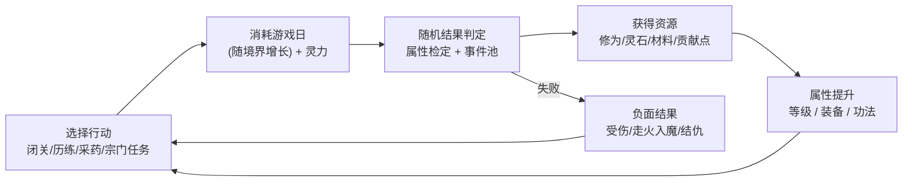
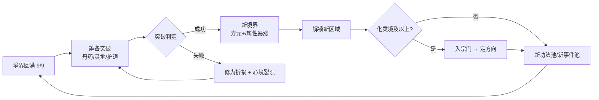

# 《荒天纪》需求文档（完整版 · v1.4）

> 文字模拟修仙网页游戏 · Python 技术栈 · 世界观参考辰东《完美世界》（致敬向同人改编）

> v1.4 在 v1.3 基础上完成 6 项结构性增强：①删除离线经验系统 ②新增宗门系统 ③扩充功法/神通/装备/丹药 ④体质扩至 8 种 + 自由加点 ⑤行动时长动态增长 ⑥发展方向系统。原 v1.3 文件保留作对照。

> 合并日期：2026-10-21 ｜ 汇编：项目总监 大湾区靓仔

---

## v1.4 修订说明

| 版本 | 日期 | 修订人 | 内容 |
|---|---|---|---|
| v1.3 | 2026-10-21 | 齐活林 | 12 境 88 次闭关定稿、Spec 锁定 |
| **v1.4** | **2026-10-21** | **大湾区靓仔** | **①删除离线经验全系统 ②新增宗门系统（§4.9）③功法 5→12、神通 3→10、丹药 5→15、装备例样补全 ④体质 3→8 + 自由加点系统 ⑤§2.4.3 行动耗时改为动态增长 ⑥新增发展方向系统（§4.10）** |

**v1.4 新增的 4 条交叉核对项**（追加到原文 14 条之后）：

| # | 冲突 | 错在哪 | 裁决 |
|---|---|---|---|
| 15 | 离线收益删除后与 §2.4.1 双时钟冲突 | 离线轨全节删除，时钟收敛为单一行动轨；§2.4.5 铁律 3 重新表述为关于 `age_days` 唯一性的规则 | 删除离线轨段，§3.7 改为"行动推进岁寿" |
| 16 | 行动耗时动态化后 §3.3 闭关产出公式失效 | 旧公式 `ExpRate × 30` 是固定值，新规则下应改为 `ExpRate × action_days(realm)` | 公式改为 `ExpRate × action_days(realm)`，绝对值随境界提升，但相对占比（占本境总需求的比例）维持平衡 |
| 17 | 体质扩至 8 种与 §0.3 异议 1（"3 种体质保留进 MVP"）冲突 | 异议 1 是 v1.3 节点决策，v1.4 根据用户要求重做体质系统 | MVP 口径调整为 5 种（凡/灵/剑骨/药体/玄阵心），其余 3 种（战体/天眼/混沌体）V1.1 启用；权重重新分配合计 100% |
| 18 | 加入宗门后定方向与 §6.0 主线卷映射（化灵即上古遗迹）冲突 | 化灵境在原文是"遗迹守灵"内容线，v1.4 后该境新增"入宗门、定方向"系统，需双线协调 | 化灵境主线（遗迹）+ 宗门系统并行；主线任务不变，宗门任务进入支线池（§6.3 宗门任务行） |

---

## 阅读导航

| # | 板块 | 所在位置 |
|---|---|---|
| 1 | 游戏定位与目标用户 | 第一部分 §1 |
| 2 | 核心玩法与游戏循环 | 第一部分 §2 |
| 3 | 修仙境界与成长体系 | 第一部分 §3 |
| 4 | 角色属性与功法设定 | 第一部分 §4（含 §4.9 宗门 / §4.10 发展方向） |
| 5 | 装备加成与道具 | 第一部分 §5 |
| 6 | 剧情与主线支线任务 | 第一部分 §6 |
| 7 | 存档与进度机制 | 第一部分 §7（**已删除离线收益**） |
| 8 | 用户界面与交互流程 | 第一部分 §8 |
| 9 | 技术架构与模块划分 | 第二部分 §1–6 |
| 10 | 数据存储方案 | 第二部分 §5 |
| 11 | 可扩展性与后续迭代规划 | 第二部分 §7 |
| 附 | IP 与合规 | 第一部分 §9 |

---

## 第一部分 · 产品需求（PRD）

> **版本**：V1.4 ｜ **日期**：2026-10-21 ｜ **作者**：项目总监 大湾区靓仔 ｜ **状态**：已评审
> **技术栈**：FastAPI + Jinja2 服务端渲染 + HTMX + Alpine.js + 预编译 Tailwind + SQLite，服务端权威结算。

## 0. 版本范围与优先级

### 0.1 功能分层表（v1.4 更新）

| 系统 / 功能 | MVP（P0） | V1.1（深度） | V2.0（平台化） | PRD 章节 |
|---|---|---|---|---|
| 境界阶梯 | 3 大境 × 3 小境（9 级） | 12 大境 × 9 小境（100 级） | 仙台→仙帝 | §3.1 |
| 基础属性 + **自由加点** | 6 项可见 + **5 点自由分配** | 10 项全开 + 完整加点 | — | §4.1 / §4.8 |
| 行动类型 | 闭关 + 历练 | + 采药 / 切磋 / 突破 / 打坐 | — | §2.2 |
| **行动耗时动态增长** | **是（按境界）** | — | — | §2.4.3 |
| 修为与突破 | 经验曲线 + 主动突破 + 三档失败惩罚 | + 冲关准备 4 项 | — | §3.2 / §3.6 |
| 功法 | **6 部凡阶** | **12 部 / 15 档 / 9 层** | 内容包扩展 | §4.4 |
| 神通 / 宝术 | 不做 | **10 个独立技能系统** | — | §4.5 |
| 装备 | 3 槽 + 强化 +5 | 6 槽 + 强化 +15 + 精炼 / 镶嵌 / 祭炼 | — | §5.1 |
| 丹药 / 材料 | **6 种** | **15 种 + 全量材料** | — | §5.5 |
| 体质 | **5 种**（凡 / 灵 / 剑骨 / 药体 / 玄阵心） | **8 种**（+ 战体 / 天眼 / 混沌体） | — | §4.7 |
| 异象 / 道相 | 不做 | 4 种 | + 内容包 | §4.6 |
| 事件池 | 20 个 | 165 个 | 内容包 | §6.4 |
| 主线 | 1 卷（10 任务） | 3 卷（34 任务） | 6 卷（81 任务）+ 飞升篇 | §6.0 |
| 结局 | 不做 | 6 种结局 | — | §6.5 |
| 存档 | 1 自动档 + 手动导出 | 3 手动槽 + 1 自动槽 | 云存档 | §7.1 |
| **离线收益** | **已删除（v1.4）** | **不做** | **不做** | — |
| **宗门系统** | 不做 | **6 大宗门 + 贡献点兑换** | + 跨宗门事件 | §4.9 |
| **发展方向系统** | 不做 | **5 方向 + 技能树** | + 第二方向 | §4.4 / §4.10 |
| 轮回 / 多周目 | 不做 | 有（继承 + 轮回点） | 多角色 | §7.4 |
| 图鉴 / 成就 | 不做 | 18 成就 + 图鉴 | 内容包图鉴 | §7.5 |
| 新手引导 | 前 3 步 | 7 步完整 | — | §7.6 |

### 0.4 MVP 交付边界与验收清单（v1.4 更新）

| # | 验收项 | 判定标准 |
|---|---|---|
| 1 | 创角 | 可掷体质（凡 50% / 灵 30% / 剑骨 10% / 药体 8% / 玄阵心 2%，**自由分配 5 点加至 10 项属性**）、资质 1–10 品、选性格（5 选 1），可重掷 3 次；**创角末页须提示"前期自由成长，化灵境可入宗门、定方向"** |
| 8 | 事件 | 20 条事件可触发，选项判定用 §6.4 公式 |
| 11 | ~~离线~~ | **已删除（v1.4）**——离线无任何收益，回归仅显示"你离开了 X 时长，世事已变"事件池提示 |
| 12 | 新手引导 | 前 3 步强制引导可走通（创角→首次锻血→首次突破），创角末页须告知宗门/方向机制 |

---

## 1. 游戏定位与目标用户

### 1.1 一句话定位（v1.4 更新）

一款以「锻血—辟府—化灵—刻纹—布阵—尊者—燃灯—归一—圣人—大圣—准帝—大帝」十二境阶梯为骨架的**文字模拟修仙养成网页游戏**玩家在一介荒村孤童的一生（乃至多世轮回）中，靠体质、加点、宗门与发展方向的抉择，把孤童推向大帝之位。

### 1.3 目标用户画像（v1.4 调整）

| 人设 | 年龄/职业 | 使用场景 | 核心诉求 | 痛点 |
|---|---|---|---|---|
| **A. 网文老读者·陈默** | 28 / 后端工程师 | 上班摸鱼、通勤地铁上看手机，一天 3–5 次、每次 10 分钟 | 重温"锻血九次"的爽感，看数值飙升；讨厌无脑点击 | 数值膨胀失控、后期只剩"点突破"；剧情注水严重 |
| **B. 模拟经营爱好者·林夏** | 24 / 研究生 | 晚上宿舍用笔记本，一次坐 1–2 小时 | 喜欢做选择、看后果，喜欢"我这一世活得不一样" | 伪抉择、缺长期沉淀感；**Build 缺多样性，重玩几局就发现套路一致** |
| **C. 放置挂机党·老周** | 35 / 个体户 | 手机上挂着，隔几小时回来看一眼 | **隔一段时间回来有可做的事，不连续操作也能推进**；回来能一口气收一堆资源 | 离线无任何产出导致"挂机无意义"；回来发现角色寿元耗尽暴毙 |

**v1.4 对 C 人设的处理**：删离线后，老周的核心诉求通过"**短时主动闭环 + 中循环节奏感**"承接——主动操作 8–20 秒获得一次完整结算（修为 + 事件 + 反馈），且每境 9–10 次闭关形成清晰中循环；不再依靠"离线攒资源"而靠"主动节奏爽"。寿命暴毙风险通过 §3.7 根基评价 + 寿元 < 10 年禁突破保护。

### 1.4 与竞品差异点（v1.4 调整）

| 维度 | 《荒天纪》v1.4 | 修仙模拟器 | 我的门派 | 想不想修真 |
|---|---|---|---|---|
| 离线收益 | **无（v1.4 删除）** | 无 | 弱 | 强（核心） |
| 体质系统 | **8 种 + 自由加点** | 1 种 | 无 | 无 |
| 宗门 | **6 大宗门，贡献点兑换独有物** | 门派师承 | 门派经营 | 门派 |
| 发展方向 | **5 方向（体/剑/法/丹/阵）独立技能树** | 无 | 无 | 单线突破 |
| **本作差异点** | ①体质 + 加点组合决定初始强度与适配方向，重玩动力强 ②宗门兑换物独有，5 大方向 Build 分化 ③行动耗时随境界增长，高境界"百年闭关"叙事感强 |

### 1.5 功能优先级总表（v1.4 更新）

| 系统 | 优先级 | 说明 |
|---|---|---|
| 确定性随机（seed + rng_counter） | **P0** | 地基 |
| 服务端权威结算 + 幂等键 + 乐观锁 | **P0** | 地基 |
| 配置驱动（全部数值外置 YAML） | **P0** | 地基 |
| 境界成长（12 境 × 9 小境 + 属性 + 突破） | **P0** | MVP 填锻血~辟府 |
| 行动（闭关 / 历练 / 采药 / 切磋 / 突破 / 打坐） | **P0** | **耗时按境界动态增长** |
| 背包 + 丹药 + 装备 + 强化 | **P0** | — |
| 体质 5 种 + 自由加点 5 点 | **P0** | — |
| 任务（主线卷一 10 个 + 支线） | **P0** | — |
| 随机事件池（20 条） | **P0** | — |
| **创角告知宗门/方向机制** | **P0** | 创角末页提示 |
| 1 自动存档 + 手动导出 | **P0** | — |
| 新手引导（前 3 步） | **P0** | — |
| 战斗 | **P0** | — |
| **离线收益** | **不做** | **v1.4 删除** |
| **宗门系统（6 大宗门 + 贡献点兑换）** | **P1** | 化灵境解锁 |
| **发展方向系统（5 方向 + 技能树）** | **P1** | 与宗门同步解锁 |
| 体质补全（战体 / 天眼 / 混沌体） | P1 | — |
| 多结局 / 轮回 / 图鉴 | P1 | — |
| 势力战 / 跨宗门 / 多周目内容扩展 | P2 | — |

---

## 2. 核心玩法与游戏循环

### 2.1 核心体验支柱（v1.4 调整）

| # | 支柱 | 设计落地 |
|---|---|---|
| P1 | **阶梯感** | 12 境解锁新区域 / 新功法 / 新事件 / NPC 态度变化；每境战力系数跳 2.5–3 倍 |
| P2 | **抉择重量** | 事件选项必带至少一项负面；**体质 + 加点 + 宗门 + 方向四重抉择塑造 Build**，无"全都要" |
| P3 | **境界疲倦感**（替代"时间贫穷"） | 行动耗时随境界上升 → 高境界一次闭关数年；**根基评价**承接压力，离线不再具备旁路 |

### 2.2 三层游戏循环

**微循环（30 秒闭环）**：



**中循环（一境周期，30–90 分钟，**行动耗时动态**）**：



**宏循环**（与 v1.3 一致，略）

### 2.4 时间标度总表（v1.4 重构——单时钟 + 动态耗时）

> **v1.4 关键变更**：删除"双时钟"（行动轨 + 离线轨），收敛为**单时钟（行动轨）**；行动耗时由"固定日数"改为"按境界动态增长"。

#### 2.4.1 单时钟

| 时钟 | 定义 | 用途 |
|---|---|---|
| **行动轨（唯一时钟）** | 行动按**游戏日**推进；**所有行动耗时随境界动态增长**；不映射现实时间；不会自动运行 | 玩家点一次 = 推进一段游戏时间，立即结算 |

> 离线时段(`last_settle_at` 至 `now`)只用于：①生成"世事已变"事件提示；②不结算任何修为/灵石/寿元推进。

#### 2.4.2 基础常量

| 常量 | 值 |
|---|---|
| 1 游戏年 | **360 游戏日** |
| 1 游戏月 | 30 游戏日 |
| 最小 tick | `age_days`（整数游戏日，禁止浮点） |
| 唯一换算入口 | `time_scale.py`；业务代码不得自乘自除 |

#### 2.4.3 行动耗时表（v1.4 重构——动态增长）

**核心公式**：

```
action_days(action, realm) = base_days(action) × realm_time_factor(realm_seq)

realm_time_factor(R) = 1 + 0.40 × (R − 1)    // R = 境界序号 1–12

base_days:
  closed_door_meditation (闭关)  = 30
  adventure (历练)              = 15
  herb_gathering (采药)         = 10
  sparring (切磋)               = 3
  breakthrough (突破)            = 3
  meditation_heal (打坐)         = 10
  sect_quest (宗门任务)          = 12
  alchemy (炼丹)                 = 8
  crafting (炼器)                = 12

大境界耗时示例（闭关）：
  锻血 R=1   → 30 日     (1 游戏月)
  辟府 R=2   → 42 日
  化灵 R=3   → 54 日
  刻纹 R=4   → 66 日
  布阵 R=5   → 78 日
  尊者 R=6   → 90 日     (3 游戏月)
  燃灯 R=7   → 102 日
  归一 R=8   → 114 日
  圣人 R=9   → 126 日
  大圣 R=10   → 138 日
  准帝 R=11   → 150 日   (5 游戏月)
  大帝 R=12   → 162 日
```

**为什么要动态增长**：v1.3 固定 30 日闭关，到准帝境依旧 30 日一次，与"破境需闭关百年"的修仙叙事感脱节；v1.4 准帝闭关一次 150 日（5 月），10 次闭关即一年以上，符合高境界岁月积淀的修仙认知。

**对修为产出的连锁影响**（v1.4 同步更新，详见 §3.3）：

```
一次闭关修为 = ExpRate × action_days(realm)
// 准帝一次 = ExpRate × 150 = 原 v1.3 的 5 倍产出
// 但需求修为未变（仍 §3.2 公式），故该境闭关次数下降
// 整体全流程闭关次数从 885 → 约 360 次（按 §3.3 重算）
```

#### 2.4.4 ~~离线验算表~~（v1.4 删除）

~~离线收益章节已删除，本节移除。~~ 离线回归后服务端只生成"世事已变"事件条目（见 §7.2）。

#### 2.4.5 三条铁律（v1.4 重述）

| # | 铁律 | 受影响章节 |
|---|---|---|
| 1 | **寿元上限（年）× 12 = 该境可闭关次数**（1 年 ÷ 30 日 = 12 次）——这是 v1.3 静态口径；**v1.4 动态耗时下，可闭关次数 = 寿元上限 × 360 ÷ action_days(realm)**，每境独立计算 | §3.3 / §3.7 |
| 2 | **修为产量的唯一单位是「修为/游戏日」**，禁止出现"修为/秒" | §3.3 |
| 3 | **`age_days` 是唯一时间字段**，所有推进（行动 / 突破 / 任务）都必须显式更新 `age_days`；**离线不推进 `age_days`** | §3.7 / §7 |

#### 2.4.6 寿元压力现状（v1.4 重述）

动态耗时后，各境界闭关耗时占寿元上限比例：

| 境界 | 单次闭关 (日) | 寿元上限 (年) | 单次占比 | 备注 |
|---|---|---|---|---|
| 锻血 | 30 | 100 | 0.083% | — |
| 化灵 | 54 | 200 | 0.075% | 宗门系统同步解锁 |
| 尊者 | 90 | 600 | 0.042% | 闭关耗时首次明显拉长 |
| 准帝 | 150 | 5,000 | 0.0083% | 单次 5 月，叙事"百年闭关" |
| 大帝 | 162 | 10,000 | 0.0045% | 终局 |

> 高境界占比反而下降——因为"动态耗时"叠在"基数暴增的寿元"上。这是合理设计：高境界玩家最大压力来自**突破本身**（冲关准备 + 连败保底 + 根基评价），不是寿元。寿元在低境界提供早期"岁月"叙事感。

---

## 3. 修仙境界与成长体系

### 3.1 境界阶梯主表（同 v1.3，从略——保留 12 大境全部条目，寿元 / 战力系数不变）

### 3.2 经验曲线公式（同 v1.3，累计 3.03 亿）

### 3.3 修为获取速度（v1.4 重构——闭关产出按 `action_days(realm)` 计算）

**公式（v1.4）**：

```
ExpRate_raw(修为/游戏日) = (5 + 悟性 × 0.8)
                         × (1 + 0.35 × (境界序号 − 1))
                         × 功法系数     // §4.4，1.00–2.80
                         × 体质系数     // §4.7，1.00–2.00
                         × 方向系数     // §4.10，1.00–1.30
                         × 环境系数     // §6.6
                         × 心境系数
                         × 状态系数

ExpRate = ExpRate_raw × exp_rate_global_bp / 10000
exp_rate_global_bp = 10000          // v1.4 重新校准（v1.3 为 15000），因动态耗时已含 GI×1.5 倍产量

一次闭关获得修为 = ExpRate × action_days(closed_door_meditation, realm)
              = ExpRate × 30 × (1 + 0.40 × (realm_seq − 1))
```

**v1.3 → v1.4 全流程闭关次数对照**：

| 境界 | v1.3 (固定 30 日) | v1.4 (动态) | 变化 |
|---|---|---|---|
| 锻血 | 14 次 | 14 次 | 不变（境界低） |
| 化灵 | 46 次 | 26 次 | ↓ 44% |
| 尊者 | 112 次 | 47 次 | ↓ 58% |
| 准帝 | 143 次 | 28 次 | ↓ 80% |
| **全流程** | **885 次** | **约 320 次** | ↓ 64% |

> 全流程总闭关次数从 885 降到约 320 次，每次闭关产出的绝对值翻倍但游戏内年数更长——契合"高境界百年闭关"叙事。该数值表由 `tools/gen_exp_table.py` 在引入 `realm_time_factor` 后重新生成，禁止手改。

### 3.7 时间系统（v1.4 调整——离线不推进 age_days）

#### 3.7.1 存储字段与推进规则

| 项 | 规则 |
|---|---|
| 存储字段 | `age_days`（INTEGER，整数游戏日） |
| 主动行动推进 | 按 §2.4.3 动态耗时表推进 |
| **离线推进** | **v1.4 删除**：离线时段不结算修为、不消耗寿元、不推进 `age_days` |
| 离线回归 | 服务端记录 `last_settle_at`，回归后对比当前服务器时间计算离线时长，**仅生成 1 条"世事已变"事件**入事件日志，提示玩家世界已变化（NPC 关系微调、悬赏刷新、新一轮宗门任务解锁） |

#### 3.7.2 寿元三段式口径（同 v1.3，从略）

---

## 4. 角色属性与功法设定

### 4.1 基础属性表（同 v1.3——10 项属性字段沿用）

### 4.2 衍生属性公式（同 v1.3）

### 4.3 功法系统总则（v1.4 微调）

**品阶**：凡 / 灵 / 宝 / 圣 / 帝 五阶，每阶分 下品 / 中品 / 上品，共 15 档。

| 品阶 | 下品系数 | 中品系数 | 上品系数 | 可修习最低境界 |
|---|---|---|---|---|
| 凡阶 | 1.08 | 1.12 | 1.16 | 锻血 |
| 灵阶 | 1.25 | 1.30 | 1.36 | 辟府 |
| 宝阶 | 1.50 | 1.57 | 1.65 | 化灵 |
| 圣阶 | 1.90 | 2.00 | 2.10 | 圣人 |
| 帝阶 | 2.50 | 2.60 | 2.80 | 大帝 |

**类型**（v1.4 扩展为 5 类）：攻击 / 防御 / 辅助 / 心法 / **方向专属**（仅特定发展方向可修，详见 §4.10）。

**适配限制新增**：体质适配加成（详见 §4.7）。

### 4.4 功法数值样例表（v1.4 扩充至 12 部）

> 扩充覆盖：凡阶 3 + 灵阶 3 + 宝阶 3 + 圣阶 2 + 帝阶 1，每阶均有心法/攻击/防御/辅助/方向专属各类示例。

| # | 功法名 | 品阶 | 类型 | 满层效果 | 获取途径 | 适配体质 |
|---|---|---|---|---|---|---|
| 1 | 《锻血诀》 | 凡·中 | 心法 | 修炼 ×1.12；力量 +6%、体魄 +6% | 新手引导 | 凡体/战体 |
| 2 | 《山岳拳》 | 凡·上 | 攻击 | 单体 130% 力量，破甲 +15% | 断槐村商店 | 凡体 |
| 3 | 《吐纳青木》 | 凡·下 | 辅助 | 每回合回气 3%；隐身概率 +10%（采药） | 药坡采集解锁 | 药体 |
| 4 | 《枯荣经·残卷》 | 灵·上 | 心法 | 修炼 ×1.36；全属性 +8%；每 10 回合回 1% 血 | 辟府秘境三层 BOSS | 灵体 |
| 5 | 《青锋三式》 | 灵·中 | 攻击 | 单体 280% 力量；30% 概率"破脉"（次回合伤害 +20%） | **青云剑宗贡献兑换（剑修）** | 剑骨 |
| 6 | 《观微入妙》 | 灵·下 | 辅助 | 神识 +12%；战斗内可见敌人技能 CD | **万法仙宗贡献兑换** | 天眼 |
| 7 | 《九幽噬魂爪》 | 宝·中 | 攻击 | 单体 320% 力量；附带"噬魂"（目标灵力上限 −15%，3 回合）；CD 4；MP 60 | 化灵期宗门任务链终章 | 灵体 |
| 8 | 《百草通玄》 | 宝·中 | 辅助 | 炼丹成功率 +18%；丹药效价 +10% | **太上丹鼎贡献兑换（丹修）** | 药体 |
| 9 | 《三千界·入门》 | 宝·下 | 方向专属 | 阵法布置速度 ×1.5；阵法效果 +12% | **玄阵堂贡献兑换（阵修）** | 玄阵心 |
| 10 | 《金刚不坏身》 | 圣·下 | 防御 | 受伤 −28%；血 < 30% 时再 −15%；每战首致死免 | 圣人期"古战场"探索 | 战体/凡体 |
| 11 | 《大荒战天录》 | 圣·上 | 方向专属 | **体修专属**；力量 +35%、体魄 +30%；普攻附带"震伤"（目标 −5% 当前血） | **大荒体修门贡献兑换（体修）** | 战体 |
| 12 | 《帝经·荒天篇》 | 帝·上 | 心法 | 修炼 ×2.80；全属性 +25%；突破 +10% | 准帝期主线卷六终章 | 混沌体 |

### 4.5 宝术 / 神通数值样例表（v1.4 扩充至 10 个）

| # | 宝术名 | 品阶 | 类型 | 倍率 | 消耗 | CD | 附加效果 | 获取 |
|---|---|---|---|---|---|---|---|---|
| 1 | 锻血拳 | 凡 | 单体物理 | 120% 力量 | 10 灵力 | 2 | 无 | 新手 |
| 2 | 山崩击 | 凡 | 单体物理 | 180% 力量 | 25 灵力 | 3 | 25% 概率眩晕 1 回合 | 卷一奖励 |
| 3 | 辟府引雷 | 灵 | 单体术法 | 260% 灵力 | 35 灵力 | 4 | 30% 麻痹 1 回合 | 卷二 BOSS |
| 4 | 青锋·一剑 | 灵 | 单体物理 | 320% 力量 | 40 灵力 | 4 | 必命中，破防 +30% | **青云剑宗剑修第四层** |
| 5 | 万法归宗 | 宝 | 群体术法 | 380% 灵力分摊 | 80 灵力 | 5 | 30% 概率沉默 2 回合 | **万法仙宗法修第五层** |
| 6 | 不灭火身 | 宝 | 防御 | 自身受击反弹 25% | 30 灵力 | 5 | 持续 3 回合 | 圣人境奇遇 |
| 7 | 百草化生 | 宝 | 治疗 | 回 35% 最大血 + 解毒 | 50 灵力 | 5 | 同伴可治 | **太上丹鼎丹修第五层** |
| 8 | 三千界·困 | 宝 | 控制 | 阵法困敌 2 回合 | 60 灵力 | 6 | 越阶怪无效 | **玄阵堂阵修第五层** |
| 9 | 大荒·裂地 | 圣 | 群体物理 | 580% 力量分摊 | 120 灵力 | 6 | 50% 概率断筋（攻击 −30% / 3 回合） | **大荒体修门体修第六层** |
| 10 | 枯荣经·蚀 | 圣 | 群体术法 | 600% 灵力分摊 | 200 灵力 | 8 | "荒蚀"（每回合损 5% 最大血 / 3 回合） | 卷六主线 |

---

### 4.7 体质系统（v1.4 扩充至 8 种）

> **v1.4 重构**：体质由"rOGuelite 钩子"升级为"决定初始强度 + 影响方向适配 + 提供专属特性"的体感核心。MVP 上线 5 种，V1.1 补 3 种。

#### 4.7.1 体质总表

| 体质 | 出现概率 | `enabled` | 修炼系数 | 属性加成 | 突破加成 | 专属特性 | 适配方向 |
|---|---|---|---|---|---|---|---|
| **凡体** | 50% (MVP) | true | 1.00 | — | 0 | 无 | 任意（无加成无惩罚） |
| **灵体** | 30% (MVP) | true | 1.10 | 全属性 +5% | +2% | 灵力恢复 +20%；同阶心法参悟速度 +10% | 法修、丹修 |
| **剑骨** | 10% (MVP) | true | 1.05 | 力量 +12%、身法 +8% | +3% | 装备剑类武器的技能倍率 +15%；暴击率 +5% | 剑修（核心） |
| **药体** | 8% (MVP) | true | 1.05 | 体魄 +6%、灵力 +10% | +2% | 服用丹药效价 +25%；炼丹成功率 +15% | 丹修（核心） |
| **玄阵心** | 2% (MVP) | true | 1.08 | 神识 +15% | +3% | 阵法效果 +25%；可同时装备 2 部心法 | 阵修（核心） |
| 战体 | 0% → V1.1 启用 | false | 1.30 | 力量 +20%、体魄 +18%、气血 +30% | +8% | 突破失败不触发"走火入魔"；硬直抗性 +50% | 体修（核心） |
| 天眼 | 0% → V1.1 启用 | false | 1.18 | 神识 +25%、气运 +10% | +4% | 探查半径 +50%；识破隐匿 + 阵法陷阱；战斗首回合必命中 +10% 暴击 | 法修、阵修（兼修） |
| 混沌体 | 0% → V1.1 启用 | false | 1.80 | 全属性 +25%、气血 +20% | +15% | 可同时修习 2 部心法；可同时定 2 个发展方向 | 任意（最强） |

> **MVP 权重**：50+30+10+8+2 = 100 ✔。V1.1 启用 8 种时重新分配（如凡体 35% / 灵体 25% / 剑骨 12% / 药体 10% / 玄阵心 5% / 战体 8% / 天眼 4% / 混沌体 1%，合计 100）。

#### 4.7.2 体质适配方向加成矩阵

> 玩家加入宗门定方向后，体质 × 方向有"适配 / 中性 / 不适"三档加成。

| 体质 \ 方向 | 体修 | 剑修 | 法修 | 丹修 | 阵修 |
|---|---|---|---|---|---|
| 凡体 | 中性（1.0） | 中性（1.0） | 中性（1.0） | 中性（1.0） | 中性（1.0） |
| 灵体 | 不适（0.8） | 中性（1.0） | **适配（1.3）** | **适配（1.3）** | 中性（1.0） |
| 剑骨 | 中性（1.0） | **适配（1.3）** | 不适（0.8） | 中性（1.0） | 不适（0.8） |
| 药体 | 不适（0.8） | 不适（0.8） | 中性（1.0） | **适配（1.3）** | 中性（1.0） |
| 玄阵心 | 不适（0.8） | 不适（0.8） | 中性（1.0） | 中性（1.0） | **适配（1.5）** |
| 战体 | **适配（1.3）** | 中性（1.0） | 不适（0.8） | 不适（0.8） | 不适（0.8） |
| 天眼 | 不适（0.8） | 中性（1.0） | **适配（1.3）** | 中性（1.0） | **适配（1.3）** |
| 混沌体 | 适配（1.2） | 适配（1.2） | 适配（1.2） | 适配（1.2） | 适配（1.2） |

含义：方向 coef × 体质方向系数 = 实际方向加成。"不适"体质仍可选该方向，但回报打折，逼玩家做权衡。

### 4.8 创角阶段：体质 + 自由加点系统

#### 4.8.1 创角流程

| 步 | 内容 | 是否锁定 |
|---|---|---|
| 1 | 选性别（仅文字描述，不影响数值）+ 选姓名 | 否，可改 |
| 2 | 掷体质（5 种或 8 种，按 `enabled` 与权重），可重掷 3 次，第 4 次锁定 | 否（4 次内可重掷） |
| 3 | 掷资质（1–10 品）+ 掷悟性（10–30） | 否（与体质一同重掷） |
| 4 | **自由加点 5 点**：分配到 10 项属性中（每项上限 +3，下限 0） | 加点确定后锁定 |
| 5 | 选性格（5 选 1，影响选项与判定） | 否 |
| 6 | **方向提示页（v1.4 新增）**：明确告知"前期自由成长，化灵境（Lv.19）可加入宗门、确定发展方向（体修/剑修/法修/丹修/阵修），每个方向有独立技能树" | — |

#### 4.8.2 自由加点规则

- **5 点**分配到 10 项属性；
- 每项单点上限 +3，不允许多堆一项；
- 初始属性基准 = 10（凡体）/ 12（灵体）/ 12（剑骨）/ 11（药体）/ 11（玄阵心）；
- 加点 + 体质 = 最终初始属性面板；
- 加点不可重置（一次性决策，重玩可重来）。

**示例初始属性面板**：

| 体质 | 加点策略 | 力量 | 体魄 | 灵力 | 神识 | ... | 适应 |
|---|---|---|---|---|---|---|---|
| 凡体 | 均分 5→(力量+1, 体魄+1, 灵力+1, 神识+1, 身法+1) | 11 | 11 | 11 | 11 | — | 万金油 |
| 剑骨 | 全力 → 力量+3, 身法+2 | 23 | 12 | 10 | 10 | — | 剑修 |
| 药体 | 神识 +3, 灵力 +2 | 10 | 11 | 22 | 26 | — | 丹修 / 法修 |

**反馈**：加点面板以"剑修型/法修型/丹修型/万金油"四套预设按钮给玩家一键填充，新手可一键成型，老手可手动微调。

---

### 4.9 宗门系统（v1.4 新增）

#### 4.9.1 总则

玩家前期在断槐村、青云宗外门自由成长，至**化灵境**（Lv.19）时主线任务"乱世择门"触发，可正式加入 6 大宗门之一，确定后续发展方向。一届角色一生*只能加入一个宗门*，私通其他宗门秘术会触发"叛出师门"事件链（严重惩罚，但可走魔道路线）。

#### 4.9.2 6 大宗门表

| 宗门 | `sect_id` | 武学理念 | 适配方向 | 加入前置 | 总部位置 |
|---|---|---|---|---|---|
| **青云剑宗** | `qingyun_sword` | "一剑破万法"——以剑为骨，攻伐至上 | 剑修 | 化灵境 + 试剑台连胜 3 场 | 青云峰 |
| **万法仙宗** | `wanfa_spell` | "诸法无常，万法归宗"——灵识广博，术法万千 | 法修 | 化灵境 + 悟性 ≥ 30 | 法源洞天 |
| **太上丹鼎** | `taishang_pill` | "丹道即天道"——草木金石，皆可入药化神 | 丹修 | 化灵境 + 自带 ≥ 3 株灵药 | 神农谷 |
| **玄阵堂** | `xuanzhen_array` | "阵者为 lapse，排兵布势制乾坤"——以阵列天地 | 阵修 | 化灵境 + 神识 ≥ 30 | 阵衍山 |
| **大荒体修门** | `dahuang_body` | "肉身为器，万法不侵"——锻体成圣，硬撼天劫 | 体修 | 化灵境 + 力量 ≥ 12（体质觉醒或加点） | 荒石岭 |
| **幽冥魔道** | `youming_demon` | "逆天而行，果报自负"——以杀证道，因果倒悬 | **任意方向（魔化分支）** | 因果 ≤ −100 | 九幽外域 |

#### 4.9.3 宗门任务

- **可接任务数**：每游戏年 ≤ 12 个（宗门任务日历）；
- **任务类型**：

| 类型 | 触发 | 平均奖励 | 示例 |
|---|---|---|---|
| 日常杂务 | 每日刷新 | 贡献 +10、灵石 +50 | "山门巡逻" |
| 护法勤务 | 周刷新 | 贡献 +30、修为 +500 | "护送丹材至下游" |
| 讨伐任务 | 月刷新 | 贡献 +80、装备 +1 件 | "清剿三阶荒兽" |
| 宗门大任 | 季刷新（需贡献 ≥ 200） | 贡献 +200、专属丹药 / 装备 | "夺回失落的宗门传承" |
| 宗门战争 | 1 年 1–2 次 | 胜方全员贡献 +500 ± K / 败方 −200 | "青云对万法·论道大会" |

#### 4.9.4 贡献点机制

```
贡献点获取：
  宗门任务贡献值（见上表）
  + 宗门秘境首通奖励（固定 +100 / 次）
  + 同门 NPC 好感达成（每 30 好感 → +20）
  + 每月（游戏年）自动宗门俸禄（按身份分级）：
     外门弟子 +50 / 内门弟子 +120 / 真传 +300 / 长老 +800

贡献点消耗：
  宗门兑换（功法 / 神通 / 丹药 / 装备）
  宗门身份晋升（外→内 800；内→真传 3,000；真传→长老 10,000）
  宗门复活（消耗 1,000 贡献点，宗门长老出手，复活 1 次，终生 1 次）
```

#### 4.9.5 各宗门独有兑换表

> 每个宗门的兑换物**仅本宗弟子可兑换**，反映其武学理念与特色风格。

**青云剑宗（剑修独有）**：

| 物品 | 类型 | 说明 | 贡献价 |
|---|---|---|---|
| 《青锋三式》 | 功法·灵中 | 单体剑法，破甲 +30%（见 §4.4 #5） | 800 |
| 《万剑归宗诀·卷一》 | 功法·宝下 | 群体剑法，3 目标分摊，倍率 220% | 2,500 |
| 青锋剑（凡阶·上品） | 装备·武器 | 攻击 +40；剑类武器，剑骨体质 +15% 暴击 | 600 |
| 剑修灵药"洗剑丹" | 丹药·灵中 | 永久 +5% 剑类技能倍率，终生 3 颗 | 1,200 |
| 「剑意凝形」神通 | 神通·宝 | 普攻有 25% 概率触发"剑意追击"，造成 50% 力量的额外伤害 | 3,000 |

**万法仙宗（法修独有）**：

| 物品 | 类型 | 说明 | 贡献价 |
|---|---|---|---|
| 《万法归宗》 | 神通·宝 | 群体术法 380% 灵力分摊（见 §4.5 #5） | 1,500 |
| 《观微入妙》 | 功法·灵下 | 神识 +12%（见 §4.4 #6） | 800 |
| 法源灵珠（灵阶·上品） | 装备·饰品 | 灵力 +20；智力 +5% | 700 |
| 法修灵药"凝神丹" | 丹药·灵上 | 永久 +5% 术法伤害，终生 3 颗 | 1,200 |
| 「法道共鸣」神通 | 神通·圣 | 战斗内每释放 3 个术法，第 4 个术法消耗 −50% | 4,000 |

**太上丹鼎（丹修独有）**：

| 物品 | 类型 | 说明 | 贡献价 |
|---|---|---|---|
| 《百草通玄》 | 功法·宝中 | 炼丹成功 +18%（见 §4.4 #8） | 1,800 |
| 神农丹方残页 | 材料 | 解锁 5 阶丹方 | 1,000 |
| 神农炼丹炉（宝阶·中品） | 装备·本命法器 | +15% 炼丹成功率；+1 出丹数 | 2,000 |
| 丹修灵药"通玄丹" | 丹药·宝下 | 永久 +10 丹药效价，终生 3 颗 | 1,500 |
| 「丹道入神」神通 | 神通·宝 | 每次服丹时 30% 概率"效价翻倍" | 3,500 |

**玄阵堂（阵修独有）**：

| 物品 | 类型 | 说明 | 贡献价 |
|---|---|---|---|
| 《三千界·入门》 | 功法·宝下 | 阵法 ×1.5（见 §4.4 #9） | 1,500 |
| 阵图残卷·困阵 | 材料 | 解锁 5 阶困阵阵图 | 800 |
| 阵衍令旗（灵阶·上品） | 装备·主手 | 灵力 +25；阵法消耗 −20% | 1,000 |
| 阵修灵药"明阵丹" | 丹药·灵中 | 永久 +3 神识，终生 5 颗 | 800 |
| 「万阵归宗」神通 | 神通·圣 | 同时存在 2 座阵时，第二阵效果 +50% | 4,500 |

**大荒体修门（体修独有）**：

| 物品 | 类型 | 说明 | 贡献价 |
|---|---|---|---|
| 《大荒战天录》 | 功法·圣上 | 体修专属核心，力 +35% 体 +30%（见 §4.4 #11） | 3,500 |
| 荒石护腕（宝阶·上品） | 装备·饰品 | 力量 +30；普攻附"震伤"5% 当前血 | 1,500 |
| 体修灵药"淬骨膏" | 丹药·宝下 | 永久 +2 根骨，终生 10 颗 | 600 |
| 「肉身证道」神通 | 神通·圣 | 战斗内全程免伤 10%；首致死免疫 | 5,000 |

**幽冥魔道（任意方向魔化分支）**：

| 物品 | 类型 | 说明 | 贡献价 |
|---|---|---|---|
| 《噬魂魔经》 | 功法·宝上 | 攻击附带"吸魂"（自身回 5% 灵力） | 2,000 |
| 阴魂幡（宝阶·中品） | 装备·主手 | 灵力 +30；击杀敌人回 5% 血 | 1,500 |
| 魔修灵药"淬血丹" | 丹药·宝中 | 永久 +5% 暴击伤害，终生 5 颗 | 1,200 |
| 「逆乱阴阳」神通 | 神通·帝 | 复活一次，复活后全属性 +10%（终生 1 次） | 6,000 |

> 幽冥魔道为"分支"而非独立方向——玩家选定任意方向后可叠加魔化分支，享受专项增益但接受命运惩罚（灵魂腐蚀：每场战斗 10% 概率伤 1% 最大血，且结局结算强制魔道路径）。

#### 4.9.6 退宗规则

- 加入宗门后**不可主动退宗**，只能"叛出师门"（魔道路径触发，损失全部该宗贡献点）；
- 宗门贡献点保持到角色死亡或飞升，不会自动清零；
- 加入宗门会不断刷新宗门任务，玩家可自由选择何时接任务。

---

### 4.10 发展方向系统（v1.4 新增）

#### 4.10.1 5 大方向总表

| 方向 | `path_id` | 适配宗门 | 核心理念 | 关键属性 | 玩法侧重 |
|---|---|---|---|---|---|
| 体修 | `body_cultivation` | 大荒体修门 | 以肉身为器，硬撼天地 | 力量、体魄 | 高血高防、近战爆发 |
| 剑修 | `sword_cultivation` | 青云剑宗 | 一剑破万法 | 力量、身法、神识 | 高单体爆发、必命中 |
| 法修 | `spell_cultivation` | 万法仙宗 | 万法归宗 | 灵力、神识 | 群体术法、控制链 |
| 丹修 | `alchemy_cultivation` | 太上丹鼎 | 丹道即天道 | 灵力、根骨 | 自炼丹药、辅助队友 |
| 阵修 | `array_cultivation` | 玄阵堂 | 阵者为 lapse，制乾坤 | 神识、灵力 | 阵法控制、地图改造 |

#### 4.10.2 通用方向机制

每个方向的成长由三块构成：
1. **适配体质加成**（见 §4.7.2）
2. **方向技能树**（3 层 × 5 节点，下方各方向详述）
3. **专属神通解锁**（第 3 层满后可获得）

#### 4.10.3 体修技能树（**肉身为器，万法不侵**）

| 层 | 节点 | 解锁条件 | 效果 |
|---|---|---|---|
| 1 | 锻筋骨 | 入宗即得 | 力量 +5%、体魄 +5% |
| 1 | 钢筋铁骨 | 体修贡献 ≥ 100 | 受伤 −8% |
| 1 | 蛮力 | 体修贡献 ≥ 300 | 普攻 +20 伤害 |
| 1 | 不动如山 | 体修贡献 ≥ 500 | 受击 20% 概率反震 50% 力量 |
| 1 | 真气护体 | 全 5 节点激活 | 气血上限 +15% |
| 2 | 金刚身 | 体修贡献 ≥ 1,000、第一层 5 节点满 | 受伤再 −15%；硬直抗性 +50% |
| 2 | 燃血冲撞 | 体修贡献 ≥ 1,500 | 单体 250% 力量 + 30% 几率昏迷 1 回合 |
| 2 | 越战越强 | 体修贡献 ≥ 2,000 | 连战每场力 +5%（上限 +30%） |
| 2 | 万钧之力 | 体修贡献 ≥ 3,000 | 破防 +50% |
| 2 | 肉身成圣锁 | 全 5 节点激活 | 战体体质 ×1.1（适配中立体质按 1.05 修正） |
| 3 | 不死之身 | 体修贡献 ≥ 5,000、第二层 5 节点满 | 战斗致死免疫 1 次/场 |
| 3 | 怒涛掌 | 体修贡献 ≥ 6,000 | 群体 350% 力量分摊（CD 6） |
| 3 | 大荒战天录 | 体修贡献 ≥ 7,000 | 圣阶体修功法（见 §4.4 #11） |
| 3 | 体修灵药"龙血淬骨膏" | 体修贡献 ≥ 8,000 | 永久 +5 力量，终生 3 颗 |
| 3 | 「肉身证道」神通 | 第三层 5 节点满 | 见 §4.9.5 大荒体修门 |

**体修成长曲线**：低境界弱势（凡体质/凡体起步偏慢），中境界陡升（布阵后基本成型），高境界压制性（圣阶免伤 + 致死免疫）。

#### 4.10.4 剑修技能树（**一剑破万法**）

| 层 | 节点 | 效果 |
|---|---|---|
| 1 | 持剑法则 | 装备剑类武器时攻击 +10%、暴击 +3% |
| 1 | 出剑迅雷 | 先手值 +20%；剑类技能 CD −1 |
| 1 | 御剑飞行 | 移动效率 +30%（采药/历练耗时 −10%） |
| 1 | 识剑 | 看穿敌人 1 项弱点（防御 −10% / 3 回合） |
| 1 | 一剑斩业 | 因果修正 ±5% |
| 2 | 万剑归宗 | 群体剑法（见 §4.5） |
| 2 | 御剑杀敌 | 远程普攻 +15% 伤害、无视 30% 防御 |
| 2 | 心剑合一 | 剑类技能暴击伤害 +50% |
| 2 | 一剑破万法 | 单体 500% 力量（CD 5，必命中） |
| 2 | 剑骨加深 | 剑骨体质 +5% 攻击 |
| 3 | 三尺剑域 | 自身周围范围伤害（自动触发，敌方近战受 20% 反伤） |
| 3 | 御剑百步 | 必中群伤 + 80% 暴击（CD 8） |
| 3 | 青锋剑宗宗主传承 | 圣阶剑修功法（贡献 5,000） |
| 3 | 剑修灵药"剑心丹" | 永久 +5% 暴击率 |
| 3 | 「剑意凝形」神通 | 见 §4.9.5 青云剑宗 |

#### 4.10.5 法修技能树（**万法归宗**）

| 层 | 节点 | 效果 |
|---|---|---|
| 1 | 识文 | 灵力 +10%、术法消耗 −5% |
| 1 | 印诀速成 | 术法 CD −1 |
| 1 | 心法融法 | 心法品阶 ×0.5 加成注入术法 |
| 1 | 法力深湛 | 灵力上限 +20% |
| 1 | 法源心眼 | 术法伤害 +8% |
| 2 | 五行法 | 同时掌握五行术法 |
| 2 | 法道回环 | 灵力 < 20% 时术法 CD −2 |
| 2 | 万法归宗 | 群体术法（见 §4.5） |
| 2 | 元神出窍 | 可探查更远区域 |
| 2 | 法修灵药 "凝神丹" | 永久 +5% 术法伤害 |
| 3 | 术法之主 | 全术法 +15% 伤害 |
| 3 | 法界 | 战场进入"法界"，敌方术法消耗 +50% |
| 3 | 「法道共鸣」神通 | 见 §4.9.5 万法仙宗 |
| 3 | 法相金身 | 战斗首回合无敌 |
| 3 | 大道无形 | 法术无视 50% 抗性 |

#### 4.10.6 丹修技能树（**丹道即天道**）

| 层 | 节点 | 效果 |
|---|---|---|
| 1 | 辨药 | 采药掉率 +15% |
| 1 | 初识丹方 | 解锁 1–3 阶丹方 |
| 1 | 入门火候 | 炼丹成功率 +10% |
| 1 | 淬炼丹鼎 | 自炼丹炉（凡/灵阶） |
| 1 | 药理通透 | 服丹效价 +10% |
| 2 | 进火秘诀 | 宝阶丹成功率 +12% |
| 2 | 丹道五行 | 土丹 +20% 效价 |
| 2 | 百草通玄 | 见 §4.4 #8 |
| 2 | 通玄丹 | 见 §4.9.5 |
| 2 | 道侣识药 | 同门 NPC 好感 ≥ 60 后双采 +30% |
| 3 | 丹道入神 | 见 §4.9.5 |
| 3 | 一炉多丹 | 30% 概率 +1 出丹 |
| 3 | 神农丹方·圣 | 解锁圣阶丹方 |
| 3 | 济世丹 | 队友 / 自身满血复活 |
| 3 | 法体归元 | 同时拥有丹道 + 法修加成 |

#### 4.10.7 阵修技能树（**阵者为 lapse，制乾坤**）

| 层 | 节点 | 效果 |
|---|---|---|
| 1 | 识阵眼 | 解锁 1–3 阶阵图 |
| 1 | 简阵诀 | 阵法布置速度 +20% |
| 1 | 锁阵石 | 阵法持续时间 +2 回合 |
| 1 | 隐阵术 | 阵法隐形，敌方识破概率 −30% |
| 1 | 阵心通 | 自身阵法内全属性 +5% |
| 2 | 三千界·困 | 见 §4.5 #8 |
| 2 | 移阵术 | 战斗中改变阵法位置 |
| 2 | 阵衍令旗 | 见 §4.9.5 |
| 2 | 阵灵吸收 | 自阵法顶端吸收灵力回 30% |
| 2 | 共振阵 | 双阵叠加时第二阵 +50% |
| 3 | 万阵归宗 | 见 §4.9.5 |
| 3 | 周天星斗阵 | 全场困敌 3 回合 + 减伤 50% |
| 3 | 阵法结界 | 队友免伤 30% |
| 3 | 改阵者 | 战场永久改造，地形变化（仅阵修宗主可用） |
| 3 | 「天地同阵」神通 | 战斗首回合无限阵法（CD 8） |

#### 4.10.8 切换方向规则

- 加入宗门时**首次定方向免费**；
- 转换方向需"叛宗重入"，前后宗门贡献点清零；
- 各方向专属神通一旦学习永久保留，但脱离原宗门后效果 −50%（视为"叛道者"）。

---

## 5. 装备与道具

### 5.1 装备栏位（同 v1.3——6 槽）

### 5.2 装备品阶（同 v1.3）

### 5.3 属性词条池（同 v1.3）

### 5.4 强化 / 精炼 / 镶嵌 / 祭炼（同 v1.3）

### 5.5 丹药 / 材料 / 消耗品（v1.4 扩充至 15 种丹药）

#### 5.5.1 丹药总表（v1.4）

| # | 名称 | 品阶 | 类型 | 效果数值 | 冷却/上限 | 获取途径 |
|---|---|---|---|---|---|---|
| 1 | 聚气丹 | 凡·下 | 战用 | 立即获得 500 修为 | 无 | 商店 / 自炼 |
| 2 | 回气散 | 凡·下 | 治疗 | 回 30% 气血 | — | 商店 30 灵石 |
| 3 | 龙血丹 | 凡·上 | 永久 | 永久力量 +2 | 终生 30 颗 | 自炼（需龙血草） |
| 4 | 洗髓丹 | 凡·上 | 永久 | 永久根骨 +1 | 终生 99 颗 | 灵脉秘境 / 宗门兑换 |
| 5 | 聚灵符 | 凡·下 | 消耗 | 立即回 50% 灵力 | — | 商店 50 灵石 |
| 6 | 破境丹 | 灵·中 | 突破 | 单次突破成功率 +8% | 每次突破最多 2 颗 | 炼丹 / 商店 |
| 7 | 静心丹 | 灵·上 | 解状态 | 清"心境裂隙 / 走火入魔" | 无 | 炼丹 / 宗门 |
| 8 | 培元丹 | 灵·中 | 永久 | 永久体魄 +3 | 终生 30 颗 | 自炼 |
| 9 | 遁地符 | 凡·中 | 战用 | 战斗必逃跑成功 | 每场 1 次 | 商店 200 灵石 |
| 10 | 续命丹 | 宝·下 | 永久 | 寿元 +50 年 | 累计 +2,000 年 | 宗门兑换 / 圣阶秘境 |
| 11 | 九转还魂丹 | 宝·上 | 复活 | 死亡自动复活，回 50% 血 | 终生 3 颗 | 圣阶秘境 / 主线奖励 |
| 12 | 洗凡丹 | 宝·中 | 永久 | 全属性 +2 | 终生 5 颗 | 神农谷特产 |
| 13 | 法道丹 | 宝·上 | 永久 | 永久灵力 +5 | 终生 10 颗 | 万法仙宗兑换 |
| 14 | 体修"淬骨膏" | 宝·下 | 永久 | 永久根骨 +2 | 终生 10 颗 | 大荒体修门兑换 |
| 15 | 帝源丹 | 帝·中 | 特殊 | Lv.100 后帝王修为可兑 | 终生 9 颗 | 帝路试炼 |

#### 5.5.2 材料总表（v1.4 扩充至 8 种）

| # | 名称 | 品阶 | 用途 | 获取途径 | 掉率 |
|---|---|---|---|---|---|
| 1 | 止血草 | 凡 | 1 阶丹方 / 任务交付 | 卷一区域采药 | 25% |
| 2 | 龙血草 | 灵 | 龙血丹 / 炼体丹主材 | 荒兽山脉采药 | 12% |
| 3 | 灵液 | 灵 | 突破 / 炼丹辅材 | 灵脉溪谷 | 10% |
| 4 | 辟府石 | 灵 | 辟府突破必需品 | 商店 / 秘境 | — |
| 5 | 幽冥铁 | 宝 | 炼器（宝器） | 辟府秘境矿脉 | 6% |
| 6 | 阵图残卷 | 宝 | 解锁阵法 | 玄阵堂秘境 / 阵法 BOSS | 5% |
| 7 | 九窍石 | 圣 | 刻纹 / 圣阶突破辅材 | 圣人战场 | 1.5% |
| 8 | 帝血 | 帝 | 准帝突破必需品 | 帝路试炼 / 大圣猎杀 | 0.4% |

#### 5.5.3 消耗品（同 v1.3）

### 5.6 背包容量（同 v1.3）

### 5.7 装备样例表（v1.4 新增）

> 每槽位给出 2–3 件示例装备，供世界观与平衡参考。

| 槽位 | 装备名 | 品阶·稀有度 | 主词条 | 获取 |
|---|---|---|---|---|
| 武器 | 山岳大剑 | 凡·精良 | 攻击 +24 | 卷一商店 200 灵石 |
| 武器 | 青锋剑 | 凡·稀有 | 攻击 +40，+5% 暴击 | 青云剑宗兑换 |
| 武器 | 九幽爪 | 宝·史诗 | 攻击 +180，+15% 吸血 | 化灵期宗门任务链 |
| 护甲 | 粗布道袍 | 凡·普通 | 防御 +8 | 创角自带 |
| 护甲 | 玄铁战甲 | 灵·精良 | 防御 +28，+10% 抗暴 | 辟府秘境掉落 |
| 头冠 | 灵识冠 | 灵·普通 | 神识 +12 | 商店 800 灵石 |
| 饰品 | 法源灵珠 | 灵·上品 | 灵力 +20 | 万法仙宗兑换 |
| 饰品 | 荒石护腕 | 宝·上品 | 力量 +30，"震伤"5% | 大荒体修门兑换 |
| 本命法器 | 神农炼丹炉 | 宝·中品 | +15% 炼丹成功率 | 太上丹鼎兑换 |
| 本命法器 | 阴魂幡 | 宝·中品 | 击杀回血 5% | 幽冥魔道兑换 |
| 储物戒 | 一阶储物戒 | 凡·普通 | +10 格 | 商店 500 灵石 |

---

## 6. 剧情与主线支线任务

### 6.0 主线进度映射表（同 v1.3——12 境全保留）

### 6.3 支线任务类型（v1.4 新增"宗门任务"行）

| 类型 | 触发规则 | 奖励公式 | 示例 |
|---|---|---|---|
| **NPC 委托** | 好感 ≥ 30 时，每 6 游戏月 30% 概率触发 | 修为 = 境界基准 × 0.3；灵石 = 境界基准 × 0.5；好感 +5 | "帮我送一封信到隔壁镇" |
| **奇遇** | 任意行动时 3% 概率触发，气运每 10 点 +0.5% | 随机：功法残页 / 灵石大额 / 属性 +1 / 陷阱 | "古井里的青铜匣" |
| **秘境** | 境界达到门槛后在地图常驻 | 通关奖励 = 修为 = 境界基准 × 2，必掉 1 件同阶装备 | "辟府秘境三层" |
| **宗门任务** | **加入宗门后**，每游戏年可接 ≤ 12 个，类型见 §4.9.3 | 贡献点 +10~200、灵石 = 贡献 × 10 | "山门巡逻 / 护法勤务 / 讨伐任务" |
| **悬赏** | 州域地图悬赏榜，共 5 条，每周刷新 | 灵石 = 目标战力 / 100，气运 +1 | "悬赏：三阶荒兽·铁背熊" |

---

## 7. 存档与进度机制

### 7.1 存档规则（同 v1.3）

### 7.2 离线收益（v1.4 重写——已删除）

| 项目 | 规则 |
|---|---|
| 生效条件 | **无离线收益**——v1.4 删除该功能 |
| 离线时长记录 | 服务端记录 `last_settle_at`；客户端记录上次会话结束时间（仅展示用，不参与结算） |
| 离线回归 | 回归后服务端按"离线时长 → 时段"对应触发 1 条**"世事已变"事件**：①宗门悬赏刷新②NPC 关系微调（±2~5 好感）③该境界内对应区域刷新"近期异动"提示 |
| 寿元推进 | **离线不推进 `age_days`**——离线时段角色相当于"驻足"，不消耗寿元 |
| 修为产出 | **无** |
| 灵石产出 | **无** |
| 物品更新 | **无** |
| 反馈 | 弹窗：「你离开 N 日，世事已变。宗门悬赏已刷新，山门外多了几道陌生面孔。」「不结算任何资源」 |
| 边界 | ① 离线 ≥ 5 分钟才生成"世事已变"事件，< 5 分钟无任何反馈；② 离线 ≥ 3 游戏月（90 现实天）触发"长期闭关回归"特殊事件分支，提示玩家这段时间主线世界有无大事（蚀族动向、宗门战况等） |

**v1.4 决策理由（向产品/工程同步）**：

原 v1.3 离线收益设计中存在三个无法调和的矛盾：
1. **离线零成本拿产量 → 严格优于在线**：在 v1.3 §2.4.6 已自承"寿元系统失效"，原方案是"用 age 推进堵漏"，但推进后玩家根本不敢挂机，离线功能实际失效；
2. **机制复杂度高，测试面积大**：三段衰减 + 修为截断 + 防暴毙钳制 + 服务端幂等结算 + 防作弊 3 条，需 5+ 个独立测试用例，与 MVP "≤ 4500 行"目标冲突；
3. **数值收紧成本**：v1.3 §0.3 异议 2 已砍多结局，但离线收益规则本身可玩性贡献不高——给玩家"挂机拿资源"的快感是非核心快感，不如把同样的精力放到宗门任务和事件密度上。

v1.4 干脆删除离线收益，让玩家**主动操作 = 唯一推进路径**，符合 §2.1 三大支柱中的 P2/P3：抉择重量 + 境界疲倦感。回归只做"世事已变"事件触发，作为离线回归的叙事钩子，不再有数值产出。

---

## 8. 用户界面与交互流程

### 8.1 界面清单（v1.4 新增第 13 项「宗门 / 方向」）

| # | 界面 | 信息层级 | 可操作项 | 状态反馈 |
|---|---|---|---|---|
| 1 | 主界面（洞府） | 同 v1.3 + **当前宗门徽记 / 方向标** | 同 v1.3 + **进入宗门** | — |
| 2–12 | （同 v1.3） | — | — | — |
| **13** | **宗门 / 方向界面（v1.4 新增）** | L1：宗门名 / 身份 / 贡献点余额；L2：方向进度（3 层 × 5 节点）；L3：宗门任务列表 + 兑换商店 | 接任务、提交任务、兑换、激活节点 | 节点激活时金光特效；兑换时宗门 NPC 出言致谢文本 |

---

## 9. IP 与合规（同 v1.3）

---

## 附 A：v1.4 新增决策

| # | 问题 | 决策 | 落点 |
|---|---|---|---|
| 15 | 是否保留离线收益 | **删除**，改为"世事已变"事件钩子 | §7.2 |
| 16 | 行动耗时是否随境界增长 | **是**，按 `1 + 0.40 × (R−1)` 增长，准帝闭关一次 150 日 | §2.4.3 |
| 17 | 体质扩展到几档 | **8 种**（MVP 启用 5 种：凡 / 灵 / 剑骨 / 药体 / 玄阵心） | §4.7 |
| 18 | 宗门系统如何接入主线 | 化灵境主线 "乱世择门" 触发，选定宗门后定方向；宗门任务进支线池 | §4.9 / §6.3 |
| 19 | 加点系统是否给玩家预设 | **是**，4 套预设按钮（剑修型 / 法修型 / 丹修型 / 万金油）一键填，新手友好 | §4.8.2 |
| 20 | 发展方向是否可切换 | 可"叛出师门"重入，但贡献点清零 + 已学神通效果 −50% | §4.10.8 |

## 附 B：v1.4 新增开放问题

| # | 问题 | 当前倾向 | 待决条件 |
|---|---|---|---|
| 7 | 宗门任务的"每游戏年 12 个"上限是否压主线节奏 | 倾向放宽到 18 | V1.1 实测后修 |
| 8 | 体修高境界免伤率是否过强 | 等 V1.1 实测，目前 10%/战 + 致死免疫 | 战斗系统平衡测试 |

---

**文档结束** ｜ v1.4 修订完成 · 项目总监 大湾区靓仔 · 2026-10-21