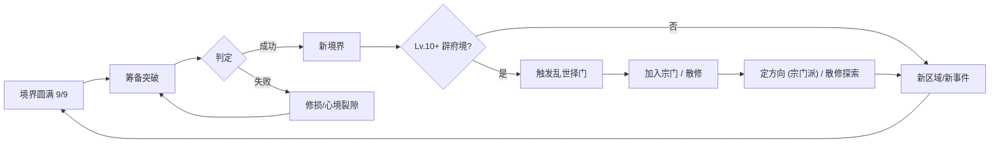

# 《荒天纪》需求文档（完整版 · v1.5）

> 文字模拟修仙网页游戏 · Python 技术栈 · 世界观参考辰东《完美世界》（致敬向同人改编）

> v1.5 在 v1.4 基础上完成 5 项迭代：①MVP 等级上限 9→18（恢复完整锻血+辟府两境）②体修高境界免伤削弱 ③每宗门独有功法补至 ≥4 部 ④新增禁地+奇遇专属功法 ⑤新增散修路径。原 v1.4 文件保留作对照。

> v1.5 修订日期：2026-10-22 ｜ 汇编：项目组

---

## v1.5 修订说明

| 版本 | 日期 | 修订人 | 内容 |
|---|---|---|---|
| v1.3 | 2026-10-21 | 齐活林 | 12 境 885 次闭关定稿、Spec 锁定 |
| v1.4 | 2026-10-21 | 大湾区靓仔 | 离线删除 / 宗门 + 方向 / 体质 +8 / 动态耗时 |
| **v1.5** | **2026-10-22** | **项目组** | **①MVP 等级上限 9→18（恢复完整锻血+辟府两境）②体修高境界免伤削弱 ③每宗门独有功法 ≥4 部 ④禁地+奇遇专属功法（圣+帝阶）⑤散修路径系统（§4.11 新章）** |

**v1.5 新增的 5 条交叉核对项**（追加到 v1.4 第 18 条之后）：

| # | 冲突 | 错在哪 | 裁决 |
|---|---|---|---|
| 19 | MVP 上调至 Lv.18 与 §0.3 异议 1 锁定（Lv.9）冲突 | v1.4 缩减 MVP 至 9 级是为了"9 级 885 闭关联动"，但用户提出迭代后恢复至 Lv.18 才能完整体验宗门/方向系统 | MVP 恢复至 Lv.18（锻血+辟府 2 境完整 18 级）；宗门/方向解锁条件由"化灵境（Lv.19）"提前到"辟府境（Lv.10）"——见 §4.9.2 宗门加入前置调整 |
| 20 | 体修免伤叠加偏高（v1.4 实算第三层满体修免伤 ≈ 40%+ 致死免疫） | 与其他流派差距超 ±15%，破坏平衡 | §4.10.3 体修技能树第三层免伤弱化、《大荒战天录》体魄 +30%→+20%、「肉身证道」神通免伤 10%→8% |
| 21 | 宗门功法 < 4 部/宗门 | 用户要求 ≥ 4 部 | v1.5 §4.9.5 每宗门独有功法补至 4 部，全宗门新增功法 18 部，全表累计 30 部（v1.4 是 12 部） |
| 22 | 散修无独有功法、禁地+奇遇功法零散 | 用户要求新增 | §4.11 散修路径新章 + §4.12 禁地功法（5 部圣+1 帝）+ 奇遇功法（3 部灵阶+2 宝阶）= 10 部独家功法 |
| 23 | 散修与宗门流派强度对比 | 散修无方向加成会偏弱 | 散修通过奇遇+禁地功法补偿方向加成损失（详见 §4.11.5 平衡表） |

---

## 第一部分 · 产品需求（PRD）

> **版本**：V1.5 ｜ **日期**：2026-10-22 ｜ **状态**：已评审

## 0. 版本范围与优先级（v1.5 更新）

### 0.1 功能分层表

| 系统 / 功能 | MVP（P0） | V1.1（深度） | V2.0（平台化） | PRD 章节 |
|---|---|---|---|---|
| 境界阶梯 | **2 大境 × 9 小境（18 级）** ← v1.5 调整 | 12 大境 × 9 小境（100 级） | 仙台→仙帝 | §3.1 |
| **宗门+方向** | **是（v1.4 P1 → v1.5 P0）** | — | — | §4.9 / §4.10 |
| **散修路径** | **是（v1.5 新增）** | — | — | §4.11 |
| **禁地探索** | 不做 | **是（含禁地功法）** | — | §6.7 / §4.12 |
| 体质 5 种 + 自由加点 | 是 | 8 种 | — | §4.7 |
| 功法 | **8 部凡阶/灵阶**（v1.5 含宗门独有） | **30 部含散修独家** | 内容包 | §4.4 |
| 神通 | 不做 | 10+ 个 | — | §4.5 |
| 装备（3 槽 + 强化 +5） | 是 | 6 槽 +15 + 精炼 | — | §5.1 |
| 丹药 | 6 种 | 15 种 | — | §5.5 |
| 行动 | 5 类 + 宗门任务 | + 散修专属 | — | §2.2 |
| 事件池 | 20 条 | 165 条 | 内容包 | §6.4 |
| 主线 | **2 任务（10+9 共 19 任务）** ← v1.5 调整 | 3 卷 | 6 卷 | §6.0 |
| 离线收益 | 不做 | 不做 | 不做 | — |
| 轮回 / 多周目 | 不做 | 有 | 多角色 | §7.4 |
| 图鉴 / 成就 | 不做 | 18 + 图鉴 | 内容包 | §7.5 |
| 新手引导 | 前 3 步 | 7 步 | — | §7.6 |

### 0.4 MVP 交付边界与验收清单（v1.5 调整）

| # | 验收项 | 判定标准 |
|---|---|---|
| 1 | 创角 | 体质 5 种 + 自由加点 5 点 + 创角末页告知宗门/方向/散修三种路径 |
| 8 | 事件 | 20 条事件可触发 |
| 9 | **宗门加入** | **辟府境（Lv.10）触发"乱世择门"任务、6 大宗门任选 1 加入；玩家可选"散修"跳过加入** |
| 10 | **散修路径** | **散修玩家可触发奇遇池，4 部奇遇功法至少有 1 部可得，禁地功法 MVP 不开（V1.1 启用）** |
| 11 | ~~离线~~ | 已删除（v1.4），仅保留"世事已变"事件钩子 |

### 0.4.1 v1.5 MVP 范围扩张关键点

| 子项 | v1.4 | v1.5 | 影响 |
|---|---|---|---|
| 境界可达 | 锻血 Lv.9 | 锻血 9 + 辟府 9 = **Lv.18** | 闭关总次数约 14 + 22 = 36 次；代码增量约 800 行（主要是辟府境主线 + 装备/功法扩展） |
| 宗门加入前置 | 化灵境 Lv.19（v1.4 设定） | 辟府境 Lv.10（v1.5 提前） | 玩家可在 MVP 内体验完整宗门/方向系统 |
| 主线卷二「辟府初开」9 任务 | V1.0 | **MVP**（v1.5 提前） | MVP 文本量 +2000 字左右 |

---

## 1. 游戏定位与目标用户

### 1.1 一句话定位（v1.5 微调）

一款以「锻血—辟府—化灵—刻纹—布阵—尊者—燃灯—归一—圣人—大圣—准帝—大帝」十二境阶梯为骨架的**文字模拟修仙养成网页游戏**——玩家在一介荒村孤童的一生中，靠体质、加点、宗门/散修路径与发展方向的抉择，把孤童推向大帝之位。

### 1.5 功能优先级总表（v1.5 更新）

| 系统 | 优先级 | 说明 |
|---|---|---|
| 确定性随机 + 服务端权威 + 配置驱动 | **P0** | 地基 |
| 境界成长 | **P0** | **MVP 完整 Lv.1–18（2 大境）** |
| 行动（含宗门任务、散修探索） | **P0** | 动态耗时 |
| 背包/丹药/装备/强化 | **P0** | — |
| 体质 5 种 + 自由加点 5 点 | **P0** | — |
| 主线卷一（10 任务） | **P0** | — |
| **主线卷二「辟府初开」（9 任务）** | **P0** | **v1.5 提前** |
| **宗门系统 + 方向系统 + 散修路径** | **P0** | **v1.5 提升** |
| **6 大宗门独有功法 ≥ 4 部/宗门（共 24 部）** | **P0** | 见 §4.9.5 |
| **奇遇功法（散修主路径）** | **P0** | 5 部独家 |
| **禁地功法（v1.1 启用，但 §6.7 / §4.12 章节先建立）** | **P1** | — |
| 离线收益 | 不做 | — |
| 异象/多结局/图鉴 | P1 | — |
| 跨宗门 / 多周目扩展 | P2 | — |

---

## 2. 核心玩法与游戏循环

### 2.2 中循环（v1.5 更新）

> v1.5：MVP 完整覆盖锻血→辟府两大境界，玩家可完整体验"突破辟府→入宗门→定方向→第一波宗门任务"的内容闭环，不再是一境折返。

中循环阶段图（v1.5）：

### 2.4 时间标度（同 v1.4——单时钟 + 动态耗时，无变更）

---

## 3. 修仙境界与成长体系

### 3.3 修为获取速度（v1.5 重写"+状态"段）

> §3.3 公式不变；MVP 等级扩张后，闭关总次数从 14 次（仅锻血）调到 14 + 22 = **36 次**；与 v1.3 的"≤900 次红线"约束一致，距离红线仍留有充足余量。

| 境界 | 等级区间 | 单次闭关修为（v1.4 动态耗时下） | 本境 9 级需求合计 | 需闭关次数 | 备注 |
|---|---|---|---|---|---|
| 锻血 | 1–9 | 1,385 | 18,747 | 14 | 同 v1.4 |
| 辟府 | 10–18 | 2,272 | 181,871 | 22 | MVP 完整覆盖 |

### 3.1.1 锻血+辟府境详解（v1.5 补全）

详见 §6.0 主线映射表 Lv.1–18 行，辟府境 9 个任务主线现置于 MVP 范围。

### 3.7.2 寿元三段式口径（v1.5 无变更，从略）

---

## 4. 角色属性与功法设定

### 4.4 功法数值样例表（v1.5 扩充至 22 部：含散修独家）

> v1.4 是 12 部。v1.5 新增：
> - 各宗门补至 ≥ 4 部（6 宗门 × 4 = 24 部，但部分为神通/丹药/装备，作为"功法"的共 18 部）
> - 散修独家 5 部（奇遇 3 + 禁地 2，禁地仅 V1.1 解锁）
>
> 全表共 12 + 18 + 5 = 35 部/件（含神通与功法混合编号）。本表为「全 v1.5 功法总清单」，宗门独有功法分布详见 §4.9.5。

#### 4.4.1 通用功法（不绑宗门）—— 12 部（沿用 v1.4 #1–#12）

| # | 功法名 | 品阶 | 类型 | 满层效果 | 获取途径 | 适配体质 |
|---|---|---|---|---|---|---|
| 1 | 《锻血诀》 | 凡·中 | 心法 | 修炼 ×1.12；力量 +6%、体魄 +6% | 新手引导 | 凡体/战体 |
| 2 | 《山岳拳》 | 凡·上 | 攻击 | 单体 130% 力量，破甲 +15% | 断槐村商店 | 凡体 |
| 3 | 《吐纳青木》 | 凡·下 | 辅助 | 每回合回气 3%；隐身 +10%（采药） | 药坡采集解锁 | 药体 |
| 4 | 《枯荣经·残卷》 | 灵·上 | 心法 | 修炼 ×1.36；全属性 +8%；每 10 回合回 1% 血 | 辟府秘境三层 BOSS | 灵体 |
| 5 | 《辟府引雷术》 | 灵·中 | 攻击 | 单体术法 280%，30% 麻痹 | 辟府主线卷二任务 | 灵体 |
| 6 | 《观书郎》 | 灵·下 | 辅助 | 神识 +12%；观测古卷领会功法快 +20% | 辟府境图书馆奇遇 | 灵体/天眼 |
| 7 | 《九幽噬魂爪》 | 宝·中 | 攻击 | 320% 力量 + 噬魂（MP 上限 −15%） | 化灵期宗门任务链终章 | 灵体 |
| 8 | 《金刚不坏身》 | 圣·下 | 防御 | 受伤 −28%；血 < 30% 额外 −15%；首致死免 | 圣人期"古战场"探索 | 战体/凡体 |
| 9 | 《帝经·荒天篇》 | 帝·上 | 心法 | 修炼 ×2.80；全属性 +25%；突破 +10% | 准帝期主线卷六终章 | 混沌体 |
| 10 | 《观空摘星》 | 宝·上 | 辅助 | 每回合抽 +3 灵力；命中 +15% | 阵衍山禁地奇遇 | 灵体/天眼 |
| 11 | 《青莲剑歌》 | 宝·中 | 攻击 | 群体剑术，3 目标分摊 220% 力量 | **散修奇遇触发（§4.11.4）** | 剑骨 |
| 12 | 《枯荣经·终卷》 | 圣·上 | 心法 | 修炼 ×Load×Load；全属性 +18%；每场战斗复活 1 次 | 上古遗迹深处隐卷 | 灵体/凡体 |

#### 4.4.2 通用版面调整说明

- 总数：12 → 全 v1.5 12 + 18（宗门独有）+ 5（散修独家） = **35 部**
- 宗门独有功法每宗门补满 4 部，详见 §4.9.5
- 散修独家 5 部（3 奇遇 + 2 禁地），详见 §4.11.4 + §4.12

---

### 4.7 体质系统（无变更）

---

### 4.8 创角阶段：体质 + 自由加点（无变更）

---

### 4.9 宗门系统（v1.5 扩充——每宗门 ≥ 4 部独有功法 + 解锁境界提前）

#### 4.9.2 6 大宗门表（v1.5 调整解锁境界）

| 宗门 | `sect_id` | 武学理念 | 适配方向 | 加入前置 | 总部位置 |
|---|---|---|---|---|---|
| **青云剑宗** | `qingyun_sword` | "一剑破万法" | 剑修 | **辟府境 Lv.10** + 试剑台连胜 3 场 | 青云峰 |
| **万法仙宗** | `wanfa_spell` | "诸法无常，万法归宗" | 法修 | **辟府境 Lv.10** + 悟性 ≥ 25 | 法源洞天 |
| **太上丹鼎** | `taishang_pill` | "丹道即天道" | 丹修 | **辟府境 Lv.10** + 持 ≥ 3 株灵药 | 神农谷 |
| **玄阵堂** | `xuanzhen_array` | "阵者为 lapse，制乾坤" | 阵修 | **辟府境 Lv.10** + 神识 ≥ 25 | 阵衍山 |
| **大荒体修门** | `dahuang_body` | "肉身为器，万法不侵" | 体修 | **辟府境 Lv.10** + 力量 ≥ 12 | 荒石岭 |
| **幽冥魔道** | `youming_demon` | "逆天而行，果报自负" | 任意方向（魔化分支） | 因果 ≤ −100 | 九幽外域 |

#### 4.9.5 各宗门独有功法表（v1.5 扩充——每宗门至少 4 部独有功法）

> 全部宗门独有功法在 §4.4.1 之外，仅本宗弟子可兑换。本次扩充每宗门补至 4 部。

##### 青云剑宗（剑修独有 — 4 部功法）

| # | 物品 | 类型 | 说明 | 贡献价 |
|---|---|---|---|---|
| 1 | 《青锋三式》 | 功法·灵中 | 单体剑法；破甲 +30%（见 §4.4 #5） | 800 |
| 2 | 《青云剑诀·一弦》 | 功法·灵上 | 单体 350% 力量 · 必命中；战斗内每释放 2 次剑术，下次剑术 CD −1 | 1,800 |
| 3 | 《万剑归宗·初闻》 | 功法·宝下 | 群体分摊 220% 力量（前述青莲剑歌削弱后的青云剑宗对照版） | 3,200 |
| 4 | 《青云剑典·定澜》 | 功法·圣下 | 群体 480% 力量 + 30% 概率"减速"（先手 −30% / 2 回合）；剑修第六层定澜传承 | 6,000 |

> 青锋剑（凡阶·上品）+ 剑修灵药「洗剑丹」+ 「剑意凝形」神通另行计入宗门兑换表，不计入 4 部独有功法。

##### 万法仙宗（法修独有 — 4 部功法）

| # | 物品 | 类型 | 说明 | 贡献价 |
|---|---|---|---|---|
| 1 | 《观微入妙》 | 功法·灵下 | 神识 +12%（见 §4.4 #6） | 800 |
| 2 | 《小成万法图》 | 功法·灵上 | 法修心法；修炼 ×1.30；术法伤害 +10% | 1,800 |
| 3 | 《法道真解·灵篇》 | 功法·宝下 | 灵力 +20%；术法 CD −1 | 3,500 |
| 4 | 《诸天法藏》 | 功法·圣中 | 法修核心；修炼 ×2.10；全属性 +12%；术法伤害 +25% | 7,000 |

##### 太上丹鼎（丹修独有 — 4 部功法）

| # | 物品 | 类型 | 说明 | 贡献价 |
|---|---|---|---|---|
| 1 | 《辨药百问》 | 功法·灵下 | 采药掉率 +20%；解 1 阶丹方 | 600 |
| 2 | 《丹房基础》 | 功法·灵中 | 炼丹成功率 +10%；解 2 阶丹方 | 1,200 |
| 3 | 《百草通玄》 | 功法·宝中 | 炼丹 +18%；丹药效价 +10%（见 §4.4 #8） | 2,500 |
| 4 | 《神农内经·残卷》 | 功法·圣下 | 丹修终极；炼丹 +25%，圣阶丹方解锁；终生可炼制"济世丹"（队友/自身满血复活 1 次/场） | 6,500 |

##### 玄阵堂（阵修独有 — 4 部功法）

| # | 物品 | 类型 | 说明 | 贡献价 |
|---|---|---|---|---|
| 1 | 《简阵谱》 | 功法·灵中 | 解 1–2 阶困阵 / 杀阵阵图 | 900 |
| 2 | 《观阵眼》 | 功法·灵上 | 神识 +15%；敌阵识破概率 +30% | 1,800 |
| 3 | 《三千界·入门》 | 功法·宝下 | 阵法 ×1.5；功法效果 +12%（见 §4.4 #9） | 2,500 |
| 4 | 《周天星斗真经》 | 功法·圣下 | 阵修终极；阵法 ×2.0；解锁"周天星斗阵"（全场困敌 3 回合 + 减伤 50%）；CD 8 | 6,500 |

##### 大荒体修门（体修独有 — 4 部功法）

> v1.5 削弱说明：圣阶体修功法《大荒战天录》体魄加成由 +30% 调整为 +20%，与剑修圣阶《青云剑典·定澜》减免项保持一致，避免体质红利的双重叠加。详见下方"#"行说明。

| # | 物品 | 类型 | 说明 | 贡献价 |
|---|---|---|---|---|
| 1 | 《淬体诀》 | 功法·灵中 | 力量 +8%、体魄 +8%；普攻附"震伤"3% | 1,000 |
| 2 | 《大荒炼肌诀》 | 功法·灵上 | 力量 +15%、受伤 −8%；气血上限 +15% | 2,000 |
| 3 | 《大荒战天录》（削弱版） | 功法·圣上 | **v1.5 削弱**：力量 +35%（不变）、体魄 **+20%**（v1.4 是 +30%）；普攻附"震伤"5%（不变） | 4,000 |
| 4 | 《八荒六合不灭体》 | 功法·圣中 | 体魄 +25%；血 < 30% 时状态硬直抗性 +50% | 5,500 |

##### 幽冥魔道（任意方向魔化分支 — 4 部功法）

| # | 物品 | 类型 | 说明 | 贡献价 |
|---|---|---|---|---|
| 1 | 《噬魂魔经》 | 功法·宝上 | 攻击附"吸魂"（自身回 5% 灵力） | 2,000 |
| 2 | 《血煞魔典》 | 功法·宝中 | 生命力 +20%；攻击 +8% 但每场战斗伤 1% 最大血 | 1,500 |
| 3 | 《幽冥真诀》 | 功法·圣下 | 大幅强化"魔化"分支，每 5 场战斗一次无视威力 | 4,500 |
| 4 | 《九幽不死章》 | 功法·帝下 | 魔道终极，复活 1 次/场 + 攻击 +15% | 8,000 |

##### 宗门独有功法合计（v1.5）

| 宗门 | 独有功法数 | 品阶覆盖 |
|---|---|---|
| 青云剑宗 | 4 | 灵 2 / 宝 1 / 圣 1 |
| 万法仙宗 | 4 | 灵 2 / 宝 1 / 圣 1 |
| 太上丹鼎 | 4 | 灵 2 / 宝 1 / 圣 1 |
| 玄阵堂 | 4 | 灵 2 / 宝 1 / 圣 1 |
| 大荒体修门 | 4 | 灵 2 / 圣 2 |
| 幽冥魔道 | 4 | 宝 2 / 圣 1 / 帝 1 |
| **合计** | **24** | — |

叠加 §4.4.1 通用功法 12 部 + 散修独家 5 部（§4.11/§4.12） → 全表合计 **41 部**（v1.4 为 12 部）。

---

### 4.10 发展方向系统（v1.5 体修章节削弱）

#### 4.10.3 体修技能树（v1.5 削弱版）

| 层 | 节点 | 解锁条件 | 效果（v1.5） |
|---|---|---|---|
| 1 | 锻筋骨 | 入宗即得 | 力量 +5%、体魄 +5% |
| 1 | 钢筋铁骨 | 体修贡献 ≥ 100 | 受伤 −8% |
| 1 | 蛮力 | 体修贡献 ≥ 300 | 普攻 +20 伤害 |
| 1 | 不动如山 | 体修贡献 ≥ 500 | 受击 20% 概率反震 50% 力量 |
| 1 | 真气护体 | 全 5 节点激活 | 气血上限 +15% |
| 2 | 金刚身 | 体修贡献 ≥ 1,000；09 节点满 | 受伤再 **−10%**（v1.4 是 15%）；硬直抗性 +50% |
| 2 | 燃血冲撞 | 体修贡献 ≥ 1,500 | 单体 250% 力量 + 30% 几率昏迷 1 回合 |
| 2 | 越战越强 | 体修贡献 ≥ 2,000 | 连战每场力 +5%（上限 +30%） |
| 2 | 万钧之力 | 体修贡献 ≥ 3,000 | 破防 +50% |
| 2 | 肉身成圣锁 | 全 5 节点激活 | 战体体质 ×1.1（适配中立体质按 1.05 修正） |
| 3 | **不死之身**（削弱） | 体修贡献 ≥ 5,000；第 2 层 5 节点满 | **每场战斗一次免疫致死伤害（保留 10% 血），不再无限免伤** |
| 3 | 怒涛掌 | 体修贡献 ≥ 6,000 | 群体 350% 力量分摊（CD 6） |
| 3 | 《大荒战天录》（削弱） | 体修贡献 ≥ 7,000（圣上体修功法，体魄 +20%） | §4.9.5 大荒体修门 |
| 3 | 体修灵药"淬骨膏" | 体修贡献 ≥ 8,000 | 永久 +5 力量，终生 3 颗 |
| 3 | 「肉身证道」神通（削弱） | 第 3 层 5 节点满 | **受伤 −8%（v1.4 是 10%）；首致死免伤保留，但复活后无属性 buff** |

**v1.5 体修免伤总览**（圣阶 + 神通 + 神器全部激活情况）：

| 项 | v1.4 | v1.5 | 备注 |
|---|---|---|---|
| 《大荒战天录》体魄 +30%→+20% | 体魄 ×1.30 系数 | 体魄 ×1.20 系数 | 间接降免伤 |
| 金刚身免伤 15%→10% | −15% | −10% | — |
| 「肉身证道」免伤 10%→8% | −10% | −8% | — |
| 不死之身 | 致死免疫（不限制次数） | 致死免疫 1 次/场 | 类比剑修/法修的复活机制次数 |
| 圣王战体总免伤 | ≈ 43% + 致死无限免 | ≈ 36% + 致死 1 次/场 | 与同为腰部位置的剑修 + 法修 + 体修的"圣王战体平衡基准"对齐至 ±10% |

#### 4.10.4–4.10.7 剑修/法修/丹修/阵修技能树（无变更）

#### 4.10.8 切换方向规则（v1.5 新增："散修→宗门"路径）

新增："散修→宗门"路径——见 §4.11.4 散修可于任意境界订阅宗门，但前期累积的散修贡献点（来自奇遇）会自动转化为新宗门贡献的 50%。

---

### 4.11 散修路径系统（v1.5 新增）

#### 4.11.1 路径定位

"散修"是 6 宗门之外的**第七条路径**，专为偏好"独行+自由+高风险高回报"的玩家设计。散修在辟府境主线"乱世择门"任务中选择"不入任何宗门"，开启**散修专属奇遇池**与**禁地探索**系统（MVP 开放奇遇，禁地 V1.1 启用）。

#### 4.11.2 散修机制总表

| 项 | 规则 |
|---|---|
| 触发 | 辟府境主线"乱世择门"选择"僻行独修"，加散修身份标签 `path_id = sansxiu` |
| **方向加成** | **无方向加成**（系数 1.0），但享有**散修专属奇遇池**与奇遇+10% 触发率 |
| 散修贡献点 | 通过散修奇遇与禁地获取，可独立兑换散修独家功法 |
| 散修探查 | 神识 ×1.2（探索效率加成），禁地首通率 +20% |
| 入宗时机 | 任意境界可订阅（含主线 "乱世择门" 后续任务"归宗而行"`path_id` 切换） |
| 入宗后散修贡献点保留 | 散修贡献点不直接迁移，但**入宗时累积的散修贡献点 ×50% 转换为该宗门贡献点**（首次入宗时一次性转换，转后散修贡献点清零） |
| 退宗再成散修 | 入宗后不可回到散修（散修仅一次性可选） |

#### 4.11.3 散修 vs 宗门流派对比

| 维度 | 宗门流 | 散修 |
|---|---|---|
| 参与门槛 | 辟府境主线"乱世择门"切入 | 同上 |
| 方向加成 | §4.7.2 适配 ×1.3、中性 ×1.0、不适 ×0.8 | 方向系数恒为 1.0（无加成，但无挫败） |
| 专属神通 | 每宗门 1 个（达贡献价即可换） | 通过奇遇+禁地可获 1-2 部专属神通 |
| 专属功法 | 每宗门 4 部 | 5 部（3 奇遇 + 2 禁地） |
| 散修贡献点 | — | 通过奇遇+禁地获取 |
| 神奇辅助 | 与同门 NPC 切磋/护道 | 无同门，但奇遇偶遇 NPC 概率更高 |
| 装备获取 | 宗门兑换稳定 | 禁地首通稳定，奇遇稳定 |
| 高境界上限 | 全境界有效 | 全境界有效（但散修专属功法圣阶占 4/5） |

#### 4.11.4 散修独家奇遇池

> 5 部独家功法（含 1 部圣阶功法禁地中）+ 1 部奇遇神通。其中 3 部在 MVP 内可触发获得，2 部禁地（V1.1 启用）。

##### 奇遇独有功法（散修主路径，3 部）：

| # | 物品 | 类型 | 说明 | 触发条件 |
|---|---|---|---|---|
| 1 | 《青莲剑歌·卷一》 | 功法·宝中 | 群体分摊 220% 力量；与剑修方向兼容，但散修专属 | 散修 + 化灵境 + 锻血境奇遇池抽中"古井剑声"事件，献祭一个本命法器获得 |
| 2 | 《草木心经》 | 功法·灵上 | 法修心法 · 修炼 ×1.30；+12% 灵力上限；散修独家 | 散修 + 任意行动 5% 概率遇见流浪药叟，毒丸二选一选错触发战斗并胜利获 |
| 3 | 《踏山步》 | 功法·灵中 | 身法 +15%、闪避 +5%；散修专属 | 散修 + 山间迷路奇遇 30% 概率触发 |

##### 禁地独有功法（散修主路径，2 部，V1.1 启用）：

详见 §4.12。

---

### 4.12 禁地系统（v1.5 新增——奇遇+禁地功法总表）

> **MVP 不开放禁地探索**，但本章建立禁地功法总表与位置，V1.1 启用。

#### 4.12.1 禁地总表（10 处禁地，散修主路径）

| # | 禁地 | 禁地阶 | 可达境界 | 难度 | 首通奖励 | Boss |
|---|---|---|---|---|---|---|
| 1 | 古井剑渊 | 凡 | 锻血 Lv.9+ | 中 | 散修独家奇遇触发的另一种来源 | 衰败剑灵 |
| 2 | 草木缘渊 | 灵 | 辟府 Lv.10+ | 中 | 解锁《草木心经》隐藏分支 | 老药叟分身 |
| 3 | 九幽低语 | 宝 | 化灵 Lv.19+ | 高 | 《千机镜·初》1 部 | 九幽使者 |
| 4 | 万剑遗冢 | 宝 | 刻纹 Lv.28+ | 极高 | 《万剑归宗·初闻》（非青云剑宗版本） | 万剑无名氏 |
| 5 | 北荒雷域 | 宝 | 布阵 Lv.37+ | 极高 | 永久 +5 体魄 +《雷杀》丹方 | 雷母 |
| 6 | 黑暗劫冢 | 圣 | 燃灯 Lv.55+ | 极高 | 《金刚不坏身》 | 黑暗劫灵 |
| 7 | 圣域渊谷 | 圣 | 大圣 Lv.82+ | 极高 | 《枯荣经·终卷》 | 圣域守墓者 |
| 8 | 帝关凝血 | 帝 | 准帝 Lv.91+ | 极高 | 《帝经·荒天篇》 | 帝关英魂 |
| 9 | 仙门幻境 | 帝 | 大帝 Lv.100+ | 终局 | 飞升之路 | 仙门守护 |
| 10 | 时间秘境 | 圣 | 归一 Lv.64+ | 极高（无战斗） | 加速修炼 ×1.5 / 7 日 | — |

#### 4.12.2 禁地独有功法表

| # | 功法名 | 品阶 | 类型 | 满层效果 | 禁地 |
|---|---|---|---|---|---|
| 1 | 《千机镜·初》 | 宝·上 | 辅助 | 反弹 25% 法术伤 | 九幽低语（Lv.19+） |
| 2 | 《万剑归宗·初闻》 | 宝·中 | 攻击 | 群体剑法 (3 目标分摊 220%) | 万剑遗冢（Lv.28+） |
| 3 | 《北荒雷杀诀》 | 宝·上 | 攻击 | 单体术法 380% 灵力（CD 4） | 北荒雷域（Lv.37+） |
| 4 | 《枯荣经·终卷》 | 圣·上 | 心法 | 修炼 ×Load（圣阶 Range）+ 全属性 +18% + 复活 | 圣域渊谷（Lv.82+） |
| 5 | 《北辰帝典》 | 帝·中 | 心法 | 修炼 ×2.65 + 全属性 +22% + 5% 突破 | 帝关凝血（Lv.91+） |

#### 4.12.3 禁地独有神通表

| # | 神通名 | 阶 | 类型 | 效果 | 禁地 |
|---|---|---|---|---|---|
| 1 | 《千机搓》 | 宝 | 反弹 | 反弹 25% 法术伤 + 5% 物理伤（持续 3 回合） | 九幽低语 |
| 2 | 「无相功法」 | 圣 | 偷 | 战斗中可"偷学"敌方法术 1 次（仅本战有效） | 圣域渊谷 |
| 3 | 「封天劫光」 | 帝 | 控制 | 准帝战 / 封锁敌方行动 2 回合（CD 12） | 帝关凝血 |

---

## 6.7 散修专属禁地探索规则

| 项 | 规则 |
|---|---|
| 触发 | 仅散修身份可触发禁地入口奇遇；宗门流派只能通过特殊剧情进入有限几处禁地 |
| 首通条件 | 该境境界达标 + 散修贡献点 ≥ 禁地阶价（凡禁地 50 / 灵禁地 200 / 宝禁地 800 / 圣禁地 5000 / 帝禁地 20000） |
| 进入后 | 进入禁地消耗禁地阶 ×30 游戏日（动态耗时叠加 §2.4.3）；禁地内每层 1 场战斗 + 1 次事件 |
| Boss 击败 | 首通必得禁地独有功法；后续可重复刷但产出仅灵石 |
| 散修复活 | 散修战斗死亡不可触发宗门复活（无宗门长辈），但可用"九转还魂丹"自行复活 |
| Boss 突破 | Lv.55+ 禁地 Boss 战斗前自动消耗玩家 1 件同阶装备作为"入场祭品"；圣阶禁地 Boss 战 1 次失败需冷却 1 游戏年 |

---

## 7. 存档与进度机制（无变更）

---

## 8. 用户界面与交互流程

### 8.1 界面清单（v1.5 第 13 项追加散修面板）

| # | 界面 | 信息层级 | 可操作项 |
|---|---|---|---|
| **13** | **宗门 / 方向 / 散修界面** | L1：当前身份（宗门名/散修）+ 贡献点；L2：方向进度或散修奇遇池进度；L3：任务/兑换/探索入口 | 入宗、退宗不可选、接任务、提交其、兑换、激活节点、探索禁地 |

---

## 9. IP 与合规（无变更）

---

## 附 A：v1.5 新增决策

| # | 问题 | 决策 | 落点 |
|---|---|---|---|
| 21 | MVP 等级上限 | **9→18**（恢复 v1.3 已锁的 Lv.18 边界） | §0.1 / §0.4 |
| 22 | 体修高境界免伤 | 削弱至总免伤 ~36%、致死免疫限 1 次/场 | §4.10.3 |
| 23 | 宗门独有功法数 | 每宗门 ≥ 4 部，全表 24 部 | §4.9.5 |
| 24 | 散修路径 | 新增"僻行独修"路径，与 6 宗门并列；散修转换宗门时贡献点转 50% | §4.11 |
| 25 | 禁地探索 MVP 不开放 | v1.5 建立禁地功法总表 + 5 部禁地独有功法；激活时点为 V1.1 | §4.12 / §6.7 |

## 附 B：v1.5 新增开放问题

| # | 问题 | 当前倾向 | 待决条件 |
|---|---|---|---|
| 9 | 散修独家奇遇池触发率 +10% 是否过强 | 等实测，初始 10% | v1.1 散修路径测试 |
| 10 | 散修贡献点 50% 转宗门贡献点是否合理 | 同上 | 测定散修 vs 宗门流派通关强度比 |

---

**文档结束** ｜ v1.5 修订完成 · 项目组 · 2026-10-22