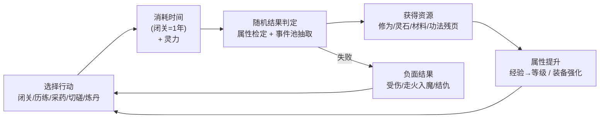
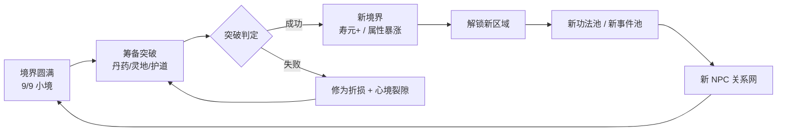
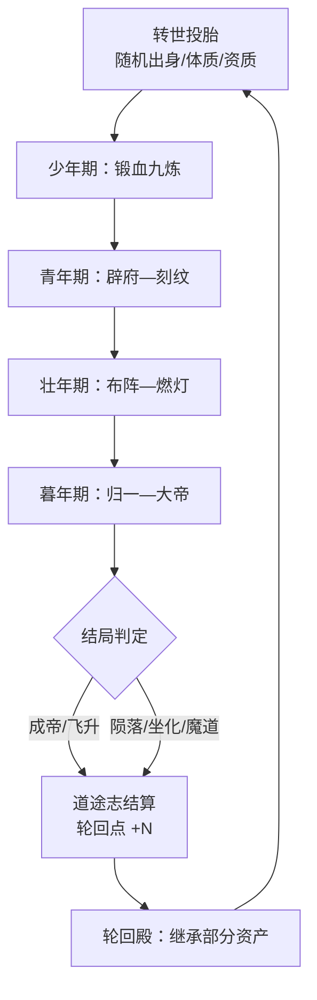
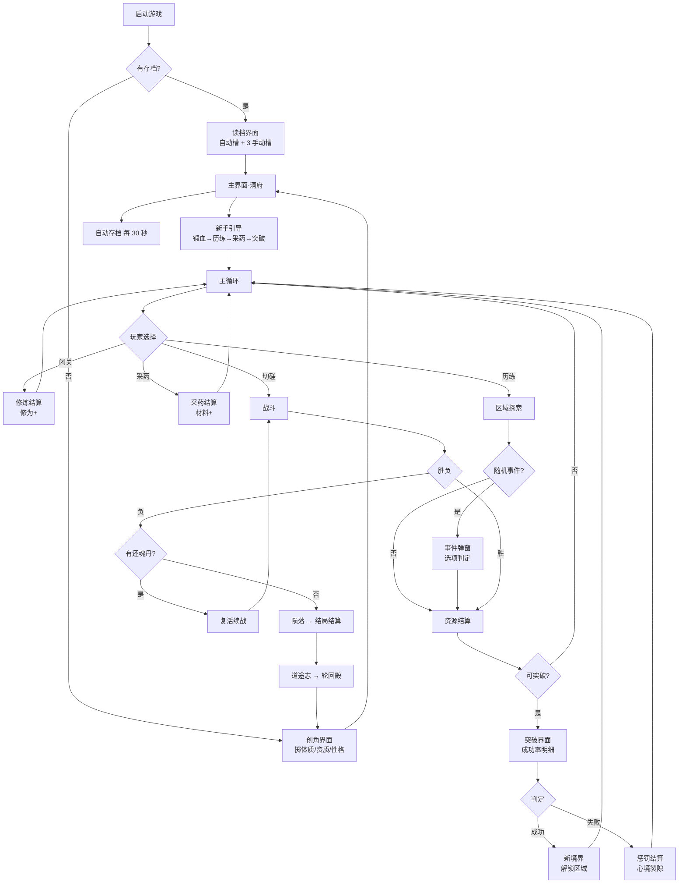

# 《荒天纪》产品需求文档（PRD）

> **版本**：V1.3（定稿） ｜ **日期**：2026-10-21 ｜ **作者**：产品经理 许清楚 ｜ **状态**：已评审，待合并
> **文档范围**：产品侧需求（游戏设计层）。技术架构、数据库、接口协议、部署方案见架构师章节 `02-技术方案.md`。
> **技术栈**：**FastAPI + Jinja2 服务端渲染 + HTMX + Alpine.js + 预编译 Tailwind + SQLite**，服务端权威结算。技术栈细节以 `02-技术方案.md` §1 为准，本文档不重复定义。
> **说明**：本作为《完美世界》致敬向同人改编，仅借鉴修炼体系框架与世界观气质，不复制原文与具体剧情。原创化改名词表见第 9 章。

**修订记录**

| 版本 | 日期 | 修订人 | 内容 |
|---|---|---|---|
| V1.0 | 2026-10-21 | 许清楚 | 首版，9 章全量 |
| V1.1 | 2026-10-21 | 许清楚 | ①新增 §0 版本范围与优先级；②§3.7 时间与寿元口径；③§3.6.1 冲关准备字段；④§6.1.1 卷↔区域↔功法映射；⑤§7.2 离线规则重写；⑥§7.5 图鉴数量修正 + 人生大事记 |
| V1.3 | 2026-10-21 | 许清楚 | ①修为曲线指数 1.9→1.78，节点表与累计总量按脚本实算重填；②`ExpRate` 单位改为「修为/游戏日」；③离线推进年龄并消耗寿元（推翻 V1.2「离线不计龄」）；④体质最高档改名「荒天战体」，MVP 三档权重 70/29/1；⑤新增「持续闭关」批量交互与 ≤900 次红线；⑥§6.1 加「版本归属」列；⑦新增 §0.4 MVP 验收清单、§8.5 文案拆分口径；⑧§9 明确非商业定位 |
| **V1.4** | 2026-10-21 | 许清楚 | **时间模型定稿**：①删除 `ACTION_SPEEDUP` / `action_speedup`，「60 现实秒/游戏日」口径作废；②改为**双轨时钟**——行动轨按游戏日推进、不与现实时间映射，离线轨 `1 现实小时 = 1 游戏年`；③§7.2 离线折算与三段衰减（100%/60%/30%，24h 合计 58.3%）按新口径重算；④`realm_decay_bp` 停用（由三段衰减接管）；⑤§3.3 恢复 `0.35` 境界系数并引入**全局倍率 `exp_rate_global_bp = 14500`**，节奏表改为 890 次口径 |
| V1.2 | 2026-10-21 | 许清楚 | **与技术方案交叉核对后的消除冲突版**（5 项硬冲突）：①§7.1 存档权威源改为服务端 SQLite，浏览器不存游戏状态；②新增 §2.4《时间标度总表》统一三处时间口径并回填修正 §3.3 / §6.2 / §7.2；③新增 §6.0《主线进度映射表》（Lv.1–100 无空隙）与 §6.6《区域清单表》（17 区域）；④新增 §4.8《战斗规则》；⑤§3.1 境界主表改双列（本作用名作主名），§4/§5/§6 境界名同步替换；⑥新增 §1.5《功能优先级总表》 |

---

## 0. 版本范围与优先级（与架构师 02-技术方案 §7.2 对齐）

> 本文档 1–9 章描述的是 **V1.0 完整目标形态**，不是 MVP 交付范围。开发按下列三档推进，**架构与数据表结构一次成型**（避免后期加字段迁移），仅内容量与 UI 曝光分档放开。

### 0.1 功能分层表

| 系统 / 功能 | MVP（P0，先做） | V1.1（深度） | V2.0（平台化） | PRD 章节 |
|---|---|---|---|---|
| 境界阶梯 | 3 大境 × 3 小境（9 级） | 12 大境 × 9 小境（100 级） | 仙台→仙帝（资料片） | §3.1 |
| 基础属性 | 6 项参战属性可见 | 10 项全开放 | — | §4.1 |
| 行动类型 | 闭关 + 历练 | + 采药 / 切磋 / 突破准备 / 一键日常 | — | §2.2 / §8.4 |
| 修为与突破 | 经验曲线 + 主动突破 + 三档失败惩罚 + 连败保底 | + 冲关准备 4 项 | — | §3.2 / §3.6 |
| 功法 | 3 本凡阶（各 3 层） | 30 本 / 15 档 / 9 层 | 内容包扩展 | §4.3 / §4.4 |
| 宝术（主动技能） | 不做（功法被动替代） | 独立技能系统 | — | §4.5 |
| 装备 | 武器 / 护甲 / 饰品 3 槽 + 强化 +1~+5 | 6 槽 + 强化 +15 + 精炼 / 镶嵌 / 祭炼 | — | §5.1 / §5.4 |
| 丹药 / 材料 | 3 种丹药 + 背包 60 格 | 全量 | — | §5.5 / §5.6 |
| 体质 | **3 种（凡体 70% / 灵体 29% / 荒天战体 1%）** | 6 种（补 宝体 / 神体 / 混沌体，默认 `enabled: false`） | — | §4.7 |
| 异象 | 不做 | 4 种 | + 内容包 | §4.6 |
| 事件池 | 20 个事件 | 165 个事件 | 内容包 | §6.4 |
| 主线 | **1 卷（荒村孤童，10 个任务）** | **3 卷（卷一一~三，34 个任务）** | 6 卷全量（81 个任务）+ 飞升篇 | §6.0 / §6.1 |
| 结局 | 不做（死亡=读最近存档） | 6 种结局 | — | §6.5 |
| 存档 | 1 自动档 + 手动导出 | 3 手动槽 + 1 自动槽 | 云存档接口 | §7.1 |
| 离线收益 | 固定效率 + 24h 上限 | 三段衰减曲线 | — | §7.2 |
| 轮回 / 多周目 | 不做 | 有（继承 + 轮回点） | 多角色 | §7.4 |
| 图鉴 / 成就 | 不做 | 18 成就 + 图鉴 + 人生大事记 | 内容包图鉴 | §7.5 |
| 新手引导 | 前 3 步 | 7 步完整 | — | §7.6 |

### 0.2 三条不可妥协的"地基"（产品侧背书，任何版本都不得削减）

| # | 地基 | 产品理由 |
|---|---|---|
| 1 | **配置驱动**（所有数值外置于 `data/content/*.yaml`） | 本 PRD 的每个数字都是**基准值，允许 Alpha 后 ±30% 调参**；若硬编码，平衡性迭代将退化为改代码 + 回归测试 |
| 2 | **确定性随机**（`seed` + `rng_counter`） | 产品需要能用同一 seed 复现"这一世"，才能做平衡性验收与 bug 复现；也是"重开这一世看看另一条路"这类玩家诉求的基础 |
| 3 | **属性字段一次建满** | MVP 虽只曝光 6 项参战属性，但 `根骨 / 悟性 / 气运 / 道心 / 因果` 5 个字段**必须在初版数据表内以默认值存在**（只是 UI 不显示、成长来源为 0）。理由：V1.1 加属性若需数据迁移，旧档全部失效，玩家资产归零是最不可接受的事故 |

### 0.3 产品侧对 MVP 裁剪的 2 处异议（已与架构师确认）

| # | 架构师建议 | 产品意见 | 结论 |
|---|---|---|---|
| 1 | 体质砍到 V1.1 | **反对**。体质是「每一世都不一样」的 Roguelite 钩子，砍掉后创角只剩性格，重复开局动力不足。MVP 只需 3 种体质，实现成本仅 3 个乘算系数 | **体质保留进 MVP（3 种）** |
| 2 | 多结局砍到 V1.1 | **同意**。MVP 3 大境撑不到结局判定，6 结局内容量大、测试成本高 | 多结局进 V1.1 |

### 0.4 MVP 交付边界与验收清单（工程师照此勾选）

**范围**：2 大境 × 9 小境（18 级）+ 20 条事件 + 1 卷主线 + 5 类行动，约 4,500 行代码。

| # | 验收项 | 判定标准（可勾选） |
|---|---|---|
| 1 | 创角 | 可掷体质（凡体 70% / 灵体 29% / 荒天战体 1%）、资质 1–10 品、选性格（5 选 1），可重掷 3 次 |
| 2 | 境界成长 | 锻血九重 + 辟府九洞天共 18 级可完整走通，`global_level = 9×(major−1)+minor` 成立 |
| 3 | 修为与突破 | 闭关 1 次 = 30 游戏日；`ExpRate` 单位是"修为/游戏日"；突破需主动点击；失败按三档惩罚结算 |
| 4 | 五类行动 | 闭关 / 历练 / 采药 / 切磋 / 打坐 全部可用，均正确推进 `age_days` |
| 5 | 战斗 | 30 回合上限、逃跑率、连战惩罚、气血战后不回满 全部生效 |
| 6 | 背包与装备 | 60 格；武器/护甲/饰品 3 槽；强化 +1~+5（失败规则按 §5.4） |
| 7 | 丹药 | 3 种（聚气丹 / 洗髓丹 / 破境丹），可服用、可堆叠 99 |
| 8 | 事件 | 20 条事件可触发，选项判定用 §6.4 公式，结果影响属性/关系/因果 |
| 9 | 任务 | 卷一 10 个主线任务全通，可领奖、可追踪 |
| 10 | 存档 | 1 个自动档（服务端）+ 手动导出 `.json`；刷新页面状态不丢 |
| 11 | 离线 | 离线 8 小时回归有产出；`age_days` 与寿元同步推进；剩余 1 年即停、不判死 |
| 12 | 新手引导 | 前 3 步强制引导可走通（创角→首次锻血→首次突破） |
| 13 | 地基 | 确定性随机可复现（同 seed 同结果）；幂等键生效；配置驱动（改 YAML 不改代码）；乐观锁冲突返回 3001 |
| 14 | 单元测试 | 覆盖率 ≥ 60%，其中 `domain/` 层 ≥ 80% |
| 15 | **性能红线** | Lv.1→18 总闭关次数 **≤ 60 次**（实算 36 次：锻血 14 + 辟府 22）；全量 Lv.1→100 **≤ 900 次**（实算 885，留 15 次余量）；单次请求 P95 < 300ms |

**不在 MVP 范围（明确排除，防止范围蔓延）**：宝术/主动技能、装备精炼/镶嵌/祭炼、道相、多结局、轮回、图鉴成就、多存档槽、势力战、组队、云存档。

---

## 1. 游戏定位与目标用户

### 1.1 一句话定位

一款以「锻血—辟府—化灵—刻纹—布阵—尊者—燃灯—归一—圣人—大圣—准帝—大帝」十二境阶梯为骨架的**文字模拟修仙养成网页游戏**，玩家在一个角色的一生（乃至多世轮回）中，用抉择与经营把一介荒村孤童推向大帝之位。

### 1.2 基本信息

| 项目 | 内容 |
|---|---|
| 游戏名（暂定） | 《荒天纪》 |
| 品类 | 文字模拟养成 + 修仙放置 + 事件抉择（Roguelite 轮回） |
| 平台 | PC 浏览器 / 移动浏览器（响应式，最小 375×667） |
| 单局时长 | 主线一周目 8–12 小时；单次会话 15–30 分钟；挂机可离线 24 小时 |
| 单周目寿命 | 游戏内 100–10000 年（随境界提升上限） |
| 收费模式 | 买断/免费+资料片（本阶段不设计内购） |
| 语言 | 简体中文 |
| 美术需求 | 极简文字 + 少量图标/立绘位；不使用实时战斗动画 |

### 1.3 目标用户画像

| 人设 | 年龄/职业 | 使用场景 | 核心诉求 | 痛点 |
|---|---|---|---|---|
| **A. 网文老读者·陈默** | 28 / 后端工程师 | 上班摸鱼、通勤地铁上用手机浏览器打开，一天 3–5 次，每次 10 分钟 | 想重温"锻血九次"的爽感，想看数值一路飙升；讨厌无脑点击 | 同类游戏数值膨胀失控、后期只剩"点突破"；剧情文本注水严重 |
| **B. 模拟经营爱好者·林夏** | 24 / 研究生 | 晚上宿舍用笔记本，一次坐 1–2 小时 | 喜欢做选择、看后果，喜欢"我这一世活得不一样" | 伪抉择（选项结果一样）、缺少长期成长的沉淀感 |
| **C. 放置挂机党·老周** | 35 / 个体户 | 手机上挂着，隔几小时回来看一眼 | 离线也要有收益，回来能一口气收一堆资源 | 离线收益过低导致"挂机无意义"；回来发现角色寿元耗尽暴毙 |

**共同需求**：数值透明可推演、抉择有真实后果、文本有修仙味而非白话网文腔。

### 1.4 与竞品差异点

| 维度 | 《荒天纪》（本作） | 修仙模拟器 | 我的门派 | 太吾绘卷 | 想不想修真 |
|---|---|---|---|---|---|
| 核心驱动 | 文字事件抉择 + 数值养成 | 事件卡牌抉择 | 门派经营 + 弟子养成 | 武侠沙盒 + 传剑 | 放置挂机 + 境界突破 |
| 境界体系 | 12 大境 × 9 小境，原著向 | 自创 9 境 | 自创境界 | 无修仙境界 | 自创 12 境 |
| 寿元压力 | **强**（境界=寿元，坐化是主结局之一） | 中 | 弱 | 强 | 无 |
| 轮回/多周目 | **有**，带继承与图鉴 | 无 | 无 | 有（传剑） | 无 |
| 离线收益 | 有（24h 上限，三段衰减最低 30%） | 无 | 弱 | 无 | 强（核心） |
| 战斗 | 文字回合制，自动+技能 | 无 | 自动战斗 | 战棋 | 自动 |
| 文本量 | 中（8–12 万字） | 高 | 中 | 极高 | 低 |
| **本作差异点** | ①境界阶梯严格对齐原著阶梯，玩家有"知识红利" ②寿元=硬约束，逼玩家在"稳妥修炼"与"冒险搏命"间取舍 ③每世结束生成"道途志"（人生总结），驱动多周目 | | | | |

### 1.5 功能优先级总表

> 口径与架构师 §7.2 / §7.3 严格一致：**P0 = MVP 必做；P1 = V1.0 补齐；P2 = V2.0 / 资料片**。MVP 只做"2 大境 × 9 小境（18 级）线性成长 + 主线卷一（10 任务）+ 闭关/历练/采药/切磋/打坐/突破/背包/装备（3 槽 + 强化 +5）/任务"。

**系统级优先级**

| 系统 | 优先级 | 说明 |
|---|---|---|
| 确定性随机（seed + rng_counter） | **P0** | 地基，后期补不上 |
| 服务端权威结算 + 幂等键 + 乐观锁 | **P0** | 地基 |
| 配置驱动（全部数值外置 YAML） | **P0** | 地基 |
| 境界成长（12 境 × 9 小境 + 属性 + 突破） | **P0** | MVP 填锻血~辟府 2 境，结构按 12 境建 |
| 行动（闭关 / 历练 / 采药 / 切磋 / 突破） | **P0** | 五类行动全做 |
| 背包 + 丹药（3 种）+ 装备（3 槽：武器/护甲/饰品）+ 强化 +1~+5 | **P0** | — |
| 体质（3 种：凡体 70% / 灵体 29% / 荒天战体 1%） | **P0** | 见 §0.3 异议 1；权重必须合计 100% |
| 任务（主线卷一 10 个 + 支线委托） | **P0** | — |
| 随机事件池（20 条） | **P0** | — |
| 离线收益（固定效率 + 24h 上限） | **P0** | — |
| 1 自动存档 + 手动导出 | **P0** | — |
| 新手引导（前 3 步） | **P0** | — |
| 战斗（回合制遭遇战 + 逃跑） | **P0** | 规则见 §4.8 |
| 宝术 / 主动技能 | P1 | MVP 用功法被动替代 |
| 装备 6 槽 + 强化 +15 | P1 | — |
| 装备精炼 / 镶嵌 / 祭炼 | **P2** | 测试成本高、收益低 |
| 异象系统 | P1 | — |
| 体质补全（宝体 / 神体 / 混沌体，`enabled: false` 转 true） | P1 | — |
| 主线卷三（15 任务，V1.0 收尾） | P1 | — |
| 主线卷四~卷六（47 任务） | **P2** | 文案量太大，V2.0 再做 |
| 多结局（6 种） | P1 | — |
| 轮回 / 多周目 / 轮回殿 | P1 | — |
| 图鉴 / 成就 / 人生大事记 | P1 | — |
| 3 手动存档槽 | P1 | — |
| 离线三段衰减曲线 | P1 | MVP 用固定效率 |
| 势力战 / 组队 / 开宗立派 | **P2** | — |
| 云存档 / 多角色 / 内容包 / PWA | P2 | — |

**12 个界面优先级**

| # | 界面 | 优先级 | MVP 简化形态 |
|---|---|---|---|
| 1 | 主界面（洞府） | **P0** | 完整 |
| 2 | 角色面板 | **P0** | 只显示 6 项参战属性 |
| 3 | 修炼界面 | **P0** | 完整 |
| 4 | 功法面板 | **P0** | 3 本凡阶 / 3 层 |
| 5 | 背包 | **P0** | 4 分类页签 |
| 6 | 任务面板 | **P0** | 主线 + 委托两页签 |
| 7 | 地图 / 区域 | **P0** | 3 个区域 |
| 8 | 战斗界面 | **P0** | 普攻 / 防御 / 逃跑（无宝术） |
| 9 | 事件弹窗 | **P0** | 完整 |
| 10 | 突破界面 | **P0** | 无"冲关准备"，只显示成功率 |
| 11 | 设置 / 存档 | **P0** | 1 自动档 + 导出 |
| 12 | 结局 / 道途志 | P1 | MVP 死亡仅显示战报弹窗 |

---

## 2. 核心玩法与游戏循环

### 2.1 核心体验支柱

| # | 支柱 | 设计落地 |
|---|---|---|
| P1 | **阶梯感**：每跨一境，世界对你改观 | 12 境解锁新区域/新功法池/新事件池/NPC 态度变化；每境战力系数跳 2.5–3 倍 |
| P2 | **抉择重量**：每个选项都有代价，没有"全都要" | 事件选项必带至少一项负面；因果值双刃（高因果招劫、低因果被欺） |
| P3 | **时间贫穷**：寿元是唯一不可再生的资源 | 一切行动消耗"月"；闭关快但耗时，冒险快但有死亡风险 |

### 2.2 三层游戏循环

**微循环（30 秒内闭环）**



单次操作目标耗时：**8–20 秒**（点击 → 结算 → 看到数字变化）。

**中循环（一个境界周期，约 30–90 分钟）**



**宏循环（一世 / 多世轮回，8–12 小时/世）**



### 2.3 "模拟感"的六大实现手段

| 手段 | 具体机制 | 数值/规则 |
|---|---|---|
| 事件随机池 | 按境界/区域/时间分池，每次行动 65% 无事、35% 触发事件 | 权重表见 6.5 |
| 性格与心境 | 创角时选 5 种性格（孤傲/温厚/狡黠/疯癫/中庸），影响选项可见性与判定加值 | 每种性格 ±3 个选项分支，判定 +8% / -5% |
| NPC 关系网 | 每个重要 NPC 有 好感（-100~100）与 因果（-100~100）双轴 | 好感 ≥ 60 可请教功法；≤ -60 会主动寻仇 |
| 寿元压力 | 每次闭关消耗 30 游戏日（1 游戏月，即 1 年可闭关 12 次）；寿元见底时全属性每 10 年 −2% | 见 §2.4 / §3.7 |
| 因果/劫难 | 因果值高 → 天劫难度高但奖励好；低 → 遇贵人几率高 | 见 6.5 |
| 不完美成长 | 属性软上限、功法适配限制、走火入魔 | 见 3.5 / 4.4 |

### 2.4 时间标度总表（全文唯一时间口径）

> 本节是全文唯一的时间换算来源。**行动是回合制，不与现实时间映射；只有离线需要换算。** §3.3 / §6.2 / §7.2 / §8.1 的所有时间数字都必须由此表推出。

#### 2.4.1 两个时钟（不得混用）

| 时钟 | 定义 | 用途 |
|---|---|---|
| **行动轨（唯一结算基准）** | 行动按**游戏日**推进，**不做任何"现实秒 → 游戏日"的映射**：闭关 **30 日** / 历练 15 日 / 采药 10 日 / 切磋 3 日 / 突破 3 日 / 打坐 10 日 | 玩家点一次 = 推进一段游戏时间，立即结算 |
| **离线轨** | **`1 现实分钟 = 1 游戏日`**（等价于 `1 现实小时 = 60 游戏日`），上限 24 小时；行动轨与它之间**无换算关系** | 离线结算修为与寿元 |

> **`ACTION_SPEEDUP` / `action_speedup` 配置已删除**，不得再引入。行动是回合制，不存在"现实秒→游戏日"的换算需求；只有离线需要这条换算，且固定为 1 小时 = 1 年。

#### 2.4.2 基础常量

| 常量 | 值 |
|---|---|
| 1 游戏年 | **360 游戏日** |
| 1 游戏月 | 30 游戏日 |
| 最小 tick | `age_days`（整数游戏日，禁止浮点）；"月 / 年"只出现在展示层 |
| 唯一换算入口 | `time_scale.py`；业务代码不得自乘自除 |

#### 2.4.3 行动耗时表（唯一版本）

| 行动 | 推进游戏日 | 说明 |
|---|---|---|
| 闭关 | **30 日** | 修为产出 = `ExpRate × 30`（见 §3.3） |
| 历练 | 15 日 | 触发 1 次区域事件判定 |
| 采药 | 10 日 | — |
| 切磋 | 3 日 | 含战斗结算 |
| 突破 | 3 日 | 失败再 + `breakthrough_cooldown_days`（30 日） |
| 打坐（疗伤） | 10 日 | 回复 20% 气血 |
| 事件选项 | 0 – 24 日 | 事件自带 `time_cost_days` |
| 炼丹 / 炼器 | 5 – 30 日 | `craft_days` |

#### 2.4.4 离线验算表

| 离线时长 | 基础折算（×60 日/小时）| 三段衰减后有效日数 | 折合游戏年 | 寿元消耗 |
|---|---|---|---|---|
| 2 小时 | 120 日 | 120（100%） | 0.33 年 | 0.33 年 |
| 8 小时 | 480 日 | 408（2h 全速 + 6h 线性降至 60%） | 1.13 年 | 1.13 年 |
| **24 小时（上限）** | 1,440 日 | **840（58.3%）** | **2.33 年** | **2.33 年** |

> 锻血境寿元 100 年，挂满 24 小时消耗 2.3%，且结算到"剩余 1 年"即停，**不会因挂机坐化**。
>
> **为什么给得这么克制**：本作是有限内容的回合制游戏（一周目 885 次闭关、8–12 小时）。若按"1 现实小时 = 1 游戏年"给，24h 就是 288 次闭关（占全流程 1/3），挂机三天即可通关，主动玩法被直接跳过。离线在这里的定位是**不惩罚不上线的人**，而不是替代上线。

#### 2.4.5 三条铁律

| # | 铁律 | 受影响章节 |
|---|---|---|
| 1 | **寿元上限（年）× 12 = 可闭关次数**（1 年 ÷ 30 日 = 12 次）。玩家看"还剩 40 年"= "还能闭关 480 次" | §3.3 / §3.7 |
| 2 | **修为产量的唯一单位是「修为/游戏日」**，禁止出现"修为/秒" | §3.3 / §7.2 |
| 3 | **离线推进 `age_days` 并消耗寿元**，与行动轨同一套 `age_days`；保护方式是"结算到剩余 1 年即停"，不是"不计时" | §7.2 |

#### 2.4.6 寿元压力的现状（诚实披露）

按 §3.3 节奏表实算，各境界闭关耗时占寿元上限的比例：**锻血 1.2% / 辟府 1.2% / 化灵 2.0% / 刻纹 1.4% / 布阵 1.7% / 尊者 1.6% / 燃灯 1.2% / 归一 0.6% / 圣人 0.4% / 大圣 0.3% / 准帝 0.2%**，最高 2.0%。

> **结论**：寿元在本版数值下**不构成生死压力**。P3 支柱（"时间贫穷"）的落点已改为 **§3.7.3 根基评价**——以"本境突破尝试次数"为主判据。若后续要恢复生死线，唯一可行调法是**下调寿元基准**（如锻血 10 年），不改离线规则。该调整归 V1.1 平衡项。

---
## 3. 修仙境界与成长体系

### 3.1 境界阶梯主表

> **命名硬规则**：本表 `境界（本作用名）` 列是**唯一合法名称**，全部配置表、数据库枚举、UI 文案、剧情文本一律使用它；`原著参考` 列仅供文档内对照，**不得进入代码与界面**（详见 §3.1.1 与 §9.3）。

| 序 | 境界（本作用名） | 原著参考 | 小境界划分 | 等级区间 | 寿元上限 | 突破条件 | 基础突破成功率 | 战力系数 | 解锁玩法权限 |
|---|---|---|---|---|---|---|---|---|---|
| 1 | **锻血** | 搬血 | 九次锻血（一至九炼） | 1–9 | 100 年 | Lv.9 满 + 修为满 + 气血 ≥ 80% | 85% | 1.0 | 采药、历练（断槐村）、切磋 |
| 2 | **辟府** | 洞天 | 开九府（一至九府） | 10–18 | 150 年 | Lv.18 满 + 修为满 + 1 枚"辟府石" | 80% | 3.0 | 辟府秘境、功法阁一层、炼器 |
| 3 | **化灵** | 化灵 | 九转化灵 | 19–27 | 200 年 | Lv.27 满 + 修为满 + 灵液 ×10 | 75% | 9.0 | 灵兽捕捉、丹药自炼、宗门任务 |
| 4 | **刻纹** | 铭纹 | 九道刻纹 | 28–36 | 300 年 | Lv.36 满 + 修为满 + 刻纹刀 | 70% | 27 | 刻纹（装备词条重铸） |
| 5 | **布阵** | 列阵 | 九座大阵 | 37–45 | 400 年 | Lv.45 满 + 修为满 + 阵图 ×1 | 65% | 81 | 结伴同行（NPC 组队）、势力战 |
| 6 | **尊者** | 尊者 | 一至九重天 | 46–54 | 600 年 | Lv.54 满 + 修为满 + 尊者果 | 60% | 300 | 开宗立派、收徒、州域地图 |
| 7 | **燃灯** | 神火 | 燃灯一至九炼 | 55–63 | 800 年 | Lv.63 满 + 修为满 + 灯芯 | 55% | 1,000 | 跨州传送、道相觉醒（首个） |
| 8 | **归一** | 真一 | 归一至归九 | 64–72 | 1,200 年 | Lv.72 满 + 修为满 + 归一石 | 48% | 3,000 | 时间秘境（加速修炼）、道统争夺 |
| 9 | **圣人** | 圣人 | 一至九品圣人 | 73–81 | 2,000 年 | Lv.81 满 + 修为满 + 圣兵胚 | 40% | 12,000 | 圣域探索、开府建道统 |
| 10 | **大圣** | 大圣 | 一至九重大圣 | 82–90 | 3,000 年 | Lv.90 满 + 修为满 + 大圣劫（战斗） | 32% | 50,000 | 登天路开启、诸圣争锋事件链 |
| 11 | **准帝** | 准帝 | 一至九重准帝 | 91–99 | 5,000 年 | Lv.99 满 + 修为满 + 帝血 ×3 + 帝劫 | 20% | 200,000 | 登天路终极试炼、大帝道统挑战 |
| 12 | **大帝** | 大帝 | 唯一（帝位） | 100 | 10,000 年 | 准帝九重 + 帝劫全部通过 | — | 1,000,000 | 结局判定、仙门（飞升之门） |

> **表下说明**：以上 `境界（本作用名）` 即工程落地名。`原著参考` 列仅表示"该阶梯在气质上对标原著某一境"，**不构成任何名称授权关系**，任何人不得将「原著参考」列的词语写入 YAML / 数据库 / 前端字符串 / 剧情文本。第 4 / 5 / 6 章出现的境界名已全部按本表同步替换。

**资料片预留（V2.0，不做进本阶段数值表）**：仙台 → 真仙 → 仙王 → 仙帝，作为 101+ 等级段与"飞升后"内容。

#### 3.1.1 命名分层规则（IP 合规强制项，架构师请按此建 `realms.yaml`）

> **规则**：本文档正文为便于读者对照原著阶梯来源，保留"原著参考名"；**但配置枚举值、UI 文案、代码标识符、数据表内容一律使用「上线名」**。工程师建表时以 `realm_id` 为准。

| 序 | 原著参考名（仅本文档正文用） | 上线名（UI/文案必用） | 配置枚举 `realm_id` | 基准寿元 |
|---|---|---|---|---|
| 1 | 搬血 | **锻血** | `forging_blood` | 100 |
| 2 | 洞天 | **辟府** | `open_palace` | 150 |
| 3 | 化灵 | **化灵** | `spirit_transform` | 200 |
| 4 | 铭纹 | **刻纹** | `engrave_pattern` | 300 |
| 5 | 列阵 | **布阵** | `array_master` | 400 |
| 6 | 尊者 | **尊者** | `venerable` | 600 |
| 7 | 神火 | **燃灯** | `kindle_lamp` | 800 |
| 8 | 真一 | **归一** | `unify_one` | 1200 |
| 9 | 圣人 | **圣人** | `sage` | 2000 |
| 10 | 大圣 | **大圣** | `great_sage` | 3000 |
| 11 | 准帝 | **准帝** | `quasi_emperor` | 5000 |
| 12 | 大帝 | **大帝** | `emperor` | 10000 |

**验收标准**：全量文案与 YAML 中 `forging_blood` 等枚举名对应的 `display_name` 必须为上表「上线名」，出现「搬血 / 洞天 / 荒古圣体 / 大荒芜经」等原著词即判为不合规（见 §9.3 自检清单）。

### 3.2 经验（修为）曲线公式

**单级需求修为**：

```
Exp(L) = floor( 100 × L^1.78 × K(realm) )
```

其中 `L` 为**全局等级**（1–99），`K(realm)` 为该等级所属境界的系数：

| 境界 | 锻血 | 辟府 | 化灵 | 刻纹 | 布阵 | 尊者 | 燃灯 | 归一 | 圣人 | 大圣 | 准帝 |
|---|---|---|---|---|---|---|---|---|---|---|---|
| K | 1.0 | 1.8 | 3.0 | 4.5 | 6.5 | 9.0 | 12 | 16 | 22 | 30 | 42 |

> **指数为什么是 1.78 而不是 1.9**：按 1.9 实算，1→100 累计为 **5.14 亿**，一周目会被拖到 17–20 小时，打穿 §1.2 的"8–12 小时"目标；1.78 实算累计 **3.03 亿**，与设计目标 3.1 亿偏差 −2.3%，落在容差内。

**关键节点验算（由脚本实算，禁止手改）**：

| 等级 | 所属境界 | 需求修为 |
|---|---|---|
| 1 → 2 | 锻血 | 100 |
| 5 → 6 | 锻血 | 1,754 |
| 9 → 10 | 锻血 | 4,995 |
| 18 → 19 | 辟府 | 30,878 |
| 36 → 37 | 刻纹 | 265,112 |
| 54 → 55 | 尊者 | 1,091,197 |
| 72 → 73 | 归一 | 3,237,217 |
| 90 → 91 | 大圣 | 9,029,691 |
| 99 → 100 | 准帝 | 14,978,900 |

**1 → 100 累计总需求**：**约 3.03 亿**（脚本实测；目标 3.1 亿，偏差 −2.3%）。

**生成与校验规则（写进 CI）**：
- 上表由 `tools/gen_exp_table.py` 生成后回填文档，**任何人不得手改**；
- 脚本断言：①曲线严格单调递增 ②`|累计 − 3.1亿| / 3.1亿 < 5%` ③任一等级需求 > 0；
- 调参只允许改 `realms.yaml` 的 `exp_k_bp`（每境独立）与 `balance/overlay_alpha.yaml` 的 delta 覆盖层，改完必须重跑脚本刷新本表。

### 3.3 修为获取速度（唯一单位：修为 / 游戏日）

> **单位约定（§2.4.5 铁律 2）**：本节一律使用「修为 / 游戏日」。**禁止出现"修为/秒"**——两者差 60 倍，是上一版"一次闭关打穿整个锻血境"的直接原因。

**公式**：

```
ExpRate_raw(修为/游戏日) = (5 + 悟性 × 0.8)
                         × (1 + 0.35 × (境界序号 − 1))
                         × 功法系数     // §4.4，1.00–2.80
                         × 体质系数     // §4.7，1.00–1.80
                         × 环境系数     // §6.6，1.0 / 1.5 / 2.0 / 3.0 / 5.0
                         × 心境系数     // 道心 ≥80→1.20；60–79→1.10；30–59→1.00；<30→0.75
                         × 状态系数     // 正常 1.0 / 心境裂隙 0.8 / 走火入魔 0.5 / 双修 1.3

ExpRate = ExpRate_raw × exp_rate_global_bp / 10000
exp_rate_global_bp = 15000          // = 1.50×，发行默认值（全流程 885 次 ≤ 900 红线）

一次闭关获得修为 = ExpRate × 30      // 因一次闭关 = 30 游戏日
```

> **⚠ 全局倍率使用规则（策划必读）**：下表所有速率与次数都是**在基准值 + `exp_rate_global_bp = 1.50` 下**得出的。**调整整体节奏只许改 `exp_rate_global_bp` 这一个数，不许逐格改表**——改表会与代码里的倍率叠乘，导致实际表现与文档对不上。该倍率的作用是把全流程总闭关次数从 1,291 次压到 **885 次**，落进 900 红线以内。

**节奏表（权威口径，合计 885 次）**：

| 境界 | 等级区间 | 单次闭关修为 | 本境 9 级需求合计 | 需闭关次数 | 消耗游戏年 | 寿元上限 | 占比 |
|---|---|---|---|---|---|---|---|
| 锻血 | 1–9 | 1,385 | 18,747 | 14 | 1.2 年 | 100 年 | 1.2% |
| 辟府 | 10–18 | 8,552 | 181,871 | 22 | 1.8 年 | 150 年 | 1.2% |
| 化灵 | 19–27 | 15,909 | 722,805 | 46 | 3.8 年 | 200 年 | 1.9% |
| 刻纹 | 28–36 | 39,421 | 1,943,477 | 50 | 4.2 年 | 300 年 | 1.4% |
| 布阵 | 37–45 | 54,956 | 4,356,170 | 80 | 6.7 年 | 400 年 | 1.7% |
| 尊者 | 46–54 | 77,176 | 8,579,355 | 112 | 9.3 年 | 600 年 | 1.6% |
| 燃灯 | 55–63 | 133,442 | 15,350,313 | 116 | 9.7 年 | 800 年 | 1.2% |
| 归一 | 64–72 | 293,023 | 26,342,851 | 90 | 7.5 年 | 1,200 年 | 0.6% |
| 圣人 | 73–81 | 531,126 | 45,181,174 | 86 | 7.2 年 | 2,000 年 | 0.4% |
| 大圣 | 82–90 | 692,704 | 74,996,786 | 109 | 9.1 年 | 3,000 年 | 0.3% |
| 准帝 | 91–99 | 882,000 | 125,332,141 | 143 | 11.9 年 | 5,000 年 | 0.2% |
| 大帝 | 100 | 882,000 | 14,978,900 | 17 | 1.4 年 | 10,000 年 | 0.0% |
| **合计** | 1–100 | — | **303,005,690（3.03 亿）** | **885** | **73.8 年** | — | — |

> **885 次 = 锻血~准帝 868 次 + 大帝 17 次**，距 900 红线留 15 次余量。每境次数按 `ceil(该境需求 / 单次闭关修为)` 取整，单次修为与次数均由 `tools/gen_exp_table.py` 一并生成，禁止手改。

**四个场景样例**：

| 场景 | 悟性 | 境界 | 功法 | 体质 | 环境 | 心境 | 单次闭关修为 | 该级需闭关次数 |
|---|---|---|---|---|---|---|---|---|
| 开局锻血 Lv.1→2（需 100） | 30 | 1 | 1.00 | 1.00 | 1.0 | 1.0 | 1,339 | **0.1 次**（1 次连升数级） |
| 锻血 Lv.8→9（需 4,050） | 30 | 1 | 1.00 | 1.00 | 1.0 | 1.0 | 1,339 | **3.0 次** |
| 尊者 Lv.50→51（需 951,500） | 200 | 6 | 1.65 | 1.15 | 2.0 | 1.1 | 74,603 | **12.8 次** |
| 准帝 Lv.99→100（需 14,978,900） | 500 | 11 | 2.80 | 1.50 | 3.0 | 1.2 | 852,600 | **17.6 次** |

**反馈**：
- 修炼界面主展示「**闭关一次 +X 修为（本级的 Y%）**」与「**本境还需 N 次闭关**」，不展示"每秒"。
- 寿元条旁显示"还能闭关 N 次"（= 剩余年 × 12）。
- 升级瞬间全屏金光 + 一句随境界更换的短句（"你体内的血，又沸腾了一次"/"丹田里，多了一方天地"）。

**边界**：
- 修为溢出保留，不因升级清空；**单次闭关最多连升 5 级**，超出留作溢出值（防一次点击跳过整境）。
- Lv.100 后修为转「帝源」，可兑换帝兵。
- `ExpRate` 跌破基准 50% 时 UI 提示"你已道基受损，修炼事倍功半"，给出恢复途径（静心丹）。
- 寿元不足以支撑"本境剩余闭关次数"时，闭关按钮转警示色并显示"你未必能修完这一境"（不禁止，允许搏）。

### 3.4 战力计算与倍率

```
战力 CP = (力量×2.0 + 体魄×1.8 + 灵力×1.5 + 神识×1.2 + 身法×1.0 + 根骨×0.8)
        × 境界战力系数
        × (1 + 0.10 × (小境界 - 1))        // 小境界线性加成，九重 = ×1.80
        × (1 + 功法战力加成)                // 0.00–0.80
        × (1 + 装备战力加成)                // 0.00–1.50
        × (1 + 异象加成)                    // 0.00–0.60
        × (1 + 体质加成)                    // 0.00–0.50
```

**跨境界战力对照**（同属性、同装备下）：

| 境界 | 1 重战力 | 9 重战力 | 相对锻血一重 |
|---|---|---|---|
| 锻血 | 1,000 | 1,800 | 1× |
| 辟府 | 3,000 | 5,400 | 3× |
| 化灵 | 9,000 | 16,200 | 9× |
| 刻纹 | 27,000 | 48,600 | 27× |
| 布阵 | 81,000 | 145,800 | 81× |
| 尊者 | 300,000 | 540,000 | 300× |
| 燃灯 | 1,000,000 | 1,800,000 | 1,000× |
| 归一 | 3,000,000 | 5,400,000 | 3,000× |
| 圣人 | 12,000,000 | 21,600,000 | 12,000× |
| 大圣 | 50,000,000 | 90,000,000 | 50,000× |
| 准帝 | 200,000,000 | 360,000,000 | 200,000× |
| 大帝 | 1,000,000,000 | — | 1,000,000× |

### 3.5 资质 / 悟性 / 体质对成长的影响

**综合乘算公式**：

```
成长总量 = 基础成长 × 资质系数 × 悟性系数 × 体质系数 × 功法适配系数
资质系数 = 1 + (资质品阶 - 5) × 0.06          // 资质 1 品–10 品 → 0.76–1.30
悟性系数 = 1 + 悟性 / 200                      // 悟性 10–500 → 1.05–3.50
体质系数 = 见 §4.7 表
功法适配系数 = 1.0（适配）/ 0.6（跨阶修习）/ 0.3（越两阶修习）
```

**三者对游戏体验的差异化定位**：

| 变量 | 初见可见性 | 主要影响 | 玩家决策 |
|---|---|---|---|
| 资质（1–10 品） | 创角可见，不可改 | 所有属性成长（乘算） | 决定"这一世值不值得投入" |
| 悟性 | 创角可见，可用丹药 +1（上限 +20） | 修炼速度、功法参悟、暴击伤害 | 高悟性=快，但战力弱 |
| 体质 | 创角随机（可刷） | 修炼速度 + 突破率 + 专属加成的核心 | 荒天战体=天胡开局 |

**反馈**：创角界面显示"你的体质：凡体（平庸之资）"，用词要克制、有文学感，不直接给数值。
**边界**：悟性丹药最多食用 20 颗，超出提示"你的神识已近饱和，再食无益"。

### 3.6 突破判定细则

```
P_success = clamp( P_base
                 + Δ根骨 + Δ丹药 + Δ灵地 + Δ心境 + Δ因果 + Δ体质 + Δ保底
                 , 0.05, 0.95 )
```

| 修正项 | 规则 |
|---|---|
| Δ根骨 | (根骨 − 100) × 0.08%，上下限 ±10% |
| Δ丹药 | 破境丹 +8%/颗（最多 2 颗）、天材地宝 +5%/件（最多 2 件），总上限 +20% |
| Δ灵地 | 普通地 0、灵脉 +3%、地脉福地 +6%、圣地 +10% |
| Δ心境 | 道心 ≥ 80 → +3%；60–79 → 0；< 30 → −8% |
| Δ因果 | 因果 > 200 → +5%；< −200 → −5% |
| Δ体质 | 神体 +5%、荒天战体 +10%、混沌体 +15% |
| Δ保底 | 连续失败 n 次，下次 +15% × n，上限 +30%（成功后清零） |

**失败惩罚三档**（按修正后成功率划分）：

| 档位 | 条件 | 修为损失 | 气血 | 附加 |
|---|---|---|---|---|
| 轻伤 | 成功率 ≥ 60% | −10% | −30% | 无 |
| 中伤 | 30% ≤ 成功率 < 60% | −20% | −60% | 心境裂隙（修炼 −20%，持续 24 游戏月） |
| 重伤 | 成功率 < 30% | −35% | −90%（不会致死，最低留 1） | 道心 −5；5% 概率走火入魔（随机 1 项属性 −3，功法倒退 1 层） |

**反馈**：突破前有"筹备确认弹窗"，逐条列出所有加成来源与最终成功率，玩家可取消。
**边界**：寿元不足 10 年时禁止突破（提示"你已气血枯败，强行突破无异自寻死路"）；丹药可在弹窗内直接使用。

#### 3.6.1 冲关准备项（供架构师在 `realms.yaml.breakthrough` 预留字段）

突破为**玩家主动点击触发**（修为满仅置 `can_breakthrough` 标记，不自动突破）。点击后进入"冲关准备"界面，可叠加下列 4 项加成，**总加成上限 30%**：

| 准备项 | 配置字段 | 加成范围 | 消耗 | 玩家感知 |
|---|---|---|---|---|
| 备丹药 | `prep.pill_bonus_bp` | 0–2000（0–20%） | 破境丹 8%/颗（≤2 颗）、天材地宝 5%/件（≤2 件） | 弹窗内勾选，实时显示成功率变化 |
| 请护法 | `prep.guardian_bonus_bp` | 0–1500（0–15%） | 请 1 位好感 ≥ 60 的 NPC，消耗人情（好感 −10） | "道友在洞外为你护法"文案 + 立绘位 |
| 择吉日 | `prep.omen_bonus_bp` | 0–800（0–8%） | 等待 1–12 游戏月（消耗寿元） | 显示"下一个吉日：距今 3 月" |
| 借灵地 | `prep.land_bonus_bp` | 0–1000（0–10%） | 站在灵脉 / 地脉福地 / 圣地 | 由当前 `region` 自动带入，不可选 |

| 其它配置字段 | 建议值 | 说明 |
|---|---|---|
| `breakthrough.prep_bonus_cap_bp` | 3000 | 4 项加成总和上限（30%） |
| `breakthrough_cooldown_days` | 30 | 失败后冷却 30 游戏日，期间不可再冲关 |
| `fail_streak_bonus_bp_per` | 1500 | 每连败 1 次 +15% |
| `fail_streak_bonus_cap_bp` | 3000 | 连败补偿上限 +30% |
| `guaranteed_after_fails` | 5 | 连败 5 次后第 6 次**必成**（成功率强制 100%，UI 明示"心魔已破，此关必过"） |

**边界**：4 项加成叠满仍低于 5% 时，UI 必须显示"此关九死一生"红色警示；连败保底触发前 1 次，UI 提示"再败一次，天道也要给你让路"。

### 3.7 时间系统与寿元口径

> 本节所有换算**必须**来自 §2.4《时间标度总表》，不得另立口径。

#### 3.7.1 存储字段与推进规则

| 项 | 规则 |
|---|---|
| 存储字段 | `age_days`（INTEGER，整数游戏日，**禁止浮点**） |
| 换算常量 | `1 游戏年 = 360 日`；`1 游戏月 = 30 日`；**离线轨 `1 现实分钟 = 1 游戏日`**（§2.4.1；行动轨不与现实时间映射） |
| 主动行动推进 | 见 §2.4.3 行动耗时表（闭关 30 日 / 历练 15 日 / 采药 10 日 / 切磋 3 日 / 突破 3 日 / 打坐 10 日） |
| **离线推进** | **离线推进 `age_days` 并消耗寿元**（`offline_advances_age: true`）。同时写两列：`days_advanced`（推进天数）与 `lifespan_consumed_days`（寿元消耗天数，两者相等）。折算按 `离线小时 × 360 × 三段效率`，钳制见 §7.2（结算到剩余寿命 1 年即停，绝不判死） |
| 年龄显示 | 主界面显示"第 N 年"（= `age_days // 360 + 1`）与"剩余 M 年"，不显示天数 |

#### 3.7.2 寿元三段式口径

```
lifespan_max = realms[realm_id].base_lifespan_years   // §3.1 表，锻血 100 → 大帝 10,000
             + Σ items[].lifespan_bonus_years         // 延寿丹药，终生累计上限 +2,000 年
             + Σ flags.lifespan_bonus_years           // 功法 / 体质 / 道相延寿，累计上限 +500 年

寿命剩余（年） = lifespan_max − (age_days // 360)
```

| 规则 | 口径 |
|---|---|
| 突破成功 | `lifespan_max` **整体重算** = 新境界基准 + 全部加成（不是"加差值"）。玩家感知为"续命"：锻血→辟府净增 50 年、大圣→准帝净增 2,000 年 |
| 突破失败 | 不改变 `lifespan_max`，但 `age_days` 照常推进（失败也耗时间，这是失败的真实代价） |
| 延寿丹药 | 每颗提供 `lifespan_bonus_years`（例："续命丹" +50 年），终生累计上限 +2,000 年，超出后按钮置灰"此身已不容于天" |
| 寿元 ≤ 0 | 触发「坐化」结局（§6.5），进入轮回流程 |
| 寿元 < 20% | 主界面寿元条变红并缓慢闪烁；每次行动前提示一次（同类提示每 10 游戏年最多 1 次，避免烦人） |
| 寿元 < 10 年 | 禁止突破（防止"搏命冲关"变成必死设计），提示"气血枯败，需先服延寿丹" |
| 寿元耗尽前保护 | 离线结算若推算到"已超寿元"，**停在剩余 5 年**并提示"你在闭关中惊醒，寿元将尽"，不直接判死（给玩家操作机会） |

#### 3.7.3 根基评价（替代"寿元生死线"的成绩机制）

按 §2.4.6 实测，各境界闭关耗时只占寿元上限的 0.2%–2.2%，因此**"年龄占寿元比"这一维度已无法区分玩家**（人人都满分）。根基评价改以**突破尝试次数**为主判据、寿元占比为辅助判据：

**主判据：本境突破尝试次数**

| 尝试次数 | 根基等级 | 效果 |
|---|---|---|
| 1 次成功 | **圆满** | 全属性 +5%，下一境基础突破成功率 +3% |
| 2 次成功 | **扎实** | 全属性 +2% |
| 3 次成功 | **虚浮** | 全属性 −3% |
| ≥ 4 次成功 | **崩坏** | 全属性 −8%，下一境基础突破成功率 −5%，并触发"心魔缠身"（每次闭关 10% 概率损失修为） |

**辅助判据（仅在主判据相同档内做微调）**：若在该境界内耗用的寿元超过上限 60%（实际只可能发生在"长期挂机 / 反复失败"的极端情形），则根基等级下调一档。

**为什么这样改**：突破失败本来就有三档惩罚（§3.6），但它只惩罚"当下"；根基评价把失败的代价延伸到"下一境"，让玩家在"用丹药稳一手"和"赌一次省丹药"之间有长期权衡——这才是真正可感知的压力来源。

**反馈**：突破结算界面必须显示"根基：扎实（你尝试了 2 次）"，并在境界面板长期展示当前根基等级。
**边界**：根基等级每次突破时重算覆盖（不叠加），避免长期累积导致数值失控；连败保底必成（§3.6.1 `guaranteed_after_fails`）仍计入尝试次数。

## 4. 角色属性与功法设定

### 4.1 基础属性表

| 属性 | 缩写 | 作用 | 初始值 | 成长来源 | 软上限 |
|---|---|---|---|---|---|
| 力量 | STR | 物理攻击、破防、负重 | 10 | 锻血、历练、炼体功法、丹药 | 9,999 |
| 体魄 | CON | 气血上限、减伤、抗毒 | 10 | 锻血、炼体、体质觉醒 | 9,999 |
| 灵力 | SPR | 灵力上限、术法威力、炼丹 | 10 | 化灵、心法、灵脉修炼 | 9,999 |
| 神识 | SEN | 命中、暴击率、探查、参悟 | 10 | 刻纹、冥想、神识类功法 | 9,999 |
| 根骨 | BON | 突破成功率、属性成长率 | 10 | 洗髓丹、境界提升 | 999 |
| 悟性 | WIS | 修炼速度、功法参悟、暴伤 | 10 | 创角随机、悟道事件 | 500 |
| 身法 | AGI | 先手、闪避、逃跑成功率 | 10 | 历练、身法功法 | 9,999 |
| 气运 | LUK | 掉落品质、事件好结果率 | 5 | 创角随机、特殊事件 | 100 |
| 道心 | MND | 心魔抗性、心境系数、突破 | 10 | 抉择、闭关、劫难 | 100 |
| 因果 | KAR | 特殊轴：招劫/遇贵人 | 0 | 事件、杀戮、救人 | −1,000 ~ +1,000 |

### 4.2 衍生属性公式

| 衍生属性 | 公式 | 说明/上限 |
|---|---|---|
| 气血上限 HP | `50 + 体魄 × 12 + 境界战力系数^0.5 × 80` | 无上限 |
| 灵力上限 MP | `30 + 灵力 × 10 + 境界战力系数^0.5 × 60` | 无上限 |
| 攻击 ATK | `力量 × 2.2 + 武器攻击` | — |
| 防御 DEF | `体魄 × 1.2 + 护甲防御` | — |
| 减伤率 DR | `DEF / (DEF + 500 + 境界战力系数^0.5 × 300)` | 上限 75% |
| 破防 PEN | `力量 × 1.5 + 神识 × 0.5` | 无视对方 30%–70% 防御 |
| 暴击率 CR | `5% + 神识 × 0.03% + 身法 × 0.02%` | 上限 60% |
| 暴击伤害 CD | `150% + 悟性 × 0.2%` | 上限 300% |
| 命中 HIT | `85% + 神识 × 0.03%` | 上限 99% |
| 闪避 EVA | `3% + 身法 × 0.04%` | 上限 40% |
| 先手值 INIT | `身法 × 1.5 + 神识 × 0.5` | 高者先手 |
| 神识探查 | `神识 / 10` 米范围，可识破隐匿 | — |
| 道心抗性 MR | `道心 × 1.5 + 心境加成` | 抵抗心魔/幻境/魅惑 |

### 4.3 功法系统总则

**品阶**：凡 / 灵 / 宝 / 圣 / 帝 五阶，每阶分 下品 / 中品 / 上品，共 15 档。

| 品阶 | 下品系数 | 中品系数 | 上品系数 | 可修习最低境界 |
|---|---|---|---|---|
| 凡阶 | 1.08 | 1.12 | 1.16 | 锻血 |
| 灵阶 | 1.25 | 1.30 | 1.36 | 辟府 |
| 宝阶 | 1.50 | 1.57 | 1.65 | 化灵 |
| 圣阶 | 1.90 | 2.00 | 2.10 | 圣人 |
| 帝阶 | 2.50 | 2.60 | 2.80 | 大帝 |

**类型**：攻击（主动术法）/ 防御（护体）/ 辅助（增益/治疗）/ 心法（被动，影响修炼与属性）。

**修炼层数**：1–9 层。第 n 层加成为 `品阶系数 × (1 + 0.08 × n)`。
例：宝阶中品（1.57）第 9 层 → `1.57 × 1.72 = 2.70`。

**适配限制**：
- 同阶可修（系数 1.0）；越一阶修习需境界达标，系数 1.0 但参悟速度 ×0.6；
- 越两阶以上强行修习，系数 ×0.3 且每次参悟 15% 概率走火入魔。
- 心法最多同时装备 1 部；攻击/防御/辅助各最多装备 3 部。

**学习 / 参悟 / 走火入魔**：

| 环节 | 规则 |
|---|---|
| 获取 | 功法阁兑换（灵石）、事件掉落、NPC 传授、秘境宝箱 |
| 学习 | 消耗 1 个"参悟回合"（=1 游戏月），成功率 `50% + 悟性×0.2% + 神识×0.05% − 品阶惩罚(凡0/灵5/宝10/圣18/帝25)`，上限 95% |
| 参悟升层 | 每层需"感悟值" = `层数 × 品阶基准(凡100/灵400/宝1,500/圣8,000/帝40,000)`，每次参悟 +`悟性 × 2 + 神识 × 1` |
| 走火入魔 | 学习失败时 8% 概率触发：气血 −50%，随机属性 −2，功法层数 −1；需"静心丹"解除 |

### 4.4 功法数值样例表（5 部）

| 功法名 | 品阶 | 类型 | 满层效果（第 9 层） | 获取途径 |
|---|---|---|---|---|
| 《锻血诀》 | 凡阶·中品 | 心法 | 修炼速度 ×1.12；力量 +6%、体魄 +6% | 新手引导发放 |
| 《枯荣经·残卷》 | 灵阶·上品 | 心法 | 修炼速度 ×1.36；全属性 +8%；每 10 回合恢复 1% 气血 | 辟府秘境三层 BOSS |
| 《九幽噬魂爪》 | 宝阶·中品 | 攻击 | 单体重击，倍率 320% 力量，附带"噬魂"（目标灵力上限 −15%，持续 3 回合），CD 4 回合，耗 MP 60 | 化灵期宗门任务链终章 |
| 《金刚不坏身》 | 圣阶·下品 | 防御 | 受到伤害 −28%；气血低于 30% 时额外 −15%；每场战斗首次致死伤害免疫 | 圣人期"古战场"探索 |
| 《帝经·荒天篇》 | 帝阶·上品 | 心法 | 修炼速度 ×2.80；全属性 +25%；突破成功率 +10% | 准帝期主线卷六终章 |

### 4.5 宝术 / 神通数值样例表（3 个）

| 宝术名 | 品阶 | 类型 | 倍率 | 消耗 | 冷却 | 附加效果 |
|---|---|---|---|---|---|---|
| 锻血拳 | 凡阶 | 单体物理 | 120% 力量 | 10 灵力 | 2 回合 | 无 |
| 辟府引雷 | 灵阶 | 单体术法 | 260% 灵力 | 35 灵力 | 4 回合 | 30% 概率麻痹 1 回合（目标无法行动） |
| 枯荣经·蚀 | 圣阶 | 群体术法 | 600% 灵力（分摊至最多 3 目标） | 200 灵力 | 8 回合 | 附加"荒蚀"（每回合损失目标 5% 最大气血，持续 3 回合） |

**反馈**：释放时中央区显示一行竖排大字术法名 + 屏幕轻微震动（可选关闭）。
**边界**：灵力不足时按钮置灰并显示"灵力不足（需 200）"；冷却中显示剩余回合数。

### 4.6 道相（异象）系统

> 命名：本作用「**道相**」替代「异象」一词（见 §9.3 第 10 组）。

修行至**燃灯境**开始觉醒道相（被动光环，最多同时激活 1 个主道相 + 2 个副道相）。

| 道相名 | 品阶 | 觉醒条件 | 效果 | 稀有度 |
|---|---|---|---|---|
| 星辰耀青天 | 灵阶 | 燃灯境，已开 ≥ 5 府 | 灵力上限 +12%；每回合回复 2% 灵力 | 常见（55%） |
| 混沌种青莲 | 宝阶 | 燃灯境，悟性 ≥ 200 | 修炼速度 +15%；气血上限 +10% | 少见（30%） |
| 阴阳生死图 | 圣阶 | 圣人境，经历 ≥1 次濒死 | 暴击率 +8%；每场战斗 1 次免死（保留 1 点气血） | 稀有（12%） |
| 仙王临九天 | 帝阶 | 大帝境，或准帝九重渡帝劫成功 | 全属性 +20%；先手值 ×2 | 极稀有（3%） |

### 4.7 体质系统

| 体质 | 出现概率 | 版本 | `enabled` | 修炼系数 | 属性加成 | 突破加成 | 专属特性 |
|---|---|---|---|---|---|---|---|
| 凡体 | **70%** | MVP | true | 1.00 | 无 | 0 | 无 |
| 灵体 | **29%** | MVP | true | 1.10 | 全属性 +5% | +2% | 灵力恢复 +20% |
| **荒天战体** | **1%** | MVP | true | 1.50 | 气血 +30%，力量 +20% | +10% | 突破失败不触发"走火入魔" |
| 宝体 | 0%（预留） | V1.1 | false | 1.20 | 全属性 +8%，气血 +15% | +3% | 装备强化成功率 +10% |
| 神体 | 0%（预留） | V1.1 | false | 1.35 | 全属性 +10% | +5% | 每场战斗首次受击减伤 50% |
| 混沌体 | 0%（预留） | V1.1 | false | 1.80 | 全属性 +25% | +15% | 可同时修习 2 部心法 |

> **权重必须合计 100%**：MVP 三档 70 + 29 + 1 = 100 ✔。`enabled: false` 的档位权重填 0，由启动自检拦截"合计 ≠ 10000bp"的配置。
> **为什么 MVP 只留一档头奖（1%）而不是 8%+3%+0.9% 三档**：创角要保留一个"天胡"传播点，但 MVP 内容量撑不起宝体/神体的差异化体验，先按 `enabled: false` 留位，V1.1 再把权重拆细。

**反馈**：体质在创角时以"异象短暂显化"文本呈现，如"你降生时，村口老槐树无风自断——荒天战体"。
**边界**：体质不可后天更换（资料片预留"换血"玩法）；创角可重掷 3 次，第 4 次锁定。

---

### 4.8 战斗规则（产品侧系数口径）

> 架构师 §4.4 只给了引擎骨架，本节给出**伤害、先手、逃跑、恢复、连战、强度分级**六组产品系数。字段名与 §4.4 对齐：`hp / atk / def / spirit / speed`。

#### 4.8.1 回合流程

| 项 | 规则 |
|---|---|
| 形式 | 回合制，双方交替行动，每方每回合 1 个行动：普攻 / 宝术 / 防御 / 用道具 / 逃跑 |
| 先手值 | `INIT = speed × 1.5 + 神识 × 0.5`；高者先手；相等时由 rng 决定 |
| 先手修正 | 道相「仙王临九天」INIT ×2；被偷袭（事件触发）时敌方必先手；防御状态下本回合 `def × 1.5` |
| 回合上限 | **30 回合**。达上限判"未分胜负"，按撤退处理（双方保留气血/灵力，玩家照常消耗本次行动时间），该敌人 24 游戏月内不再刷新 |

#### 4.8.2 伤害公式

```
基础伤害 = max( atk × 技能倍率 − def × 0.6 , atk × 0.05 )
破防修正 = 1.15  若 PEN ≥ 敌方 def
         1.00  若 敌方 def × 0.3 ≤ PEN < 敌方 def
         0.80  若 PEN < 敌方 def × 0.3
暴击修正 = 暴击时 × CD（150%–300%，见 §4.2）
随机浮动 = 0.95 – 1.05
最终伤害 = 基础伤害 × 破防修正 × 暴击修正 × 随机浮动
```

**最小伤害保底** `atk × 0.05`：防止高防敌人造成 0 伤害导致 30 回合拉锯。

#### 4.8.3 逃跑成功率

```
逃跑率 = 45%
       + (自身 speed − 敌方 speed) × 0.1%
       + 境界差 × 5%
clamp 到 [5%, 90%]
BOSS 战 −30%；秘境内部 −20%
```

失败惩罚：本回合白费并被敌方攻击一次；连续逃跑失败 3 次后，本场战斗禁止再逃跑（提示"退路已断"）。

#### 4.8.4 恢复节奏

| 项 | 规则 |
|---|---|
| 战斗内灵力 | 每回合结束回复 `灵力上限 × 3%` |
| 战斗内气血 | **不自动回复**。只能靠丹药、心法被动、宝术 |
| 战斗结束 | 灵力回满；**气血不回满** |
| 战后恢复 | "打坐"行动（消耗 1 游戏月）回复 20% 气血；丹药即时回复 |
| 设计意图 | 让"连战"成为真实成本，逼玩家在"继续刷"和"回洞府疗伤"间取舍 |

#### 4.8.5 连战惩罚（防无限刷）

| 同一游戏年内第 n 场 | 敌方属性倍率 | 玩家状态 |
|---|---|---|
| 1 | ×1.00 | 正常 |
| 2 | ×1.15 | 正常 |
| 3 | ×1.30 | 正常 |
| 4 | ×1.45 | 正常 |
| ≥ 5 | ×1.60 | **力竭**：全属性 −20%，需打坐 1 游戏月解除 |

#### 4.8.6 PVE 敌人强度分级

| 分级 | 相对玩家 | HP 倍率 | ATK 倍率 | 掉落倍率 | 修为倍率 | 说明 |
|---|---|---|---|---|---|---|
| 同阶 | ±1 小境 | 1.0 | 1.0 | 1.0 | 1.0 | 日常刷怪 |
| 高一阶 | +1 大境 | 2.6 | 2.2 | 2.2 | 2.5 | 有风险，需备丹药 |
| 越两阶 | +2 大境 | 7.0 | 5.0 | 5.5 | 6.0 | 高风险高回报 |
| 越三阶以上 | ≥ +3 大境 | — | — | — | — | **封锁**，提示"此物非你所能撼动"（防越级卡 bug） |

#### 4.8.7 敌方 AI 与反馈

| 项 | 规则 |
|---|---|
| 技能决策 | 灵力足够时 60% 概率放技能，否则普攻 |
| 低血行为 | 气血 < 20%：杂兵 30% 概率逃跑；精英 30% 概率"狂暴"（atk +30%，每场一次） |
| 反馈 | 伤害飘字（暴击金框、闪避显示"闪"）；气血 < 25% 时屏幕边缘泛红 + 一行"你已重伤" |
| 边界 | 逃跑失败提示"你被拦下了"；30 回合上限提示"鏖战不下，双方各自退开"；灵力不足时宝术按钮置灰并显示"灵力不足（需 60）" |

## 5. 装备与道具

### 5.1 装备栏位（6 槽）

| 槽位 | 说明 | 可装备类型 | 主属性倾向 |
|---|---|---|---|
| 武器（主手） | 兵器/法器/拳套 | 刀、剑、枪、鼎、幡、拳套 | 攻击、暴击 |
| 护甲（身） | 战衣/道袍/甲胄 | 轻甲、重甲、法袍 | 防御、气血 |
| 头冠 | 冠/巾/盔 | 冠、盔、面饰 | 神识、灵力 |
| 饰品 | 玉佩/戒指/铃 | 玉佩、戒指、铃铛 | 气运、暴击伤害 |
| 本命法器 | 唯一，可祭炼成长 | 任意法器（绑定） | 随祭炼等级成长 |
| 储物戒 | 唯一，扩容背包 | 戒指 | 背包格数 |

### 5.2 装备品阶与稀有度

**品阶（决定基础数值）**：凡器 / 灵器 / 宝器 / 圣器 / 帝兵，各分下/中/上三品，共 15 档。
**稀有度（决定词条数量与颜色）**：

| 稀有度 | 颜色 | 词条数 | 出现权重 | 基础数值倍率 |
|---|---|---|---|---|
| 粗劣 | 灰 | 0 | 30 | 0.6 |
| 普通 | 白 | 1 | 35 | 1.0 |
| 精良 | 绿 | 2 | 20 | 1.3 |
| 稀有 | 蓝 | 3 | 10 | 1.7 |
| 史诗 | 紫 | 4 | 4 | 2.2 |
| 传说 | 橙 | 4 + 1 特殊 | 0.9 | 3.0 |
| 神话 | 红 | 5 + 1 特殊 | 0.1 | 4.0 |

### 5.3 属性词条池

**主词条（1 条，随槽位固定）**：

| 槽位 | 主词条 | 数值区间（按下/中/上品 + 稀有度倍率换算前） |
|---|---|---|
| 武器 | 攻击 | 12 / 24 / 40 |
| 护甲 | 防御 | 8 / 16 / 28 |
| 头冠 | 神识 | 6 / 12 / 20 |
| 饰品 | 气运 | 2 / 4 / 7 |
| 本命法器 | 攻击 + 灵力 | 10 / 20 / 34 |
| 储物戒 | 背包格 +10 / +18 / +30 | — |

**副词条池（随机抽取，同条目不重复）**：

| 词条 | 数值区间（%） | 权重 |
|---|---|---|
| 力量 | 3–12 | 14 |
| 体魄 | 3–12 | 14 |
| 灵力 | 3–12 | 14 |
| 神识 | 3–12 | 12 |
| 身法 | 3–12 | 12 |
| 气血上限 | 4–15 | 12 |
| 暴击率 | 1–6 | 8 |
| 暴击伤害 | 5–25 | 6 |
| 破防 | 2–10 | 5 |
| 修炼速度 | 2–8 | 2 |
| 气运 | 1–5 | 1 |

### 5.4 强化 / 精炼 / 镶嵌 / 祭炼

| 系统 | 作用对象 | 消耗 | 成功率 | 失败处理 |
|---|---|---|---|---|
| **强化** | 全部装备，+1 → +15 | 强化石 `50 × (当前等级+1)` + 灵石 `100 × 当前等级` | `100% − 当前等级 × 5%`，最低 25%；宝体 +10% | +1~+5 失败不降级；+6~+10 失败 −1 级；+11~+15 失败不变但材料消失，5% 概率碎裂（装备保留，等级归零） |
| **精炼** | 副词条重铸（洗练） | 精炼石 ×1 + 灵石 500 | 100%（必出，但随机） | 可花费 500 灵石"锁定"1 条副词条不参与重铸 |
| **镶嵌** | 有孔装备（1–3 孔） | 对应属性宝石 | 100% | 宝石可拆卸，拆卸费 = 装备等级 × 200 灵石 |
| **祭炼** | 仅本命法器 | 同品阶装备 ×1（吞噬） | 100% | 每次祭炼 +1 祭炼等级（上限 100），每级 +2% 全属性；祭炼 50 级后需同阶以上 |

**每级强化加成**：`基础主词条 × 8%`（线性叠加，+15 = +120%）。

### 5.5 丹药 / 材料 / 消耗品

**丹药（可服用）**：

| 名称 | 品阶 | 效果数值 | 冷却/上限 | 获取途径 |
|---|---|---|---|---|
| 聚气丹 | 凡·下 | 立即获得 500 修为 | 无 | 商店 20 灵石 / 采药炼制 |
| 洗髓丹 | 凡·上 | 永久 根骨 +1 | 终生 99 颗 | 灵脉秘境 / 宗门兑换 2,000 灵石 |
| 破境丹 | 灵·中 | 单次突破成功率 +8% | 每次突破最多 2 颗 | 炼丹（需 3 阶丹方）/ 商店 5,000 灵石 |
| 静心丹 | 灵·上 | 清除"心境裂隙"与"走火入魔" | 无 | 炼丹 / 宗门丹房 |
| 九转还魂丹 | 宝·上 | 死亡时自动复活，恢复 50% 气血 | 终生 3 颗 | 圣阶秘境 / 主线奖励 |

**材料（不可直接使用，用于炼制/任务）**：

| 名称 | 品阶 | 用途 | 获取途径 | 掉率 |
|---|---|---|---|---|
| 龙血草 | 灵 | 炼体丹主材 | 荒兽山脉采药 | 12% |
| 幽冥铁 | 宝 | 炼器（宝器） | 辟府秘境矿脉 | 6% |
| 九窍石 | 圣 | 刻纹刻印 / 突破辅材 | 圣人战场 | 1.5% |
| 帝血 | 帝 | 准帝突破必需品 | 帝路试炼 / 大圣以上猎杀 | 0.4% |

**消耗品**：

| 名称 | 效果 | 价格 |
|---|---|---|
| 回气散 | 恢复 30% 气血 | 30 灵石 |
| 聚灵符 | 立即恢复 50% 灵力 | 50 灵石 |
| 遁地符 | 战斗必定逃跑成功 | 200 灵石 |
| 辟府石 | 辟府境突破必需品 | 800 灵石 |
| 传讯玉简 | 远程联络 NPC | 100 灵石 |

### 5.6 背包容量与堆叠

| 规则 | 数值 |
|---|---|
| 基础格数 | 60 格 |
| 储物戒加成 | +10 / +18 / +30 格 |
| 材料堆叠上限 | 999 / 格 |
| 丹药堆叠上限 | 99 / 格 |
| 装备堆叠 | 不堆叠（1 件 1 格） |
| 扩包 | 每 20 格 5,000 灵石，最多 +60 格 |

**反馈与边界**：
- 背包满时拾取提示"行囊已满，是否丢弃/出售？"，提供"一键分解（灰白品质）"。
- 材料不足时炼丹按钮置灰，显示"缺龙血草 ×2"。
- 死亡时背包内物品全部保留（不爆装），但"因果 < −500"状态下有 20% 概率遗失 1 件随机装备。

---

## 6. 剧情与主线支线任务

### 6.0 主线进度映射表（Lv.1–100 无空隙全覆盖）

> **用途**：工程师据此判断"玩家现在该播哪段主线 / 在哪个区域 / 解锁了哪些系统"。**必须无空隙、无重叠**。

| 等级区间 | 境界 | 所属卷 | 当前主区域 | 本段解锁的系统 | 本段主线任务数 | 卷末 BOSS |
|---|---|---|---|---|---|---|
| 1–9 | 锻血 | 卷一 荒村孤童 | 断槐村 / 村后山 / 药坡 | 修炼、历练、采药、背包、装备、战斗、事件 | 10 | 独眼山猫王（Lv.9） |
| 10–18 | 辟府 | 卷二 辟府初开 | 青云宗外门 / 灵脉溪谷 / 辟府秘境 | 功法、参悟、炼器、宗门任务、秘境、悬赏 | 9 | 外门执事·柳无咎（Lv.18） |
| 19–27 | 化灵 | 卷三 刻纹入阵 | 上古遗迹一层 / 二层 | 炼丹、灵兽捕捉、支线奇遇 | 8 | 遗迹守灵·初（Lv.27） |
| 28–36 | 刻纹 | 卷三 刻纹入阵 | 上古遗迹三层 / 宗内密室 / 刻纹崖 | 刻纹（装备词条重铸）、冲关准备 | 7 | 遗迹守灵·终（Lv.36） |
| 37–45 | 布阵 | 卷四 布阵镇荒 | 北荒战场 / 蚀族关隘 | 结伴同行（NPC 组队）、势力战 | 7 | 蚀族先锋（Lv.45） |
| 46–54 | 尊者 | 卷四 布阵镇荒 | 州域五城 | 开宗立派、收徒、州域地图、跨区传送 | 7 | 蚀族大祭司（Lv.54） |
| 55–63 | 燃灯 | 卷五 燃灯照夜 | 黑暗深渊 | 道相觉醒（首个）、跨州传送 | 7 | 深渊领主（Lv.63） |
| 64–72 | 归一 | 卷五 燃灯照夜 | 圣域外围 / 时间秘境 | 时间秘境（加速修炼）、道统争夺 | 7 | 邪祟·无面（Lv.72） |
| 73–81 | 圣人 | 卷六 帝路争锋 | 圣域外围深层 | 圣域探索、开府建道统 | 6 | 圣域守门人（Lv.81） |
| 82–90 | 大圣 | 卷六 帝路争锋 | 登天路 / 帝关 | 登天路开启、诸圣争锋事件链 | 6 | 诸圣之首（Lv.90） |
| 91–99 | 准帝 | 卷六 帝路争锋 | 帝冢 | 帝劫试炼（三关） | 6 | 帝劫·三关（Lv.99） |
| 100 | 大帝 | 卷六 帝路争锋 | 帝冢·帝座 | 结局判定、仙门（飞升之门） | 1 | — |
| **合计** | 12 境 | 6 卷 | 20 个区域 | — | **81** | 12 个 |

**版本切分**：MVP 只做第 1 行（Lv.1–18）；V1.0 做到第 4 行（Lv.1–36，卷一~卷三，共 34 个任务）；Lv.37–100 的主线（47 个任务）为 V2.0。表中 12 行全部保留，供 V2.0 直接填充，**不因当前版本裁掉行**。

**校验规则（工程师请写进启动自检）**：
1. `Σ 本段主线任务数 = 81`，且每个任务必须属于唯一的等级区间；
2. 等级区间连续覆盖 1–100，不允许出现"该等级无主线可播"的空档；
3. 每个区域的 `level_range` 必须落在其所属等级区间内（§6.6）；
4. 每本功法的 `required_realm` 必须 ≤ 其所在卷的境界（防"永远拿不到"）。

### 6.1 主线结构（按境界分卷）

| 卷 | 卷名 | 对应境界（上线名） | 核心冲突 | 参考要素（原创化） | **版本归属** | 任务数 |
|---|---|---|---|---|---|---|
| 卷一 | 荒村孤童 | 锻血（1–9） | 断槐村遭荒兽袭，孤儿求生，为活命九次锻血 | 石村意象 → 改为"断槐村"；锻血炼体 | **V1.0 / MVP** | 10 |
| 卷二 | 辟府初开 | 辟府（10–18） | 入青云宗为外门弟子，同辈倾轧，辟府秘境夺宝 | 宗门试炼、"地脉福地"福地设定 | **V1.0 / MVP** | 9 |
| 卷三 | 刻纹入阵 | 化灵（19–27）–刻纹（28–36） | 宗门内乱：长老夺权，主角被卷入上古遗迹封印 | 遗迹、刻纹传承 | **V1.0** | 15 |
| 卷四 | 布阵镇荒 | 布阵（37–45）–尊者（46–54） | 蚀族南侵，州域大战，主角被迫挂帅 | 荒族入侵 → 改为"蚀族南侵"；州域格局 | **V2.0** | 14 |
| 卷五 | 燃灯照夜 | 燃灯（55–63）–归一（64–72） | 黑暗动乱：上古邪祟复苏，诸圣陨落，主角燃灯照夜 | 黑暗动乱 | **V2.0** | 14 |
| 卷六 | 帝路争锋 | 圣人（73–81）–大圣（82–90）–准帝（91–99）–大帝（100） | 诸帝道统齐现，登天路开启，最终帝劫 | 帝路 → 改为"登天路" | **V2.0** | 19 |
| **合计** | — | 12 境 | — | — | — | **81** |

> **文本量决策（主理人定稿）**：一周目 8–12 万字的文案量不是一人可交付，**V1.0 只做卷一~卷三（共 34 个任务，覆盖锻血→刻纹 4 个大境）**；卷四~卷六（47 个任务）列为 **V2.0**。§6.0 的映射表保留全 12 境，供 V2.0 直接填充，不删减。

#### 6.1.1 卷 ↔ 境界 ↔ 区域 ↔ 功法 映射表（供 `realms.unlock_regions` 与内容可达性校验）

> 用途：架构师据此校验"是否存在设计上永远拿不到的功法/区域"，并作为 MVP→V1.0 内容填充的验收清单。**每一行的区域数、功法数、事件数必须能一一对应到配置文件的条目**。

| 卷 | 等级跨度 | 区域（`region_id`） | 本卷新增功法 | 累计功法 | 本卷事件池（条数） | 卷末 BOSS |
|---|---|---|---|---|---|---|
| 卷一 | 1–9 | `duanhuai_village` 断槐村（出生点）、`back_hill` 村后山、`herb_slope` 药坡 | 3 本凡阶（含首本《锻血诀》） | 3 | 村野池（20） | 独眼山猫王（Lv.9） |
| 卷二 | 10–18 | `qingyun_outer` 青云宗外门、`palace_secret` 辟府秘境、`spirit_creek` 灵脉溪谷 | +5 本灵阶 | 8 | 宗门池（25） | 外门执事·柳无咎（Lv.18） |
| 卷三 | 19–36 | `ancient_ruin_1..3` 上古遗迹三层、`sect_forbidden` 宗内密室、`engrave_cliff` 刻纹崖 | +6 本宝阶 | 14 | 遗迹池（30） | 遗迹守灵（Lv.36） |
| 卷四 | 37–54 | `north_waste` 北荒战场、`five_cities` 州域五城、`shi_pass` 蚀族关隘 | +6 本宝阶上品 / 圣阶下品 | 20 | 战场池（35） | 蚀族大祭司（Lv.54） |
| 卷五 | 55–72 | `dark_abyss` 黑暗深渊、`holy_outskirt` 圣域外围、`time_secret` 时间秘境 | +6 本圣阶 | 26 | 深渊池（30） | 邪祟·无面（Lv.72） |
| 卷六 | 73–100 | `heaven_road` 登天路、`emperor_pass` 帝关、`emperor_tomb` 帝冢 | +4 本帝阶 | 30 | 帝路池（25） | 帝劫三关（Lv.100） |
| 飞升篇（资料片） | 101+ | `immortal_gate` 仙门（预留） | 预留 | 预留 | 预留 | 预留 |

**数量汇总校验**：区域 20 个 / 功法 30 本 / 事件 165 条 / BOSS 6 个 / 卷 6 卷 —— 与 §0.1、§7.5 图鉴条目数必须完全一致。

**待补充（架构师无阻塞，V1.0 内容填充时由策划补全）**：每本功法的 `tech_id`、每个事件的 `event_id`、每个区域的 `level_range` 与 `monster_pool`。本 PRD 只锁定"数量与归属"。

### 6.2 主线任务链示例（第一章 · 荒村孤童，10 个任务）

| # | 任务名 | 触发条件 | 目标 | 奖励 | 解锁内容 |
|---|---|---|---|---|---|
| 1 | 断槐之下 | 新游戏进入 | 与"老瞎子"对话 ×1 | 修为 +50、粗布衣 ×1 | 基础操作引导 |
| 2 | 第一次锻血 | 完成 #1 | 在村后山完成 1 次锻血 | 修为 +200、力量 +2 | 修炼面板 |
| 3 | 山中有虎 | Lv.2 | 击败"独眼山猫"（HP 180） | 修为 +400、兽骨 ×2、灵石 30 | 历练区域 |
| 4 | 药锄与血 | Lv.3 | 采得 3 株"止血草" | 修为 +500、止血草 ×3 | 采药系统、商店 |
| 5 | 老瞎子的眼 | 完成 #4，好感 ≥ 10 | 交付止血草 ×3 给老瞎子 | 修为 +800、《锻血诀》凡中品 | 功法系统、参悟 |
| 6 | 村里的哭声 | Lv.4 | 选择：救 / 不救被荒兽围困的孩童 | 救：因果 +50、气运 +2；不救：因果 −30、灵石 +200 | 事件抉择系统、因果面板 |
| 7 | 第三次锻血 | Lv.5 | 锻血至三重 | 修为 +1,500、体魄 +3 | 辟府石线索 |
| 8 | 荒兽来袭 | Lv.6，且已过 24 游戏月 | 守住村口（连续 3 波，共 5 只荒兽） | 修为 +3,000、幽冥铁 ×1、灵石 300 | 战斗系统完整版、组队 |
| 9 | 第六次锻血 | Lv.7 | 锻血至六重（需龙血草 ×1） | 修为 +4,000、龙血草 ×1 | 炼体丹药方 |
| 10 | 拜入山门 | Lv.9 满 + 修为满 | 通过"青云宗"入门试（3 场切磋） | 修为 +8,000、辟府石 ×1、宗门令 | **突破辟府境**、卷二开启 |

> 注：§6.2 起为**游戏内实际文案与任务配置**，全部使用 §3.1.1「上线名」（锻血/辟府/刻纹…）。副本条目名如"辟府秘境三层"同理。

### 6.3 支线任务类型

| 类型 | 触发规则 | 奖励公式 | 示例 |
|---|---|---|---|
| **NPC 委托** | 好感 ≥ 30 时，每 6 游戏月 30% 概率触发 | `修为 = 境界基准 × 0.3`；`灵石 = 境界基准 × 0.5`；好感 +5 | "帮我送一封信到隔壁镇" |
| **奇遇** | 任意行动时 3% 概率触发，气运每 10 点 +0.5% | 随机：功法残页（15%）/ 灵石大额（40%）/ 属性永久 +1（35%）/ 陷阱（10%，气血 −40%） | "古井里的青铜匣" |
| **秘境** | 境界达到门槛后在地图常驻 | 通关奖励 = `修为 = 境界基准 × 2`，必掉 1 件同阶装备 | "辟府秘境三层" |
| **宗门任务** | 宗门贡献 ≥ 100 后可接，每日（游戏年）3 次 | 贡献 +20~80，灵石 = 贡献 × 10 | "清剿山匪" |
| **悬赏** | 州域地图悬赏榜，共 5 条，每周刷新 | `灵石 = 目标战力 / 100`，气运 +1 | "悬赏：三阶荒兽·铁背熊" |

**境界基准**（用于奖励换算）：锻血 100 / 辟府 500 / 化灵 2,000 / 刻纹 6,000 / 布阵 20,000 / 尊者 60,000 / 燃灯 200,000 / 归一 600,000 / 圣人 2,000,000 / 大圣 6,000,000 / 准帝 20,000,000。

### 6.4 事件系统

**触发规则**：每次行动结算后，`35%` 概率触发事件；事件池按 `境界段 × 区域 × 时段` 过滤后按权重抽取。

**事件池权重表**：

| 事件类别 | 权重 | 说明 |
|---|---|---|
| 修炼资源类 | 30 | 灵脉现世、天降灵雨 |
| NPC 交互类 | 25 | 求助、挑衅、赠礼、情缘 |
| 战斗遭遇类 | 20 | 荒兽、劫匪、仇家 |
| 机缘奇物类 | 12 | 残破功法、古宝、异象感悟 |
| 危险陷阱类 | 8 | 毒瘴、禁制、心魔幻境 |
| 因果业报类 | 5 | 曾经的选择回响（救过的人来报恩/复仇） |

**选项与判定规则**：

```
判定成功率 = clamp( 基础值(40%~70%)
                  + 属性修正
                  + 性格修正(±8% / −5%)
                  + 气运 × 0.3%
                  + 因果修正(>0 时 +因果/100；<0 时 −|因果|/150)
                  , 5%, 95% )
```

| 选项类型 | 典型属性修正 | 结果分支 |
|---|---|---|
| 硬闯 | 力量 × 0.05% + 体魄 × 0.03% | 成功：奖励 + 声望；失败：气血 −40%，因果 +10 |
| 智取 | 神识 × 0.06% + 悟性 × 0.04% | 成功：奖励 ×1.2；失败：无收益，耗时 +2 月 |
| 交涉 | 气运 × 0.5% + NPC 好感 × 0.2% | 成功：好感 +10，奖励；失败：好感 −15 |
| 退避 | 必定成功 | 无奖励，耗时 +1 月，因果 0 |

**影响范围**：事件可改 ①属性（永久 ±1~5）②NPC 好感/因果（±5~30）③因果值（±10~100）④时间（±1~24 月）⑤状态（受伤/中毒/心境裂隙）。

**反馈与边界**：事件弹窗必须显示"每个选项的已知风险提示"（如"（危险）"标记），但不显示具体成功率，保留紧张感。同一事件 30 游戏月内不重复触发。

### 6.5 结局系统

| 结局 | 类型 | 达成条件 | 结算画面 |
|---|---|---|---|
| **成帝** | 主结局 | 等级 100 + 主线卷六完成 + 帝劫三关全过 | "这一世，你成了帝。"+ 帝号自定义 |
| **飞升** | 隐藏主结局 | 成帝后开启"飞升之门"，通过仙台试炼（资料片前作为终局彩蛋） | 白光吞没屏幕，留一行"你去了哪里，无人知晓" |
| **陨落** | 失败结局 | 战斗中气血归零且无还魂丹 | 死亡战报：击杀者、存活年数、最高境界 |
| **坐化** | 失败结局 | 寿元归零（自然死亡，非战斗） | "你在蒲团上闭眼，再未睁开。" |
| **隐世** | 中性结局 | 寿元剩余 < 50 年时主动选择"归隐"，且道心 ≥ 80 | "江湖再无你的名字，只有山间多了一间草庐。" |
| **魔道** | 分支结局 | 因果 ≤ −500 且完成"魔道抉择"事件链（3 段） | "你成了自己少年时最恨的那种人。" |

**反馈**：结局后强制生成**「道途志」**——一页纸的人生总结（出身、关键抉择 3 条、最高境界、击杀数、救人数、寿终年岁、一句评语），可保存为图片分享。

---

### 6.6 区域清单表（20 个区域）

> 环境系数直接喂给 §3.3 的修为公式与 §6.4 的事件判定。危险度 = 该区域怪物的相对强度分级（见 §4.8.6）。

| # | 区域 | `region_id` | 境界门槛 | 环境系数 | 特产材料 | 常驻秘境 | 悬赏数 | 危险度 |
|---|---|---|---|---|---|---|---|---|
| 1 | 断槐村 | `duanhuai_village` | 锻血 Lv.1 | 1.0 | 止血草 | — | 1 | 低（安全区，不刷怪） |
| 2 | 村后山 | `back_hill` | 锻血 Lv.2 | 1.0 | 兽骨、止血草 | — | 1 | 低（同阶） |
| 3 | 药坡 | `herb_slope` | 锻血 Lv.3 | 1.0 | 龙血草（12%）、止血草 | — | 1 | 低（同阶） |
| 4 | 青云宗外门 | `qingyun_outer` | 辟府 Lv.10 | 1.5（灵脉） | 灵液 | — | 2 | 低（安全区） |
| 5 | 灵脉溪谷 | `spirit_creek` | 辟府 Lv.11 | 1.5（灵脉） | 灵液、辟府石 | 灵脉洞窟（2 层） | 2 | 中（同阶） |
| 6 | 辟府秘境 | `palace_secret` | 辟府 Lv.14 | 2.0（福地） | 辟府石（8%）、幽冥铁 | 辟府秘境（3 层） | 0 | 高（高一阶） |
| 7 | 上古遗迹一层 | `ancient_ruin_1` | 化灵 Lv.19 | 1.5 | 残破功法页 | 遗迹（3 层） | 2 | 中（同阶） |
| 8 | 上古遗迹二层 | `ancient_ruin_2` | 化灵 Lv.23 | 1.5 | 残破功法页、灵液 | 遗迹（3 层） | 2 | 中高（同阶） |
| 9 | 上古遗迹三层 | `ancient_ruin_3` | 刻纹 Lv.30 | 2.0（福地） | 幽冥铁（6%）、刻纹刀 | 遗迹（3 层） | 0 | 高（高一阶） |
| 10 | 宗内密室 | `sect_forbidden` | 刻纹 Lv.32 | 2.0（福地） | 宝阶功法残页 | — | 0 | 高（高一阶） |
| 11 | 刻纹崖 | `engrave_cliff` | 刻纹 Lv.28 | 2.0（福地） | 刻纹石 | — | 2 | 中（同阶） |
| 12 | 北荒战场 | `north_waste` | 布阵 Lv.37 | 2.0 | 荒兽内丹、阵图 | — | 3 | 高（高一阶） |
| 13 | 蚀族关隘 | `shi_pass` | 布阵 Lv.41 | 2.0 | 蚀族骨甲 | — | 3 | 极高（越两阶） |
| 14 | 州域五城 | `five_cities` | 尊者 Lv.46 | 2.0 | 全品类商店 | — | 5 | 低（安全区 + 悬赏榜） |
| 15 | 黑暗深渊 | `dark_abyss` | 燃灯 Lv.55 | 3.0（圣地） | 灯芯、邪祟残核 | 深渊（5 层） | 3 | 极高（越两阶） |
| 16 | 圣域外围 | `holy_outskirt` | 归一 Lv.64 | 3.0（圣地） | 圣阶功法残页、九窍石 | 圣域（3 层） | 3 | 极高（越两阶） |
| 17 | 时间秘境 | `time_secret` | 归一 Lv.68 | 5.0（时间秘境） | 归一石 | 时间秘境（1 层） | 0 | 无战斗（纯修炼场） |
| 18 | 登天路 | `heaven_road` | 大圣 Lv.82 | 3.0（圣地） | 帝血（0.4%）、帝兵胚 | — | 3 | 极高（越两阶） |
| 19 | 帝关 | `emperor_pass` | 准帝 Lv.91 | 3.0（圣地） | 帝血（0.4%） | — | 3 | 极高（越两阶） |
| 20 | 帝冢 | `emperor_tomb` | 准帝 Lv.95 | 3.0（圣地） | 帝兵、帝源 | 帝劫试炼（3 关） | 0 | 终局（越三阶以上封锁） |

**关卡解锁规则**：区域一旦解锁**永久开放**，不回锁（允许玩家回低级区域刷材料）；回低阶区域时怪物按玩家当前境界动态缩放至"同阶"强度，但掉落降为原价值的 30%（防低级区刷钱）。

## 7. 存档与进度机制

### 7.1 存档规则（服务端权威）

> **权威源只有一个：服务端 SQLite**。浏览器**不得**持有任何游戏状态。这条与 02-技术方案 §1.2 / §5.2 的 DDL 完全一致，工程师照此实现即可。

| 项目 | 规则 |
|---|---|
| **权威存储** | 服务端 SQLite。每个存档槽一行 `character` 记录 + 关联表（inventory / technique / quest / relation / flag / milestone_log）。**前端不持有权威状态** |
| **浏览器端可存什么** | 仅 `localStorage` 保存两项：①UI 偏好（音量、文本速度、动效开关）②最近使用的 `slot_id`。**严禁在 localStorage / IndexedDB 存任何角色数据、背包、修为、时间戳** |
| **存档槽位** | 3 个手动槽 + 1 个自动槽（自动槽只读、不可覆盖）。槽位是数据库里的 `save_slot` 记录，不是浏览器的对象/文件 |
| **自动存档** | 每次行动结算的同一事务内落库（无需"存档"动作）；自动槽在每次结算后覆盖 |
| **手动存档** | 玩家点"保存"→ 把当前 `character` 状态复制到指定 `slot_id`（服务端复制，非前端上传） |
| **读档** | 从服务端拉取指定 `slot_id` 的状态快照，覆盖活动角色；读档前校验 `content_version` 兼容性 |
| **导出 / 导入** | 仍保留 `.json` 文件：内容为**服务端快照的序列化结果**（含 `schema_version` / `content_version` / `content_hash` / `checksum`）。导入必须校验四项，缺失内容按"未知物品"占位并提示；导入是"新建一个槽位"，不覆盖现有槽 |
| **跨设备** | 本阶段不做云存档；导出/导入即为跨设备方案（架构师预留云存档接口） |
| **版本兼容** | `schema_version` 迁移链 + `content_version` 校验，旧档升级后必须可读（02-技术方案 §风险 R4） |
| **并发保护** | 每次写入带 `version` 乐观锁；`version` 不匹配返回 3001 冲突，前端提示"该存档已在别处被修改，是否重新载入？" |

### 7.2 离线收益

| 项目 | 规则 |
|---|---|
| 生效条件 | 距 `last_settle_at` ≥ 5 分钟（服务端时间） |
| 结算方 | **服务端权威**：`POST /offline/settle` 幂等结算；`UNIQUE(character_id, to_ts)` 防重复发放 |
| **离线时长折算** | `1 现实分钟 = 1 游戏日`（= 60 日/小时）。先按分钟数得基础日数，再乘三段衰减效率得 `effective_days`；**年龄按基础日数推进**（`age_days_adv`），**产出按 `effective_days` 结算**，两者不得混用 |
| 离线时长上限 | **24 小时**（`offline_cap_hours: 24`）→ 基础 1,440 日，衰减后 **840 有效日 = 2.33 游戏年** |
| 修为产出 | `离线修为 = ExpRate(修为/游戏日) × effective_days` |
| **效率三段衰减** | 0–2h：100%；2–8h：100% → 60%（线性）；8–24h：60% → 30%（线性）。分段积分后 24h 合计 **58.3%（840 有效日）** |
| 境界衰减 | **已由三段衰减接管**。`realm_decay_bp` 默认全 1.0（不生效），仅保留配置位——两者叠加会产生 0.7×0.3 的双重惩罚 |
| **修为截断** | 单次结算最多连升 **3 级**（`Σ Exp(L..L+2)`）。超出部分按 **20% 折算为灵石** |
| **年龄与寿元** | **`age_days += age_days_adv`（基础日数，不打折），寿元同步消耗**。12 小时离线 = 720 日 = 2 游戏年；24 小时 = 1,440 日 = 4 游戏年 |
| **防暴毙钳制** | 结算前先算"结算后剩余寿命"：若 ≤ 1 年，则按比例截断 `effective_days` 只结算到剩余 1 年，弹窗"你在闭关中惊醒，寿元将尽"。**绝不因离线判死**，也不进入坐化流程 |
| **寿元 ≤ 1 年时** | 离线收益归 0（只回报"你已油尽灯枯，无法再闭关"），不推进 `age_days` |
| 附带收益 | 每离线 1 小时额外 `灵石 = 境界基准 × 0.02`（上限 24 小时） |
| 反馈 | 回归弹窗分段呈现：「你闭关了 7 小时 23 分」→「修为 +N」→「灵石 +N」→「寿元 −X 年」→「期间大事记 ≤3 条」，逐段可点"继续" |
| 边界 | ①离线期间已达突破条件但未突破 → 只到"当前级满"为止，**不自动突破**；②离线 < 5 分钟不结算，返回空报告；③结算幂等，重复请求返回首次结果 |

**为什么离线必须推进年龄**：离线零成本拿产量、在线每次闭关都付寿元 → **离线严格优于在线，玩家最优解是永不打开游戏，寿元系统直接失效**。因此离线与在线共用同一套 `age_days`，只用"剩余 1 年即停"保护挂机党，不做"不计时"的例外。

**防作弊（三条，全部服务端口径）**

| # | 攻击方式 | 防线 |
|---|---|---|
| 1 | 改系统时钟 / 伪造时间戳 | 服务端 `last_settle_at` 与**服务器时间**比对，且维护单调 `max_seen_ts`：若 `now < last_settle_at` 或 `now < max_seen_ts` → `dt = 0`，收益归 0，累加 `tamper_score` 并写 `stat_log` 告警 |
| 2 | 刷新页面重复刷行动 / 刷突破 / 刷掉落 | 每角色 `rng_seed` + **单调递增 `rng_counter`**，随机按域派生流（事件/掉落/突破/战斗各一条派生流，互不干扰）。刷新后 counter 与业务数据同事务落库、**不回退** |
| 3 | 重复提交同一请求（双击 / 重放） | 所有写接口带幂等键 `request_id`，服务端 `UNIQUE(request_id)` 去重；重复请求返回首次结果。行动另有最小间隔 `action_cooldown_sec`（默认 1 秒） |

### 7.3 死亡 / 寿元耗尽处理

| 情形 | 处理 |
|---|---|
| 战斗死亡（有还魂丹） | 自动消耗 1 颗，恢复 50% 气血，战斗继续 |
| 战斗死亡（无还魂丹） | 进入**轮回流程**（非永久删档）：本世结算 → 保留成就/图鉴/轮回点 → 重开新一世 |
| 寿元耗尽 | 同上，结局为"坐化" |
| 轮回点获取 | `轮回点 = 最高境界序号 × 10 + 完成主线卷数 × 5` |

### 7.4 多周目与轮回继承

| 继承内容 | 继承比例 | 说明 |
|---|---|---|
| 修为 | 10% | 新一世开局直接获得"前世余韵"修为 |
| 灵石 | 20% | 上限 50,000 |
| 本命法器 | 1 件（100%） | 可指定，但祭炼等级归零 |
| 功法 | 最多 1 部《心法》，层数 −3 | 其余功法记忆化（图鉴解锁） |
| 属性 | 每项 +`min(轮回点/10, 20)` | 上限 +20 |
| 因果 | 清零 | 新的一世，新的因果 |
| 图鉴 / 成就 | 100% | 永久保留 |
| 寿命上限 | 不变 | 靠境界提升 |

**轮回点消耗**：可在"轮回殿"兑换永久增益（如"开局资质 +1"= 50 点，"悟性 +5" = 30 点，"开局随机体质权重提升" = 200 点）。

### 7.5 成就 / 图鉴 / 统计

**成就示例（18 个）**：

| # | 成就名 | 条件 |
|---|---|---|
| 1 | 初尝血味 | 完成第一次锻血 |
| 2 | 九死一生 | 单次战斗中气血低于 5% 后获胜 |
| 3 | 九府全开 | 辟府境九府全部开辟 |
| 4 | 万夫莫开 | 累计击杀 1,000 只荒兽 |
| 5 | 手不释卷 | 功法参悟总层数达 50 |
| 6 | 丹道初成 | 成功炼制第 1 炉宝阶丹药 |
| 7 | 富甲一方 | 持有灵石达 1,000,000 |
| 8 | 名动一州 | 声望达 10,000 |
| 9 | 因果缠身 | 因果值达到 +500 |
| 10 | 血债累累 | 因果值达到 −500 |
| 11 | 逆天改命 | 突破成功率 < 15% 时成功 |
| 12 | 与天争寿 | 寿元剩余 < 1 年时突破成功 |
| 13 | 登天先行 | 首次进入准帝境 |
| 14 | 一世成帝 | 达成"成帝"结局 |
| 15 | 轮回者 | 完成 3 世轮回 |
| 16 | 全知 | 图鉴收集度 100% |
| 17 | 一介凡体 | 用凡体达成圣人境 |
| 18 | 白手起家 | 全程不购买任何商店物品达成尊者境 |

**图鉴条目数（V1.0 口径，与 §6.1.1 数量汇总严格一致）**：

| 图鉴分类 | V1.0 条数 | MVP 条数 | V2.0（含内容包） |
|---|---|---|---|
| 功法 | **30** | 3 | 80 |
| 异象 | **4** | 0 | 12 |
| 体质 | **6** | 3 | 6 |
| 荒兽 | **60** | 12 | 100 |
| NPC | **40** | 8 | 60 |
| 丹药 | **30** | 3 | 50 |
| 区域 | **20** | 3 | 25 |
| 结局 | **6** | 0 | 6 |

> 修订说明：V1.0 原写"功法 80 部"与 §6.1.1 实际内容量（30 本）不符，此处以 §6.1.1 的 30 本为准；80 部为 V2.0 含内容包的目标。

**人生大事记（生平回看，永久留存）**：

| 项 | 规则 |
|---|---|
| 定位 | 每一世自动生成一部"生平录"，是"模拟感"的最终兑现，也是玩家分享/复盘的载体 |
| 收录范围 | 仅里程碑事件：境界突破、主线卷推进、结局、首次获得圣阶以上物品、击杀 BOSS、NPC 死亡/结缘、因果突破 ±500、单次最大伤害纪录 |
| 容量 | 每世预计 80–300 条，永久保留（不分表归档），单档约 20–40KB |
| 与 `event_log` 的关系 | 普通事件日志（每次行动的 `event_log`）按 **90 天归档清理**（控制单档 20–60KB）；**里程碑单独写入 `milestone_log` 永久留存** |
| 呈现 | 结局界面可翻阅"这一年，你……"时间轴；支持导出为长图 |
| MVP | 不做（MVP 阶段只落 `stat_log` 供调试） |

**统计面板**：总游戏时长、现实游玩天数、累计轮回数、当前世年龄、击杀数、采药数、最高战力、单次最大伤害、走过的区域数、突破尝试次数与失败次数。

### 7.6 新手引导流程（分步）

| 步 | 内容 | 引导方式 | 可跳过 |
|---|---|---|---|
| 1 | 创角：选性别外观（仅文字描述）、掷体质/资质（3 次机会）、选性格（5 选 1） | 全屏创角界面 | 否 |
| 2 | 序章文本（约 300 字）+ 点击"醒来" | 打字机效果 | 否 |
| 3 | 首次锻血：高亮"修炼"按钮，完成后弹出"属性变化"对比 | 手形指引 + 遮罩 | 否 |
| 4 | 第一次历练：引导进入"村后山"，打第 1 场战斗（教学用弱怪） | 战斗内嵌提示 | 是 |
| 5 | 采药与背包：引导采集 1 株草，打开背包查看 | 高亮 | 是 |
| 6 | 第一次突破（Lv.9 → 辟府）：完整走一遍"筹备 → 判定 → 结算" | 强制，不可跳过 | 否 |
| 7 | 自由探索提示：展示"日常行动"按钮组与快捷键 | Toast | 是 |

---

## 8. 用户界面与交互流程

### 8.1 界面清单

| # | 界面 | 信息层级 | 可操作项 | 状态反馈 |
|---|---|---|---|---|
| 1 | **主界面（洞府）** | L1：姓名/境界/等级/寿元（第 N 年 / 剩余 M 年）/修为条；L2：气血/灵力/灵石；L3：当前区域/还能闭关几次 | 闭关、历练、采药、切磋、打坐、突破、打开各面板 | 修为条动画增长；寿元 < 20% 变红并缓慢闪烁；"还能闭关 N 次"实时刷新 |
| 2 | **角色面板** | L1：境界 + 战力；L2：10 项基础属性；L3：衍生属性（折叠） | 加点（如有）、查看详情 tooltip | 属性变动时数字绿色↑/红色↓ 并停留 2 秒 |
| 3 | **修炼界面** | L1："闭关一次 +X 修为（本级的 Y%）"；L2：ExpRate 七层加成明细；L3：本境还需 N 次闭关 | 切换功法、切换环境、开始闭关、**持续闭关（批量）**、服丹 | 结算后显示"第 N 年"与修为条涨幅；批量结算显示聚合面板（总天数/总修为/大事记 ≤3 条）；ExpRate 跌破基准 50% 时顶部黄条提示"道基受损" |
| 4 | **功法面板** | L1：已装备功法 3+3+1；L2：功法库列表（可筛选品阶）；L3：详情（层数/效果） | 装备/卸下、参悟、学习、遗忘 | 参悟进度条；走火入魔全屏红闪 |
| 5 | **背包** | L1：分类页签（装备/丹药/材料/消耗品）；L2：格子网格；L3：物品详情 | 使用、装备、分解、出售、整理 | 满格时格子区顶部黄条提示 |
| 6 | **任务面板** | L1：主线/支线/悬赏 页签；L2：任务列表；L3：任务详情与奖励预览 | 追踪、放弃（支线）、前往 | 追踪任务在主界面右上角常驻 |
| 7 | **地图 / 区域** | L1：当前州域大地图；L2：区域节点（灰=未解锁）；L3：区域详情 | 前往（消耗时间）、查看秘境、悬赏榜 | 前往时进度条 + 随机途中事件 |
| 8 | **战斗界面** | L1：双方血条/灵力条 + 回合数 x/30；L2：行动按钮（普攻/宝术/防御/道具/逃跑）；L3：战斗日志 | 选择技能、使用道具、逃跑 | 伤害飘字、暴击金框、闪避"闪"字；气血 < 25% 屏幕边缘泛红 |
| 9 | **事件弹窗** | L1：事件标题 + 正文（≤200 字）；L2：2–4 个选项 | 选择选项 | 判定时骰子/卷轴动画，结果分色显示 |
| 10 | **突破界面** | L1：当前 → 目标境界；L2：成功率明细表（逐项加成）；L3：惩罚预告 | 使用丹药、取消、开始突破 | 突破动画（雷云→天光/血光） |
| 11 | **设置 / 存档** | L1：音频/文本速度/动效开关；L2：存档槽位 3 手动 + 1 自动（服务端槽位）；L3：导出/导入 `.json` | 保存、读取、导出、导入、删除、重置 | 保存后右上角"已保存 ●"；版本不兼容时显示"该存档来自旧版本，已自动迁移" |
| 12 | **结局 / 道途志** | L1：结局名；L2：人生总结；L3：本世统计 | 保存图片、进入轮回 | 逐行打字机呈现 |

### 8.2 核心交互流程图



### 8.3 文字风格与排版规范

| 项 | 规范 |
|---|---|
| 正文基准字号 | 16px（移动端），15px（PC 紧凑模式） |
| 字号层级 | 标题 H1 28px / H2 22px / H3 18px / 正文 16px / 辅助信息 13px |
| 行距 | 正文 1.8；事件文本 2.0（便于慢读） |
| 正文字数上限 | 单屏文本块 ≤ 220 字；单次事件文本 ≤ 200 字；超出则分页（"继续"按钮） |
| 段间距 | 1.2em；事件文本段间留白更大（1.6em） |
| 断句习惯 | 短句为主，单句 ≤ 25 字；关键动作独立成段（如"你锻血三次。"） |
| 文风基调 | 半文半白、克制、冷峻；忌网络用语与感叹号堆砌；数字用中文（"三万六千斤"），仅属性面板用阿拉伯数字 |
| 色彩 | 主色 墨黑 `#1C1A17`、纸色 `#F3EDE1`、强调 朱砂 `#B23A2F`、灵光 青碧 `#3E7C6B`、帝辉 鎏金 `#C9A227` |
| 字体 | 正文：思源宋体 / Noto Serif SC；数字与属性：思源黑体 / Noto Sans SC |
| 排版禁忌 | 不使用 emoji；不使用颜文字；属性变动不用感叹号 |

**文风样例（作为团队写作基准）**：

> 你盘坐在石洞中，第七次锻血。
> 血气自骨髓深处翻涌上来，像一条烧红的铁链，一寸一寸地爬过五脏六腑。
> 你没有喊。
> 洞外，雪落了三天。

### 8.4 关键交互细节

| 项 | 规则 |
|---|---|
| **持续闭关（批量）** | 自动重复"闭关"直到四者之一：**修为满 / 寿元不足 10 年 / 触发事件 / 玩家中断**。一次请求一次结算：服务端在**单个事务内循环**、只落一次库，返回聚合结果（总天数、总修为、期间大事记 ≤3 条）。中断时**保留已结算部分，不整批回滚**。前端展示为一条进度条 + "已闭关 N 年"计数，可随时点"中止" |
| 快捷操作 | 主界面支持"一键日常"：自动执行 闭关×3 → 采药×2 → 切磋×1（可配置队列）。**V1.1 起提供**，MVP 不做 |
| 键盘快捷键 | `Space` 继续/确认；`Esc` 关闭弹窗；`1/2/3/4` 选择事件选项；`C` 角色面板；`B` 背包；`M` 地图；`S` 存档；`F5` 禁用（防误刷新，改为页面内确认） |
| 加载态 | 任何 >300ms 的操作显示骨架屏 + 一行短句（如"灵气汇聚中……"）；>3s 显示进度条 |
| 错误提示 | 统一右下角 Toast，3 秒消失；错误文案必须可执行（"灵石不足（需 5,000，现有 1,200）"），禁止"操作失败"这类空话 |
| 断线 / 刷新保护 | 刷新后从**服务端**最近快照恢复（不是浏览器缓存）。若上次请求已落库，直接展示服务端结果；若请求未落库（网络中断），由幂等键 `request_id` 判定为"未发生"，页面回到操作前状态并提示"上次行动未生效，请重试"。**严禁**弹窗询问"是否重算/是否补发"——那等于把重刷机会交给玩家 |
| 数值可解释性 | 所有加算/乘算来源可 hover 展开明细，由后端 `GET /stat/explain` 返回整句，例如"闭关一次 +77,489 修为 = ExpRate 2,583/日 × 30 日"；"ExpRate 2,583 = (5+200×0.8) × 境界3.75 × 功法1.65 × 体质1.15 × 环境2.00 × 心境1.10"（口径见 §3.3；前端不算任何数） |
| 移动端适配 | 底部 Tab 五宫格（洞府/修炼/背包/任务/地图）；事件弹窗全屏化；字体随系统缩放但下限 14px |
| 无障碍 | 支持系统字体放大至 150%；动效开关（关闭后去除闪烁与抖动）；色彩对比度 ≥ 4.5:1 |

---

### 8.5 文案拆分口径（`text_key` 规范）

> 供架构师落地 `data/content/text/*.zh.yaml`。原则：**逻辑层只放 `text_key`，正文独立成表**，便于改文案不碰逻辑、也便于 15 字查重。

| 项 | 规定 |
|---|---|
| 目录结构 | `data/content/text/` 下按**卷**分文件：`v1_zh.yaml` … `v6_zh.yaml`；卷内再按类型分块（`events:` / `quests:` / `npc:` / `system:`） |
| 单文件上限 | **≤ 1,200 行 / ≤ 60KB**（约 2 万字），超出即拆为 `v3_part1_zh.yaml` / `v3_part2_zh.yaml` |
| key 命名 | `{卷}.{类型}.{id}.{字段}`，例：`v1.event.village_cry.title`、`v1.event.village_cry.opt_1` |
| 拆分粒度 | **一条事件一个 key 组**（title / body / opt_1..opt_4 / result_ok / result_fail），不按句拆——按句拆会让文案人员失去上下文 |
| 正文长度 | 单条事件 `body` ≤ 200 字；单条任务描述 ≤ 120 字；单句 ≤ 25 字（与 §8.3 排版规范一致） |
| 变量占位 | 统一 `{player_name}` / `{npc_name}` / `{amount}`，禁止在文案里写死数值 |
| 查重 | 提交前跑 15 字连续重复检测（对 `blacklist.txt` + 已发布文案库两路比对） |
| 版本 | 每个文件头带 `text_version: "1.0.0"`，与 `content_version` 分开演进 |

## 9. IP 与合规说明

### 9.0 商业定位（定稿）

| 项 | 结论 |
|---|---|
| 定位 | 本项目为**免费、非商业、个人学习与同人致敬**作品 |
| 收费形态 | **不设**内购 / 订阅 / 买断 / 广告 / 平台分成。不接入任何支付 SDK |
| 分发边界 | 仅限个人学习、小范围同好交流；**不得上架应用商店、不得投放买量、不得以任何形式收费** |
| 商业化前置条件 | 任何商业化行为（含付费下载、会员、广告变现、平台分成、周边售卖）**必须先取得版权方书面授权**，否则不得上线分发 |
| 责任归属 | 上述边界由项目主理人对外承诺；每次发版前需复核一次本表 |

### 9.1 权利状态与定性

本作为古辰东《完美世界》的**致敬向同人改编作品**。核心创作原则：

> **仅借鉴原著的修炼阶梯框架（搬血→洞天→化灵→铭纹→列阵→尊者→神火→真一→圣人→大圣→准帝→大帝，本作用「锻血/辟府/刻纹/布阵/燃灯/归一」替代）与东方玄幻世界观气质，不复制原文文字、不照搬具体剧情、不使用原著专有名词与角色名。**

### 9.2 风险清单

| 风险 | 等级 | 说明 | 缓解措施 |
|---|---|---|---|
| 专有名词侵权 | **高** | 「荒古圣体」「不灭金身」「大荒芜经」「异象」等为原著标志性术语 | 全量替换为原创名词（见 §9.3），法务抽查 |
| 剧情照搬 | **高** | 石村、荒族、黑暗动乱、帝路等情节线易构成实质性相似 | 主线六卷全部原创化：地名、人物、冲突动机重写；只保留"境界阶梯"这一公共设定层 |
| 角色雷同 | 中 | 避免出现与原著同名的角色或其明显映射 | 所有 NPC 原创命名，性格与关系重新设计 |
| 商用授权 | **高** | 免费发布风险较低，一旦商业化（订阅/内购/买断）即需授权 | 商业化前必须取得版权方授权；本阶段定位为非商业/免费 |
| 美术/音乐侵权 | 中 | 若使用同人图或原声 | 全部使用自制或 CC0 资源，保留授权凭证 |
| 平台审核 | 中 | 部分平台对"同人改编"直接下架 | 上架时以"原创东方玄幻"申报，对外宣传不主动绑定原著 |

### 9.3 原创化改名词表（15 组）

| # | 原著名词 | 建议原创名词 | 理由 |
|---|---|---|---|
| 1 | 搬血境 | **锻血境**（锻血九炼） | "搬血"为原著独有动词式命名，改"锻血"保留炼体意涵且不撞名 |
| 2 | 洞天境（开洞天） | **辟府境**（开九府） | "洞天"在道教语境中属公用词但仍与原著强绑定，改"府"更古雅 |
| 3 | 化灵境 | **化灵境**（保留） | 通用修仙词汇，非原著独创，可保留 |
| 4 | 铭纹境 | **刻纹境** | 换动词规避 |
| 5 | 列阵境 | **布阵境** | 同上 |
| 6 | 尊者境 | **尊者境**（保留） | 佛教/玄幻通用称谓 |
| 7 | 神火境 | **燃灯境** | 避开"神火"直接对应，且"燃灯"有东方宗教意象 |
| 8 | 真一境 | **归一境** | 规避"真一"这一原著特有层级名 |
| 9 | 荒古圣体 | **荒天战体** | 「荒古圣体」是原著最标志性的体质名，必须替换；「荒天」与书名《荒天纪》同源，且与《帝经·荒天篇》成体系 |
| 10 | 异象 | **道相** | "异象"在原著中为体系化术语，改"道相"（道之显相） |
| 11 | 大荒芜经 | **《枯荣经》** | 原名直指原著核心功法，改以"枯荣"表达生死轮转 |
| 12 | 不灭金身 | **《金刚不坏身》** | 换为通用佛道词汇 |
| 13 | 石村 | **断槐村** | 原创地名，无映射 |
| 14 | 荒族 | **蚀族** | 原创异族名，保留"异族入侵"母题 |
| 15 | 帝路 | **登天路** | 规避"帝路"这一原著专有事件名 |

**术语自检清单（开发/文案交付前必过，CI 强制阻断合并）**：

| # | 检查项 | 载体 |
|---|---|---|
| 1 | 不得出现任何原著人名 | 全部文案、代码字符串 |
| 2 | 不得出现上表"原著名词"列中的词 | 全部文案、YAML、DB 数据 |
| 3 | 不得有连续 15 字以上与原著文本相同 | 文案表 |
| 4 | 不得有与原著高度一致的情节序列（≥3 个连续事件） | 任务/事件设计 |
| 5 | **发行包内不得存在任何禁用词载体** | 打包产物清单 |
| 6 | `ref_map.yaml`（原著↔本作对照表）**禁止进入发行包**，仅法务留档 | 打包清单反查 |

> 第 5、6 条是针对"禁用词表本身被打包进发行版"这一隐患补的：术语资产分三份——`terms.yaml`（发布，只有 id→本作名）、`blacklist.txt`（发布，纯清单，不含映射）、`ref_map.yaml`（禁止打包）。

---

## 附 A：已与架构师对齐的决策（V1.1 关闭）

| # | 问题 | 决策 | 落点 |
|---|---|---|---|
| 1 | 时间粒度：一游戏天对应多少现实秒？| **行动轨不与现实时间映射**，按游戏日推进（闭关 30 日 / 历练 15 日 / 采药 10 日 / 切磋 3 日 / 突破 3 日）；**离线轨 `1 现实分钟 = 1 游戏日`**（= 60 日/小时，上限 24h）；`ACTION_SPEEDUP` 已删除 | §2.4.1 |
| 2 | 寿元上限是固定值还是随境界提升？ | **三段式**：`境界基准 + 延寿丹药 + 功法/体质加成`；突破成功时整体重算（玩家感知"续命"） | §3.7 |
| 3 | 突破是否必须主动点击？ | **必须主动点击**。修为满仅置 `can_breakthrough` 标记。新增"冲关准备"4 项，总加成上限 30%，字段名已给 | §3.6.1 |
| 4 | 战斗是否手动？ | **半自动**：普攻自动、技能手动（MVP 无主动技能，V1.1 上） | §4.5 / §8.1 |
| 5 | 离线收益上限 | **24h + 三段衰减 + 修为截断 3 级** | §7.2 |
| 6 | `event_log` 是否 90 天归档？ | **归档，但另建 `milestone_log` 永久留存**（人生大事记） | §7.5 |
| 7 | 卷 ↔ 境界 ↔ 区域映射 | 已给出 §6.1.1 完整映射表，可直接做内容可达性校验 | §6.1.1 |
| 8 | MVP 是否砍体质 | **不砍**，MVP 保留 3 种体质（Roguelite 钩子） | §0.3 |
| 9 | 术语用原著名还是原创名 | **配置/UI/代码一律用原创名**，本文档正文保留原著名仅为对照 | §3.1.1 |
| 10 | 离线是否推进年龄 | **推进**，写入 `days_advanced` 与 `lifespan_consumed_days`；结算到剩余 1 年即停、绝不判死 | §7.2 |
| 11 | 时间标度 | 双轨：行动轨按游戏日推进、不映射现实；离线轨 **1 现实分钟 = 1 游戏日**。旧「12 游戏日/分钟」「1 现实小时 = 1 游戏年」「ACTION_SPEEDUP」口径全部作废 | §2.4.1 |
| 12 | 体质最高档命名 | 荒古圣体 → **荒天战体**（与书名《荒天纪》同源） | §4.7 / §9.3 |
| 13 | MVP 体质组合 | 凡体 70% / 灵体 29% / 荒天战体 1%（合计 100%） | §4.7 |
| 14 | 是否做批量闭关 | **做**，四条件中断 + 单事务聚合并结算 + ≤900 次红线 | §8.1 / §8.4 |

## 附 B：开放问题（V1.3 已全部关闭）

| # | 问题 | 结论 | 落点 |
|---|---|---|---|
| 1 | 修为曲线总量是否合理 | 指数由 1.9 改 **1.78**，累计 **3.03 亿**（偏差 −2.3%）；节点表由脚本生成、CI 断言偏差 < 5% | §3.2 |
| 2 | 商业化路径 | **免费、非商业、个人学习与同人致敬**；不设内购/订阅/买断/广告；商业化前必须先取得版权方授权 | §9.0 |
| 3 | 文本量由谁产出 | V1.0 **缩到 3 卷（34 任务）**，卷四~卷六（47 任务）列 V2.0 | §6.1 |
| 4 | MVP 范围 | 接受「2 大境 + 20 事件 + 1 卷主线 + ≈4,500 行」，写成 15 条可勾选验收清单 | §0.4 |
| 5 | 是否做"一键日常" | MVP 不做，V1.1 再做 | §8.4 |
| 6 | 寿元是否仍是生死线 | **否**。改为"根基评价"承接（§3.7.3）；如需恢复生死线，唯一调法是下调寿元基准，不改离线规则 | §2.4.6 |

---

**文档结束**｜配套：`02-技术方案.md`（架构师）

