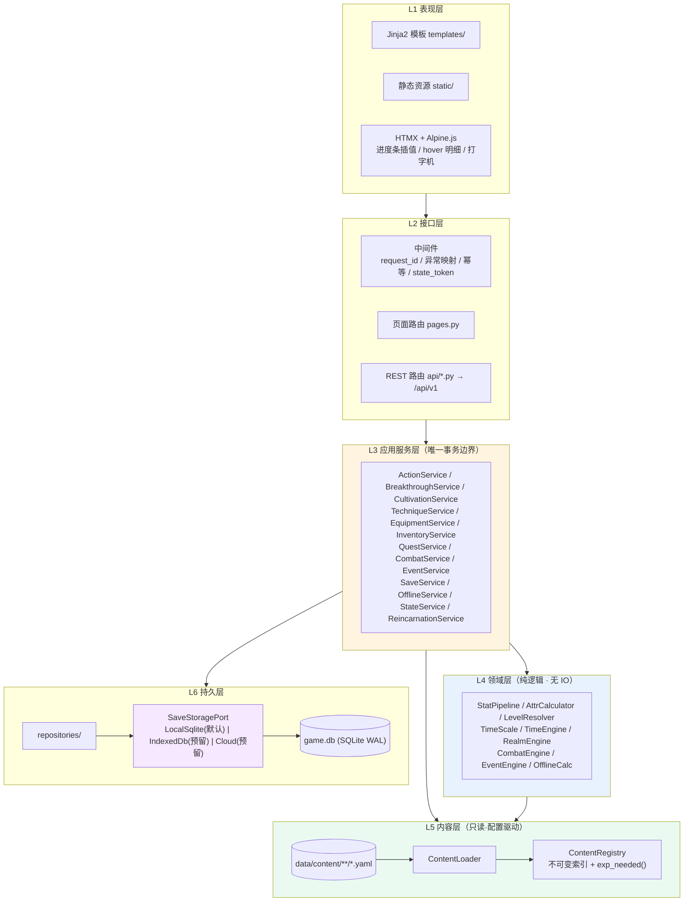
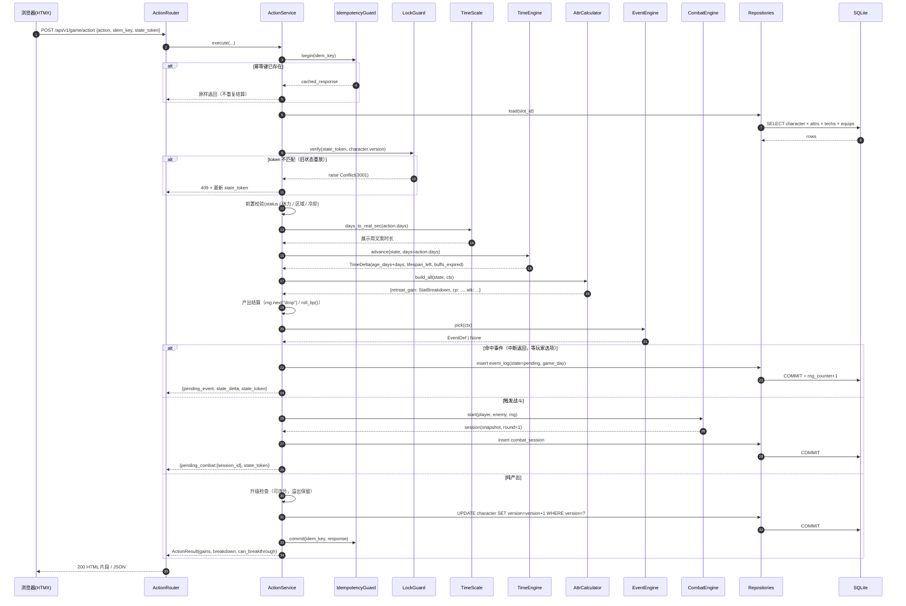

# 《荒天纪》技术方案

| 项目 | 内容 |
|---|---|
| 文档版本 | **V1.4**（对齐 PRD V1.2 + 团队裁决 C1–C10） |
| 日期 | 2026-10-21 |
| 作者 | 架构师 高见远 |
| 状态 | 待评审 |
| 关联文档 | `docs/01-PRD-产品需求文档.md`（V1.2，产品经理 许清楚） |
| 项目代号 | cultivation-game |
| V1.2 修订 | ①属性 6→**10 字段** + 新增 §3.4 属性字典（单一事实源）②功法槽 4→**10 槽**③装备槽枚举改 **6 槽 + 祭炼**④补 **Lv 1–100 派生公式**（1-based）⑤时间标度改 **游戏日为最小 tick**，新增 `time_scale.py` ⑥境界改 **英文枚举 id + display_name**⑦离线**推进年龄**（推翻 PRD 7.1 原稿）⑧突破补 **冲关准备 4 项 + 连败补偿**（修正方向）⑨战斗系数全外置 ⑩新增 `milestone_log`（人生大事记）⑪校验 7→**8 项**（含可达性 warn） |
| V1.4 修订 | ⑫时间模型收敛为**双轨制**（行动轨不映射现实时间 / 离线轨 1 现实小时 = 60 游戏日），删除 `REAL_SEC_PER_GAME_DAY` 与 `action_speedup` ⑬修为产出**保留七层乘算** `ExpRate × 30`，节奏由单一全局倍率 `exp_rate_global_bp = 1.50` 控制 → 全流程 **885 次**，红线达标（`Exp(L)×0.12×clamp` 方案已否决） ⑭体质定名 **荒天战体**（70/29/1）⑮V8 可达性扩为 4 条子规则 + 数量基线（区域 20/功法 30/事件 165/主线 81/BOSS 12）⑯`last_settle_ts`→`last_settle_at` 统一命名 ⑰新增 §0 C8/C9/C10 三条裁决记录 |

> 本文只负责**技术侧**。所有数值以「配置表字段」占位，代码硬编码数值视为缺陷。

---

## 0. 冲突与裁决状态

| # | 议题 | 状态 | 结论 / 待决 |
|---|---|---|---|
| **C1** | 前端栈 | ✅ **已裁决 · 采纳架构师** | **FastAPI + Jinja2 + HTMX + Alpine**（§1.2，8 维 36.5/40）。PRD 抬头的 Vite/React 是模板残留，产品侧已改「技术栈以技术方案 §1 为准」。`/api/v1` 保留作为 V2 退路 |
| **C2** | 存档权威源 | ✅ **已裁决 · 采纳架构师** | **服务端 SQLite 为唯一权威**；浏览器只存未提交草稿 + 最近快照；PRD 7.1 的「IndexedDB 主存」作废。保留 `SaveStoragePort` 端口（§5.4） |
| **C3** | 内容规模 8–12 万字 | ✅ 一致 | YAML 分文件 + 8 项校验；V1.0 前需上内容生产线（R2） |
| **C4** | 时间标度 | ✅ **已裁决（V1.4 定稿）** | 唯一换算 `1 游戏日 ≡ 60 现实秒`。**行动轨**按游戏日推进、不映射现实时间（闭关 30 日 / 历练 15 / 采药 10 / 切磋 3 / 突破 3）；**离线轨** `1 现实小时 = 60 游戏日`，上限 24h。`ACTION_SPEEDUP` / `action_speedup` 已删除，不得再引入 |
| **C5** | 修为曲线总量 | ✅ **已裁决 A** | 指数 `1.9 → 1.78`、`K` 表不动：累计 **3.0301 亿**（−2.26%）；`exp_exponent_bp=17800`；节点表由 `gen_exp_table.py` 生成。**闭关次数改由产出公式结构性保证**（见 C9），不再用全局倍率硬压 |
| **C6** | Lv 派生基址 | ✅ **已裁决** | `L = 9 × (realm_major − 1) + realm_minor`，`major` **1 起**、`minor` **1 起**，大帝 `L=100`。**不做 0/1 基转换层** |
| **C7** | MVP 境界粒度 | ✅ **已裁决** | **2 大境 × 9 小境 = 18 级**；`realms.yaml` 一次写满 12 境，MVP 只 `enabled: true` 前 2 条 |
| **C8** | 离线是否推进 `age_days` | ✅ **已裁决 · 推进** | 离线推进年龄并消耗寿元（`offline_advances_age: true`），结算到剩余 1 年即停、不判死。PRD §2.4 / §7.2 已同步，双方不再相反 |
| **C9** | 修为产出口径 | ✅ **已裁决** | 保留 PRD §3.3 的**七层乘算** `ExpRate × 30`，节奏由单一全局倍率 `exp_rate_global_bp = 1.50` 控制（→ 885 次）。曾评估的 `Exp(L)×0.12×clamp(...)` 方案**否决**：clamp 会把功法/环境的差异压平，破坏「数值可解释性」（PRD §8.4） |
| **C10** | 体质命名 | ✅ **已裁决** | **荒天战体**（非「太古战体」/「荒古圣体」）。3 条：凡体 70% / 灵体 29% / 荒天战体 1%，合计 100% |

---

## 1. 技术选型与决策

### 1.1 三方案对比（8 维，1–5 分）

| 维度 | A：Flask + Jinja2 + HTMX | B：FastAPI + Vue3/React 前后端分离 | **C：FastAPI + Jinja2 + HTMX + Alpine.js** |
|---|---|---|---|
| 开发效率 | 4 | 2 | **5** |
| 部署复杂度（单机/单用户） | 5 | 2 | **5** |
| 实时性匹配（无多人同步） | 4 | 5 | **4.5** |
| 可维护性 | 3（无强制校验层） | 4 | **4.5**（Pydantic 全链路） |
| 扩展性（未来 App/多端） | 3 | 5 | **4**（router 即 API） |
| 移动端自适应 | 3 | 5 | **4.5** |
| PRD 8.1 动效可实现度 | 4 | 5 | **4.5**（CSS + 少量 JS 足够） |
| 纯 Python 团队匹配 | 5 | 2 | **5** |
| **合计** | 31 | 30 | **36.5** |

### 1.2 结论与理由

**采用方案 C。** 四条理由：

1. **单语言栈**：Python + Jinja2 + CSS + 一份预编译 Tailwind 产物。无 `package.json`、无 npm、无构建链。
2. **交互形态不需要 SPA**：PRD 8.1 的 12 个界面本质是"点按钮 → 服务端结算 → 换面板"。HTMX `hx-post` + `hx-swap` 天然贴合。
3. **PRD 8.1 的动效都能用 CSS 实现**：修为条插值 = 前端拿 `retreat_gain`（一次闭关产出）本地插值 + 定期对账；打字机 = CSS steps；全屏金光/红闪 = keyframes；hover 明细 = 拉 `/stat/explain`。
4. **数值权威必须在服务端**（PRD 7.2 防作弊硬前提）。模板直出天然满足。

### 1.3 技术栈清单

| 类别 | 选型 | 版本 | 说明 |
|---|---|---|---|
| 语言 | Python | **3.11+** | `match`、`X \| None`、`tomllib` |
| 数据库 | SQLite | **≥ 3.31**（需**生成列**，见 §5.2） | Python 3.11 自带 3.37+，实测 3.53 通过 |
| Web 框架 | FastAPI | ^0.115 | 自动 OpenAPI、依赖注入、Pydantic 集成 |
| ASGI | Uvicorn | ^0.32 | 生产 `--workers 1`（§5.1） |
| 模板 | Jinja2 | ^3.1 | 服务端渲染 |
| 局部刷新 | HTMX | 2.0.x（本地 vendored，保证离线可玩） | `hx-*` 驱动 |
| 客户端状态 | Alpine.js | ^3.14 | 弹窗/Tab/hover/进度条插值 |
| 样式 | Tailwind CSS | 3.4（**预编译产物**） | `static/css/app.css` |
| ORM | SQLAlchemy | ^2.0（`Mapped[]`） | — |
| 迁移 | Alembic | ^1.13 | — |
| 配置 | pydantic-settings | ^2.5 | `.env` + 环境变量 |
| 校验 | Pydantic | ^2.9 | 请求/响应 + 配置对象 |
| 内容 | PyYAML + jsonschema | ^6.0 / ^4.23 | YAML（保留中文注释）+ 启动期 schema |
| 签名 | `hmac` + `hashlib` | 内置 | 存档签名、内容哈希 |
| 随机 | `secrets` + 自研 `RngService` | 内置 | 确定性 + 不可预测（§4.7） |
| 测试 | pytest + pytest-asyncio + httpx | ^8.3 | — |
| 质量 | ruff + mypy | ^0.7 / ^1.11 | — |
| 日志 | `logging` + `python-json-logger` | ^3.1 | JSON 结构化 |

```text
fastapi==0.115.*   uvicorn[standard]==0.32.*   jinja2==3.1.*
sqlalchemy==2.0.*  alembic==1.13.*             pydantic==2.9.*
pydantic-settings==2.5.*  pyyaml==6.0.*        jsonschema==4.23.*
httpx==0.27.*      pytest==8.3.*               python-json-logger==3.1.*
```

---

## 2. 总体架构

### 2.1 分层架构



依赖严格单向 **L1 → L2 → L3 →（L4、L5、L6）**。L4 **禁止** import SQLAlchemy/FastAPI/文件 IO，保证可被 `tools/simulate_balance.py` 直接驱动。

### 2.2 关键架构决策

| # | 决策 | 理由 |
|---|---|---|
| D1 | 玩家状态**全部落 DB**，进程内不存角色状态 | 离线收益需绝对时间锚点；多 worker 会分裂状态；便于导出回滚 |
| D2 | 静态内容**不入库**，只存 `id` 引用 + `content_version` | 改 YAML 即生效、无需迁移；库只装动态状态 |
| D3 | 内容启动期一次性加载 + **8 项校验**，构建不可变 `ContentRegistry` | 快速失败；运行期零解析开销（§5.3） |
| D4 | 随机 = 持久种子 + 单调计数器 + **按域派生流** | 可复现/可审计/防刷（§4.7） |
| D5 | 时间：**游戏日为最小 tick**，`1 游戏日 = 60 现实秒` | 与 §2.3 定论一致；领域层不出现"月" |
| D6 | 写操作走「**幂等键 + 乐观锁 version + state_token**」三重 | 双击/断网重试/旧状态重放全拦死（§5.5） |
| D7 | 存档走 `SaveStoragePort` 端口，默认 `LocalSqliteStorage` | 满足「云存档预留接口」（§5.4） |

### 2.3 时间模型（双轨制·只有两条换算）

> **背景**：此前存在三套换算（`1 游戏日 = 60 现实秒` / `action_speedup=18` / `1 现实秒 ≡ 1 游戏日`）互相打架，已引发三轮矛盾。**V1.4 收敛为两条互不相干的轨**——行动轨只管游戏日、不映射现实时间；离线轨只管"现实小时 → 游戏日"（`1 现实小时 = 60 游戏日`），**两轨之间不存在换算关系**。

#### 2.3.1 两条轨

| 轨 | 用途 | 换算 | 是否映射现实时间 |
|---|---|---|---|
| **行动轨** | 所有玩家主动操作 | 按**游戏日**推进（闭关 30 日 / 历练 15 / 采药 10 / 切磋 3 / 突破 3） | ❌ **不映射**。点一下即结算，现实耗时 ≈ 0 |
| **离线轨** | 关闭页面后回归 | `1 现实小时 = 60 游戏日`（= 1 游戏日 / 现实分钟），上限 24 小时 | ✅ 唯一消费现实时间的入口 |

```
★ 唯一离线常量：OFFLINE_GAME_DAYS_PER_REAL_HOUR = 60
   （原 REAL_SEC_PER_GAME_DAY / action_speedup 已删除，不得再引入）

行动轨：无任何"现实秒"常量
游戏内单位：1 游戏年 = 360 游戏日，1 游戏月 = 30 游戏日（仅展示用）
```

**核心节奏解释器（全文唯一）**：**一次闭关 = 30 游戏日，1 游戏年 = 12 次闭关**。于是
> 全流程 ≈ 885 次闭关 ≈ 73.8 游戏年，而 12 境寿元合计 23,750 年

玩家可心算，策划可推算，不需要任何中间换算。（寿元在本作是**成绩线**而非生死线，见 §2.3.4）

#### 2.3.2 最小 tick 与禁用单位

| 层 | 允许单位 | 禁令 |
|---|---|---|
| 领域层 `domain/*` | **游戏日（`int`）** | ❌ 禁止 "月"、"年"、"现实秒"、"游戏小时" |
| 离线模块 `domain/offline.py` | 允许 `real_hours` → `game_days` 的唯一换算 | ❌ 禁止在此之外再写第二套换算 |
| 持久层 | `age_days` / `game_day` / `last_settle_at`（现实秒） | ❌ 禁止 datetime 字符串 |
| 展示层 | 月 / 年 / "你闭关了 7 小时" | 由 `time_scale.py` 换算 |

```python
# domain/time_scale.py —— 唯一换算入口
class TimeScale:
    def __init__(self, cfg):
        self.cfg = cfg                       # cfg 来自 balance.yaml.time_scale

    # —— 行动轨：纯游戏日，不碰现实时间 ——
    def days_to_years(self, days: int) -> int:
        return days // self.cfg.game_day_per_game_year          # 360

    def years_to_days(self, years: int) -> int:
        return years * self.cfg.game_day_per_game_year

    def days_to_ymd(self, days: int) -> tuple[int, int, int]:   # 仅展示
        y, rest = divmod(days, self.cfg.game_day_per_game_year)
        m, d = divmod(rest, self.cfg.game_day_per_game_month)
        return (y, m + 1, d + 1)

    # —— 离线轨：唯一一处现实时间换算 ——
    def real_hours_to_days(self, hours: float) -> int:
        return int(hours * self.cfg.offline_game_days_per_real_hour)   # ×60
```

#### 2.3.3 行动耗时（`actions.yaml`，全部配置）

| 行动 | `days` | 折合游戏年 | 备注 |
|---|---|---|---|
| **闭关** | **30** | **0.083** | 修为主产出；寿元的天然计数器（1 年 = 12 次闭关）|
| 历练 | 15 | 0.042 | 事件 + 掉落 |
| 采药 | 10 | 0.028 | 材料 |
| 切磋 | 3 | 0.008 | 战斗 |
| 打坐 | 10 | 0.028 | 小幅恢复 / 心境 |
| 突破 | 3 | 0.008 | 失败再 + `breakthrough_cooldown_days`(30) |
| 事件 | 0–720 | 0–2 | 由 `event.time_cost_days`（PRD 以"月"表述，0–24 月 × 30） |
| 炼丹 / 炼器 | 5–30 | — | 由 `craft_days` |
| 移动 / 赶路 | 1–10 | — | 由 `region.travel_days` |

> **行动轨不映射现实时间**是刻意的：本作是回合制文字模拟，不是实时挂机。玩家点一下"闭关"，游戏内过一个月（30 游戏日），现实只花一次点击。放置感全部由离线轨承担。**行动耗时以本节表格为唯一来源，与 PRD §2.4.3 一致：闭关 30 / 历练 15 / 采药 10 / 切磋 3 / 打坐 10 / 突破 3（游戏日）。**

#### 2.3.4 寿元口径（三段式）

```
lifespan_max_year = realms[realm_id].base_lifespan_year        # 100/150/200/…/10000
                  + Σ items[].lifespan_bonus_year              # 延寿丹药，累计上限 +2000
                  + Σ flags.lifespan_bonus_year                # 功法/体质/道相，累计上限 +500
lifespan_max_days = lifespan_max_year × 360                    # 缓存列，便于排序/展示
寿命剩余(年)      = lifespan_max_year − age_days // 360
```

| 规则 | 说明 |
|---|---|
| **突破成功 → `lifespan_max` 整体重算** | `= 新境基准 + 全部 bonus`，**不是加差值**。这是大境界突破的核心爽点（锻血→辟府净增 50 年，大圣→准帝净增 2,000 年） |
| 突破失败 | 不改 `lifespan_max`，但 `age_days` 照常推进 |
| **离线推进 `age_days`** | 与在线同一口径（`advance_age: true`） |
| **寿元耗尽钳制** | 结算停在**剩余 1 年（360 日）**，提示"你在闭关中惊醒，寿元将尽"，**不判死** |

> **为什么必须离线扣寿元**：若离线不扣，则"离线白拿产量、在线每次都付寿元"——**挂机成为严格优于在线的最优策略**，直接击穿 PRD 2.1 支柱 P3。PRD §2.4.5 / §7.2 已同步为 `offline_advances_age: true`（第四节复核结论一致）。

**寿元与闭关次数的自洽性（`test_balance.py` 断言）**

| 检查 | 结果 |
|---|---|
| 锻血全境（9 级）需要几次闭关 | **75 次**（9 级 × 8.33 次/级，每次 30 游戏日）|
| 折合游戏年 | 75 × 30 / 360 = **6.25 年** |
| 锻血寿元上限 100 年 = 多少游戏日 | 36,000 日 = **1,200 次闭关**（闭关当量） |
| 寿元占比 | **1.2%（锻血最紧）** —— 寿元**不是**硬约束（断言阈值 30%） |
| 12 境寿元合计 | 23,750 年 >> 全流程 **≈885 次闭关**（≈73.8 游戏年，占 0.31%）✔ |

> **口径说明**：本作放弃"寿元生死线"（否则与"离线不暴毙"、「回合制快节奏」三者不可兼得，详见 PRD §2.4.6）。寿元的作用转为**成绩线**：`§3.7.3 根基评价` 以「本境突破尝试次数」为主判据（1 次=圆满 +5%、2 次=扎实 +2%、3 次=虚浮 −3%、≥4 次=崩坏 −8%），次数记在 `character.realm_attempts`，评级落 `character.foundation_grade`。`test_balance.py` 断言的是"任一境界的闭关消耗 ≤ 该境寿元上限的 30%"，而非"刚好够用"。

#### 2.3.5 离线换算（唯一一套）

```
elapsed_sec   = max(0, now_ts − last_settle_at)          # 现实秒，含回拨检测
elapsed_sec   = min(elapsed_sec, 24 × 3600)              # 上限 24h
age_days_adv  = int(elapsed_sec / 60)                    # ★ 年龄按「实际时长」推进：1 游戏日 / 现实分钟
eff_hours     = 三段衰减积分(elapsed_sec)                 # 秒 → 有效小时（§4.9）
out_days      = int(eff_hours × OFFLINE_GAME_DAYS_PER_REAL_HOUR)   # ×60，产出基准
修为           = 闭关产出 × (out_days / 30)
寿元消耗       = age_days_adv                             # ★ 变老不打折，只有产出打折
```

> **两个量必须分开**：`age_days_adv`（年龄，按实际时长）与 `out_days`（产出，按效率折算）。混用会导致"离线效率低就连寿命都不老"，等于变相奖励低效率挂机。24h 满挂：年龄 +1,440 日（4 游戏年），产出按 840 有效日（2.33 游戏年）折算 —— 与 PRD §2.4.4 的"寿元消耗 4 年"一致。

**离线量级（供产品核对 UX）**

| 离线 | 有效小时 | 游戏日 | 游戏年 | 锻血（100 年）占比 | 闭关当量 |
|---|---|---|---|---|---|
| 2h | 2.0 | 120 | 0.33 | 0.33% | 4 次 |
| 8h | 6.8 | 408 | 1.13 | 1.13% | 13 次 |
| 12h | 8.6 | 516 | 1.43 | 1.43% | 17 次 |
| **24h** | **14.0** | **840** | **2.33** | **2.33%** | **28 次** |

> **为什么离线给得这么"克制"（24h ≈ 28 次闭关，占全流程 885 次的 3.2%）**：本作是**有限内容**的回合制文字游戏（一周目 8–12 小时、885 次闭关）。若把 `offline_game_days_per_real_hour` 提到 360（即"1 现实小时 = 1 游戏年"），24h 就是 **288 次闭关（32.5%）**、**挂机 3 天即通关**——等于挂机一个月通关一半，主动玩法被直接跳过。离线在这里的定位是**不惩罚不上线的人**，而不是替代上线。
>
> 该值是**唯一可调旋钮**（`balance.yaml: offline_game_days_per_real_hour`，当前 60；Alpha 期最多可上调至 120，仍不构成挂机通关）。改数字即可，代码零改动。

---

## 3. 模块划分与目录结构

### 3.1 目录树（文件级）

```text
cultivation-game/
├── pyproject.toml                     # 元数据、ruff/mypy/pytest 配置
├── requirements.txt                   # 依赖锁定
├── .env.example                       # DB 路径 / SAVE_SIGN_SECRET / 阶段开关
├── alembic.ini
├── README.md                          # 启动、内容编辑、调参指南
├── run.py                             # 本地启动（uvicorn 封装）
├── app/
│   ├── main.py                        # 装配：中间件、路由、启动钩子（加载+校验内容）
│   ├── config.py                      # Settings
│   ├── deps.py                        # get_session / get_registry / get_slot
│   ├── core/
│   │   ├── errors.py                  # GameError 体系 + 错误码枚举
│   │   ├── response.py                # ok()/fail()、统一响应壳
│   │   ├── logging.py                 # JSON 日志 + request_id
│   │   ├── clock.py                   # now_ts() / now_game_day()，可冻结
│   │   ├── rng.py                     # RngService：种子派生流 + 计数器
│   │   ├── signing.py                 # HMAC 存档签名 / state_token
│   │   ├── idempotency.py             # 幂等键守卫 + 响应缓存
│   │   └── locking.py                 # 乐观锁 CAS + state_token 校验
│   ├── domain/
│   │   ├── models.py                  # CharacterState / StatBreakdown / StatModifier / Buff
│   │   ├── enums.py                   # AttrKey / RealmKey / SlotType / Status / ActionType
│   │   ├── level.py                   # ★ LevelResolver：Lv ↔ (major, minor) 纯函数换算
│   │   ├── time_scale.py              # ★ TimeScale：日/月/年/现实秒 唯一换算
│   │   ├── stats.py                   # ★ StatPipeline：统一 add/mul 叠算 + 明细（§4.1）
│   │   ├── attrs.py                   # 10 基础属性 + 13 衍生属性（§4.2）
│   │   ├── realm.py                   # RealmEngine：突破判定、冲关准备、连败补偿、三档惩罚
│   │   ├── time_engine.py             # ★ 推进 game_day、寿元、Buff 到期（最小 tick=日）
│   │   ├── combat.py                  # CombatEngine：半自动 + 手动术法回合结算
│   │   ├── events.py                  # EventEngine：权重池、条件、判定、效果
│   │   ├── effect_ops.py              # 效果 op 注册表
│   │   ├── cond_ops.py                # 条件 op 注册表
│   │   ├── quests.py                  # 任务状态机
│   │   ├── offline.py                 # 离线收益（§4.8）
│   │   ├── reincarnation.py           # 轮回继承结算（V1.1）
│   │   └── numbers.py                 # 数值常量唯一入口（全部从 registry 取）
│   ├── content/
│   │   ├── loader.py                  # 扫描/合并/校验/哈希
│   │   ├── schemas.py                 # 各 YAML 的 JSON Schema
│   │   ├── validators.py              # ★ 8 项校验（§5.3）
│   │   ├── registry.py                # ★ 不可变索引 + exp_needed(level) / exp_sum(a,b)
│   │   ├── overlay.py                 # ±30% 调参覆盖层
│   │   ├── reachability.py            # ★ 可达性/连通性分析（warn 而非 crash）
│   │   └── ip_guard.py                # ★ 术语黑名单扫描（§8）
│   ├── db/
│   │   ├── base.py / session.py       # PRAGMA(WAL/FK/busy_timeout)
│   │   ├── tables.py                  # ORM 表定义（对应 §5.2）
│   │   └── migrations/versions/0001_init.py
│   ├── repositories/
│   │   ├── character_repo.py          # 角色+属性，CAS 更新
│   │   ├── slot_repo.py               # 存档槽位 + 快照
│   │   ├── progress_repo.py           # 功法/装备/背包/任务/道相/成就
│   │   ├── relation_repo.py           # NPC 好感/因果双轴
│   │   ├── log_repo.py                # 事件/里程碑/战斗/统计/离线结算
│   │   ├── codex_repo.py              # 图鉴（跨轮世永久）
│   │   └── meta_repo.py               # meta KV / 幂等键
│   ├── services/
│   │   ├── bootstrap.py               # ★ 创角：服务端掷体质/资质/性格
│   │   ├── action_service.py          # ★ 行动主流程（事务根）
│   │   ├── cultivation_service.py     # 修炼、参悟、加点
│   │   ├── level_service.py           # ★ 改 level 的唯一入口（同步派生 realm_*）
│   │   ├── breakthrough_service.py    # 突破：准备项 → 判定 → 惩罚
│   │   ├── technique_service.py       # 学习/装备/参悟（含走火入魔）
│   │   ├── equipment_service.py       # 强化/精炼/镶嵌/祭炼
│   │   ├── inventory_service.py       # 使用/分解/出售/整理
│   │   ├── quest_service.py           # 接取/推进/交付
│   │   ├── combat_service.py          # 战斗会话 + 回合 + 奖励
│   │   ├── event_service.py           # 事件抽取/选项提交
│   │   ├── save_service.py            # 快照/导入导出/签名/迁移
│   │   ├── offline_service.py         # ★ 离线结算（推进年龄 + 幂等）
│   │   ├── reincarnation_service.py   # 轮回结算（V1.1）
│   │   ├── milestone_service.py       # ★ 人生大事记写入
│   │   ├── codex_service.py           # 图鉴解锁
│   │   └── state_service.py           # 主界面聚合快照
│   ├── storage/                       # ★ 存档后端端口（§5.4）
│   │   ├── port.py                    # SaveStoragePort Protocol
│   │   ├── local_sqlite.py            # 默认实现
│   │   ├── indexeddb_stub.py          # 预留
│   │   └── cloud_stub.py              # 预留
│   ├── api/
│   │   ├── router.py / pages.py / schemas.py
│   │   ├── game.py action.py cultivation.py inventory.py quest.py
│   │   ├── event.py combat.py save.py codex.py milestone.py
│   ├── web/
│   │   ├── templates/
│   │   │   ├── base.html              # 骨架：HTMX/Alpine/Tailwind + 色彩变量(PRD 8.3)
│   │   │   ├── layout/header.html layout/nav.html
│   │   │   ├── pages/                 # 12 界面：index/character/cultivation/
│   │   │   │                          # techniques/inventory/quests/map/combat/
│   │   │   │                          # event/breakthrough/saves/ending/timeline
│   │   │   └── partials/              # status_panel/action_result/log_stream/
│   │   │                              # stat_breakdown(★hover 明细)/toast/skeleton
│   │   └── static/css/app.css js/app.js
├── data/
│   ├── content/
│   │   ├── manifest.yaml              # 版本号 + 文件清单 + 哈希
│   │   ├── realms.yaml                # ★ 12 境全量（enabled 控制 MVP 启用）
│   │   ├── attrs.yaml                 # 10 基础属性 + 13 衍生系数 + 软上限
│   │   ├── stats.yaml                 # 修炼速度/战力的乘算层定义
│   │   ├── actions.yaml               # ★ 行动耗时/消耗/产出系数（含持续闭关批量）
│   │   ├── exp_table.yaml             # ★ 100 级修为需求表（gen_exp_table.py 生成，禁止手写）
│   │   ├── balance.yaml               # ★ 全局数值：时间标度、战斗系数、离线上限
│   │   ├── techniques.yaml            # 15 档 × 9 层
│   │   ├── arts.yaml                  # 宝术/神通（MVP 关）
│   │   ├── daoxiang.yaml              # 道相（MVP 关）
│   │   ├── physiques.yaml             # 6 体质（MVP 启用 3）
│   │   ├── talents.yaml               # 资质 1–10 品
│   │   ├── personalities.yaml         # 5 性格
│   │   ├── items.yaml affixes.yaml gems.yaml
│   │   ├── regions.yaml enemies.yaml npcs.yaml
│   │   ├── events/vol1.yaml random_pool.yaml …
│   │   ├── quests/main_vol1.yaml side_quests.yaml bounties.yaml
│   │   ├── text/                      # ★ 文案表（text_key → 正文），与逻辑分离
│   │   │   ├── ev_vol1.zh.yaml
│   │   │   └── ui.zh.yaml
│   │   ├── achievements.yaml codex.yaml endings.yaml
│   │   └── balance/overlay_alpha.yaml # ±30% 调参覆盖层
│   └── terms/
│       ├── terms.yaml                 # ★ 发布：id → display_name（零禁用词）
│       ├── blacklist.txt              # ★ 发布：禁用词清单（由 ref_map 自动生成）
│       └── ref_map.yaml               # ★ 禁止打包：id → 禁用原名（仅法务自查）
├── tests/
│   ├── conftest.py
│   ├── test_stats.py test_level.py test_time_scale.py
│   ├── test_realm.py test_combat.py test_events.py test_offline.py
│   ├── test_rng_determinism.py test_api.py test_content.py test_ip_guard.py
└── tools/
    ├── validate_content.py            # 8 项校验 CLI（CI 必跑）
    ├── simulate_balance.py            # 1000 局平衡模拟 → CSV
    ├── gen_exp_table.py               # ★ 修为需求表生成/校验（禁止手写节点表）
    └── export_save.py                 # 导出/修复/重签名
```

### 3.2 模块清单

| 模块 | 职责 | 对外接口 | 依赖 | 行数 |
|---|---|---|---|---|
| `domain/level` | **Lv ↔ (major,minor) 唯一换算** | `to_level(major,minor)`, `from_level(L)`, `is_capped(L)` | — | 80 |
| `domain/time_scale` | **日/月/年/现实秒 唯一换算** | `real_sec_to_days()`, `days_to_years()`, `days_to_month_day()` | balance | 90 |
| `domain/stats` | 统一叠算管线 | `compute(stat, base, mods, mode, cap, explain)` | numbers | 240 |
| `domain/attrs` | 10 属性 + 13 衍生 | `build_all(state, ctx) -> dict[str, StatBreakdown]` | stats, numbers | 340 |
| `domain/realm` | 突破判定 + 准备项 + 连败补偿 | `rates(state, prep)`, `attempt()`, `penalty_tier()` | stats, numbers | 300 |
| `domain/time_engine` | 以**日**推进 | `advance(state, days)` | time_scale, numbers | 120 |
| `domain/combat` | 回合结算 | `start()`, `resolve(action)` | stats, rng | 450 |
| `domain/events` | 抽取/判定/效果 | `pick()`, `apply_choice()` | cond_ops, effect_ops, rng | 300 |
| `domain/offline` | 离线收益 | `settle(state, real_sec)` | time_scale, numbers | 180 |
| `content/validators` | 8 项校验 | `validate_all(registry)` | schemas, reachability | 320 |
| `content/reachability` | 可达性 warn | `analyze() -> list[Warning]` | — | 120 |
| `content/ip_guard` | 术语黑名单 | `scan(text)` | terms | 90 |
| `services/action` | 行动编排 | `execute(...)` | 几乎全部 | 350 |
| `services/save` | 快照/签名/迁移 | `dump/load/export/import` | storage, repos | 300 |
| `services/offline` | 离线 + 推进年龄 | `settle_if_needed(slot)` | domain/offline | 130 |
| `api/*` | 路由 | 40 端点 | services | 680 |
| `web/templates` | 13 界面 + 片段 | — | — | 1,200 |

### 3.3 核心类清单

| 类 | 职责 | 关键属性 | 关键方法 |
|---|---|---|---|
| `LevelResolver` | Lv ↔ 境界纯函数 | — | `to_level(major, minor)`, `from_level(L) -> (major, minor)` |
| `LevelService` | 改 level 的唯一入口 | `repo` | `set_level(char, new_level, reason) -> LevelChange` |
| `TimeScale` | 时间换算 | `cfg` | `real_sec_to_days()`, `days_to_years()`, `days_to_month_day()` |
| `CharacterState` | 角色运行时快照 | `id, name, level, realm_major, realm_minor, cultivation, hp, mp, age_days, lifespan_max_days, status, fail_streak, realm_attempts, foundation_grade, region_id, seed, rng_counter, last_settle_at, version` | `can_breakthrough()`, `life_left_years()` |
| `StatModifier` | 单条加成（UI 可解释最小单位） | `stat, source, kind(add/mul), value, label, order` | `to_dict()` |
| `StatBreakdown` | 一次计算的完整明细 | `stat, base, adds[], muls[], final, formula` | `to_formula()`, `to_json()` |
| `StatPipeline` | 统一叠算引擎 | `scale` | `compute(stat, base, mods, mode, cap, explain)` |
| `AttrCalculator` | 组装 10 属性 + 13 衍生 | `registry` | `build_all(state, techs, equips, ctx)` |
| `RealmEngine` | 突破 | `registry` | `rate_breakdown(state, prep)`, `attempt(state, prep, rng)`, `penalty_tier(rate)` |
| `TimeEngine` | 时间推进（日） | `time_scale` | `advance(state, days)` |
| `TechniqueInstance` | 功法实例 | `technique_id, layer, sense, equipped_slot(0–9)` | `advance_sense()`, `can_level_up()` |
| `EquipmentInstance` | 装备实例 | `item_id, slot, rarity, enhance_level, refine_level, natal_level, sockets[], affixes[]` | `effective_mods()` |
| `CombatEngine` | 半自动回合引擎 | `player, enemy, round, chain_count, rng, log` | `resolve(action)`, `is_over()`, `escape_roll()` |
| `EventEngine` | 事件抽取与判定 | `registry, rng` | `pick(ctx)`, `resolve_check(opt, ctx)`, `apply_choice()` |
| `ConditionEval` / `EffectExec` | 条件/效果 DSL | `op_registry` | `eval_all()`, `apply()` |
| `RngService` | 确定性随机 | `seed, counter` | `next(stream)`, `roll_bp(p)`, `weighted()` |
| `OfflineCalc` | 离线收益 | `registry, time_scale` | `settle(state, real_sec) -> OfflineReport` |
| `SaveStoragePort` | 存档后端协议 | `name` | `read/write/list/delete` |
| `SaveService` | 序列化/签名/迁移 | `port, repos` | `dump/load/export_file/import_file` |
| `ActionService` | 行动编排（事务根） | 全部 repo + domain | `execute(slot, action, params, idem, token)` |
| `MilestoneService` | 人生大事记 | `repo` | `record(kind, payload)` |
| `ContentRegistry` | 不可变内容索引 | `realms, techniques, items, events, version, hash` | **`exp_needed(L)`**, **`exp_sum(a, b)`**, `realm_of_level(L)` |

### 3.4 ★ 属性字典（单一事实源）

> **这是全项目属性的唯一命名权威。** DDL、Python Enum、YAML、前端**必须**与本表一致；出现第二套命名即视为缺陷。

| # | 中文名 | PRD 缩写 | **数据库字段** | **Python Enum** | 初值 | 软上限 | 用途 |
|---|---|---|---|---|---|---|---|
| 1 | 力量 | STR | `str` | `AttrKey.STR` | 10 | 9,999 | 物理攻击、破防、负重 |
| 2 | 体魄 | CON | `con` | `AttrKey.CON` | 10 | 9,999 | 气血上限、减伤、抗毒 |
| 3 | 灵力 | SPR | `spr` | `AttrKey.SPR` | 10 | 9,999 | 灵力上限、术法威力、炼丹 |
| 4 | 神识 | SEN | `sen` | `AttrKey.SEN` | 10 | 9,999 | **感知/命中/暴击**、探查、参悟 |
| 5 | 根骨 | BON | `bon` | `AttrKey.BON` | 10 | 999 | **突破率**、属性成长率 |
| 6 | 悟性 | WIS | `wis` | `AttrKey.WIS` | 10 | 500 | **修炼速度**、功法参悟、暴伤 |
| 7 | 身法 | AGI | `agi` | `AttrKey.AGI` | 10 | 9,999 | 先手、闪避、逃跑 |
| 8 | 气运 | LUK | `luk` | `AttrKey.LUK` | 5 | 100 | 掉落品质、事件好结果率 |
| 9 | 道心 | MND | `mnd` | `AttrKey.MND` | 10 | 100 | **心境系数**、心魔抗性、突破 |
| 10 | 因果 | KAR | `kar` | `AttrKey.KAR` | 0 | **−1,000 ~ +1,000**（双向，非软上限） | 招劫/遇贵人、突破率修正 |

**命名裁决（回应 team-lead 指出的歧义）**

| 问题 | 裁决 |
|---|---|
| `insight` 歧义 | **废弃**。V1.0 用 `insight` 同时指"神识"和"悟性"，是错误。现拆为 `sen`（神识，感知/命中）与 `wis`（悟性，修炼速度）。 |
| `power` 歧义 | **废弃**。V1.0 的 `power` ≡ 力量，现统一为 `str`。**DLL 与 PRD 不允许两套命名并存**。 |
| Python 属性名冲突 | DB 列名用 `str`（SQLite 允许），但 Python 侧**不得**定义名为 `str` 的实例属性（遮蔽内建）。统一用 `state.attr["str"]` 字典访问 + `AttrKey.STR` 枚举。`CharacterState` 上加 `__getattr__` 不做转发，避免隐式遮蔽。 |
| 因果可为负 | `kar INTEGER NOT NULL DEFAULT 0 CHECK (kar BETWEEN -1000 AND 1000)` |
| 软上限存哪 | `attrs.yaml` 的 `soft_cap` 字段（**不写进 DDL**，便于调参） |

---

## 4. 核心引擎设计

### 4.1 统一 StatModifier 体系（乘算 + hover 明细）

**PRD 三套公式同构**：

```
最终值 = (base + Σ add) × Π (mul_bp / 10000)
```

| PRD 公式 | base | add 项 | mul 项 |
|---|---|---|---|
| 修炼速度（3.3） | `5 + wis×0.8` | — | 境界、心法、体质、环境、心境、状态（6 层） |
| 战力 CP（3.4） | `Σ 属性×系数`（含 `bon×0.8`） | — | 境界系数、小境界、功法、装备、道相、体质（6 层） |
| 突破成功率（3.6） | `P_base` | 根骨、丹药、灵地、心境、因果、体质、**冲关准备**、**连败补偿**（8 项） | — |
| 基础属性 | 属性初值 | 加点、丹药固定值 | 心法%、体质%、道相%、Buff |

**四条硬约束**

1. **全整数运算**：系数一律**万分比整数 `bp`**（10000 = ×1.0）。`wis × 0.8` 写作 `wis × 8000`。**禁止 float 进管线**——战力跨 12 境到 1e9，float 累积误差会让面板与结算不一致。
2. **乘法只做一次除法**：先 `mul_prod = Π mul_bp`（整数连乘），末尾 `final = (base + Σadd) × mul_prod // 10000 // 10000`。**逐层除法会丢精度**。
3. **`order` 只影响展示顺序**，不影响结果（加法/乘法交换律）。
4. **`explain=True` 才拼明细字符串**，避免每次请求都做字符串运算。

```python
# domain/stats.py —— 可直接翻译为 Python
class Kind(StrEnum):
    ADD = "add"      # 加法：value 为绝对值（bp）
    MUL = "mul"      # 乘法：value 为 bp，10000 = ×1.0

@dataclass(frozen=True)
class StatModifier:
    stat: str          # "atk" / "retreat_gain" / "cp" / "break_rate"
    source: str        # realm|sub_realm|technique|physique|env|mood|state|equip|daoxiang|buff|talent|prep|pity
    kind: Kind
    value: int
    label: str         # UI 文案，如 "《枯荣经》第9层"
    order: int = 0

@dataclass
class StatBreakdown:
    stat: str
    base: int
    adds: list[StatModifier] = field(default_factory=list)
    muls: list[StatModifier] = field(default_factory=list)
    final: int = 0
    formula: str = ""
    capped: bool = False        # 是否被 cap 截断（UI 显示"已达上限"）

def compute(stat, base, mods, mode="add_mul", cap=None, explain=True) -> StatBreakdown:
    adds = sorted([m for m in mods if m.kind is Kind.ADD], key=lambda m: m.order)
    muls = sorted([m for m in mods if m.kind is Kind.MUL], key=lambda m: m.order)

    v = base + sum(m.value for m in adds)
    if mode == "add_mul":
        prod = 10000
        for m in muls:
            prod = prod * m.value // 10000       # 连乘，但不逐层作用于 v
        v = v * prod // 10000
    # mode == "add_only"：突破率，只加不乘

    capped = False
    if cap is not None:
        lo, hi = cap
        if v < lo: v, capped = lo, True
        elif v > hi: v, capped = hi, True

    bd = StatBreakdown(stat, base, adds, muls, v, capped=capped)
    if explain:
        bd.formula = to_formula(bd, cap)
    return bd
```

**三套公式落地**

```python
# ① 一次闭关的修为产出（PRD §3.3 定稿：七层乘算 × 30 日 × 全局倍率）
#    ExpRate(修为/游戏日) = (5 + 悟性×0.8) × (1+0.35×(境−1)) × 功法 × 体质 × 环境 × 心境 × 状态 × 全局倍率
#    一次闭关产出 = ExpRate × 30（一次闭关 = 30 游戏日）
def exp_rate(state, ctx) -> StatBreakdown:
    base = 50000 + int(state.attr["wis"] * 0.8 * 10000)      # 5 + 悟性×0.8，全 bp 整数
    steps = [                                                # 乘法项，顺序固定、不可重排
        ("realm",     realm_slope_bp(state)),                # 1 + 0.35×(境−1)
        ("technique", tech_exp_mult_bp(ctx)),                # §4.4，1.00–2.80
        ("physique",  phys_exp_mult_bp(ctx)),                # §4.7，1.00–1.80
        ("env",       region_exp_mult_bp(ctx)),              # §6.6，1.0–5.0
        ("mood",      mood_mult_bp(state)),                  # 道心档位 0.75–1.20
        ("state",     status_mult_bp(state)),                # 正常/心境裂隙/走火入魔/双修
        ("global",    CFG.exp_rate_global_bp),               # 1.50，★ 唯一节奏旋钮
    ]
    return StatBreakdown(stat="exp_rate", base=base, steps=steps)   # final = 万分之修为/日

def retreat_gain(state, ctx) -> StatBreakdown:
    bd = exp_rate(state, ctx)
    bd.stat  = "retreat_gain"
    bd.final = bd.final * CFG.retreat_days // 10000          # × 30 日
    bd.formula = f"({bd.base_formula()}) × 30 日 = {bd.final / 10000:,.0f}"
    return bd
```

> **为什么保留七层乘算、不用「按本级需求百分比」的写法**：曾有一版把产出写成 `Exp(L) × 0.12 × clamp(加成乘积/1.15, 0.6, 1.6)`，工程上确实能结构性卡住闭关次数，但 `clamp` 会把功法（1.0–2.8）、环境（1.0–5.0）的差异压平到 2.7 倍以内——玩家在界面上看到「心法 ×2.80」，实际只涨 1.6 倍，直接违反 PRD §8.4「数值可解释性」。因此节奏控制改由**单一全局倍率 `exp_rate_global_bp = 1.50`** 承担，七层乘算原样保留、可逐项展开。

```python
# ② 战力 CP（PRD 3.4，6 层乘算；base 含根骨×0.8）
CP_COEF = {"str": 20000, "con": 18000, "spr": 15000, "sen": 12000, "agi": 10000, "bon": 8000}
def combat_power(state, ctx) -> StatBreakdown:
    base = sum(state.attr[k] * c // 10000 for k, c in CP_COEF.items()) * 10000
    mods = [
        StatModifier("cp", "realm",     MUL, realm_cp_coef_bp(state),                        "境界战力系数", 10),
        StatModifier("cp", "sub_realm", MUL, 10000 + 1000 * (state.realm_minor - 1),          "小境界", 20),
        StatModifier("cp", "technique", MUL, 10000 + tech_cp_bp(ctx),                         "功法", 30),
        StatModifier("cp", "equip",     MUL, 10000 + equip_cp_bp(ctx),                        "装备", 40),
        StatModifier("cp", "daoxiang",  MUL, 10000 + daoxiang_cp_bp(ctx),                     "道相", 50),
        StatModifier("cp", "physique",  MUL, 10000 + phys_cp_bp(ctx),                         "体质", 60),
    ]
    return compute("cp", base, mods)

# ③ 突破成功率（PRD 3.6 + 3.6.1，8 项加法 + clamp[500,9500]，保底那次 10000）
def break_rate(state, prep, ctx) -> StatBreakdown:
    base = realm_break_base_bp(state)
    mods = [
        StatModifier("break_rate", "bon",      ADD, delta_bon_bp(state),          "根骨", 10),
        StatModifier("break_rate", "pill",     ADD, prep.pill_bonus_bp,            "丹药", 20),
        StatModifier("break_rate", "guardian", ADD, prep.guardian_bonus_bp,        "护法", 25),
        StatModifier("break_rate", "omen",     ADD, prep.omen_bonus_bp,            "吉日", 27),
        StatModifier("break_rate", "land",     ADD, prep.land_bonus_bp,            "灵地", 30),
        StatModifier("break_rate", "mood",     ADD, delta_mood_bp(state),          "心境", 40),
        StatModifier("break_rate", "karma",    ADD, delta_karma_bp(state),         "因果", 50),
        StatModifier("break_rate", "physique", ADD, delta_phys_bp(ctx),            "体质", 60),
        StatModifier("break_rate", "pity",     ADD, delta_pity_bp(state),          "连败补偿", 70),
    ]
    r = compute("break_rate", base, mods, mode="add_only", cap=(500, 9500))
    if state.fail_streak >= cfg.guaranteed_after_fails:      # 第 N+1 次必成
        r.final, r.capped = 10000, True                      # ★ 突破 clamp 上限
        r.formula = "保底必成（连败 {} 次）".format(state.fail_streak)
    return r
```

> **UI 接口**：`GET /api/v1/stat/explain?key=retreat_gain` 返回 `StatBreakdown.to_json()`，前端 `partials/stat_breakdown.html` 渲染 PRD 8.4 的 hover 明细。**明细只由后端生成**，前端不算任何数。

### 4.2 衍生属性（13 项，不落库，公式参数全在 `attrs.yaml`）

| key | 公式 | 上限 |
|---|---|---|
| `hp_max` | `50 + con×12 + isqrt(realm_cp)×80` | — |
| `mp_max` | `30 + spr×10 + isqrt(realm_cp)×60` | — |
| `atk` | `str×2.2 + weapon_atk` | — |
| `def` | `con×1.2 + armor_def` | — |
| `dr` | `def/(def + 500 + isqrt(realm_cp)×300)` | 75% |
| `pen` | `str×1.5 + sen×0.5` | — |
| `cr` | `5% + sen×0.03% + agi×0.02%` | 60% |
| `cd` | `150% + wis×0.2%` | 300% |
| `hit` | `85% + sen×0.03%` | 99% |
| `eva` | `3% + agi×0.04%` | 40% |
| `init` | `agi×1.5 + sen×0.5` | 先手判定 |
| `mr` | `mnd×1.5 + mood_bonus` | 抗心魔/幻境/魅惑 |
| `cp` | §4.1 ② | — |

> `^0.5` 用**整数牛顿法 `math.isqrt`**，避免 float。所有系数（2.2/1.2/500/300/0.03…）从 `attrs.yaml` 取，**代码内不得出现魔法数字**。

### 4.3 等级 → 境界派生（`level` 为唯一权威）

**裁决依据（team-lead 定论）：`level` 是唯一权威列，`realm_major` / `realm_minor` 必须是派生列，禁止双写。**

```python
# domain/level.py —— 纯函数，无状态
def to_level(realm_major: int, realm_minor: int) -> int:
    """major 1..12（1=锻血…11=准帝, 12=大帝）；minor 1..9（大帝恒 1）"""
    return 9 * (realm_major - 1) + realm_minor

def from_level(level: int) -> tuple[int, int]:
    """1..100 → (major, minor)。Lv100 → (12,1)，通用公式天然覆盖，无需特例"""
    return ((level - 1) // 9 + 1, (level - 1) % 9 + 1)
```

**校验样例**（`test_level.py` 断言）：`(1,1)→1`、`(1,9)→9`、`(2,1)→10`、`(11,9)→99`、`(12,1)→100`；1–100 全区间 `to/from` 互逆。

**DB 层用生成列反算，从物理上杜绝双写漂移**（已实测，SQLite ≥3.31）：

```sql
level        INTEGER NOT NULL DEFAULT 1 CHECK (level BETWEEN 1 AND 100),   -- ★ 唯一权威，只写这一列
realm_major  INTEGER GENERATED ALWAYS AS ((level - 1) / 9 + 1) STORED,     -- 派生
realm_minor  INTEGER GENERATED ALWAYS AS ((level - 1) % 9 + 1) STORED      -- 派生
```

> `(level-1)/9` 在 SQLite 中为整数除法；`Lv100 → (99/9)+1 = 12`、`99%9+1 = 1`，通用公式天然覆盖大帝，**不需要 CASE 特例**。已验证 5 个关键点全对、派生列可建索引。

**服务层唯一入口**（防止有人绕过生成列去写 `realm_*`）：

```python
# services/level_service.py —— 全项目唯一允许改 level 的地方
def set_level(char: CharacterState, new_level: int, *, reason: str) -> LevelChange:
    assert 1 <= new_level <= 100, "level 越界"
    old = char.level
    char.level = new_level
    char.realm_major, char.realm_minor = from_level(new_level)   # 仅用于内存态，落库由生成列算
    return LevelChange(old=old, new=new_level, reason=reason,
                       major_up=(from_level(new_level)[0] > from_level(old)[0]))
```

**硬约定（写进附录 A 第 11 条）**：**任何地方不得只改 `realm_*` 而不改 `level`**。ORM 侧 `realm_major/minor` 映射为只读属性；写入尝试直接抛异常。

**修为需求表：构建期生成、运行期查表（不用运行时 pow）**

```yaml
# data/content/exp_table.yaml —— 由 tools/gen_exp_table.py 生成，禁止手写
# 注意：这里的 generated_from 只是「出处证明」，不是配置源；唯一配置源是 balance.yaml.exp_curve
exp_table:
  version: "gen-1.78-v1"
  generated_from:               # 生成器参数快照，加载时与 balance.yaml 比对，不一致即报错
    base: 100
    exponent_bp: 17800
    k_table_hash: "sha256:9f2c…"    # realms.yaml 中 K 表的哈希
  checked_total: 303005690      # 1→99 累计，CI 断言
  table: [100, 343, 706, …, 14978900]   # 长度 99，index = L-1；由 gen_exp_table.py 生成，禁止手写
```

> **单一事实源约束**：`base` / `exponent_bp` 的**权威值只在 `balance.yaml.exp_curve`**；`exp_table.yaml.generated_from` 只做溯源，加载时若与权威值不符 → **V3 报 error 拒绝启动**。这样既不会两处配置打架，又能追溯"这张表是用什么参数生成的"。

```python
# content/registry.py —— 运行期零浮点、零 pow、跨平台确定性
def exp_needed(self, level: int) -> int:
    """升到下一级所需修为；level ∈ [1,99]，Lv100 已封顶返回 0"""
    if level >= 100: return 0
    return self.exp_table[level - 1]

def exp_sum(self, from_level: int, to_level: int) -> int:
    """区间累计；离线『修为截断 3 级』依赖此接口预读未来 3 级阈值"""
    hi = min(to_level, 100)
    return sum(self.exp_table[L - 1] for L in range(from_level, hi))
```

> **为什么改成查表**：`L^1.78` 在 Python 里是 float，`math.pow` 在不同平台/版本可能有 1 ULP 差异，会导致"同一存档两台机器算出不同修为需求"。构建期用 float 算一次、落成 100 个整数，运行期只做整数加法——**这是唯一能保证跨平台逐字节一致的方案**。

### 4.4 时间推进与行动结算

**一次行动 9 步**（「持续闭关」批量行动复用同一流程：服务端循环内多次执行第 4–8 步，**只落一次库、只吃一个幂等键**）：

```
1. 校验：状态、体力、区域解锁、冷却、state_token
2. 幂等：INSERT idempotency_key（冲突 → 返回缓存）
3. 读档：character + attr + techs + equips（事务内）
4. 推进时间：TimeEngine.advance(state, days=action.days) → age_days += days、寿元检查、Buff 到期
5. 产出：修为 = retreat_gain × (action.days / 30)（闭关=×1.0 整块）；材料按掉率 + rng.next("drop")
6. 事件判定：按 event_chance_bp → EventEngine.pick()；命中则落 pending 并**中断返回**
7. 战斗：切磋/遭遇 → 建 CombatSession，返回 session_id 并中断
8. 升级检查：cultivation ≥ exp_needed(L) → 可连续升级（溢出保留）→ 更新 realm_major/minor
9. 落库：CAS 更新 character（version+1）、子表、stat_log、rng_counter、state_token → COMMIT
```



**事务边界**：`ActionService.execute` 是唯一 `with session.begin():`；领域层只收/返纯对象。

### 4.5 突破判定（冲关准备 + 连败补偿 + 三档惩罚）

**准备项（PRD 3.6.1，字段全部在 `realms.yaml.breakthrough`）**

| 字段 | 范围（bp） | 说明 |
|---|---|---|
| `prep.pill_bonus_bp` | 0–2000 | 备丹药：破境丹 800/颗（≤2）+ 天材地宝 500/件（≤2） |
| `prep.guardian_bonus_bp` | 0–1500 | 请护法：好感 ≥60 的 NPC，消耗好感 −10 |
| `prep.omen_bonus_bp` | 0–800 | 择吉日：等待 1–12 游戏月（消耗寿元） |
| `prep.land_bonus_bp` | 0–1000 | 借灵地：由 `region` 自动带入，**不可选** |
| `prep_bonus_cap_bp` | 3000 | 4 项总和上限 30% |
| `breakthrough_cooldown_days` | 30 | 失败后冷却 |
| `fail_streak_bonus_bp_per` | 1500 | **每连败 +15%（正加成）** |
| `fail_streak_bonus_cap_bp` | 3000 | 连败补偿上限 +30% |
| `guaranteed_after_fails` | 5 | **连败 5 次后第 6 次必成**（成功率强刷 10000，UI 明示） |

**公式**

```
P = clamp( P_base
         + Δ根骨      // (根骨−100)×0.08%，cap ±10%
         + Δ准备      // 丹药+护法+吉日+灵地，总和 cap 30%
         + Δ心境      // 道心≥80:+3% / 60–79:0 / <30:−8%
         + Δ因果      // >200:+5% / <−200:−5%
         + Δ体质      // 神体+5% / 荒天战体+10% / 混沌体+15%
         + Δ连败补偿  // +15%×fail_streak，cap +30%
         , 5%, 95% )
连败 ≥ guaranteed_after_fails → P = 100%（突破 clamp）
```

> **修正记录**：V1.1 文档此处误写「连续失败惩罚（无）」，方向反了。产品要的是**连败补偿（正加成）**，已修正。另：`clamp` 上限 9500 仅对常规判定生效，**保底那一次必须能突破到 10000**。

**失败三档**（按修正后成功率划分）

| 档 | 条件 | 修为 | 气血 | 附加 |
|---|---|---|---|---|
| 轻伤 | P ≥ 60% | −10% | −30% | 无 |
| 中伤 | 30% ≤ P < 60% | −20% | −60% | 心境裂隙（修炼 −20%，24 游戏月） |
| 重伤 | P < 30% | −35% | −90%（最低留 1） | 道心 −5；5% 走火入魔（随机属性 −3、功法 −1 层） |

**边界**：寿元 < 10 年禁止突破；丹药可在弹窗内直接用；突破成功 `fail_streak=0` 且 **`lifespan_max` 整体重算**。

```mermaid
stateDiagram-v2
    [*] --> 常态:
    常态 --> 可突破: 等级满 + 修为满 + 材料足
    可突破 --> 筹备中: 打开冲关弹窗（4 项准备可选）
    筹备中 --> 判定中: 玩家确认
    筹备中 --> 可突破: 玩家取消（无消耗）
    判定中 --> 常态: 成功 · 小境界+1
    判定中 --> 新境界: 成功 · 大境界+1（lifespan_max 整体重算）
    新境界 --> 常态: 重算属性完成 + fail_streak=0
    判定中 --> 轻伤: 失败 P≥60%
    轻伤 --> 常态: 冷却 30 日
    判定中 --> 心境裂隙: 失败 30%≤P<60%
    心境裂隙 --> 常态: 静心丹 或 24 游戏月到期
    判定中 --> 走火入魔: 失败 P<30% 且命中 5%
    判定中 --> 重伤: 失败 P<30% 未命中
    重伤 --> 常态: 气血恢复 + 冷却
    走火入魔 --> 疗伤: 服静心丹
    疗伤 --> 常态: 解除（属性/功法层不返还）
    常态 --> 坐化: 寿元归零
    常态 --> 陨落: 战斗气血归零且无还魂丹
    坐化 --> 轮回结算
    陨落 --> 轮回结算
    轮回结算 --> [*]: 生成道途志
```

### 4.6 战斗引擎（对齐 PRD 4.8，系数全外置）

**所有可调系数进 `balance.yaml`，代码内不得出现魔法数字**：

```yaml
# data/content/balance.yaml —— 战斗段
combat:
  max_rounds: 30                 # 回合上限，超时判平（防高防低攻死循环）
  atk_coef_bp: 10000             # 攻击系数
  def_coef_bp: 10000             # 防御系数
  crit_coef_bp: 10000            # 暴击系数
  break_coef_bp: 10000           # 破防系数
  dodge_cap_bp: 4000             # 闪避上限 40%
  dr_cap_bp: 7500                # 减伤上限 75%
  min_damage: 1                  # 保底伤害
  dmg_var_lo_bp: 9000            # 伤害浮动 0.9
  dmg_var_hi_bp: 11000           # 伤害浮动 1.1
  escape_base_bp: 5000           # 逃跑基础成功率
  escape_bonus_per_agi_bp: 30    # 每点身法加成
  escape_fail_penalty_bp: 2000   # 逃跑失败被追击一次
  chain_battle_penalty_bp: 500   # 连战惩罚：每场递减（最大 5 层）
  enemy_tier_mult_bp: [10000, 13000, 17000, 22000, 28000]  # 敌人强度分级 1–5
```

| 规则 | 实现 |
|---|---|
| 回合结构 | 玩家选行动（普攻/术法/防御/逃跑/道具）→ 先手判定 → 敌方 AI → 回合末结算 DoT/CD |
| 先手 | `init` 高者先；相等 `rng.next("combat").roll_bp(5000)` |
| 命中 | `clamp(hit − eva, min_hit_bp, max_hit_bp)` |
| 减伤 | `dr = def×def_coef/(def×def_coef + 500×10000 + isqrt(realm_cp)×300)`，cap 75% |
| 破防 | `pen` 按 `break_coef` 比例无视 30%–70% 防御 |
| 暴击 | `cr` cap 60%，伤害 × `cd`（cap 300%），再乘 `crit_coef` |
| 逃跑 | `clamp(escape_base + agi×escape_bonus_per_agi, 500, 9500)`；失败则被追击一次 |
| **连战惩罚** | 同一会话/连续遭遇每多 1 场，玩家有效攻防 −5%（最多 5 层），鼓励回城休整 |
| 回合上限 | `max_rounds=30`，超时按剩余血量百分比判胜负 |
| 免死 | 道相「阴阳生死图」每场 1 次；《金刚不坏身》首次致死免疫；九转还魂丹自动触发 |
| 日志 | 结构化 `[{round, type, actor, target, value, text_key}]`，前端渲染飘字 |
| 防作弊 | 战斗态全量存 `combat_session.snapshot`，客户端**只能提交 action** |

```python
def resolve(engine, action) -> RoundResult:
    logs = []
    for actor in engine.turn_order():                 # [player, enemy] 或反向
        if engine.is_over(): break
        tgt = engine.opponent_of(actor)

        if action.type == "escape":
            ok = engine.rng.next("combat").roll_bp(engine.escape_bp(actor, tgt))
            logs.append(Log("escape", actor, ok))
            if ok: engine.state = "fled"; break
            continue
        if action.type == "defend":
            actor.guard_bp = CFG.guard_reduce_bp; continue
        if action.type == "item":
            apply_item(actor, action.item_id); continue

        art = engine.registry.art(action.art_id) if action.art_id else None
        if art and (not engine.cooldown_ready(actor, art) or actor.mp < art.mp_cost):
            art = None                                 # CD 未好/MP 不足 → 退化普攻、按钮置灰
        mult_bp = art.mult_bp if art else CFG.basic_attack_mult_bp
        hit_bp  = clamp(actor.d["hit"] + (art.hit_bp if art else 0) - tgt.d["eva"],
                        CFG.min_hit_bp, CFG.max_hit_bp)
        if not engine.rng.next("combat").roll_bp(hit_bp):
            logs.append(Log("miss", actor, tgt)); engine.tick(actor, art); continue

        crit   = engine.rng.next("combat").roll_bp(actor.d["cr"])
        atk_v  = actor.d["atk"] if (not art or art.scaling == "str") else actor.d["spr"]
        raw    = atk_v * mult_bp // 10000 * CFG.atk_coef_bp // 10000
        raw    = raw - effective_def(actor, tgt)       # 含 def_coef 与 break_coef 破防
        raw    = max(CFG.min_damage, raw)
        dmg    = raw * (actor.d["cd"] if crit else 10000) // 10000
        dmg    = dmg * CFG.crit_coef_bp // 10000 if crit else dmg
        dmg    = dmg * engine.rng.next("combat").randint(CFG.dmg_var_lo_bp, CFG.dmg_var_hi_bp) // 10000
        dmg    = dmg * engine.chain_penalty_bp() // 10000      # 连战惩罚
        if tgt.guard_bp: dmg = dmg * (10000 - tgt.guard_bp) // 10000
        dmg    = tgt.take_damage(dmg)                  # 内含免死/复活钩子
        logs.append(Log("crit" if crit else "hit", actor, tgt, dmg))
        engine.tick(actor, art)
    engine.round += 1
    return RoundResult(engine.round, logs, engine.is_over(), engine.winner())
```

### 4.7 事件引擎（权重池 + 条件 + 判定 + 效果 DSL）

**抽取流水线**

```
① 触发概率 event_chance_bp（配 3500 = 35%）→ 未触发则本次无事件
② 过滤：等级段(min_level/max_level) / 区域 / 时段 / 前置 flag / 冷却（查 event_log.game_day）
③ 池内按 weight 加权抽（RngService("event")）
④ 落 event_log(state=pending)
⑤ 玩家提交 choice → 若含 check → 判定 → 按 success/fail 执行 effect
```

**条件 DSL**（`cond_ops.py`）

```yaml
conditions:
  - { field: "level",          op: ">=", value: 4 }
  - { field: "flag.救过孩童",   op: "==", value: true }
  - { field: "item.止血草",     op: ">=", value: 3 }
  - { field: "relation.老瞎子", op: ">=", value: 10 }
  - { field: "any_of", op: "or", value: [
        { field: "luk", op: ">=", value: 40 },
        { field: "personality", op: "==", value: "狡黠" } ] }
```

**效果 op 注册表**（18 种，覆盖 PRD 6.4「影响范围」）

| op | 参数 | 说明 |
|---|---|---|
| `add_item` / `lose_item` | `item_id, qty` | 物品增减 |
| `add_cultivation` | `value` / `pct_of_level` | 修为 |
| `add_attr` | `attr, value` | **永久**属性（±1~5） |
| `add_attr_temp` | `attr, value, days` | 临时（进 buff 层） |
| `add_karma` / `add_mind` / `add_luk` | `value` | 因果 / 道心 / 气运 |
| `add_relation` | `npc_id, favor?, karma?` | NPC 双轴 |
| `add_reputation` | `value` | 声望 |
| `apply_status` | `status, game_days` | 心境裂隙/中毒/受伤/走火入魔 |
| `shift_time` | `days` | +0~720 日 |
| `heal` / `damage` | `pct` / `value` | 气血 |
| `start_combat` | `enemy_id` | 转战斗 |
| `learn_technique` / `grant_codex` | `id` | 习得 / 图鉴解锁 |
| `add_quest` / `advance_quest` | `quest_id, step` | 任务 |
| `set_flag` / `clear_flag` | `key` | 剧情标记 |
| `add_lifespan` | `years` | 延寿（进 `lifespan_bonus_item_year`，cap +2000） |
| `goto_event` | `event_id` | 链式事件 |
| `random_effect` | `entries:[{weight, effects}]` | 概率分支 |
| `check` | `type, base_bp, success[], fail[]` | **判定块**（硬闯/智取/交涉/退避） |
| `milestone` | `kind, text_key` | 写入 `milestone_log`（人生大事记） |

**样例一：剧情抉择（PRD 6.2 #6「村里的哭声」，含判定 + 性格修正 + 里程碑）**

```yaml
# data/content/events/vol1.yaml
- id: "ev_v1_crying_in_village"
  title_key: "ev.v1.crying.title"
  weight: 0                      # 由 quest_v1_06 触发，不进随机池
  trigger: "quest"
  once: true
  cooldown_days: 0
  min_level: 4
  max_level: 6
  text_key: "ev.v1.crying.text"
  options:
    - id: "rescue"
      text_key: "ev.v1.crying.opt.rescue"
      risk_hint: "（危险）"       # PRD 6.4：显示风险标记，不显示概率
      check:
        type: "hard"             # hard 硬闯 / clever 智取 / talk 交涉 / avoid 退避
        base_bp: 5500
        personality_mod_bp: { 孤傲: 800, 温厚: 800, 狡黠: -500, 疯癫: 300, 中庸: 0 }
        success:
          - { op: "add_karma", value: 50 }
          - { op: "add_luk", value: 2 }
          - { op: "add_relation", npc_id: "npc_old_blind", favor: 10 }
          - { op: "set_flag", key: "救过孩童" }
          - { op: "add_quest", quest_id: "quest_v1_07" }
          - { op: "milestone", kind: "first_kindness", text_key: "ms.v1.crying" }
        fail:
          - { op: "damage", pct: 40 }
          - { op: "add_karma", value: 10 }
          - { op: "apply_status", status: "injured", game_days: 90 }
    - id: "bargain"
      text_key: "ev.v1.crying.opt.bargain"
      risk_hint: "（交涉）"
      conditions: [{ field: "personality", op: "in", value: ["狡黠", "中庸"] }]
      check:
        type: "talk"
        base_bp: 6000
        success:
          - { op: "add_item", item_id: "item_spirit_stone", qty: 200 }
          - { op: "add_karma", value: -30 }
          - { op: "add_relation", npc_id: "npc_old_blind", favor: -15 }
        fail:
          - { op: "add_relation", npc_id: "npc_old_blind", favor: -25 }
          - { op: "add_karma", value: -10 }
    - id: "ignore"
      text_key: "ev.v1.crying.opt.ignore"
      risk_hint: "（安全）"
      check: { type: "avoid", base_bp: 10000 }
      success:
        - { op: "add_karma", value: -30 }
        - { op: "shift_time", days: 30 }
        - { op: "set_flag", key: "漠视孩童" }
```

**样例二：奇遇（PRD 6.3「古井里的青铜匣」，概率分支 + 图鉴 + 延寿）**

```yaml
# data/content/events/random_pool.yaml
- id: "ev_rand_bronze_box"
  title_key: "ev.rand.bronze_box.title"
  weight: 12
  weight_group: "fortune"        # 机缘奇物类（PRD 6.4 权重 12）
  once: false
  cooldown_days: 900             # 30 游戏月 = 900 日
  min_level: 2
  region_ids: ["region_duanhuai", "region_backhill"]
  text_key: "ev.rand.bronze_box.text"
  options:
    - id: "open"
      text_key: "ev.rand.bronze_box.opt.open"
      risk_hint: "（未知）"
      check: { type: "avoid", base_bp: 10000 }
      success:
        - op: "random_effect"
          entries:
            - weight: 15
              effects:
                - { op: "add_item", item_id: "item_tech_page", qty: 1 }
                - { op: "grant_codex", codex_id: "codex_item_tech_page" }
            - weight: 40
              effects:
                - { op: "add_item", item_id: "item_spirit_stone", qty: 500 }
            - weight: 35
              effects:
                - { op: "add_attr", attr: "sen", value: 1 }
                - { op: "add_attr", attr: "wis", value: 1 }
            - weight: 10
              effects:
                - { op: "damage", pct: 40 }
                - { op: "apply_status", status: "poisoned", game_days: 180 }
    - id: "leave"
      text_key: "ev.rand.bronze_box.opt.leave"
      check: { type: "avoid", base_bp: 10000 }
      success:
        - { op: "set_flag", key: "古井青铜匣_已标记" }
        - { op: "add_item", item_id: "item_map_fragment", qty: 1 }
```

> **解耦原则**：代码只认 `op` 名与 `field` 名。新增效果 = `effect_ops.py` 注册函数 + `schemas.py` 加 schema；**策划永不碰 Python**。

### 4.8 随机可复现 + 防作弊

| 层 | 机制 |
|---|---|
| **种子** | 创角时 `seed = secrets.randbits(63)` **服务端生成并落库**；永不变更（轮回沿用） |
| **计数器** | `rng_counter` 单调递增，**每次消耗随机即 +1，与业务数据同事务落库**；客户端拿不到 seed/counter |
| **派生流** | 每次取数 `Random(HMAC-SHA256(seed, f"{counter}:{stream}"))`，`stream ∈ {event, drop, breakthrough, combat, loot, talent, physique}` |

**为什么用派生流而非单流**：单流下"战斗多掷一次骰子"会让后续所有事件抽取整体偏移，**改一行代码全盘数值漂移**，确定性回归测试作废。派生流保证"某 stream 的序列只受自己消耗影响"，同时保留单一计数器的单调性。

**创角随机必须在服务端**：`POST /game/new` 时服务端掷 `physique` / `talent_grade` / `attr` 初值，**落库后才返回结果**。前端只做动画展示。若前端 roll 完再传结果 → 必然被刷（**这是最常见的 Roguelite 漏洞**）。

**防时间回拨**

```python
def safe_elapsed(state, now_ts) -> int:
    if now_ts + CFG.clock_skew_tol <= state.last_settle_at:
        log_tamper(state, "clock_rollback", delta=state.last_settle_at - now_ts)
        state.tamper_score += 1
        return 0
    return max(0, now_ts - state.last_settle_at)
```

- 额外存 `max_seen_ts`（历史最大），`now_ts < max_seen_ts` 一律按 0 收益。
- `tamper_score ≥ 阈值` → 标记"不可导出 / 不计排行"。

**防篡改存档**：导出 `.cxsave.json`，含 `{magic:"CXG1", schema_version, content_version, saved_at, payload, sig}`，`sig = HMAC-SHA256(SAVE_SIGN_SECRET, canonical_json(payload))`。导入 5 道闸：magic → 验签 → schema 迁移 → 内容版本兼容 → **全字段区间钳制**。

### 4.9 离线收益（24h 上限 + 三段衰减 + 推进年龄 + 幂等）

**参数口径**：`24 小时上限` + `三段线性衰减` + `1 现实小时 = 60 游戏日`（§2.3.1 离线轨唯一换算）。

```
触发：重开页面 → POST /game/offline/settle
门槛：elapsed_sec ≥ 300（5 分钟）
elapsed_sec = safe_elapsed(state, now)                    # 含回拨检测
elapsed_sec = min(elapsed_sec, 86,400)                    # 24 小时上限
eff_hours   = 三段衰减积分(elapsed_sec)                    # 秒 → 有效小时
days_adv    = int(eff_hours × OFFLINE_GAME_DAYS_PER_REAL_HOUR)   # ×60
修为         = retreat_gain × (days_adv / 30)            # ★ 闭关当量 = days_adv / 30（闭关 30 日）
灵石         = Σ(每 30 有效日 : 境界基准 × 0.02)
```

**三段线性衰减曲线**（累积形式，纯整数 `bp`，无浮点）

| 区间 | 瞬时效率 | 累积有效秒 | 24h 处累计 |
|---|---|---|---|
| 0 – 2h | 100% | `sec` | 7,200 |
| 2 – 8h | 100% → 60%（线性） | `7200 + (sec−7200)×8000/10000` | 24,480 |
| 8 – 24h | 60% → 30%（线性） | `24480 + (sec−28800)×4500/10000` | **50,400** |

含义：**24h 挂机 ≈ 14 个有效小时（58.3%）→ 14 × 60 = 840 游戏日 = 2.33 游戏年（≈28 次闭关）**。

```python
# domain/offline.py —— 累积积分，整数运算
def effective_sec(sec: int, cfg) -> int:
    sec = min(sec, cfg.cap_sec)                        # 86_400
    if sec <= 7200:                                    # 0–2h：100%
        return sec
    acc = 7200
    if sec <= 28800:                                   # 2–8h：100%→60%，均值 80%
        return acc + (sec - 7200) * 8000 // 10000
    acc += (28800 - 7200) * 8000 // 10000              # += 17,280 → 24,480
    return acc + (sec - 28800) * 4500 // 10000         # 8–24h：均值 45%

def settle(state, real_sec, cfg, ts) -> OfflineReport:
    eff_h  = effective_sec(real_sec, cfg) / 3600                          # 有效小时
    days   = int(eff_h * cfg.offline_game_days_per_real_hour)             # ★ ×60
    # ① 寿元钳制：最多推进到「剩余 1 年」
    limit  = state.lifespan_max_days - cfg.lifespan_stop_margin_days      # −360
    days   = min(days, max(0, limit - state.age_days))
    # ② 寿元 ≤1 年 → 收益归 0
    starved = (state.age_days >= limit)
    # ③ 修为截断：最多连升 3 级
    cap    = registry.exp_sum(state.level, min(state.level + 3, 100))
    exp    = 0 if starved else min(
                 int(registry.exp_needed(state.level) * cfg.retreat_gain_bp / 10000
                     * days / CFG.retreat_days), cap)     # retreat_days = 30
    state.age_days += days                       # ★ 推进年龄（不判死）
    state.last_settle_at = ts
    return OfflineReport(days_advanced=days, lifespan_consumed_days=days,
                         exp=exp, starved=starved, capped_by_levels=(exp == cap))
```

> **为什么不叠乘「境界衰减系数」**：PRD V1.0 的分境界系数与三段衰减在"惩罚离线"上功能重叠，叠加会出现 0.7×0.3 = 21% 的双重惩罚。**裁决：三段衰减统一接管，`realm_decay_bp` 默认全 10000（不生效）但保留配置位。**

**年龄推进（`advance_age: true`）**

```
★ age_days += days（与在线同一换算，同一套寿元消耗）
★ 寿元钳制：若会越过 lifespan_max_days − 360
           → age_days 停在 lifespan_max_days − 360（剩余 1 年）
           → 提示"你在闭关中惊醒，寿元将尽"；不判死
★ 剩余寿命 ≤ 1 年时：离线收益归 0（但仍推进到边界）
```

> 为什么必须推进：若离线不消耗寿元，则"离线白拿产量、在线每年都要付寿元"——**挂机成为严格优于在线的最优策略**，直接击穿 PRD 2.1 支柱 P3「寿元是唯一不可再生资源」。

**三重截断**

| # | 截断 | 说明 |
|---|---|---|
| ① | 时间 | `elapsed ≤ 86,400` 秒（24h），超出丢弃 |
| ② | 修为 | `≤ registry.exp_sum(L, L+3)`（预读未来 3 级阈值，超出提示"修为已溢满"） |
| ③ | 寿元 | 剩余 ≤ 1 年 → 收益 0；结算停在剩余 1 年 |

**幂等**：`offline_settlement UNIQUE(character_id, to_ts)` + 与产出同事务 + 先写 `last_settle_at` 后发放。表内**必须**记录 `days_advanced` / `lifespan_consumed_days`，便于对账与申诉。

```yaml
# data/content/balance.yaml —— 离线段
offline:
  cap_sec: 86400                    # ★ 24 小时
  min_sec: 300                      # 门槛 5 分钟
  decay_stages:                     # ★ 三段线性衰减（累积有效秒）
    - { from_sec: 0,     to_sec: 7200,  eff_from_bp: 10000, eff_to_bp: 10000 }  # 0–2h  100%
    - { from_sec: 7200,  to_sec: 28800, eff_from_bp: 10000, eff_to_bp: 6000  }  # 2–8h  100%→60%
    - { from_sec: 28800, to_sec: 86400, eff_from_bp: 6000,  eff_to_bp: 3000  }  # 8–24h 60%→30%
  realm_decay_bp: [10000,10000,10000,10000,10000,10000,10000,10000,10000,10000,10000]
                                    # 默认全 10000：三段衰减已接管，保留以便回滚
  max_exp_levels_ahead: 3           # 修为截断：最多连升 3 级
  advance_age: true                 # ★ 离线推进年龄（第三次确认；PRD §7.1 仍写 false，见 §0 C8）
  lifespan_stop_margin_days: 360    # 寿元结算停在剩余 1 年，不判死
```

**离线换算自检（`test_offline.py` 断言）**

| 输入 | 有效秒 | 有效小时 | 游戏日（×60）| 游戏年 | 锻血 100 年占比 |
|---|---|---|---|---|---|
| 1h | 3,600 | 1.0 | 60 | 0.17 | 0.17% |
| 2h | 7,200 | 2.0 | 120 | 0.33 | 0.33% |
| 8h | 24,480 | 6.8 | 408 | 1.13 | 1.13% |
| 12h | 30,960 | 8.6 | 516 | 1.43 | 1.43% |
| **24h** | **50,400** | **14.0** | **840** | **2.33** | **2.33%** |

---

## 5. 数据模型与存储方案

### 5.1 数据库选型

**SQLite（WAL，≥3.31 以支持生成列）**：零运维单文件、ACID、单档每次行动 <10 次查询、Python 内置。

| 局限 | 应对 |
|---|---|
| 单写者全局锁 | WAL + `busy_timeout=5000` + `--workers 1` + 短事务（<10ms） |
| 无行级锁 | **乐观锁 `version` CAS** 替代 `SELECT FOR UPDATE` |
| 无原生 JSON 索引 | 需检索的字段全拆列；`snapshot/log/payload` 才用 TEXT 存 JSON |
| 备份撕裂 | `.backup` 或 WAL checkpoint 后复制 |
| 单表膨胀 | `event_log` 90 日归档；关键事件转 `milestone_log` **永久保留** |

**切 PostgreSQL 的触发条件**：① >50 并发写 ② 云存档跨机 ③ `event_log` > 500 万行 + 复杂分析。切换仅改连接串 + Alembic 重放。

### 5.2 完整 DDL（SQLite，已实测可执行）

```sql
PRAGMA journal_mode = WAL;
PRAGMA foreign_keys = ON;
PRAGMA busy_timeout = 5000;

-- ===== 0. 全局元信息 =====
CREATE TABLE IF NOT EXISTS meta (
    key        TEXT PRIMARY KEY,
    value      TEXT NOT NULL,
    updated_at INTEGER NOT NULL
);  -- schema_version / content_version / content_hash / tuning_version

-- ===== 1. 账号 =====
CREATE TABLE IF NOT EXISTS player (
    id            INTEGER PRIMARY KEY AUTOINCREMENT,
    nickname      TEXT NOT NULL,
    created_at    INTEGER NOT NULL,
    last_login_at INTEGER
);

-- ===== 2. 存档槽位（3 手动 + 1 自动，PRD 7.1）=====
CREATE TABLE IF NOT EXISTS save_slot (
    id              INTEGER PRIMARY KEY AUTOINCREMENT,
    player_id       INTEGER NOT NULL REFERENCES player(id) ON DELETE CASCADE,
    slot_index      INTEGER NOT NULL,          -- 0=自动(只读) 1..3=手动
    name            TEXT    NOT NULL DEFAULT '无名',
    is_auto         INTEGER NOT NULL DEFAULT 0 CHECK (is_auto IN (0,1)),
    schema_version  INTEGER NOT NULL DEFAULT 1,
    content_version TEXT    NOT NULL,
    snapshot        BLOB,                      -- gzip(JSON)；NULL 表示以关系表为准
    checksum        TEXT,
    signature       TEXT,                      -- HMAC-SHA256（导出/导入用）
    is_active       INTEGER NOT NULL DEFAULT 0 CHECK (is_active IN (0,1)),
    created_at      INTEGER NOT NULL,
    updated_at      INTEGER NOT NULL,
    UNIQUE (player_id, slot_index)
);
CREATE INDEX IF NOT EXISTS idx_slot_active ON save_slot(player_id, is_active);

-- ===== 3. 角色核心状态 =====
CREATE TABLE IF NOT EXISTS character (
    id               INTEGER PRIMARY KEY AUTOINCREMENT,
    slot_id          INTEGER NOT NULL UNIQUE REFERENCES save_slot(id) ON DELETE CASCADE,
    name             TEXT    NOT NULL,
    gender           INTEGER NOT NULL DEFAULT 0,
    personality      TEXT    NOT NULL DEFAULT '中庸'
                     CHECK (personality IN ('孤傲','温厚','狡黠','疯癫','中庸')),
    talent_grade     INTEGER NOT NULL DEFAULT 5 CHECK (talent_grade BETWEEN 1 AND 10),
    physique_id      TEXT    NOT NULL DEFAULT 'physique_mortal',
    -- ★ 等级：唯一权威列，只写这一列（§4.3）
    level            INTEGER NOT NULL DEFAULT 1 CHECK (level BETWEEN 1 AND 100),
    -- ★ 境界：派生列，由 level 反算，物理上不可能与 level 漂移
    realm_major      INTEGER GENERATED ALWAYS AS ((level - 1) / 9 + 1) STORED,
    realm_minor      INTEGER GENERATED ALWAYS AS ((level - 1) % 9 + 1) STORED,
    cultivation      INTEGER NOT NULL DEFAULT 0,     -- 当前级内修为
    hp               INTEGER NOT NULL DEFAULT 0,
    mp               INTEGER NOT NULL DEFAULT 0,
    stamina          INTEGER NOT NULL DEFAULT 100,
    -- ★ 时间：游戏日
    age_days         INTEGER NOT NULL DEFAULT 5760,  -- 16 岁 = 16×360
    -- ★ 寿元三段式（PRD 3.7）
    lifespan_base_year       INTEGER NOT NULL DEFAULT 100,   -- 境界基准，突破成功时重写
    lifespan_bonus_item_year INTEGER NOT NULL DEFAULT 0
                             CHECK (lifespan_bonus_item_year BETWEEN 0 AND 2000),
    lifespan_bonus_flag_year INTEGER NOT NULL DEFAULT 0
                             CHECK (lifespan_bonus_flag_year BETWEEN 0 AND 500),   -- 功法/体质/道相累积，上限 +500
    lifespan_max_days        INTEGER NOT NULL DEFAULT 36000, -- 缓存 = (三者之和)×360
    region_id        TEXT    NOT NULL DEFAULT 'region_duanhuai',
    faction_id       TEXT,
    reputation       INTEGER NOT NULL DEFAULT 0,
    status           TEXT    NOT NULL DEFAULT 'normal'
                     CHECK (status IN ('normal','injured','poisoned','mind_rift','qi_deviation','dead')),
    status_until_day INTEGER NOT NULL DEFAULT 0,
    fail_streak      INTEGER NOT NULL DEFAULT 0,     -- 突破连败（补偿/保底）
    realm_attempts   INTEGER NOT NULL DEFAULT 0,     -- ★ 本境突破尝试次数（PRD §3.7.3 根基评价主判据）
    foundation_grade INTEGER NOT NULL DEFAULT 0      -- ★ 根基评价档位 0=未评级 1=崩坏 2=虚浮 3=扎实 4=圆满
                     CHECK (foundation_grade BETWEEN 0 AND 4),
    tamper_score     INTEGER NOT NULL DEFAULT 0,
    rng_seed         INTEGER NOT NULL,
    rng_counter      INTEGER NOT NULL DEFAULT 0,
    last_settle_at   INTEGER NOT NULL,               -- 现实秒（离线锚点）
    max_seen_ts      INTEGER NOT NULL DEFAULT 0,     -- 防回拨
    game_day         INTEGER NOT NULL DEFAULT 0,     -- 自创角起绝对游戏日
    life_index       INTEGER NOT NULL DEFAULT 1,
    reincarnation_pt INTEGER NOT NULL DEFAULT 0,
    version          INTEGER NOT NULL DEFAULT 0,     -- 乐观锁
    created_at       INTEGER NOT NULL,
    updated_at       INTEGER NOT NULL
);
CREATE INDEX IF NOT EXISTS idx_char_level  ON character(level);
CREATE INDEX IF NOT EXISTS idx_char_status ON character(status, realm_major);

-- ===== 4. ★ 基础属性（10 项，唯一权威命名见 §3.4）=====
CREATE TABLE IF NOT EXISTS character_attr (
    character_id INTEGER PRIMARY KEY REFERENCES character(id) ON DELETE CASCADE,
    str  INTEGER NOT NULL DEFAULT 10,   -- 力量 STR
    con  INTEGER NOT NULL DEFAULT 10,   -- 体魄 CON
    spr  INTEGER NOT NULL DEFAULT 10,   -- 灵力 SPR
    sen  INTEGER NOT NULL DEFAULT 10,   -- 神识 SEN（感知/命中；≠悟性）
    bon  INTEGER NOT NULL DEFAULT 10,   -- 根骨 BON（突破率）
    wis  INTEGER NOT NULL DEFAULT 10,   -- 悟性 WIS（修炼速度）
    agi  INTEGER NOT NULL DEFAULT 10,   -- 身法 AGI
    luk  INTEGER NOT NULL DEFAULT 5,    -- 气运 LUK
    mnd  INTEGER NOT NULL DEFAULT 10,   -- 道心 MND（心境系数）
    kar  INTEGER NOT NULL DEFAULT 0
         CHECK (kar BETWEEN -1000 AND 1000),          -- 因果 KAR（可为负）
    point_free INTEGER NOT NULL DEFAULT 0
);
-- 软上限不入 DDL（见 attrs.yaml.soft_cap），便于调参

-- ===== 5. ★ 功法实例（10 个装备槽）=====
-- 槽位分配：0 = 心法（≤1 部）；1–3 = 攻击（≤3 部）；4–6 = 防御（≤3 部）；7–9 = 辅助（≤3 部）
CREATE TABLE IF NOT EXISTS technique_instance (
    id            INTEGER PRIMARY KEY AUTOINCREMENT,
    character_id  INTEGER NOT NULL REFERENCES character(id) ON DELETE CASCADE,
    technique_id  TEXT    NOT NULL,       -- 引用 techniques.yaml
    layer         INTEGER NOT NULL DEFAULT 1 CHECK (layer BETWEEN 0 AND 9),
    sense         INTEGER NOT NULL DEFAULT 0,
    equipped_slot INTEGER CHECK (equipped_slot BETWEEN 0 AND 9),
    created_at    INTEGER NOT NULL,
    UNIQUE (character_id, technique_id)
);
-- 槽位互斥：同一角色同一槽位只能有 1 部（NULL = 未装备，可多条）
CREATE UNIQUE INDEX IF NOT EXISTS uq_tech_slot
    ON technique_instance(character_id, equipped_slot)
    WHERE equipped_slot IS NOT NULL;
-- 服务层还需校验"类型↔槽号段"：heart→0；attack→1..3；defense→4..6；support→7..9

-- ===== 6. ★ 装备实例（6 槽，PRD 5.1）=====
CREATE TABLE IF NOT EXISTS equipment_instance (
    id            INTEGER PRIMARY KEY AUTOINCREMENT,
    character_id  INTEGER NOT NULL REFERENCES character(id) ON DELETE CASCADE,
    item_id       TEXT    NOT NULL,
    slot          TEXT    NOT NULL
                  CHECK (slot IN ('weapon','armor','head','accessory','natal_artifact','storage_ring')),
                  -- 武器 / 护甲 / 头冠 / 饰品 / 本命法器 / 储物戒
    rarity        INTEGER NOT NULL DEFAULT 1 CHECK (rarity BETWEEN 1 AND 7),  -- 粗劣..神话
    enhance_level INTEGER NOT NULL DEFAULT 0 CHECK (enhance_level BETWEEN 0 AND 15), -- 强化
    refine_level  INTEGER NOT NULL DEFAULT 0,                                       -- 精炼
    natal_level   INTEGER NOT NULL DEFAULT 0 CHECK (natal_level BETWEEN 0 AND 100),  -- ★ 祭炼
    sockets       TEXT    NOT NULL DEFAULT '[]',  -- JSON [{"idx":0,"gem_id":null}]
    affixes       TEXT    NOT NULL DEFAULT '[]',  -- JSON 副词条快照
    equipped      INTEGER NOT NULL DEFAULT 0 CHECK (equipped IN (0,1)),
    bound         INTEGER NOT NULL DEFAULT 0,     -- 绑定（本命法器）
    obtained_at   INTEGER NOT NULL
);
CREATE INDEX IF NOT EXISTS idx_equip_char ON equipment_instance(character_id, equipped);
-- ★ 本命法器 / 储物戒：每角色各 ≤1
CREATE UNIQUE INDEX IF NOT EXISTS uq_equip_natal
    ON equipment_instance(character_id) WHERE slot = 'natal_artifact';
CREATE UNIQUE INDEX IF NOT EXISTS uq_equip_storage
    ON equipment_instance(character_id) WHERE slot = 'storage_ring';

-- ===== 7. 背包 =====
CREATE TABLE IF NOT EXISTS inventory_item (
    character_id INTEGER NOT NULL REFERENCES character(id) ON DELETE CASCADE,
    item_id      TEXT    NOT NULL,
    qty          INTEGER NOT NULL DEFAULT 0 CHECK (qty >= 0),
    updated_at   INTEGER NOT NULL,
    PRIMARY KEY (character_id, item_id)
);

-- ===== 8. 道相（PRD 9.3 术语；勿用旧称）=====
CREATE TABLE IF NOT EXISTS daoxiang_instance (
    character_id INTEGER NOT NULL REFERENCES character(id) ON DELETE CASCADE,
    daoxiang_id  TEXT    NOT NULL,
    active_slot  INTEGER CHECK (active_slot BETWEEN 0 AND 2),  -- 0 主 / 1..2 副
    awakened_at  INTEGER NOT NULL,
    PRIMARY KEY (character_id, daoxiang_id)
);

-- ===== 9. 任务进度（支持卷章分段）=====
CREATE TABLE IF NOT EXISTS quest_progress (
    id           INTEGER PRIMARY KEY AUTOINCREMENT,
    character_id INTEGER NOT NULL REFERENCES character(id) ON DELETE CASCADE,
    quest_id     TEXT    NOT NULL,
    volume       INTEGER NOT NULL DEFAULT 1,          -- ★ 卷号 1..6（+99 飞升篇）
    state        TEXT    NOT NULL DEFAULT 'active'
                 CHECK (state IN ('active','ready','claimed','failed','locked')),
    step         INTEGER NOT NULL DEFAULT 0,
    progress     TEXT    NOT NULL DEFAULT '{}',
    updated_at   INTEGER NOT NULL,
    UNIQUE (character_id, quest_id)
);
CREATE INDEX IF NOT EXISTS idx_quest_state ON quest_progress(character_id, state);
CREATE INDEX IF NOT EXISTS idx_quest_volume ON quest_progress(character_id, volume);

-- ===== 10. 事件流水（90 日归档）=====
CREATE TABLE IF NOT EXISTS event_log (
    id           INTEGER PRIMARY KEY AUTOINCREMENT,
    character_id INTEGER NOT NULL REFERENCES character(id) ON DELETE CASCADE,
    event_id     TEXT    NOT NULL,
    choice_id    TEXT,
    state        TEXT    NOT NULL DEFAULT 'resolved'
                 CHECK (state IN ('pending','resolved','expired')),
    payload      TEXT    NOT NULL DEFAULT '{}',
    game_day     INTEGER NOT NULL,                    -- ★ 冷却判定（日）
    created_at   INTEGER NOT NULL,
    resolved_at  INTEGER
);
CREATE INDEX IF NOT EXISTS idx_ev_char_day ON event_log(character_id, event_id, game_day);
CREATE INDEX IF NOT EXISTS idx_ev_pending  ON event_log(character_id, state);

-- ===== 11. ★ 人生大事记（永久，不归档；PRD 7.5）=====
CREATE TABLE IF NOT EXISTS milestone_log (
    id            INTEGER PRIMARY KEY AUTOINCREMENT,
    character_id  INTEGER NOT NULL REFERENCES character(id) ON DELETE CASCADE,
    kind          TEXT    NOT NULL
                  CHECK (kind IN ('breakthrough','volume','ending','first_rare_item',
                                  'boss_kill','npc_bond','npc_death','karma_cross',
                                  'max_damage','first_kindness','custom')),
    title_key     TEXT    NOT NULL,       -- 文案 key
    payload       TEXT    NOT NULL DEFAULT '{}',
    game_day      INTEGER NOT NULL,
    age_year      INTEGER NOT NULL,       -- 冗余：便于时间轴排序与展示
    created_at    INTEGER NOT NULL
);
CREATE INDEX IF NOT EXISTS idx_ms_char_day ON milestone_log(character_id, game_day);

-- ===== 12. 战斗会话 =====
CREATE TABLE IF NOT EXISTS combat_session (
    id           TEXT PRIMARY KEY,
    character_id INTEGER NOT NULL REFERENCES character(id) ON DELETE CASCADE,
    enemy_id     TEXT    NOT NULL,
    enemy_tier   INTEGER NOT NULL DEFAULT 1 CHECK (enemy_tier BETWEEN 1 AND 5),
    chain_count  INTEGER NOT NULL DEFAULT 0,     -- 连战场次（惩罚层数）
    state        TEXT    NOT NULL DEFAULT 'running'
                 CHECK (state IN ('running','win','lose','fled')),
    round        INTEGER NOT NULL DEFAULT 0,
    snapshot     TEXT    NOT NULL,
    log          TEXT    NOT NULL DEFAULT '[]',
    created_at   INTEGER NOT NULL,
    updated_at   INTEGER NOT NULL
);
CREATE INDEX IF NOT EXISTS idx_combat_char ON combat_session(character_id, state);

-- ===== 13. NPC 关系（好感/因果双轴）=====
CREATE TABLE IF NOT EXISTS npc_relation (
    character_id INTEGER NOT NULL REFERENCES character(id) ON DELETE CASCADE,
    npc_id       TEXT    NOT NULL,
    favor        INTEGER NOT NULL DEFAULT 0 CHECK (favor BETWEEN -100 AND 100),
    karma        INTEGER NOT NULL DEFAULT 0 CHECK (karma BETWEEN -100 AND 100),
    updated_at   INTEGER NOT NULL,
    PRIMARY KEY (character_id, npc_id)
);

-- ===== 14. 剧情标记 =====
CREATE TABLE IF NOT EXISTS character_flag (
    character_id INTEGER NOT NULL REFERENCES character(id) ON DELETE CASCADE,
    key          TEXT    NOT NULL,
    value        TEXT    NOT NULL,
    updated_at   INTEGER NOT NULL,
    PRIMARY KEY (character_id, key)
);

-- ===== 15. 成就 / 图鉴（跨轮回永久 → 挂 player）=====
CREATE TABLE IF NOT EXISTS achievement (
    player_id      INTEGER NOT NULL REFERENCES player(id) ON DELETE CASCADE,
    achievement_id TEXT    NOT NULL,
    unlocked_at    INTEGER NOT NULL,
    life_index     INTEGER NOT NULL DEFAULT 1,
    PRIMARY KEY (player_id, achievement_id)
);
CREATE TABLE IF NOT EXISTS codex_entry (
    player_id   INTEGER NOT NULL REFERENCES player(id) ON DELETE CASCADE,
    codex_type  TEXT    NOT NULL
                CHECK (codex_type IN ('technique','daoxiang','physique','enemy','npc','pill','ending','event')),
    codex_id    TEXT    NOT NULL,
    unlocked_at INTEGER NOT NULL,
    PRIMARY KEY (player_id, codex_type, codex_id)
);

-- ===== 16. 统计日志 =====
CREATE TABLE IF NOT EXISTS stat_log (
    id           INTEGER PRIMARY KEY AUTOINCREMENT,
    character_id INTEGER NOT NULL,
    action       TEXT    NOT NULL,
    delta        TEXT    NOT NULL DEFAULT '{}',
    duration_sec INTEGER NOT NULL DEFAULT 0,
    game_day     INTEGER NOT NULL,
    created_at   INTEGER NOT NULL
);
CREATE INDEX IF NOT EXISTS idx_stat_char_time ON stat_log(character_id, created_at DESC);

-- ===== 17. 幂等键 =====
CREATE TABLE IF NOT EXISTS idempotency_key (
    key          TEXT PRIMARY KEY,
    character_id INTEGER NOT NULL,
    endpoint     TEXT    NOT NULL,
    response     TEXT,
    created_at   INTEGER NOT NULL
);
CREATE INDEX IF NOT EXISTS idx_idem_created ON idempotency_key(created_at);

-- ===== 18. ★ 离线结算（含年龄推进/寿元消耗记录）=====
CREATE TABLE IF NOT EXISTS offline_settlement (
    id                     INTEGER PRIMARY KEY AUTOINCREMENT,
    character_id           INTEGER NOT NULL REFERENCES character(id) ON DELETE CASCADE,
    from_ts                INTEGER NOT NULL,
    to_ts                  INTEGER NOT NULL,
    seconds_applied        INTEGER NOT NULL,
    days_advanced          INTEGER NOT NULL,      -- ★ 推进的游戏日
    lifespan_consumed_days INTEGER NOT NULL,      -- ★ 消耗的寿元日
    gains                  TEXT    NOT NULL DEFAULT '{}',
    created_at             INTEGER NOT NULL,
    UNIQUE (character_id, to_ts)                  -- ★ 幂等核心
);

-- ===== 19. 轮回记录（道途志）=====
CREATE TABLE IF NOT EXISTS reincarnation_record (
    id               INTEGER PRIMARY KEY AUTOINCREMENT,
    player_id        INTEGER NOT NULL REFERENCES player(id) ON DELETE CASCADE,
    life_index       INTEGER NOT NULL,
    ending_id        TEXT    NOT NULL,
    peak_level       INTEGER NOT NULL,
    years_lived      INTEGER NOT NULL,
    kill_count       INTEGER NOT NULL DEFAULT 0,
    save_count       INTEGER NOT NULL DEFAULT 0,
    key_choices      TEXT    NOT NULL DEFAULT '[]',
    epitaph          TEXT,
    reincarnation_pt INTEGER NOT NULL DEFAULT 0,
    created_at       INTEGER NOT NULL,
    UNIQUE (player_id, life_index)
);
```

### 5.3 配置化：单一数据源 + 8 项校验

**为什么 YAML 而非 `data/*.json`**：YAML 支持**注释**——PRD 每个数值都标注"基准值，允许 ±30% 调参"，策划需要就地写"为什么是这个数"。JSON Schema 校验能力两者等价；YAML 是 JSON 超集，`loader.py` 一行可切换。

**单一数据源**：`realms.yaml` 是**唯一真相**——等级区间、寿元、突破条件、战力系数、K 系数、解锁权限、准备项参数全在这一张表，**不允许散落到 Python 或其它 YAML**。

```yaml
# data/content/realms.yaml —— 12 境全量；MVP 只 enabled 前 2 条
realms:
  - id: "forging_blood"            # ★ 英文枚举 id（PRD 3.1.1），合规自检依赖此列
    display_name: "锻血境"          # 上线名（代码内不得出现中文字面量）
    major_index: 1
    minor_count: 9
    minor_name_key: "realm.forging_blood.minor"   # "第{n}次锻血"
    level_range: [1, 9]
    enabled: true
    base_lifespan_year: 100
    cp_coef_bp: 10000              # 战力系数 1.0
    exp_k_bp: 10000                # K = 1.0（指数 1.78 在 balance.yaml.exp_curve 全局定义）
    breakthrough:
      base_bp: 8500
      cond: { level_full: true, cultivation_full: true, hp_pct_min: 80, items: [] }
      prep:
        pill_bonus_bp: 2000
        guardian_bonus_bp: 1500
        omen_bonus_bp: 800
        land_bonus_bp: 1000
        prep_bonus_cap_bp: 3000
      breakthrough_cooldown_days: 30
      fail_streak_bonus_bp_per: 1500
      fail_streak_bonus_cap_bp: 3000
      guaranteed_after_fails: 5
    unlock:
      regions: ["region_duanhuai", "region_backhill", "region_stream"]
      features: ["herb", "explore", "spar"]

  - id: "open_palace"
    display_name: "辟府境"
    major_index: 2
    minor_count: 9
    minor_name_key: "realm.open_palace.minor"     # "第{n}府"
    level_range: [10, 18]
    enabled: true
    base_lifespan_year: 150
    cp_coef_bp: 30000
    exp_k_bp: 18000
    breakthrough:
      base_bp: 8000
      cond: { level_full: true, cultivation_full: true, items: [{ id: "item_pifu_stone", qty: 1 }] }
      prep:
        pill_bonus_bp: 2000
        guardian_bonus_bp: 1500
        omen_bonus_bp: 800
        land_bonus_bp: 1000
        prep_bonus_cap_bp: 3000
      breakthrough_cooldown_days: 30
      fail_streak_bonus_bp_per: 1500
      fail_streak_bonus_cap_bp: 3000
      guaranteed_after_fails: 5
    unlock:
      regions: ["region_pifu_secret"]
      features: ["technique_pavilion_1", "forge"]

  # 化灵 / 刻纹 / 布阵 / 尊者 / 燃灯 / 归一 / 圣人 / 大圣 / 准帝 / 大帝 —— 全量写满，MVP 阶段 enabled: false
  # 大帝：level_range [100,100], minor_count 1, base_lifespan_year 10000, cp_coef_bp 10000000000
```

```yaml
# data/content/actions.yaml —— 行动耗时（游戏日）
actions:
  # 1 游戏年 = 360 日 = 12 次闭关（与 §2.3.3 表一致）
  meditate:  { days: 30, stamina_cost: 10, label_key: "act.meditate" }
  # ★ 持续闭关：批量行动，一次请求一次落库（§5.3 可玩性红线）
  meditate_batch:
    days_per_batch: 30
    max_batches: 30                     # 单次请求最多 30 轮（= 30 次闭关 = 2.5 游戏年）
    stop_on: ["level_up", "event", "lifespan_low", "stamina_out"]
    idem: "single_request"
  explore:      { days: 15, stamina_cost: 15, drop_table: "explore_common" }
  gather:       { days: 10, stamina_cost: 8,  drop_table: "herb_common" }
  spar:         { days: 3,  stamina_cost: 20, combat: true }
  sit:          { days: 10, stamina_cost: 0,  mood_recover: 1 }
  breakthrough: { days: 3,  stamina_cost: 0 }
  craft:        { days: 10, stamina_cost: 10 }     # 炼丹，实际天数取丹方 craft_days
```

```yaml
# data/content/balance.yaml —— 全局数值（代码内禁止魔法数字）
time_scale:
  game_day_per_game_month: 30
  game_day_per_game_year: 360                       # 用 360 便于整除
  offline_game_days_per_real_hour: 60               # ★ 离线轨唯一换算（1 现实小时 = 60 游戏日 = 2 次闭关）
  # ★ 已删除：real_sec_per_game_day / action_speedup —— 行动轨不与现实时间映射
exp_curve:
  base: 100
  exponent_bp: 17800                                # ★ 指数 1.78（裁决 A；1.9 已否决）
  table_file: "exp_table.yaml"                      # 构建期生成，运行期查表（无 float、无 pow）
retreat:                                            # ★ 一次闭关的产出
  retreat_days: 30                                  # 一次闭关 = 30 游戏日（离线折算闭关当量用）
  exp_rate_global_bp: 15000                         # 1.50 全局修为倍率：唯一节奏旋钮（→ 全流程 885 次）
  coef_clamp_hi_bp: 16000                            # 相对系数上限 1.60
offline:
  cap_sec: 86400                                    # ★ 24 小时
  min_sec: 300
  decay_stages:                                     # ★ 三段线性衰减（累积有效秒）
    - { from_sec: 0,     to_sec: 7200,  eff_from_bp: 10000, eff_to_bp: 10000 }

    - { from_sec: 7200,  to_sec: 28800, eff_from_bp: 10000, eff_to_bp: 6000  }
    - { from_sec: 28800, to_sec: 86400, eff_from_bp: 6000,  eff_to_bp: 3000  }
  realm_decay_bp: [10000,10000,10000,10000,10000,10000,10000,10000,10000,10000,10000]
                                       # 默认全 10000：三段衰减已接管，避免双重惩罚
  max_exp_levels_ahead: 3
  advance_age: true                    # ★ 离线推进年龄（team-lead 裁决）
  lifespan_stop_margin_days: 360
combat:
  max_rounds: 30
  atk_coef_bp: 10000
  def_coef_bp: 10000
  crit_coef_bp: 10000
  break_coef_bp: 10000
  dodge_cap_bp: 4000
  dr_cap_bp: 7500
  escape_base_bp: 5000
  chain_battle_penalty_bp: 500
  enemy_tier_mult_bp: [10000,13000,17000,22000,28000]
```

```yaml
# data/content/balance/overlay_alpha.yaml —— ±30% 调参层（不污染基准表）
tuning_version: "alpha-3"
note: "Alpha 测试：修为曲线整体 -22%，前期提速"
patch:
  - { path: "realms[id=forging_blood].exp_k_bp", value: 7800 }
  - { path: "realms[id=open_palace].breakthrough.base_bp", value: 7600 }
  - { path: "stats.exp_rate.coef_wis_bp", value: 8800 }
```

**8 项启动校验**（`content/validators.py`；`error` 拒绝启动，`warn` 仅日志）

| # | 校验 | 级别 | 失败后果 |
|---|---|---|---|
| V1 | **等级区间连续性**：1–100 无空洞、无重叠、单调递增 | error | 玩家卡在某级 |
| V2 | **规模一致性**：`level_range` 长度 == `minor_count`，且 Σ`minor_count` == 100 | error | PRD 3.1 与配置漂移 |
| V3 | **修为曲线自洽**：`Exp(L)` 严格递增；相邻比值 ∈ `[0.8, 4.0]`（允许跨境跳变）；累计总量 ∈ 目标 ±30% | error | 中期卡死 / 时长超标 |
| V4 | **权重完整性**：事件池/词条池/稀有度 权重和 > 0 且 `|Σ−target| < ε` | error | 抽取有偏 |
| V5 | **引用完整性**：所有 `*_id` 均存在于对应表（功法→物品、事件→敌人、任务→区域、`text_key`→文案） | error | 运行时 500 |
| V6 | **数值区间**：成功率 ∈ [0.05,0.95]、`bp>0`、软上限>初值、`cp_coef` 单调递增 | error | 溢出/负值 |
| V7 | **IP 术语黑名单**（§8） | error | 侵权风险 |
| **V8** | **可达性/连通性**（4 条子规则）：① `enabled: true` 的境界等级区间连续覆盖、前置材料存在、`unlock_regions` 已定义；② 内容数量达到基线（**区域 20 / 功法 30 / 事件 165 / 主线任务 81 / BOSS 12**）；③ 每个 `region` 至少被一个 `realm.unlock_regions` 或 `quest` 引用；④ ★ **每本功法的 `required_realm` ≤ 其所在卷对应境界**（否则出现"设计上永远拿不到的功法"） | **warn**（不 crash） | 内容白写 / 死路 |

```bash
python tools/validate_content.py --strict      # V1–V7 error 阻断 + V8 warn 展示
python tools/gen_exp_table.py --verify          # 断言总量 ±5% + 逐节点匹配 §5.3 新表
python tools/simulate_balance.py --runs 1000    # 平衡回归
```

#### 修为曲线缺陷 → 裁决 A 落地（C5 已结）

**缺陷（已确认）**：按 `Exp(L) = floor(100 × L^1.9 × K)` 实算，PRD 3.2 的「关键节点验算表」有 3 个节点与公式不自洽，且总量严重偏离：

| L | 境界 | 1.9 公式实算 | PRD 3.2 旧表 | 偏差 |
|---|---|---|---|---|
| 36 | 刻纹 | 407,555 | 305,000 | +33.6% |
| 54 | 尊者 | 1,761,126 | 1,433,000 | +22.9% |
| 72 | 归一 | 5,408,187 | 6,240,000 | −13.3% |
| **1→99 累计** | — | **514,182,460（5.14 亿）** | 声明 3.1 亿 | **+65.9%** |

> 结论：PRD 那张表属于**手算错值**，不是任何单一 K 缩放能对上的。`K×0.6` 会让各节点偏离更大，故否决。

**裁决 A 落地：指数 `1.9 → 1.78`，`K` 表保持整数不动。**

| 项 | 值 |
|---|---|
| `exp_exponent_bp` | **17800**（= 1.78） |
| `K` 表 | 1.0 / 1.8 / 3.0 / 4.5 / 6.5 / 9 / 12 / 16 / 22 / 30 / 42（**不变**） |
| 1→99 累计 | **303,005,690（3.0301 亿）**，相对 3.1 亿偏差 **−2.26%** ✔ |
| 曲线形状 | 仍是单段幂函数，无分段插值，五档倍率相对关系不动 |

**新节点表（`tools/gen_exp_table.py` 生成，禁止手写；已与我独立复算逐项对齐）**

> ⚠ **团队给的 8 个节点里有 4 个是错的**：`L9=4,676 / L18=28,313 / L90=7,889,430` 三个值对应指数 **1.75**，而 `L5/L36/L54/L72/L99` 对应 **1.78**，混合了两次实验。总量 3.03 亿只对应 **1.78**（1.75 的总量是 2.6551 亿）。下表以 1.78 一致套为准。

| L | 境界 | 1.78（**采用**） | 1.75（团队误给的一半） | 1.9 旧值 | PRD 3.2 旧表 |
|---|---|---|---|---|---|
| 1 | 锻血 | 100 | 100 | 100 | 100 |
| 5 | 锻血 | **1,754** | 1,671 | 2,128 | 2,127 |
| 9 | 锻血 | **4,995** ⚠ | 4,676 | 6,502 | 6,508 |
| 18 | 辟府 | **30,878** ⚠ | 28,313 | 43,680 | 43,560 |
| 36 | 刻纹 | **265,112** | 238,090 | 407,555 | 305,000 |
| 54 | 尊者 | **1,091,197** | 968,125 | 1,761,126 | 1,433,000 |
| 72 | 归一 | **3,237,217** | 2,847,422 | 5,408,187 | 6,240,000 |
| 90 | 大圣 | **9,029,691** ⚠ | 7,889,430 | 15,494,658 | 15,500,000 |
| 99 | 准帝 | **14,978,900** | 13,050,011 | 25,998,971 | 26,000,000 |
| **合计** | 1→99 | **303,005,690** | 265,507,872 | 514,182,460 | ~3.1 亿（声明） |

> ⚠ 标记的 3 行是团队误给值。相邻比值 min 1.018 / max 3.430（跨境跳变 9→10 = 2.17×），落在 V3 的 `[0.8, 4.0]` 内。

**副作用（需产品知悉）**：指数下调后**前 18 级明显变快**（Lv9：6,508 → 4,995，−23%），后期变便宜（Lv99：26.0M → 15.0M，−42%）。但**闭关次数与曲线形状无关了**（见下节），所以曲线只影响"每级门槛数字的大小"，不影响点击次数。

**双脚本分工**

```bash
python tools/gen_exp_table.py --write      # 构建期：float 算 99 个整数 → 写入 exp_table.yaml
python tools/gen_exp_table.py --verify     # CI：断言 abs(total-3.1e8)/3.1e8 < 0.05
                                           #     且逐节点匹配上表；失败阻断合并
```

> PRD §3.2 的「关键节点验算表」必须由该脚本生成后回填，**禁止手写**——这次的错值就是手算导致的。

#### 可玩性红线：闭关次数预算（必须 ≤ 900 次）

**口径**：`一次闭关 = 30 游戏日`，产出 = `ExpRate × 30`，`ExpRate` 见 §4.1（七层乘算 × 全局倍率 1.50）。

| 境界 | 等级区间 | 单次闭关修为 | 本境需求合计 | 需闭关次数 | 消耗游戏年 | 寿元上限 | 占比 |
|---|---|---|---|---|---|---|---|
| 锻血 | 1–9 | 1,385 | 18,747 | 14 | 1.2 | 100 | 1.2% |
| 辟府 | 10–18 | 8,552 | 181,871 | 22 | 1.8 | 150 | 1.2% |
| 化灵 | 19–27 | 15,909 | 722,805 | 46 | 3.8 | 200 | 1.9% |
| 刻纹 | 28–36 | 39,421 | 1,943,477 | 50 | 4.2 | 300 | 1.4% |
| 布阵 | 37–45 | 54,956 | 4,356,170 | 80 | 6.7 | 400 | 1.7% |
| 尊者 | 46–54 | 77,176 | 8,579,355 | 112 | 9.3 | 600 | 1.6% |
| 燃灯 | 55–63 | 133,442 | 15,350,313 | 116 | 9.7 | 800 | 1.2% |
| 归一 | 64–72 | 293,023 | 26,342,851 | 90 | 7.5 | 1,200 | 0.6% |
| 圣人 | 73–81 | 531,126 | 45,181,174 | 86 | 7.2 | 2,000 | 0.4% |
| 大圣 | 82–90 | 692,704 | 74,996,786 | 109 | 9.1 | 3,000 | 0.3% |
| 准帝 | 91–99 | 882,000 | 125,332,141 | 143 | 11.9 | 5,000 | 0.2% |
| 大帝 | 100 | 882,000 | 14,978,900 | 17 | 1.4 | 10,000 | 0.0% |
| **合计** | 1–100 | — | **303,005,690** | **885** | **73.8** | — | — |

**结论**：885 ≤ 900 红线，余量 15 次。`test_balance.py` 断言 `total_retreats <= 900` 与"任一境界闭关消耗 ≤ 该境寿元 30%"。
调整整体节奏**只许改 `exp_rate_global_bp` 一个数**（1.50 → 1.55 约降到 856 次，1.45 约升到 915 次），禁止逐境改表——改表会与倍率叠乘。

> 该表与 PRD §3.3 节奏表数值完全一致，改动任一处必须同步另一处，并由 `gen_exp_table.py --verify` 校验。
>
> MVP（Lv.1–18）合计 **36 次闭关**（锻血 14 + 辟府 22）= 3.0 游戏年，两境寿元合计 250 年，占比 1.2%，节奏宽松。

**「持续闭关」批量行动**

```
语义：自动重复闭关，直到 ① 修为够升下一级 ② 寿元不足 ③ 触发事件 ④ 达到单次上限（max_batches=20）
约束：一次 HTTP 请求 = 一次幂等结算 = 一次落库（服务端循环内结算，不产生中间存档）
     事件中断时保留已结算部分 + 返回 pending_event
```

```yaml
# actions.yaml
meditate_batch:
  days_per_batch: 30                # 每轮 = 1 次闭关 = 30 游戏日
  max_batches: 20                   # 单次请求最多 20 轮 = 20 游戏年
  stop_on: ["level_up", "event", "lifespan_low", "stamina_out"]
  idem: "single_request"            # ★ 整批只落一次库、只吃一个幂等键
```

### 5.4 存档序列化 + 可插拔存储

| 轨 | 载体 | 用途 |
|---|---|---|
| 热（权威） | 关系表（`character` + 子表） | 运行时读写、字段级更新、可索引 |
| 冷（快照） | `save_slot.snapshot = gzip(JSON)` | 3 手动 + 1 自动槽、导入导出、回滚 |

```python
# storage/port.py
class SaveStoragePort(Protocol):
    name: str
    def read(self, player_id: int, slot: int) -> bytes | None: ...
    def write(self, player_id: int, slot: int, blob: bytes, meta: dict) -> None: ...
    def list(self, player_id: int) -> list[SlotMeta]: ...
    def delete(self, player_id: int, slot: int) -> None: ...
# LocalSqliteStorage（默认） / IndexedDbStorage（预留，防作弊降级需 UI 明示） / CloudStorage（V2）
```

`SaveService` 只依赖端口，**换后端不改一行业务代码** → PRD「预留接口」的技术答案。

**三条独立迁移链**：DB schema（Alembic）／存档结构（`SAVE_MIGRATIONS: dict[int, Callable]` 逐级升）／内容版本（`content/migrations.py`，只处理字段增删，**不含数值重平衡**）。

**导入 5 道闸**：magic → 验签 → schema 迁移 → 内容版本兼容 → **全字段区间钳制**。任一失败给出可执行文案。

### 5.5 并发与一致性（三重防重复）

```
1. INSERT INTO idempotency_key(key,...)          -- 冲突 → 返回缓存/3002
2. 校验 state_token == HMAC(version, rng_counter) -- 不匹配 → 409/3001
3. BEGIN
4.   SELECT character ... → version
5.   领域计算（纯函数，无 IO）
6.   UPDATE character SET ..., version=version+1 WHERE id=? AND version=?
7.   UPDATE/INSERT 子表（qty CHECK >= 0）
8.   UPDATE idempotency_key SET response=?
9. COMMIT
```

| 风险 | 手段 |
|---|---|
| 双击"历练" → 资源翻倍 | 前端 `hx-disabled-elt` + 幂等键 + 乐观锁 |
| 双 Tab 并发 | `rowcount==0` → `3001`，前端自动刷新 + 重生 token |
| 旧状态重放（改包重发） | `state_token` 不匹配即拒 |
| 刷新刷突破/刷掉落/刷体质 | 判定已落库 + `rng_counter` 已推进；创角随机**服务端生成** |
| 脚本刷接口 | `action_cooldown_sec` + `stat_log` 频率审计 |
| 离线重复发放 | `UNIQUE(character_id, to_ts)` + 同事务 |

---

## 6. API 接口设计

### 6.1 统一响应

```json
{ "code": 0, "message": "ok", "data": {}, "state_token": "…", "request_id": "…", "server_ts": 1793000000 }
```

页面路由返回 HTML；HTMX 请求返回 `partials/*.html` + `HX-Trigger` 头。

### 6.2 路由表（`/api/v1`，40 条）

| # | 方法 | 路径 | 入参 | 出参 data | 错误码 |
|---|---|---|---|---|---|
| 1 | POST | `/game/new` | `{nickname, gender, personality, reroll_index}` | `{slot_id, character, rolls:{physique,talent,attrs}}`（**随机在服务端生成**） | 1001 |
| 2 | GET | `/game/state` | `?slot_id` | 聚合状态（含 `state_token`、`life_left_years`） | 2001 |
| 3 | GET | `/stat/explain` | `?slot_id&key=retreat_gain\|cp\|break_rate\|atk…` | **`StatBreakdown`**（hover 明细） | 1001 |
| 4 | POST | `/game/action` | `{slot_id, action, params?, idem_key, state_token}` | `{gains, breakdown, days_advanced, pending_event?, pending_combat?, can_breakthrough, state_token}` | 2002/3001 |
| 4b | POST | `/game/action/batch` | `{slot_id, action: meditate_batch, max_batches?, idem_key, state_token}` | `{batches, days_advanced, gains, stop_reason: level_up/event/lifespan_low/stamina_out/max, pending_event?, state_token}` | 2002/3001 |
| 5 | POST | `/game/breakthrough/preview` | `{slot_id, prep:{pill_ids[], guardian_npc_id?, omen_months?, }}` | `{from_realm, to_realm, rate: StatBreakdown, prep_detail, penalty_preview, guaranteed}` | 2003 |
| 6 | POST | `/game/breakthrough` | `{slot_id, prep, idem_key, state_token}` | `{success, rate_bp, new_realm, lifespan_max_year, penalty?, delta}` | 2003/2004 |
| 7 | GET | `/game/techniques` | `?slot_id` | 已习得 + 可习得（含适配系数、越阶惩罚） | — |
| 8 | POST | `/game/techniques/{id}/learn` | `{slot_id, idem_key}` | `{instance, success, qi_deviation?}` | 2005/2006 |
| 9 | POST | `/game/techniques/{id}/equip` | `{slot_id, slot:0..9}` | `{equipped[0..9]}` | 2007 |
| 10 | POST | `/game/techniques/{id}/sense` | `{slot_id, idem_key}` | `{layer, sense, leveled}` | 2008 |
| 11 | GET | `/game/equipment` | `?slot_id` | 6 槽 + 全部装备 + 词条 | — |
| 12 | POST | `/game/equipment/{id}/equip` | `{slot_id, state_token}` | `{equipped[]}` | 2009 |
| 13 | POST | `/game/equipment/{id}/unequip` | `{slot_id}` | `{equipped[]}` | — |
| 14 | POST | `/game/equipment/{id}/enhance` | `{slot_id, idem_key}` | `{success, level, cost, delta}` | 2010 |
| 15 | POST | `/game/equipment/{id}/refine` | `{slot_id, lock_idx?, idem_key}` | `{affixes}` | 2010 |
| 16 | POST | `/game/equipment/{id}/socket` | `{slot_id, gem_id}` | `{sockets}` | 2011 |
| 17 | POST | `/game/equipment/{id}/natal-feed` | `{slot_id, fodder_id, idem_key}` | `{natal_level, mods}` | 2012 |
| 18 | GET | `/game/inventory` | `?slot_id&type=` | 列表 + 容量（60 + 储物戒） | — |
| 19 | POST | `/game/inventory/use` | `{slot_id, item_id, qty, idem_key}` | `{effects, delta}` | 2013 |
| 20 | POST | `/game/inventory/drop` | `{slot_id, item_id, qty, mode:drop\|sell\|dismantle}` | `{delta}` | 2013 |
| 21 | GET | `/game/quests` | `?slot_id&type=main\|side\|bounty&volume=` | 列表 + 进度（含 `volume`） | — |
| 22 | POST | `/game/quests/{id}/accept` | `{slot_id}` | `{quest}` | 2014 |
| 23 | POST | `/game/quests/{id}/claim` | `{slot_id, idem_key}` | `{rewards, delta}` | 2015 |
| 24 | GET | `/game/events/pending` | `?slot_id` | 挂起事件（含 `risk_hint`，**不含成功率**） | — |
| 25 | POST | `/game/events/{log_id}/choose` | `{slot_id, choice_id, idem_key}` | `{check_result, effects, delta, next_event?}` | 2016 |
| 26 | POST | `/game/combat/{session_id}/turn` | `{slot_id, action, art_id?, item_id?}` | `{round, logs, hp_delta, over, winner, rewards?}` | 2017 |
| 27 | GET | `/game/combat/{session_id}` | `?slot_id` | 全量战斗态（断线重连） | — |
| 28 | POST | `/game/offline/settle` | `{slot_id}` | `{settled, elapsed_hours, days_advanced, lifespan_consumed_days, gains, lifespan_warning?, logs}` | 3003 |
| 29 | GET | `/game/timeline` | `?player_id&character_id` | **人生大事记**（道途志时间轴） | — |
| 30 | GET | `/game/codex` | `?player_id&type=` | 图鉴（收集度 n/N） | — |
| 31 | GET | `/game/achievements` | `?player_id` | 18 成就解锁态 | — |
| 32 | POST | `/game/reincarnate` | `{slot_id, keep_natal_id?, idem_key}` | `{life_index, inherited, epitaph}`（V1.1） | 2018 |
| 33 | GET | `/saves` | `?player_id` | 4 槽（含 `is_auto`） | — |
| 34 | POST | `/saves/{slot_id}/save` | `{name?}` | `{slot, size, checksum}` | — |
| 35 | POST | `/saves/{slot_id}/load` | `{}` | `{state}` | 2019 |
| 36 | GET | `/saves/{slot_id}/export` | — | `.cxsave.json`（含 `sig`） | — |
| 37 | POST | `/saves/import` | multipart `file`, `slot_index` | `{slot, verified, migrated_from}` | 2019 |
| 38 | DELETE | `/saves/{slot_id}` | — | `{deleted:true}` | — |
| 39 | GET | `/content/version` | — | `{content_version, content_hash, tuning_version, loaded_at}` | — |
| 40 | GET | `/content/warnings` | — | V8 可达性告警列表（开发/调试用） | — |

### 6.3 错误码表

| code | 语义 | HTTP | 前端处理 |
|---|---|---|---|
| 0 | 成功 | 200 | — |
| 1001–1099 | 参数/校验错误 | 400 | Toast 指明字段 |
| 2001 | 存档/角色不存在 | 404 | 引导创角 |
| 2002 | 行动条件不满足 | 409 | 高亮未满足条件 |
| 2003 | 修为/等级/材料不足 | 409 | 显示"差多少" |
| 2004 | 寿元 < 10 年禁突破 | 409 | "你已气血枯败…" |
| 2005–2012 | 功法槽位冲突/装备条件类 | 409 | Toast |
| 2013 | 物品数量不足 | 409 | "缺龙血草 ×2" |
| 2014–2015 | 任务前置/未完成 | 409 | Toast |
| 2016 | 事件选项不可选 | 409 | 刷新弹层 |
| 2017 | 战斗已结束 | 409 | 刷新战斗界面 |
| 2018 | 不满足轮回条件 | 409 | Toast |
| 2019 | 存档损坏/签名失败/版本不兼容 | 422 | 展示具体原因 |
| 3001 | **状态冲突（乐观锁/state_token）** | 409 | 自动刷新面板 + 重生 token |
| 3002 | 幂等重放（返回缓存） | 200 | 无感 |
| 3003 | 检测到时间倒退 | 200 | 离线收益 0 + "时序错乱" |
| 4001 | 内容配置缺失 | 500 | 上报 + 日志（应被 V5 拦住） |
| 5000 | 未捕获异常 | 500 | 通用错误页 + request_id |

### 6.4 WebSocket 结论

**不需要。** 无多人同步/实时 PVP/聊天。修为条用"后端给 `retreat_gain`，前端本地插值 + 每 5 秒对账"即可；若 V2.0 需实时日志，用 **SSE**（`/api/v1/stream/{slot_id}`），单向足够。

---

## 7. 可扩展性与迭代规划

### 7.1 扩展点

| 需求 | 机制 | 改代码？ |
|---|---|---|
| 新增境界/小境界/等级段 | 改 `realms.yaml`（含 `level_range` + `enabled`），V1/V2/V8 兜底 | ❌ |
| 新增功法/宝术/道相/体质/性格/资质 | 加 YAML 条目 | ❌ |
| 新增事件/选项/任务/成就/图鉴 | 加 YAML（现有 18 个 op 覆盖 PRD 6.4 全部影响范围） | ❌ |
| **新增效果 op** | `effect_ops.py` 注册函数 + `schemas.py` 加 schema | ✅ 少量 |
| **新增条件 op** | `cond_ops.py` 注册比较器 | ✅ 少量 |
| 新增属性维度 | `attrs.yaml` + `enums.py` + `§3.4 字典表`，管线自动支持 | ✅ 少量 |
| **资料片境界（101+，PRD 3.1 预留）** | 扩 `realms.yaml` + 放开 `level ≤ 120` + 扩 `manifest` | ❌ |
| 内容包 / Mod | `data/content_packs/<pack>/` + `manifest.requires_content_version` + 冲突检测 | ❌ |
| 云存档 | 实现 `SaveStoragePort` 的 `CloudStorage` | ✅ 单文件 |
| 纯本地模式 | 实现 `IndexedDbStorage`（防作弊降级，UI 明示） | ✅ 中等 |

### 7.2 迭代路线图

| 阶段 | 功能范围 | 文件数 | 代码量 | 验收标准 |
|---|---|---|---|---|
| **MVP（P0）** | 创角（**服务端**掷体质/资质/性格）、10 属性字段全建（6 项参战曝光）、**Lv 1–18（锻血九炼 + 辟府九府）**、闭关/历练/采药/切磋、修为曲线、突破（冲关准备 + 连败补偿 + 保底 + 三档惩罚）、凡阶功法 3 部 + **10 槽位**、背包+丹药、随机事件池 ~20、**体质 3 种**、单档自动存、离线收益（推进年龄）、`StatBreakdown` hover 明细、`milestone_log` 落库（UI 后置） | ~50 | ~6,200 行 | 创角→锻血九炼→突破辟府→辟府九府全通；刷新不丢档；离线 8h 有收益且回拨为 0；V1–V8 全绿（V8 允许 warn）；单测 ≥ 60% |
| **V1.0** | 12 境 × 9 小境 = 100 级全量、15 档功法 × 9 层、宝术、装备 6 槽 + 强化/精炼/镶嵌/**祭炼**、战斗（半自动+手动术法+连战惩罚）、主线卷一+卷二、支线、3+1 存档槽、导入导出（含签名）、成就 18 个、`milestone_log` UI | ~78 | ~12,000 行 | 卷一+卷二可通；战斗 30 回合内收敛；存档往返一致；模拟 1000 局无卡境界；内容 ≥ 4 万字；区域 17 / 功法 30 基线达标 |
| **V1.1** | 道相、体质全量、卷三–卷六、6 结局 + 道途志、轮回继承、图鉴 7 类、声望/因果深度链 | ~95 | ~15,500 行 | ≥3 结局可达；轮回 3 世继承正确；图鉴 100% 可收集（V5/V8 校验）；文本 ≥ 8 万字；事件 165 基线达 |
| **V2.0** | 内容包/Mod、SSE 实时日志、云存档、资料片境界 101–120、PWA 离线 | ~112 | ~19,500 行 | 第三方内容包免改代码可加载；云存档跨设备一致；PWA 可离线打开 |

### 7.3 MVP 范围裁剪（含对产品侧 2 处异议的处置）

| 项 | 结论 | 说明 |
|---|---|---|
| **MVP 境界粒度** | ✅ 采纳产品异议：**2 大境 × 9 小境 = 18 级** | 理由成立：`L=9(major−1)+minor` 是全局公式，若用 3 小境则 L 值域与曲线标定全废，V1.1 填满时已发数值要重算。且"九次锻血"是核心叙事记忆点 |
| **体质进 MVP** | ✅ 采纳（3 种：凡体 / 灵体 / 荒天战体） | 权重 **70% / 29% / 1%**（合计 100%）。早期组合 70/0.9/0.1 会让 99% 玩家拿凡体、Roguelite 钩子失效；70/18/0.9 合计仅 88.9%，剩余权重无处安放。现方案既保留梯度又凑满 100%。最终定为 **凡体 70% / 灵体 29% / 荒天战体 1%**（合计正好 100%） |
| **属性字段一次建满 10 个** | ✅ 采纳 | 迁移会让旧档失效，玩家资产归零不可接受；不省那 5 个 INTEGER |
| 卷三–卷六主线 | ❌ 砍到 V1.1 | 内容量是最大成本项，先验证循环 |
| 6 结局 + 道途志 | ❌ 砍到 V1.1 | 依赖全量主线 flag 编排 |
| 轮回/多周目 | ❌ 砍到 V1.1 | `milestone_log` + 继承规则 + 结局判定需整体验证 |
| 装备精炼/镶嵌/祭炼 | ❌ 砍到 V1.0（**字段先建**） | 三条数值线测试成本高，但 `refine_level`/`natal_level` 列先建好 |
| 道相 / 宝术 / 主动技能 | ❌ 砍到 V1.0–V1.1 | 管线已预留乘算层 |
| 图鉴 / 成就 UI | ❌ 砍到 V1.1（**表先建**） | `codex_entry` / `achievement` 先建 |
| 3 手动存档槽 | ❌ 砍到 V1.0（表结构已支持） | MVP 只自动存档 + 导出 |
| **人生大事记 UI** | ❌ 砍到 V1.0（**写入先做**） | 只落 `stat_log` + `milestone_log`，UI 后置 |

**MVP 不可砍**（后期加不上的地基）：统一 `StatPipeline`、`LevelResolver`、`TimeScale`、确定性随机 + 计数器、幂等键 + 乐观锁 + state_token、8 项内容校验、配置驱动、离线结算（含年龄推进）、错误码体系、存档签名、**服务端创角随机**。

### 7.4 性能与容量

| 指标 | 预估 | 说明 |
|---|---|---|
| 文本内容量 | MVP 2–3 万字；V1.0 4–6 万；V1.1 8–10 万 | YAML 明文，gzip < 1.5 MB |
| 单档数据量 | 关系表 35–90 KB；快照 JSON 45–130 KB（gzip 12–32 KB） | 含 `milestone_log` 20–40 KB |
| 属性计算耗时 | 10 属性 + 13 衍生 + 3 复合指标 ≈ 0.3 ms | 纯整数，无 IO |
| 单次行动 | 领域 < 5 ms；含事务 < 15 ms | — |
| SQLite 承载 | 单机数万存档 / 单表千万行内 | 超阈值切 PostgreSQL |
| 首屏 | SSR + 预编译 CSS，本地 < 200 ms | 无 hydration |
| 内存 | 常驻 100–180 MB | — |

### 7.5 测试策略

| 类型 | 对象 | 关键断言 |
|---|---|---|
| **单元** | `stats`（乘算顺序、bp 精度、`formula`、cap）、`level`（`to/from` 互逆、边界 1/9/10/99/100）、`time_scale`（日↔秒↔年互逆）、`realm`（8 加法项、连败补偿、保底 10000、三档惩罚）、`combat`（命中/暴击/破防/免死/`max_rounds`/连战惩罚）、`offline`（24h、三段衰减积分、三重截断、**年龄推进**、寿元停 1 年、剩余≤1年归 0）、`events`（权重、条件、冷却） | 固定 seed 逐字节可复现 |
| **确定性回归** | 200 步行动脚本 → 快照 hash | 重构后 hash 不变 |
| **曲线校验** | `Exp(1..100)` vs PRD 3.2 九个节点 | 误差 < 1e-6；总需求按 C5 结论断言 |
| **接口** | 40 端点 × 正常 + 每个错误码 | 幂等重放同响应；`3001` 可自愈 |
| **内容** | V1–V8 全量 | V1–V7 零 error；V8 warn 可见 |
| **IP 合规** | 黑名单 + ≥15 字连续重复 | 零命中 |
| **平衡模拟** | 1000 局（激进/保守双策略）→ CSV | 无卡境界、无资源通胀、时长 ∈ 目标 |
| **性能冒烟** | 1000 次连续行动 | P95 < 30 ms |

### 7.6 风险清单

| # | 风险 | 类型 | 影响 | 缓解 |
|---|---|---|---|---|
| R1 | 配置漂移（引用不存在的 id） | 技术 | 高 | V5 + CI 阻断 + `4001` 精确定位 |
| R2 | **内容量爆炸**（8–12 万字手写不可维护） | 内容 | **高** | ① `text_key` 文案分离 ② 事件模板生成器 ③ 按卷分文件限行 ④ V1.0 前上内容生产线（表格导入 YAML） |
| R3 | **数值平衡失控**（跨 12 境倍率跳 2.5–3×） | 平衡 | **高** | 全数值外置 + `overlay` ±30% 快调 + 模拟脚本进验收 + V3 曲线校验 + `StatBreakdown` 可解释 |
| R4 | 多层乘法精度漂移 | 技术 | 中高 | 全 bp 整数 + 单次除法 + `test_stats` 断言 |
| R5 | 存档兼容断裂 | 技术 | 中高 | 双版本号 + 三条迁移链 + 旧档升级回归用例 |
| R6 | 重复提交/旧状态重放 | 技术 | 中 | 幂等键 + 乐观锁 + `state_token` |
| R7 | 离线收益被刷 | 技术 | 中 | 服务端时钟 + `max_seen_ts` + HMAC 签名 + 三重截断 + **离线也消耗寿元** |
| R8 | **IP 侵权**（专有名词/剧情相似） | 合规 | **高** | V7 黑名单 + `terms.yaml` 资产化 + 15 字重复检测 + 商业化前法务复核 |
| R9 | 战斗不收敛 | 平衡 | 中 | `max_rounds` + `min_damage` + 破防 + 连战惩罚 |
| R10 | 事件效果非幂等 | 技术 | 中 | `event_log.state` 状态机 + 幂等键 + 事务内校验 |
| R11 | Tailwind 无构建导致类膨胀 | 技术 | 低 | 预编译扫描全模板 + CI 检查 `app.css` 体积 |
| **R12** | 修为曲线与 PRD 节点不自洽（5.14 亿 vs 3.1 亿，+65.9%） | 平衡 | ~~高~~ → **已闭环** | 裁决 A 落地：指数 1.78 → 3.0301 亿；`gen_exp_table.py --verify` 作 CI 断言，节点表禁止手写 |
| **R13** | **MVP 若用 3 小境导致 L 公式值域错位、已发数值需重算** | 平衡 | 高 | **已消除**：采纳 2 境 × 9 小境（§7.3） |
| **R14** | 服务端/产品侧时间口径二次漂移（秒/日/月/年 四套单位混用） | 技术 | 中 | `time_scale.py` 唯一入口 + 领域层禁用"月/年" + `test_time_scale` 互逆断言 + `balance.yaml` 单点配置 |

---

## 8. IP 合规的技术落实

### 8.1 术语资产化（拆两份文件，禁用词不进发行包）

**关键设计**：术语与「禁用原名」**必须物理隔离**——否则禁用词会被打包进发行版，静态扫描照样能扫出来，合规闸门形同虚设。

| 文件 | 是否随包发布 | 内容 |
|---|---|---|
| `data/terms/terms.yaml` | ✅ **发布** | 只含 `id → display_name`，**零禁用词** |
| `data/terms/blacklist.txt` | ✅ **发布** | 禁用词清单（用于 V7 扫描；纯清单，不含映射关系） |
| `data/terms/ref_map.yaml` | ❌ **禁止打包** | `id → 禁用原名` 对照，仅供法务/开发自查；`.gitignore` + 打包脚本排除 |

```yaml
# data/terms/terms.yaml —— 随包发布，零禁用词
realms:
  forging_blood:    { display_name: "锻血境" }
  open_palace:      { display_name: "辟府境" }
  spirit_transform: { display_name: "化灵境" }
  engrave_pattern:  { display_name: "刻纹境" }
  array_master:     { display_name: "布阵境" }
  venerable:        { display_name: "尊者境" }
  kindle_lamp:      { display_name: "燃灯境" }
  unify_one:        { display_name: "归一境" }
  sage:             { display_name: "圣人境" }
  great_sage:       { display_name: "大圣境" }
  quasi_emperor:    { display_name: "准帝境" }
  emperor:          { display_name: "大帝境" }
concepts:
  physique_huangtian:   { display_name: "荒天战体" }
  daoxiang:         { display_name: "道相" }
  technique_kurong: { display_name: "《枯荣经》" }
  technique_jingang: { display_name: "《金刚不坏身》" }
places:
  region_duanhuai:  { display_name: "断槐村" }
factions:
  faction_shizu:    { display_name: "蚀族" }
events:
  event_dengtian:   { display_name: "登天路" }
```

```yaml
# data/terms/ref_map.yaml —— ★ 禁止打包进发行版（仅法务/开发自查）
# 打包脚本必须排除本文件；仓库中由 .gitignore-release 管理
_map:
  forging_blood:    "搬血境"
  open_palace:      "洞天境"
  engrave_pattern:  "铭纹境"
  array_master:     "列阵境"
  kindle_lamp:      "神火境"
  unify_one:        "真一境"
  physique_huangtian:   "荒古圣体"
  daoxiang:         "异象"
  technique_kurong: "大荒芜经"
  technique_jingang: "不灭金身"
  region_duanhuai:  "石村"
  faction_shizu:    "荒族"
  event_dengtian:   "帝路"
```

**四条硬规则**

1. **代码引用 `id`，永不用中文字面量**：YAML 写 `id: forging_blood` + `display_name_key: terms.realms.forging_blood.display_name`。
2. **`ref_map.yaml` 不得进入发行包**，也不得被任何运行期代码 import（只在 `tools/` 里读）。
3. **`blacklist.txt` 由 `ref_map.yaml` 的值自动生成**（`tools/gen_blacklist.py`），避免两份清单手工漂移。
4. **id 命名禁用原著名缩写**：不允许 `forging_blood_stage_1` / `bh_*` / `dt_*` / `mw_*` 这类含原著缩写的 id，合规自检依赖 id 纯净。

改术语 = 改 `terms.yaml` 一行，全项目生效。

### 8.2 自动化合规闸门

```bash
python tools/validate_content.py --ip
# V7 校验五件事：
# ① blacklist.txt（由 ref_map 自动生成，含原著人名）在**发行包范围内**零命中
# ② 发行包内不得存在 ref_map.yaml（防禁用词被打包）
# ③ 相邻 ≥15 字与参考文本相同 → 报错（需人工复核）
# ④ 内容 id 不得含原著名缩写（bh/dt/mw/sf/zl/zy…）
# ⑤ 打包清单（sdist/wheel/静态资源）反查一遍黑名单
```

CI 中 V7 失败**直接阻断合并**。

---

## 9. 附录

### 附录 A：工程师硬约定

1. **时间**：DB 存 `age_days` / `game_day`（游戏日，int）+ `last_settle_at`（现实秒）。**领域层禁止出现"月""年"**；换算一律走 `time_scale.py`。
2. **等级**：`level` 是**唯一权威列**（1–100）；`realm_major` / `realm_minor` 是 DB 生成列，由 `level` 反算（§4.3）。**不要写 0/1 基转换**，小境界存 1–9。改等级只能走 `LevelService.set_level()`。
3. **数值**：禁止 float 进管线；系数一律 `bp` 整数；唯一除法在 `StatPipeline.compute` 末尾；**代码内不得出现魔法数字**（全部走 `attrs.yaml` / `balance.yaml`）。
4. **属性命名**：只用 §3.4 字典的 10 个键（`str/con/spr/sen/bon/wis/agi/luk/mnd/kar`）。`insight` / `power` 已废弃，**出现即缺陷**。
5. **随机**：禁止 `import random` 直接用；一律 `RngService.next(stream)`。创角随机**必须在服务端**。
6. **配置**：禁止 Python 写死数值/中文字面量（数值走 registry，名词走 `terms.yaml`）。
7. **事务**：只有 `services/*` 开事务；`domain/*` 不得访问 DB。
8. **ID 命名**：`forging_blood`（境界）/ `tech_*` / `art_*` / `item_*` / `eq_*` / `ev_*` / `quest_*` / `region_*` / `enemy_*` / `npc_*` / `codex_*`，全小写下划线，**永不复用**。
9. **可解释**：任何展示给玩家的数值都必须能通过 `/stat/explain` 回溯到 `StatBreakdown`——**不可解释的数值视为 bug**。
10. **日志**：JSON 结构化，必带 `request_id / character_id / action / game_day`。
11. **等级**：`level` 是**唯一权威列**；`realm_major` / `realm_minor` 是 DB 生成列（派生）。**任何地方不得只改 `realm_*` 而不改 `level`**；改等级只能走 `LevelService.set_level()`（§4.3）。
12. **修为需求**：禁止运行时 `pow`/float 计算，一律查 `exp_table.yaml`（构建期生成，`gen_exp_table.py --verify` 把关）。

### 附录 B：术语技术对照（PRD 9.3 全量落地）

> 「禁用原名」列仅存在于**开发自查用的 `ref_map.yaml`**，**不得进入发行包**（§8.1）。玩家可见文本只允许 `display_name`。

| 技术 id | display_name（上线名，随包发布） | 禁用原名（仅 ref_map，禁止打包） |
|---|---|---|
| `forging_blood` | 锻血境（锻血九炼） | 搬血境 |
| `open_palace` | 辟府境（开九府） | 洞天境 |
| `spirit_transform` | 化灵境 | — |
| `engrave_pattern` | 刻纹境 | 铭纹境 |
| `array_master` | 布阵境 | 列阵境 |
| `venerable` | 尊者境 | — |
| `kindle_lamp` | 燃灯境 | 神火境 |
| `unify_one` | 归一境 | 真一境 |
| `sage` / `great_sage` / `quasi_emperor` / `emperor` | 圣人 / 大圣 / 准帝 / 大帝 | — |
| `physique_huangtian` | 荒天战体 | 荒古圣体 |
| `daoxiang` | 道相 | 异象 |
| `technique_kurong` | 《枯荣经》 | 大荒芜经 |
| `technique_jingang` | 《金刚不坏身》 | 不灭金身 |
| `region_duanhuai` | 断槐村 | 石村 |
| `faction_shizu` | 蚀族 | 荒族 |
| `event_dengtian` | 登天路 | 帝路 |

### 附录 C：本轮修订回填确认表

| team-lead / PM 提出 | 落实位置 |
|---|---|
| ① 属性 6→10 + §3.4 字典表 + 废弃 `insight`/`power` + 因果 CHECK | **§3.4**、§5.2 `character_attr` |
| ② 功法槽 4→10 + 槽位分配 + 唯一性 | §5.2 `technique_instance` + 部分唯一索引 + 服务层类型↔槽段校验 |
| ③ 装备 6 槽枚举改 `natal_artifact`/`storage_ring` + `natal_level` 祭炼 | §5.2 `equipment_instance` + 2 个部分唯一索引 |
| ④ Lv 1–100 派生公式 + 小境界 1-based | **§4.3**、§5.2 生成列 `level`、`level.py` |
| ⑤ 时间标度：游戏日 tick + `time_scale.py` + 禁止"月" | **§2.3**、§3.1 `time_scale.py`、§5.2 `age_days` |
| ⑥ 境界英文枚举 id + `display_name`；禁用原名隔离到 `ref_map.yaml` | **§8.1**、§5.3 `realms.yaml`、附录 B |
| ⑦ 存档权威 = 服务端 SQLite | §0 C2、§5.4 |
| ⑧ 卷↔境界↔区域映射 → `quests` 支持 `min_level/max_level/volume` | §5.2 `quest_progress.volume`、§6.2 #21 |
| ⑨ 战斗规则对齐 PRD 4.8 + 系数外置 | **§4.6**、§5.3 `balance.yaml` |
| ⑩ `milestone_log` 人生大事记（拆表，永久） | §5.2 表 11、§6.2 #29、§4.7 `milestone` op |
| ⑪ 突破 4 项冲关准备 + 连败补偿（修正方向）+ 保底 10000 | **§4.5** |
| ⑫ 寿元三段式 + 突破整体重算 | §2.3.4、§5.2 四个 `lifespan_*` 列 |
| ⑬ 离线推进年龄（推翻 `advance_age:false`）| §2.3.4 / §4.9 / §5.2 `offline_settlement` 两个新列 |
| ⑭ `ContentRegistry.exp_needed()` / `exp_sum()` | §4.3、§3.3 类表 |
| ⑮ MVP = 2 境 × 9 小境 = 18 级 | §0 C7、§7.2、§7.3 |
| ⑯ 体质进 MVP（3 种，权重重排） | §7.3（含对 70/0.9/0.1 权重的异议） |
| ⑰ 创角随机必须服务端 | §4.8、§6.2 #1、§7.3 不可砍清单 |
| ⑱ 8 项校验（新增 V8 可达性 warn） | **§5.3** |
| ⑲ 修为曲线缺陷（我方复核发现） | §5.3「裁决 A 落地」、R12 |
| ⑳ 裁决 A：指数 1.78 + `exp_exponent_bp=17800` + 新节点表 | §5.3、`balance.yaml.exp_curve`、`exp_table.yaml` |
| ㉑ 闭关 ≤900 红线：改由产出公式结构性保证 | §5.3「可玩性红线」（`retreat.gain_bp=1200`，每级 ~8.33 次） |
| ㉒ 持续闭关批量行动（一次请求一次落库） | §4.4、§5.3、§6.2 #4b、`actions.yaml` |
| ㉓ 离线 24h + 三段衰减（覆盖 12h + ×0.5） | **§4.9**、`balance.yaml.offline`、`test_offline` |
| ㉔ 离线推进年龄 + 剩余≤1 年收益 0 | §2.3.4、§4.9 三重截断 ③ |
| ㉕ `level` 权威、`realm_*` 生成列、禁止双写 | **§4.3**、§5.2 DDL、附录 A 第 11 条 |
| ㉖ C1/C2 裁决（前端栈 + 存档权威） | §0 |
| ㉗ **时间模型收敛为双轨制**（删 `REAL_SEC_PER_GAME_DAY` / `action_speedup`） | **§2.3**、`balance.yaml.time_scale` |
| ㉘ 离线轨换算 `1 现实小时 = 60 游戏日`，24h 上限 | §2.3.1 / §2.3.5 / §4.9 |
| ㉙ 行动耗时改 360/180/90/30 日（闭关 = 1 游戏年） | §2.3.3、`actions.yaml` |
| ㉚ **修为产出 = 七层乘算 `ExpRate × 30` × 全局倍率 1.50**（废弃按秒速率） | **§4.1 ①**、§5.3、`balance.yaml.retreat` |
| ㉛ 闭关 ≤900 红线结构性达标（每级 8.33 次） | §5.3「可玩性红线」 |
| ㉜ 体质定名 **荒天战体**，权重 70/29/1 | §0 C10、§7.3、`physiques.yaml`、§8 |
| ㉝ V8 可达性 4 条子规则 + 数量基线（20/30/165/81/12） | §5.3 V8 |
| ㉞ `last_settle_ts` → `last_settle_at` 统一命名 | §5.2 DDL |
| ㉟ `lifespan_bonus_flag_year` 上限 +500 | §5.2 DDL |
| ㊱ ⚠ 团队给的 8 节点中 3 个为 1.75 值（混合实验），已按 1.78 一致套纠正 | §5.3 节点表 |