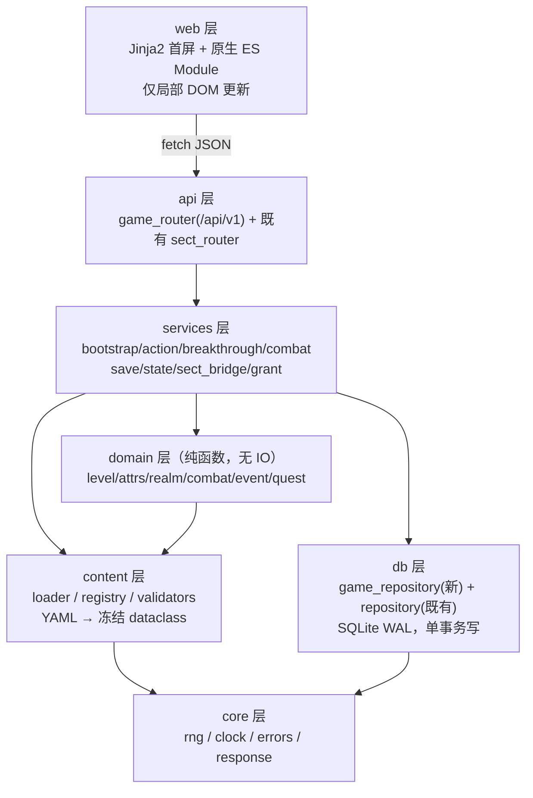

# 《荒天纪》v1.5 · 系统设计与任务分解

> 作者：高见远（架构师）｜ 输入：`03-MVP实现任务书.md`（锁定，最高优先级）+ PRD 基线 v1.5 ｜ 日期：2026-10-23
> 本文只做设计，不改任何代码；表名/字段名/枚举值一律沿用任务书 §6，偏离项集中在 §0。
> 目标：把已存在的「宗门任务/贡献/散修钱包/2 禁地」切片**作为子模块嵌入**主游戏，交付可创角→Lv.18→19 主线→宗门/散修→2 禁地→存档读档的完整链路。

---

## 0. 偏离与口径声明（先读这段）

| # | 任务书原文 | 本文决策 | 理由 |
|---|---|---|---|
| D1 | §5 目录含 `content/forbidden_lands.yaml` | **保留该文件**：存 10 处禁地的展示元数据（名称/阶/可达境界/Boss/首通奖励/desc/enabled）；数值与启用状态的唯一权威仍是既有 `data/content/sect/quest_config.yaml` 的 `forbidden_land` 段。validators 校验两边 `land_id` / `display_name` / boss 名称一致，不一致拒绝启动 | 任务书 §4.1-17 与验收 R94 要求「10 处配置、启用 2 处」；只靠 quest_config 的 2 条无法展示另外 8 处。双源但职责分离：展示 vs 运行数值。 |
| D2 | §7 `POST /sect/leave-direction` | 主路径 `/sect/direction`（定方向），同时注册 `/sect/leave-direction` 别名指向同一 handler | 任务书命名疑为笔误（"定方向"而非"放弃方向"）；别名兼容零成本 |
| D3 | §6 `character.rng_seed` | 存 `TEXT`（32 字节 hex），**永不出现在任何响应体** | 安全基线 §9「种子不暴露给前端」 |
| D4 | PRD §3.3 锻血单次闭关 1,385 / 辟府 2,272 | 以**公式**为准；创角悟性基准取 30 → 单次 **1,305**（−5.8%）/ **2,466**（+8.5%）；`ceil` 后闭关 **15 / 74 次，合计 89 次**（14 次不够：14×1,305=18,270 < 18,747，会在锻血末段卡住）。**`ExpRate` 内部保留浮点、禁止逐层取整，只在最终结算 `floor(ExpRate × days)` 取整一次**（逐层取整会让辟府变 58×42=2,436、次数变 75） | 已实算验证：`Exp(L)=floor(100×L^1.78×K)` 精确复现 PRD 的 100 / 4,050 / 4,995 / 30,878 与两境合计 18,747 / 181,871，**曲线无需任何修正**；而按 PRD 两个"单次闭关值"反解悟性得 30.78 与 26.72，**互相矛盾**，故单次值不可作为真值来源 |
| D5 | 任务书未定 `age_days` 初值 | **`age_days` 初值 = 1**（第 1 日），`game_year(d) = (d-1)//360+1` | 既有 `forbidden_land_service` 已用 `(d-1)//360+1` 口径，必须对齐，否则首个游戏年边界错 1 天 |
| D6 | 随机确定性红线 12 | 既有 Service 增加**可选** `rng=None` 关键字参数（默认走原 `random`），覆盖 `QuestService.take`、`QuestPoolRepository.draw/refresh_yearly_weights`、`ForbiddenLandService._roll_rewards`；游戏层传入 `RngService` 适配器。旧调用与 28 个测试零影响 | 只靠「落库幂等」无法满足红线 12（同一请求重放仍会重新抽签）。可选参数是向后兼容的最小改造，且能把宗门任务/禁地掉落纳入统一确定性随机流。 |
| D7 | 「初始基准随体质」与「悟性 ∈[10,30]」两条口径冲突 | **`wis` 不吃体质 `base_attrs`**，创角时独立 roll `∈[10,30]`，可再加点 ≤+3 → 实际 `[10,33]`；其余七项（力/体/灵/神识/根骨/身法/道心）走体质基准。节奏基准取 `wis=30`（即 D4 的整定值） | 若 `wis` 也按体质基准 10 起算，`ExpRate=(5+0.8×10)×1.5×30=585`，锻血需 32 次闭关、辟府需 311 次，直接击穿 900 红线；而 `wis∈[10,30]` 只有作为**独立 roll** 才能与 D4 的 1,305 自洽（`(5+0.8×30)×1.5×30=1,305`）。此条为两条已下发口径的唯一自洽解 |

---

## 1. 架构总览



| 层 | 职责 | 允许依赖 | 禁止 |
|---|---|---|---|
| web | 12 界面渲染、局部刷新、伤害飘字/弹窗 | api（HTTP） | 持有任何权威状态、直连 DB、`innerHTML` 插用户输入 |
| api | 入参白名单校验、错误码→HTTP、`{ok,data,error}` 包装 | services | 业务规则、SQL |
| services | 编排：事务边界、幂等、桥接既有宗门 Service、发奖 | domain / content / db / core | 前端细节 |
| domain | 公式与规则（修为/属性/突破/战斗回合/事件判定/任务目标） | content / core | db、IO、`random` |
| content | YAML 加载、索引、启动自检、内容版本与 hash | core | services |
| db | 参数化 SQL、快照存取、乐观锁 | core | 业务判断 |

**与既有宗门子系统的边界（单向往内）**

| 侧 | 权威数据 | 游戏层如何用 |
|---|---|---|
| 宗门侧（既有，不改） | `sect_member` / `sect_reputation` / `sansxiu_wallet` / `forbidden_land_progress` / `sect_active_quest` / `sect_quest_record` | 作为身份与贡献的**唯一权威**；游戏层只读 + 通过既有 Service 写 |
| 游戏侧（新增） | `character` / inventory / technique / equipment / quest / flag / combat / save | 不复制宗门贡献点，只在 `character.sect_id`/`path_id` 存**只读镜像**供 `GET /state` 快速渲染 |
| 桥接点 | `SectBridgeService` | 唯一允许「调用既有 Service + 在同一业务动作内发奖」的地方；既有 Service 永不 import 游戏层 |

---

## 2. 模块与文件清单

### 2.1 内容层 YAML（16 个新增，均在 `data/content/`，全中文注释）

| 文件 | 职责 | 关键条目（启动自检断言） | 行数 |
|---|---|---|---|
| `manifest.yaml` | 内容版本 + 文件清单 + 加载顺序 | `content_version: "1.5.0"` | 30 |
| `game.yaml` | 全局：时间/修为/战斗/突破/背包/存档/事件 | `exp_rate_global_bp=15000`、`action_base_days`（闭关 30/历练 15/采药 10/切磋 3/打坐 10/突破 3）、`realm_time_factor_bp=4000`、`event_trigger_bp=3500`、`save_slots=3` | 150 |
| `realms.yaml` | 12 境全量，`enabled` 前 2 | 9 小境/境、`exp_k_bp`（锻 10000/辟 18000）、`base_lifespan_years`、`breakthrough` 段 | 180 |
| `techniques.yaml` | 41 部功法（含宗门 24 / 散修 3 / 禁地 2） | `tech_id` 与既有 `SEED_TECHNIQUES` **同名同 id**，否则兑换发放会错位 | 320 |
| `items.yaml` | 6 丹药 + 4 材料 + 5 消耗品 | 堆叠上限、`effect` 枚举 | 110 |
| `equipments.yaml` | 装备模板 + 7 档稀有度 + 词条池 | 6 槽、强化上限 +5、词条权重和 =100 | 200 |
| `physiques.yaml` | 5 种体质，权重和 =10000bp | 凡体 5000 / 灵体 3000 / 剑骨 1000 / 药体 800 / 玄阵心 200；id = `fan_ti/ling_ti/jian_gu/yao_ti/xuan_zhen_xin`。每档必备 5 组字段：`cultivate_bp`（修炼系数）、`attr_bonus`（属性加成）、`breakthrough_bp`（突破加成）、`base_attrs`（初始基准 10/12/12/11/11）、`direction_affinity`（显式映射 `{sword,spell,pill,array,body} → 1.3/1.0/0.8`，**禁止隐含规则**）。断言：权重和 ==10000 且 5 组字段齐全，缺一 fail-fast（验收 R02）。**不启用**荒天战体/宝体/神体 | 80 |
| `talents.yaml` | 资质 1–10 品系数 | `1+(品-5)*0.06` | 40 |
| `personalities.yaml` | 5 种性格判定修正 | ±8% / −5% | 45 |
| `regions.yaml` | 20 区域，`enabled` 6 个 | 环境系数 1.0–5.0、`level_range` 落在 §6.0 区间 | 250 |
| `forbidden_lands.yaml` | 10 处禁地**展示元数据**（`land_id/name/desc/tier/required_realm_seq/boss`），见 D1 | 断言恰好 10 条；`enabled` 仅 `gujing_jianyuan` + `caomu_yuanyuan` 2 处；与 `quest_config.forbidden_land` 的 `land_id`/`display_name`/`boss.name` 逐条一致；首通功法 `tech_id` 必须存在于 `techniques.yaml`；任一不符即拒绝启动。**本文件不写任何数值型消耗/奖励/掉率** | 110 |
| `enemies.yaml` | 杂兵/精英/Boss（含 2 禁地 Boss、独眼山猫王、柳无咎） | `force_level_coef` 与 `quest_config` Boss 系数一致 | 150 |
| `events.yaml` | 20 事件，2–4 选项 | 每事件每选项**至少 1 项负面**；`weight` 分类权重 30/25/20/12/8/5 | 340 |
| `quests_main.yaml` | 19 主线（卷一 10 + 卷二 9） | 目标类型枚举、`unlock_next`、奖励 | 300 |
| `sects.yaml` | 6 宗门 + 24 独有功法兑换 + 5 方向树 | 加入条件、贡献价、方向节点门槛 | 280 |
| `sansxiu.yaml` | 散修路径 + 奇遇池（3 功法） | 奇遇触发率 +10%、贡献转换 50% | 120 |

### 2.2 后端新增/修改文件

| 相对路径 | 新增/改 | 职责 | 行数 |
|---|---|---|---|
| `backend/app/core/__init__.py` | 新 | 导出 rng/clock/errors/response | 15 |
| `backend/app/core/rng.py` | 新 | `RngService`：HMAC-SHA256(seed, f"{stream}:{counter}") → int/float/roll/pick；counter 由调用方在**同事务**内 `+1` | 80 |
| `backend/app/core/clock.py` | 新 | 唯一时间入口：`game_year(age_days)=(age_days-1)//360+1`、`game_month`、`action_days(base, realm_index)=max(1, round_half_up(base×(1+0.40×(realm_index-1))))`（**返 int，返回前断言 `isinstance(days,int)`**）、`days_to_years` | 70 |
| `backend/app/core/errors.py` | 新 | `GameError(code,message,detail)` + 4xxx 错误码常量 + `CODE_TO_HTTP`（映射见 §5 末） | 120 |
| `backend/app/core/response.py` | 新 | `ok(data)` / `fail(err)` 统一包装 | 30 |
| `backend/app/content/__init__.py` | 新 | `load_all()` 单例 + 缓存 | 20 |
| `backend/app/content/loader.py` | 新 | 读 15 YAML → 冻结 dataclass；计算 `content_hash`（sha256 of 文件内容排序拼接） | 160 |
| `backend/app/content/registry.py` | 新 | 索引与查询：`technique(id)`、`events_for(region, realm)`、`enabled_regions()`、`main_quest(id)`、`sect(id)` | 170 |
| `backend/app/content/validators.py` | 新 | 启动自检：数量断言（19/20/41/20 区域/6 宗门）、权重和=100、体质权重和、区域 level_range 覆盖 1–18 无空隙、每事件选项负面、`tech_id` 与 DB 种子一致 | 150 |
| `backend/app/domain/__init__.py` | 新 | 导出 6 个模块 | 15 |
| `backend/app/domain/level.py` | 新 | `exp_need(L, realm_index)`、`exp_rate(char, registry)->float`（**全程 float，禁止中途 round/int**）、`close_door_gain(exp_rate, days)=floor(exp_rate*days)`（**只在这一次 floor**）、`apply_exp()`（连升 ≤5、溢出保留） | 100 |
| `backend/app/domain/attrs.py` | 新 | 10 基础 + 13 衍生 + 软上限 + CP | 140 |
| `backend/app/domain/realm.py` | 新 | 境界映射、`breakthrough_chance()`、三档惩罚、根基评价、寿元重算 | 130 |
| `backend/app/domain/combat.py` | 新 | 回合引擎（纯函数 `step(state, player_action, rng)`）：伤害/破防/暴击/闪避/先手/连战/敌人 AI/30 回合 | 280 |
| `backend/app/domain/event.py` | 新 | 事件筛选（区域×境界×30 月去重）、判定成功率、效果应用 | 120 |
| `backend/app/domain/quest.py` | 新 | 目标类型匹配、进度推进、解锁链 | 110 |
| `backend/app/db/game.sql` | 新 | 完整 `character` + 11 张游戏子表（`IF NOT EXISTS` 全部） | 200 |
| `backend/app/db/game_repository.py` | 新 | 13 个 Repository + `_ensure_character_columns()` 迁移 + 快照 build/restore | 400 |
| `backend/app/services/bootstrap_service.py` | 新 | 创角：加点=5、重掷≤3、体质抽取、初始物品、序章主线 | 120 |
| `backend/app/services/action_service.py` | 新 | 5 类行动结算：耗时→修为→事件/战斗触发→自动存档 | 170 |
| `backend/app/services/breakthrough_service.py` | 新 | preview / execute / 惩罚 / 根基 / 冷却 | 130 |
| `backend/app/services/combat_service.py` | 新 | 会话开/回合/结束、刷新恢复、归属校验 | 150 |
| `backend/app/services/save_service.py` | 新 | 3 手动 + 1 自动、快照、导出/导入（HMAC）、乐观锁 | 200 |
| `backend/app/services/state_service.py` | 新 | `/state` 聚合快照（角色/修为/寿元/区域/任务/日志） | 140 |
| `backend/app/services/sect_bridge_service.py` | 新 | 包装既有 3 个 Service：入宗/方向/接任务/完成/兑换/散修奇遇/贡献转换/禁地 | 240 |
| `backend/app/services/grant_service.py` | 新 | 幂等发奖：`reward_grant_log` UNIQUE(char,source_type,source_ref) | 100 |
| `backend/app/services/__init__.py` | 改 | 追加导出（**不改既有导出**） | +10 |
| `backend/app/schemas/game.py` | 新 | 全部 Pydantic 请求/响应模型（白名单枚举 + 范围校验） | 280 |
| `backend/app/api/game_router.py` | 新 | 全部 `/api/v1/*` 路由 + 异常映射 + `character_id` 归属校验 | 640 |
| `backend/app/api/__init__.py` | 改 | 追加 `game_router` 导出 | +2 |
| `backend/app/models/entities.py` | 改 | **追加**枚举（ActionKind/CombatStatus/QuestMainStatus/PathId），既有类零改动 | +45 |
| `backend/app/db/repository.py` | 改 | `init_db` 先跑 `game.sql` 再跑既有 DDL + 补列迁移（见 §9） | +18 |
| `backend/app/db/__init__.py` | 改 | 追加 game_repository 导出 | +6 |
| `backend/app/main.py` | 改 | `create_app`：内容加载→自检→建库→种子→挂 game_router→静态（存在才挂）；加中间件刷新 `app.state.today_day/game_year/realm_seq` | +40 |
| `run.py`（项目根） | 新 | `uvicorn.run(app, host=127.0.0.1, port=5088)`，`DATA_DIR` 可由环境变量覆盖 | 35 |
| `requirements.txt` | 新 | fastapi/uvicorn/jinja2/pyyaml/pydantic/pytest/httpx | 12 |

### 2.3 Web 层（`backend/app/web/`）

| 文件 | 职责 | 行数 |
|---|---|---|
| `__init__.py` | 目录常量 `TEMPLATE_DIR` / `STATIC_DIR` | 10 |
| `templates/index.html` | 首屏骨架：状态栏 + 12 pane 容器 + `<script type="module">` | 130 |
| `templates/panes/creation.html` | 创角（姓名/性别/体质/资质/性格/加点/末页三路径告知） | 90 |
| `templates/panes/main.html` | 主界面（修为条/寿元警戒/行动按钮/日志） | 80 |
| `templates/panes/character.html` | 属性面板（10 基础 + 13 衍生 + 明细 tooltip） | 80 |
| `templates/panes/techniques.html` | 功法（列表/学习/参悟/装备 1+3×3 槽） | 70 |
| `templates/panes/inventory.html` | 背包（分类页签/使用/出售/装备/强化） | 80 |
| `templates/panes/quests.html` | 主线（19 条进度链） | 55 |
| `templates/panes/map.html` | 区域（20 区域，开放 6） | 55 |
| `templates/panes/sect.html` | 宗门/方向/散修（入宗/任务/兑换/奇遇/转换） | 100 |
| `templates/panes/forbidden.html` | 禁地（2 处 + Boss + 首通） | 50 |
| `templates/panes/combat.html` | 战斗（回合/技能/道具/逃跑/战报） | 90 |
| `templates/panes/event.html` | 事件弹窗（选项风险标记） | 50 |
| `templates/panes/saves.html` | 存档（3 手动 + 1 自动 + 导出/导入） | 70 |
| `templates/panes/logs.html` | 事件/里程碑日志 | 45 |
| `static/css/theme.css` | 暗色水墨设计变量（色板/字阶/间距） | 120 |
| `static/css/main.css` | 布局 + 响应式（≥1024 双栏，≤768 单栏）+ 飘字动画 | 420 |
| `static/js/core/api.js` | fetch 封装：统一错误码处理、409 冲突重载提示 | 90 |
| `static/js/core/state.js` | 客户端只读缓存（唯一源仍是服务端）+ 订阅通知 | 70 |
| `static/js/core/router.js` | hash 路由 → 12 pane，`history` 同步 | 80 |
| `static/js/core/ui.js` | 安全渲染工具：`el()`/`text()`/`toast()`/`floatDamage()`（**禁 innerHTML 插用户输入**） | 150 |
| `static/js/panes/*.js` | 12 个 pane 模块，各渲染 + 绑定 → 调 `api.js`（每 60–110 行） | 950 |

### 2.4 测试（`backend/tests/game/`，新增 ≥40，既有 28 不动）

`test_domain_level.py` / `test_domain_attrs.py` / `test_domain_realm.py` / `test_domain_combat.py` / `test_domain_event.py`（包 A）｜`test_api_bootstrap.py` / `test_api_action.py` / `test_api_breakthrough.py` / `test_api_combat.py` / `test_api_save.py` / `test_api_sect_bridge.py` / `test_api_forbidden.py` / `test_rng_determinism.py`（包 B）｜`test_web_smoke.py`（包 C）

---

## 3. 数据模型

### 3.1 `character`（完整表，`game.sql`；**所有非 id 列必须有默认值**）

```sql
CREATE TABLE IF NOT EXISTS character (
  id                 INTEGER PRIMARY KEY AUTOINCREMENT,
  name               TEXT    NOT NULL DEFAULT '',
  gender             TEXT    NOT NULL DEFAULT 'unknown',   -- male/female/unknown（仅文本描述用）
  personality        TEXT    NOT NULL DEFAULT 'zhongyong', -- 孤傲/温厚/狡黠/疯癫/中庸
  physique           TEXT    NOT NULL DEFAULT 'fan_ti',
  talent             INTEGER NOT NULL DEFAULT 5,           -- 资质 1–10 品
  level              INTEGER NOT NULL DEFAULT 1,           -- 全局等级 1–18
  realm_index        INTEGER NOT NULL DEFAULT 1,           -- 大境序号 1–12
  realm_stage        INTEGER NOT NULL DEFAULT 1,           -- 小境 1–9 = (level-1)%9+1
  cultivation        INTEGER NOT NULL DEFAULT 0,           -- 当前等级内累计修为
  exp_overflow       INTEGER NOT NULL DEFAULT 0,           -- 连升上限后溢出（不丢失）
  hp                 INTEGER NOT NULL DEFAULT 0,           -- 0 表示按衍生公式取满
  mp                 INTEGER NOT NULL DEFAULT 0,
  age_days           INTEGER NOT NULL DEFAULT 1,           -- 见 D5：初值 1
  lifespan_max_days  INTEGER NOT NULL DEFAULT 36000,       -- 100 年 × 360
  spirit_stone       INTEGER NOT NULL DEFAULT 0,
  karma              INTEGER NOT NULL DEFAULT 0,           -- 因果 −1000..1000
  dao_heart          INTEGER NOT NULL DEFAULT 10,          -- 道心 0..100
  str                INTEGER NOT NULL DEFAULT 10,
  con                INTEGER NOT NULL DEFAULT 10,
  spr                INTEGER NOT NULL DEFAULT 10,
  sen                INTEGER NOT NULL DEFAULT 10,
  bon                INTEGER NOT NULL DEFAULT 10,
  wis                INTEGER NOT NULL DEFAULT 10,
  agi                INTEGER NOT NULL DEFAULT 10,
  luk                INTEGER NOT NULL DEFAULT 5,
  region_id          TEXT    NOT NULL DEFAULT 'duanhuai_village',
  path_id            TEXT    NOT NULL DEFAULT '',          -- ''=未择 / sansxiu / 6 宗门 id
  sect_id            TEXT,                                  -- 只读镜像，权威在 sect_member
  direction_id       TEXT    NOT NULL DEFAULT '',          -- 5 方向之一
  foundation         TEXT    NOT NULL DEFAULT '',          -- 圆满/扎实/虚浮/崩坏
  fail_streak        INTEGER NOT NULL DEFAULT 0,
  realm_attempts     INTEGER NOT NULL DEFAULT 0,           -- 本境突破尝试次数（根基主判据）
  bag_slots          INTEGER NOT NULL DEFAULT 60,
  pending_event      TEXT    NOT NULL DEFAULT '',          -- JSON 快照，'''=无待决事件
  status             TEXT    NOT NULL DEFAULT 'normal',    -- normal/injured/qi_deviation/dead
  rng_seed           TEXT    NOT NULL DEFAULT '',          -- 32B hex，绝不下发
  rng_counter        INTEGER NOT NULL DEFAULT 0,
  last_settle_at     INTEGER NOT NULL DEFAULT 0,           -- 仅用于"世事已变"，不结算离线收益
  version            INTEGER NOT NULL DEFAULT 1,
  created_at         INTEGER NOT NULL DEFAULT 0
);
```

> 兼容性：既有测试执行 `INSERT OR IGNORE INTO character (id) VALUES (?)`（`test_quest_service.py:51` 等），上表除 `id` 外**全部带 DEFAULT 或可 NULL**，因此该语句继续成立。`sect_contribution.sql` 里的占位 `CREATE TABLE IF NOT EXISTS character` 变成 no-op（`placeholder/realm_major/realm_minor` 三列全仓库无代码引用，已 grep 确认）。

### 3.2 游戏子表 DDL 要点（同文件 `game.sql`，全部 `IF NOT EXISTS`）

| 表 | 主键 | 关键列 | 约束/说明 |
|---|---|---|---|
| `character_technique` | (char_id, tech_id) | `layer` 1–9、`sense` 感悟值、`equipped_slot` TEXT（`heart`/`atk1..3`/`def1..3`/`sup1..3`） | 心法 ≤1、每类 ≤3 由 service 校验 |
| `character_equipment` | `instance_id` AUTOINCREMENT | `template_id`、`slot`（weapon/armor/helm/accessory/natal/storage）、`rarity`、`enhance` 0–5、`affixes_json`、`equipped` 0/1 | 每槽仅 1 件 `equipped=1`（部分唯一索引） |
| `character_inventory` | (char_id, item_id) | `item_type`（pill/material/consumable）、`qty` | 材料 999 / 丹药 99 上限 |
| `character_quest` | (char_id, quest_id) | `status`（locked/active/ready/completed）、`step`、`progress_json` | 主线幂等 |
| `character_flag` | (char_id, key) | `value` TEXT | 一次性事件、路径标记、`event_last:{id}`=age_days |
| `character_relation` | (char_id, npc_id) | `favor` −100..100、`karma` | 护法/请教/寻仇 |
| `combat_session` | `char_id` | `session_json`、`status`、`turn`、`updated_at`、`version` | 一角色一会话 |
| `save_slot` | `slot_id`（0=自动,1–3 手动） | `char_id`、`snapshot_json`、`content_version`、`content_hash`、`checksum`、`created_at` | **不设 FK**（快照独立于角色存活） |
| `event_log` | `log_id` | char_id、kind、payload_json、created_at | 限长 500 条（插入后裁剪） |
| `milestone_log` | `log_id` | char_id、title、detail | 限长 200 条 |
| `meta` | `key` | `value` | `active_char_id`、`content_version` |
| `reward_grant_log` | `grant_id` | char_id、`source_type`、`source_ref`、payload_json、created_at | **UNIQUE(char_id,source_type,source_ref)** → 发奖幂等 |

### 3.3 FK 关系与删档/读档顺序

- 全部游戏子表 + 既有宗门 6 表均 `FOREIGN KEY(character_id) REFERENCES character(id) ON DELETE CASCADE`。`character` 是唯一父表。
- **删角色**：单事务 `DELETE FROM character WHERE id=?` → 12 张子表级联清理（依赖 `PRAGMA foreign_keys=ON`，`init_db` 已开）。`save_slot` 不级联（快照保留，可再导入）。
- **删存档槽**：只删 `save_slot` 行，不动 `character`。
- **读档**：事务内顺序 = ①`character` UPDATE（`version` 校验）→ ②清空并重灌 5 张角色子表（technique/equipment/inventory/quest/flag/relation）→ ③upsert `sect_member`/`sect_reputation`/`sansxiu_wallet`/`forbidden_land_progress` → ④`DELETE FROM combat_session`（不恢复战斗，防读档刷奖励）→ ⑤版本号 +1。**必须是这个顺序**：先父后子会因 FK 失败，先子后父会留下孤儿记录。
- **导入**：新建 `character` 行（`id` 自增，不覆盖既有），再走同一「读档」流程；`checksum`/`content_version` 校验失败**不落库**。

---

## 4. 核心流程

### 4.1 创角 → 首登
| 步 | 动作 | 校验/结果 |
|---|---|---|
| 1 | `GET /` | 无 active character → 前端切 creation pane |
| 2 | `POST /bootstrap/reroll` ×≤3 | 返回体质/资质/性格候选；第 4 次 → `4002` |
| 3 | `POST /bootstrap` | 加点 **Σ==5 且单项 ≤ +3**、每项 ≥0（越界/负数 → `4001`）；`wis` 独立随机 ∈[10,30]（见 D7）；`talent ∈ [1,10]`；枚举白名单 + 字符串长度上限 |
| 4 | service 事务 | 生成 `rng_seed`；按 `physiques.yaml` 权重抽体质 → 按该档 `base_attrs`（凡 10 / 灵 12 / 剑骨 12 / 药体 11 / 玄阵心 11）写七项基础属性（力量/体魄/灵力/神识/根骨/身法/道心），`wis` 用 D7 的独立 roll，气运恒 5、因果恒 0 → 叠加玩家加点（单项 ≤3）→ 建 character + 初始 inventory（粗布衣）+ 学《锻血诀》Layer1 + `character_quest` 写主线 #1 active + `save_slot(0)` 自动存档 |
| 5 | 返回 `/state` | 前端进 main pane，展示序章文本 + 首次闭关引导（可跳过非强制项） |

### 4.2 行动结算（闭关/历练/采药/切磋/打坐）
`POST /action {kind, repeat?}` →
1. 守卫：`pending_event != ''` → `4010`；`combat_session.status='active'` → `4012`；`status='dead'` → `4006`。
2. `days = max(1, round_half_up(base[kind] × (1 + 0.40 × (realm_index − 1))))` —— **唯一入口 `core/clock.py:action_days()`，业务代码禁止自乘 1.4**；落库前断言 `isinstance(days, int)`（`age_days` 一旦成浮点，寿元/坐化判定全飘）。基准：闭关 30 / 历练 15 / 采药 10 / 切磋 3 / 打坐 10 / 突破 3 → 锻血 `30/15/10/3/10`，辟府 `42/21/14/**4**/14`（切磋 4.2 → 4，非 4.2 非 5）。
2b. `repeat` 1–10（**持续闭关，P0**）：**整批在一个事务内**跑完并聚合成 `{total_days, total_exp, levels_up, milestones≤3}`；中途遇事件/战斗即截断本批并返回（剩余次数作废，前端需重新点）——**禁止逐次各开事务**，否则中途崩溃会丢已算修为。
3. 每轮：`age_days += days` → 修为产出 = `ExpRate × days`（打坐回 20% 气血、切磋/历练/采药走掉落与战斗）→ `apply_exp`（连升 ≤5，溢出进 `exp_overflow`）→ `rng_counter` 同事务 +1。
4. 事件判定：`next_bp('event') < 3500 + (path_id=='sansxiu' ? 1000 : 0)` → 从 `events_for(region, realm, 30 月未出)` 加权抽 1 条 → 写 `pending_event`（含 `instance_id`、选项快照、`created_at_days`）。
5. 战斗判定：历练/切磋按 `enemies.yaml` 抽敌 → 建 `combat_session(status='active')`，返回 `{settle, pending_event?, combat?}`。
6. 同事务：`character.version+1` + 覆盖 `save_slot(0)`。刷新页面 → `GET /state` 返回同一份结果（不重 roll）。

### 4.3 突破（预览 / 执行 / 惩罚 / 根基）
| 阶段 | 规则 |
|---|---|
| 前置 | `level` 达本境顶（9 或 18）且 `cultivation ≥ exp_need(level)`；`寿元 < 3600 日（10 年）` → `4008`；`fail_streak` 冷却 30 日未过 → `4009` |
| preview | 逐项返回 `Δ根骨/Δ丹药/Δ灵地/Δ心境/Δ因果/Δ体质/Δ保底` 与 `final_bp`，`clamp 500–9500`；`fail_streak ≥ 5` → `final_bp = 10000` 并标 `guaranteed=true`；4 项准备加成和 `≤ 3000` |
| execute | `age_days += action_days(3)`；`realm_attempts+1`；`rng.roll(final_bp)` |
| 成功 | `level+1`、`realm_index/realm_stage` 重算、`lifespan_max_days` **整体重算**（100→150 年）、`fail_streak=0`、根基重算、`cultivation -= exp_need`（余量进 `exp_overflow`） |
| 失败 | 三档惩罚（≥60% 轻伤 −10% 修为/−30% 气血；30–60% 中伤 −20%/−60% + 心境裂隙；<30% 重伤 −35%/−90% 气血 + 道心 −5 + 5% 走火入魔）、`fail_streak+1` |
| 根基 | 按 `realm_attempts`：1→圆满(+5% 全属性,+3% 下境)、2→扎实(+2%)、3→虚浮(−3%)、≥4→崩坏(−8%,−5% 下境)；辅助判据：本境耗寿 >60% 降一档 |

### 4.4 战斗回合（含会话持久化与刷新恢复）
`GET /combat` → 返回 `session_json`（含 `enemy`、`player{hp,mp,cd,status}`、`turn`、`log[-20:]`、`status`）。
`POST /combat/action {action_type: attack|skill|defend|item|flee, skill_id?, item_id?}` →
1. 归属校验（`combat_session.char_id == active_char_id`，否则 `4013`）；`status != active` → `4014`。
2. `domain.combat.step()` 纯函数：先手值比 → 玩家行动 → 敌方 AI → 回合 +1 → 结算眩晕/CD/每回合回 MP 3%。
3. 结果写回 `session_json`（同事务，`rng_counter` 同步 +1）→ 刷新可原样恢复，**不会重 roll**。
4. 终止：`victory`（掉落 + 修为 + 连战计数）→ `defeat`（有九转还魂丹则消耗 1 颗续战，否则 `character.status='dead'`）→ `escaped` / `timeout(30 回合)`；终止时 `DELETE combat_session` 并写 `event_log`。
5. 连战惩罚：同一游戏年第 n 场敌方 ×`1+(n-1)*0.15`（≥5 → ×1.6 + 玩家力竭 −20%，打坐解除）。

### 4.5 事件选择（pending_event 防重放）
`POST /event/choose {instance_id, option_id}` →
1. 读 `character.pending_event`；空 → `4010`；`instance_id` 不符 → `4011`（重放/换页攻击）。
2. `option_id` 必须 ∈ 快照选项白名单，否则 `4011`。
3. `domain.event` 计算判定（`clamp(基础 40–70% + 属性 + 性格 ±8/−5 + 气运×0.3% + 因果修正, 5%, 95%)`）→ 应用效果（属性/资源/因果/耗时 0–24 日/状态）。
4. 同事务：`pending_event=''` → `character_flag['event_last:'+id]=age_days`（30 月去重）→ `version+1`。二次提交必然 `4010`。

### 4.6 宗门：加入 → 定方向 → 接任务 → 完成 → 兑换
| 步 | 接口 | 内部 |
|---|---|---|
| 1 | `GET /sect` | 读 `sects.yaml` + `resolve_role`（`sect_member` 存在=disciple，否则 sansxiu） |
| 2 | `POST /sect/join {sect_id}` | 校验 `level ≥ 10`（辟府）+ 宗门条件（剑宗试剑连胜 3 / 法宗 `sen≥25` / 丹宗灵药≥3 / 阵宗 `sen≥25` / 体宗 `str≥12` / 魔道 `karma≤−100`）→ 写 `sect_member`（`joined_at_days=age_days`）+ 镜像 `character.sect_id/path_id`；若原 `path_id='sansxiu'` → `general_contribution × 0.5` 转入 `sect_member.contribution` 并**清零钱包**（`sansxiu_join_convert_rate`） |
| 3 | `POST /sect/direction {direction_id}` | 首次免费；写 `character.direction_id`，解锁方向树 1 层首节点 |
| 4 | `POST /sect/quest/take {level}` | **调既有** `QuestService.take(char, sect, level, today_day=age_days, game_year=game_year(age_days))`；异常码原样透传 |
| 5 | `POST /sect/quest/complete {quest_id}` | **调既有** `QuestService.complete(...)` → 再用 `GrantService` 幂等发放灵石/修为（`source_ref=f"quest:{quest_id}"`） |
| 6 | `POST /sect/exchange {item_type,item_id}` | **调既有** `ExchangeService.check_and_exchange`（扣贡献+写兑换日志，物品表 `base_price` 为价）→ `GrantService` 真发物品/功法（`source_ref=f"exchange:{exchange_id}"`） |

### 4.7 散修：择路 → 奇遇 → 贡献转换 → 禁地
| 步 | 接口 | 说明 |
|---|---|---|
| 择路 | `POST /sect/join {sect_id:'sansxiu'}` | `path_id='sansxiu'`，无方向加成（方向系数 1.0），奇遇触发率 +10%，神识 ×1.2 |
| 奇遇 | `POST /sect/sansxiu/encounter` | 从 `sansxiu.yaml` 奇遇池抽（可用时 `rng`）→ 产 `pending_event`（复用事件链路）→ 奖励 3 部独家功法之一 + `sansxiu_wallet.general_contribution` |
| 转换 | `POST /sect/sansxiu/convert` | 仅当本次由散修 → 宗门：`general_contribution × 0.5` → `sect_member.contribution`，钱包清零（一次性，`character_flag['sansxiu_converted']=1` 防重） |
| 禁地 | `GET /forbidden` / `POST /forbidden/enter {land_id}` | **五步固定时序**：①只读前置校验（`path_id=='sansxiu'` 否则 `4024`、境界、年次数≤3、冷却30日、钱包余额）②扣进入耗时（凡30/灵60/宝120/圣240/帝360 日）③创建 Boss 战斗会话 ④胜利后调既有 `ForbiddenLandService.enter()`（此刻才扣贡献、更新进度、返回 rewards）⑤`GrantService` 真发放（`source_ref=f"fl:{land_id}:{attempt}"`）。失败/逃跑只耗时间，不扣贡献、不置首通；刷新页面可继续同一场 Boss 战 |

> **禁地时序红线**：⑤步顺序不可调换。②的耗时与④的扣贡献分属两个事务 —— 时间损失是"冒险有代价"的设计意图，不补偿；但**严禁把 `enter()` 提前到③之前**（会变成"没打赢也扣贡献"）。`combat_session` 保留在库里，刷新页面继续同一场 Boss 战，不重 roll。

### 4.8 存档 / 读档 / 导出 / 导入
| 接口 | 行为 |
|---|---|
| `POST /saves/save {slot_id:1..3, expected_version}` | 快照 = `character` + 6 张子表 + 4 张宗门表 → `snapshot_json`；`version` 不匹配 → `409/4004` |
| `POST /saves/load {slot_id}` | 见 §3.3 顺序；`content_version` 不兼容 → `4021` |
| `POST /saves/export {slot_id}` | 返回 `{schema_version, content_version, content_hash, snapshot, checksum=HMAC-SHA256(secret, snapshot)}`；大小 ≤2MB |
| `POST /saves/import {payload}` | 校验 4 项（schema/content/hash/checksum）→ 失败 `4020` 且不落库 → 成功**新建**槽位 |
| `POST /saves/delete {slot_id}` | 仅删槽行；`slot_id=0` 自动槽不可删 |
| 自动存档 | 每次 `/action`、`/breakthrough`、事件结算、战斗结束的**同一事务**内覆盖 `slot_id=0` |

---

## 5. 接口清单（前缀 `/api/v1`；统一 `{ok, data, error:{code,message,detail}}`）

| 方法 | 路径 | 请求体要点 | 响应 data 要点 | 复接既有 |
|---|---|---|---|---|
| GET | `/` `/health` | — | HTML / `{status:ok}` | 页面 |
| POST | `/bootstrap` | name, gender, personality, physique, talent, `wis ∈[10,30]`, points{str..luk} **Σ=5 且单项 ≤3** | character 摘要 + 序章 | — |
| POST | `/bootstrap/reroll` | — | 候选体质/资质/性格 + 剩余次数 | — |
| GET | `/state` | — | 角色/修为/寿元/区域/身份/主线/日志/待决事件/战斗 | — |
| POST | `/action` | kind(白名单), `repeat` 1–10（持续闭关，**整批单事务**） | `{total_days,total_exp,levels_up,milestones≤3}` + pending_event? + combat? | — |
| POST | `/breakthrough/preview` | prep{pill,guardian,omen,land} | 加成明细 + final_bp + guaranteed | — |
| POST | `/breakthrough` | prep{} + expected_version | 成功/失败 + 惩罚 + 根基 | — |
| POST | `/event/choose` | instance_id, option_id | 判定 + 效果 + 耗时 | — |
| GET/POST | `/combat`, `/combat/action` | action_type, skill_id?, item_id? | 回合结果 + 血量/飘字 + status | — |
| GET | `/character` | — | 10 基础 + 13 衍生 + 明细 + CP | — |
| GET/POST | `/techniques`, `/techniques/learn|equip|unequip|meditate` | tech_id, slot | 列表 / 结果 | — |
| GET/POST | `/inventory`, `/inventory/use|sell|equip|unequip|enhance` | item_id, qty, instance_id | 列表 / 结果 | — |
| GET/POST | `/quests`, `/quests/claim` | quest_id | 19 主线列表 / 领奖 | — |
| GET/POST | `/map`, `/map/travel` | region_id | 20 区域（6 开放）/ 耗时+环境系数 | — |
| GET | `/sect` | — | 身份/贡献/方向/可兑换 | ✅ repository 只读 |
| POST | `/sect/join` | sect_id（含 `sansxiu`） | 新身份 + 条件未达明细 | ✅ 写 `sect_member` |
| POST | `/sect/direction` (`/sect/leave-direction` 别名) | direction_id | 方向与已解锁节点 | — |
| POST | `/sect/quest/take` | level(low/mid/high) | 任务详情 | ✅ `QuestService.take` |
| POST | `/sect/quest/complete` | quest_id | 贡献/好感/解锁 | ✅ `QuestService.complete` + 发奖 |
| POST | `/sect/exchange` | item_type, item_id | 剩余贡献 + 已发放物品 | ✅ `ExchangeService` + 发奖 |
| POST | `/sect/sansxiu/encounter` | — | 奇遇事件 / 奖励 | — |
| POST | `/sect/sansxiu/convert` | — | 转换前后贡献 | ✅ `sansxiu_wallet` |
| GET/POST | `/forbidden`, `/forbidden/enter` | land_id | 10 条禁地（2 处 enabled）/ 五步时序：先扣耗时→Boss 战→胜利后 `enter()` 扣贡献→发奖 | ✅ `ForbiddenLandService.enter`（仅在 Boss 胜利后调用） |
| GET/POST | `/saves`, `/saves/save|load|export|import|delete` | slot_id, payload | 槽位列表 / 结果 | — |
| GET | `/logs` | — | event_log + milestone_log | — |

**错误码（`core/errors.py`）**：4001 加点非法 / 4002 重掷用尽 / 4003 无活动角色 / 4004 版本冲突 / 4005 行动非法 / 4006 寿元不足或已坐化 / 4007 修为不足 / 4008 寿元<10 年禁突破 / 4009 突破冷却 / 4010 无待决事件 / 4011 事件选项非法或重放 / 4012 战斗会话不存在 / 4013 会话归属不符 / 4014 战斗已结束 / 4015 背包已满 / 4016 物品不足 / 4017 功法不可学（含功法槽位冲突） / 4018 装备/槽位非法（含强化超上限） / 4019 存档槽非法 / 4020 导入校验失败 / 4021 内容版本不兼容 / 4022 属性未达要求 / 4023 区域未解锁 / 4024 **身份不符 / 身份不可回退**（散修限定禁地、已入宗不可退回散修） / 4025 事件不存在 / 5000 内部错误。既有 1xxx–3xxx 原样透传（映射见既有 `sect_router._HTTP_STATUS_MAP`）。

**`CODE_TO_HTTP` 权威映射（QA 断言以此为准，4001–4025 已冻结，不再增减）**

| HTTP | 业务码 |
|---|---|
| 400 | 4001, 4005, 4007, 4018, 4020 |
| 402 | 4016（资源不足，与既有 `ERR_EXCHANGE_INSUFFICIENT_CONTRIBUTION`→402 保持同族） |
| 403 | 4006, 4008, 4013, 4017, 4022, 4023, 4024 |
| 404 | 4003, 4012, 4019, 4025 |
| 409 | 4004, 4010, 4011, 4014, 4015, 4021 |
| 429 | 4002, 4009 |
| 500 | 5000 |

> 4006 用 403 而非 410：寿元耗尽/坐化是「当前不允许该动作」，角色仍可读档重来；410 语义为"资源永久消失"，不适用。
> 4015 背包已满用 409 而非 507：与本项目乐观锁/状态冲突同族，前端统一走"提示后重试"分支。

---

## 6. 状态机

| 状态机 | 状态与转移 |
|---|---|
| 主线任务 `character_quest.status` | `locked` →(前置达成/上一任务 completed) `active` →(目标计数满) `ready` →(`/quests/claim`) `completed` → 解锁下一 `active`。MVP 无 failed |
| 战斗会话 `combat_session.status` | `active` →(hp≤0 且有还魂丹) `active`（消耗丹、回 50% 血）；`active` → `victory` / `defeat` / `escaped` / `timeout(30 回合)` → 行被删除（日志留档）。刷新只读回 `active` |
| 宗门身份 `character.path_id` | `''`（未择）→ `sansxiu` 或 6 宗门之一（Lv.10 起）；`sansxiu` → 宗门（一次性，贡献 50% 转换后不可回退）；宗门 → `defected`（MVP 不开放退宗） |
| 事件 `character.pending_event` | `''` →(行动触发) `pending(JSON)` →(`/event/choose` 校验 instance+option) `resolved` → `''`。`pending` 期间 `/action` 与 `/combat/action` 均 409 |
| 角色 `character.status` | `normal` ⇄ `injured`（受伤/中毒）；`normal` → `qi_deviation`（走火入魔，需静心丹）；→ `dead`（战斗死亡无还魂丹 / 寿元 ≤0 坐化）；`dead` 为终态（MVP 不做轮回） |

---

## 7. 实现顺序与工程工作包（文件不重叠，仅 A→B→C 单向依赖）

### 包 A：内容 + 引擎（无 DB、无 HTTP，可独立单测）
- **文件**：`data/content/*.yaml`（**16 个**，含 `forbidden_lands.yaml`）+ `backend/app/core/*`（5）+ `backend/app/content/*`（4）+ `backend/app/domain/*`（7）+ `backend/tests/game/test_domain_*.py`（5）
- **前置**：无
- **验收**：
  - `cd backend && python -m pytest tests/ -q` → 既有 28 全绿
  - `cd backend && python -c "from app.content import load_all; c=load_all(); print(c.content_version)"` → `1.5.0`（`validators` 全部断言通过，含体质权重 10000bp / 禁地双源一致性 / 19+20+41 交叉引用）
  - `python -m pytest tests/game/test_domain_*.py -q` → ≥20 passed
  - `python -c "from app.core.clock import action_days as f; print([f(30,r) for r in (1,2)], f(3,2), type(f(3,2)))"` → `[30, 42] 4 <class 'int'>`

### 包 B：持久化 + 服务 + API（依赖 A）
- **文件**：`backend/app/db/game.sql`、`db/game_repository.py`、`db/repository.py`(改)、`db/__init__.py`(改)、`services/*`（8 新 + `__init__` 改）、`schemas/game.py`、`api/game_router.py`、`api/__init__.py`(改)、`models/entities.py`(改)、`main.py`(改)、`run.py`、`requirements.txt`、`backend/tests/game/test_api_*.py` + `test_rng_determinism.py`（8）
- **前置**：A 完成
- **B0（第 1 个任务，先做，见 §9 第 1 行）**：修 `repository.py` 的线程连接缺陷 —— `_global_conn` + `RLock` + `get_conn()` 三级回退 + `transaction()` 加锁；并补 `test_api_smoke.py`（`TestClient` 调 `/health` 与 `/api/v1/sect/status/1/qingyun_sword` 断言非 500）。
  **验收门槛：B0 单独提交，且 `TestClient` 冒烟 + 既有 28 测试同时全绿后，才允许开始 B1（DDL/服务/路由）。**
- **验收**：
  - `python -m pytest backend/tests -q` → 28 既有 + A/B 新增全绿
  - `python run.py` 后：
    `curl -s localhost:5088/health` → ok；`curl -s -XPOST localhost:5088/api/v1/bootstrap -d '{...}'` → `ok:true` 且返回 character_id；`curl -s localhost:5088/api/v1/state` → 含修为/寿元/区域；同一 `/action` 重复提交 → 结果一致（D6 的 `rng` 透传保证算法级一致）

### 包 C：Web UI（依赖 B 的接口契约）
- **文件**：`backend/app/web/**`（`__init__.py`、`templates/index.html` + 13 pane、`static/css/2`、`static/js/core/4`、`static/js/panes/12`）、`backend/tests/game/test_web_smoke.py`
- **前置**：B 完成（`main.py` 已按「目录存在才挂载」写好，C 只需落文件）
- **验收**：`curl -s localhost:5088/ | grep -c 'data-pane=' ` → ≥12；`python -m pytest backend/tests/game/test_web_smoke.py -q` → passed；手测：创角→闭关→突破→入宗→接任务→兑换→禁地→存档/读档→导出/导入 全链路可达

---

## 8. 风险与待明确（仅列阻塞项）

| # | 风险 | 默认方案（不再等确认） |
|---|---|---|
| R1 | 修为节奏与 PRD 表差 6–9%（D4） | 曲线公式已实算对齐 PRD 的等级节点与两境合计（误差 0）；只差"单次闭关值"，由 `game.yaml.exp_rate_global_bp` 一键调。QA 只断言「单调递增 + Lv.9→10=4,995 + Lv.18 封顶 + 溢出不丢失」 |
| R2 | 既有 Service 内部用 `random`，与「确定性随机」红线字面冲突（D6） | 已由 D6 解决：给 4 个抽取点加**可选** `rng=None`，游戏层传 `RngService` 适配器 → 红线 11/12 按**算法确定性**验收（同一 seed+counter 必得同一结果），不再靠"落库幂等"绕过 |
| R0 | **（已复现的阻塞级缺陷，方案已定）** `_thread_local.conn` 导致 anyio 线程池拿不到连接，真实 uvicorn 下所有走 Repository 的接口 500，而 28 个测试因直调 Service 全绿掩盖了它 | 见 §9 第 1 行 + §7 包 B 的 **B0**：`_global_conn` + `RLock` + `get_conn()` 三级回退。**B0 必须先于 B1 合并**，并新增 `test_api_smoke.py` 防回归 |
| R3 | `init_db` 改动是全仓第二高耦合点，可能一次性打挂 28 个测试 | 严格按 §9 六条护栏执行；**B0 绿后**，下一个提交只改 `init_db` 的 DDL 执行顺序 + 补列，并立刻跑 `pytest backend/tests -q`，绿了再动其他 |
| R4 | 既有 `data/game.db` 可能存在旧占位 `character` 表，新列缺失 | `_ensure_character_columns()`：`PRAGMA table_info` 后逐列 `ALTER TABLE ADD COLUMN ... DEFAULT`；不 DROP/RENAME |
| R5 | 禁地「Boss 胜利后才扣贡献」跨「扣耗时」与「`enter()`」两阶段，中断会吞掉已耗时间 | 时间损失是**设计意图**（冒险有代价），不补偿；奖励侧由 `reward_grant_log` 唯一键 + `GET /forbidden` 补发兜底。禁止把 `enter()` 提前到 Boss 战之前（那会变成"未打赢也扣贡献"） |
| R6 | 19 主线 × 20 事件 × 41 功法文案量大，易与 `tech_id`/`event_id` 对不上 | `validators` 启动期硬断言：`quests_main` 引用的 `tech_id/item_id/enemy_id/region_id` 必须全部可达，任一缺失则**拒绝启动**并打印缺失清单 |

---

## 9. 对既有代码的具体改造点

| 文件 | 改什么 | 为什么 | 如何保证 28 个测试不破 |
|---|---|---|---|
| **`backend/app/db/repository.py`（B0，**工程包 B 的第 1 个任务**，先修这个再修别的）** | **线程连接缺陷修复**：①模块级新增 `_global_conn = None` 与 `_lock = threading.RLock()`；②`init_global_conn()` 同时写 `_global_conn` 和 `_thread_local.conn`；③`get_conn()` 改为「`_thread_local.conn` 优先 → 否则 `_global_conn` → 都没有才 `RuntimeError`」；④`transaction()` 用 `with _lock:` 包住 `yield/commit/rollback`；⑤连接保持 `check_same_thread=False`，靠 `RLock` 串行化 | **已复现的阻塞级缺陷**：`_thread_local.conn` 只在调用线程写入，而 FastAPI 同步路由跑在 anyio 线程池，工作线程拿不到连接 → `RuntimeError: Repository 未初始化`。服务能启动但**所有走 Repository 的接口在真实 uvicorn/TestClient 下 500**；既有 28 测试直接调 Service，全绿掩盖了该问题。复现：`TestClient(create_app(':memory:')).get('/api/v1/sect/status/1/qingyun_sword')` | ①`get_conn()` 保留 `_thread_local` 优先 → 既有 `conftest.py` 的 `_thread_local.conn = conn` 注入方式**原样有效**，28 测试路径不变；②`init_db()` 签名与行为不变；③新增 `backend/tests/game/test_api_smoke.py`：`TestClient` 调 `/health` 与 `/api/v1/sect/status/1/qingyun_sword` 断言不 500，防回归 |
| `backend/app/db/repository.py`（B0 之后） | ①`_SCHEMA_PATH` 旁新增 `_GAME_SCHEMA_PATH`；②`init_db()` 内执行顺序改为 **game.sql → sect_contribution.sql**；③新增 `_ensure_character_columns(conn)`（`PRAGMA table_info(character)` 补缺失列）；④仅当 `db_path != ':memory:'` 时 `PRAGMA journal_mode=WAL` | game.sql 必须先建完整 `character`，既有 DDL 的占位 `CREATE TABLE IF NOT EXISTS character` 才会 no-op；旧库需要补列 | ①两文件全部 `IF NOT EXISTS`，重复执行幂等；②`character` 除 `id` 外全列带 DEFAULT → `INSERT OR IGNORE INTO character (id) VALUES (?)` 继续成立；③不动任何既有 Repository 方法/签名；④不删表不重建；⑤**改完立即** `python -m pytest backend/tests -q` 必须 28 passed |
| `backend/app/main.py` | `create_app()` 增加：内容加载+自检→`init_global_conn`→`seed_quest_pool()`→`seed_techniques()`→挂 `game_router`→`/` 路由（模板目录存在才 render，否则 503）→静态目录存在才 `mount`；新增 `@app.middleware("http")` 按 `meta.active_char_id` 刷新 `app.state.today_day / current_game_year / current_realm_seq` | 让既有 `sect_router` 的 `_today_day()` 等依赖拿到**真实**游戏日，而不是硬编码 1 | 28 个测试**不 import `main`**（只 import services/db/config），改动零影响；`create_app(db_path=":memory:")` 签名保持可用 |
| `backend/app/db/__init__.py` | 追加 game_repository 的 13 个 Repository 与 `_ensure_character_columns` 导出 | 包内统一入口 | 纯追加，既有 `__all__` 项一个不删 |
| `backend/app/services/__init__.py` | 追加 8 个新 Service 导出 | 同上 | 纯追加 |
| `backend/app/api/__init__.py` | 追加 `game_router` 导出 | 同上 | 纯追加 |
| `backend/app/models/entities.py` | 追加 `ActionKind` / `CombatStatus` / `MainQuestStatus` / `PathId` 四个枚举 | 新层需要枚举 | 既有 `RolePath`/`QuestLevel`/`QuestStatus`/6 个 dataclass **一行不改**；`RolePath.NONE` 已存在，直接复用作「未择路」 |
| `backend/app/config/loader.py` | **不改** | 宗门阈值权威，`SectBridgeService` 只调用 `load()` | 零风险 |
| `backend/app/services/quest_service.py` / `forbidden_land_service.py` / `backend/app/db/repository.py` 的 `QuestPoolRepository` | **只加可选参数，不动默认行为**（D6）：`QuestService.take(..., rng=None)`、`ForbiddenLandService.enter(..., rng=None)`、`ForbiddenLandService._roll_rewards(..., rng=None)`、`QuestPoolRepository.draw(..., rng=None)` / `refresh_yearly_weights(game_year, rng=None)`。内部改为 `r = rng or random`，其余逻辑逐行不动；`rng` 需实现 `uniform(a,b)->float`、`randint(a,b)->int`（`RngService` 提供适配器 `RandomAdapter`） | 红线 11/12 要求算法级确定性；不传 `rng` 时走原 `random`，**旧调用与 28 测试行为完全一致** | ①参数为**关键字、默认 None** → 既有位置参数调用不受影响；②`rng=None` 分支逻辑与原实现逐字相同；③既有 28 测试不传 `rng`，断言全部仍成立；④新增 `test_rng_determinism.py` 断言「同一 seed+counter 两次调用结果相同」 |
| `backend/app/services/exchange_service.py` / `api/sect_router.py` / `schemas/quest.py` / `data/content/sect/quest_config.yaml` / `backend/tests/*` | **一行不改** | 任务书 §2 硬约束；这三个不涉及随机抽取 | 零风险 |
| `backend/app/db/sect_contribution.sql` | **不改**（其占位 `character` 段保留，启动时自动失效） | 避免动既有 DDL 文本 | 执行顺序保证其 no-op |

---

## 附：产出物索引

- 类图：`docs/class-diagram.mermaid`
- 关键时序图（行动结算 / 突破 / 战斗 / 宗门桥接）：`docs/sequence-diagram.mermaid`
- 实现说明（工程师填写）：`docs/04-实现说明.md`
- 需求覆盖矩阵：由产品经理 `docs/05-MVP验收矩阵.md` 对齐本文 §5 接口表与任务书 §4.1 的 20 项
